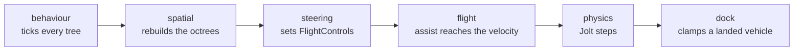
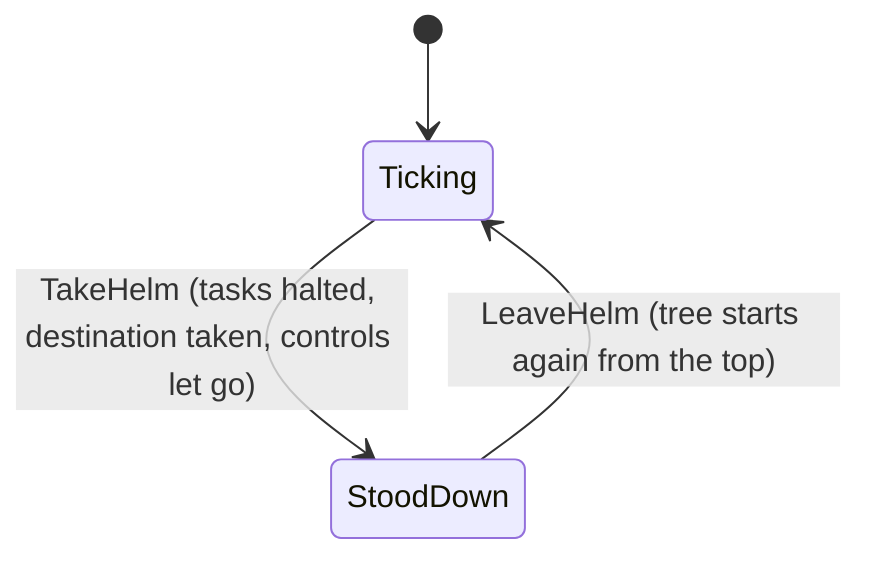

# AI

The `ai` module gives a game's automated actors their choices and their movement, through five
tools of no genre, each usable alone. What an actor weighs, what its tasks do and where it goes are
the game's; the engine supplies the mechanisms and runs them in the
[simulation](glossary.md#simulation), deterministically, so every player and every replay sees the
same choices.

## Concepts

| Tool | What it answers | Header |
| --- | --- | --- |
| Pathfinding | The cheapest way across a graph of the caller's nodes and edges | `ai/Pathfinding.h` |
| Courses | A way through space round spheres in the way, as straight legs | `ai/Courses.h` |
| Steering | How a vehicle (any body the flight model flies) gets to a place without hitting anything | `ai/Steering.h` |
| Utility AI | Which of several options scores best, for choices that are scoring problems | `ai/UtilityAi.h` |
| Behaviour trees | What an entity does next, for choices that are sequences | `ai/BehaviourTree.h` |

An **agent** is an [entity](glossary.md#entity) the simulation acts for. A **decision**
(`Ai::DecisionDefinition`, `defs/decisions/<name>.yaml`) and a **tree**
(`Ai::BehaviourDefinition`, `defs/behaviours/<name>.yaml`, whose leaves are the game's named
**tasks**) are [definitions](glossary.md#definition), so a [mod](glossary.md#mod) can reweigh a
choice or change a sequence by a [patch](glossary.md#patch), with no code changed.

## How it works

### Where AI runs in a step

Steering and behaviour trees are [systems](glossary.md#system) that run every
[step](glossary.md#step); the other three are functions a game or a system calls. The diagram shows
the order of the systems that matter here within one step.



`behaviour` runs first, so a tree acts on the world as the step begins, as the queued
[commands](glossary.md#command) do, and what a task sets in motion (a destination, a berth asked
for) is flown and answered in the same step. `steering` runs after `spatial`, so it reads this
step's positions, and before `flight`, so its controls are flown this step.

### Pathfinding

`Ai::FindPath` is A* over a directed graph (`Ai::Graph`): an adjacency list of nodes by index,
each edge with a non-negative cost. What a node stands for is the caller's. Without a heuristic the
search is Dijkstra's. With one, the heuristic must be consistent (never more than an edge's cost
plus the estimate at its far end, and zero at the goal); a straight-line distance is, for costs
that are lengths.

The search is deterministic: open nodes are expanded by estimated cost, then by index, and a node's
way in is replaced only by a strictly cheaper one, so of several shortest paths the same one comes
back every run. A bad start, goal, edge, cost or estimate throws `std::invalid_argument`.

### Courses

`Ai::Waypoints` builds a graph of waypoints across a space at one moment, round a set of spheres
(`Ai::Sphere`: a hill, a building, a platform, a planet), with a clearance in metres. Each sphere
is ringed by six waypoints, the corners of an octahedron at 1.5 times its radius plus the clearance
from its centre. At that distance a leg along an edge of the octahedron clears the sphere with 6% to
spare. Two waypoints are joined wherever the straight leg between them is clear (`Ai::LegClear`).

`PlotCourse(from, to)` returns the shortest `Ai::Course` through that graph, ends included, or
nothing when every way is blocked. A clear straight leg is returned as it is. The ends get some
latitude, so a course can leave a body in low orbit or start at a planet's centre: a leg from an end
within a sphere's clearance is judged by the radius alone, and an end inside the sphere is not
judged against it.

Boxes are obstacles too (`Ai::Box`: a deck or a pier, turned as it is), for a course in among a
structure's parts. Each is ringed by its eight corners, pushed out 1.5 times the clearance along each
of its axes, so a leg along an edge or across a face of the ring passes it by half the clearance to
spare. A leg is clear of a box when it keeps the clearance from every side. An end inside a box is
not judged against it, and from an end nearer a box than the clearance, a leg keeps as far from it
as the end is, both measured along the box's axes as the clearance is (the most the end is outside
the box along any one), so a course can start or end just over a deck under a pier, or beside its
corner. Such an end is given a waypoint straight out from each of the box's faces to its ring. A
course is told how near a box an end is resting on it: from an end that near, as a vehicle on a
deck is, the only ways out are straight out from the box's faces, so it lifts off before it goes
anywhere. The docks give it the vehicle's resting height and half its hover, short of where any
point over a berth is, so a vehicle under a low roof still goes out level.

A sphere or a box that moves while a vehicle flies the course stays where it was in the graph, so a
caller plots again as the vehicle goes, or makes the course in an entity's axes (below).

### Steering

Steering flies a vehicle to its **destination** (`Ai::Destination`, a
[component](glossary.md#component); a vehicle without one is left alone), keeping clear of what is
near. It has four behaviours, each a free function over an `Ai::Agent` (position, velocity, top
speed, braking acceleration, radius):

| Behaviour | What it returns |
| --- | --- |
| `Seek` | The velocity towards a target at the agent's top speed |
| `Arrive` | The fastest velocity it can still stop at the target from, √(2ad); in the last metres no faster than the distance a second, so it does not oscillate; plus the target's own velocity |
| `Avoid` | The desired velocity, turned aside from the first obstacle it would pass within the clearance of, and slowed so it never closes on any obstacle faster than it can stop before the clearance |
| `Separate` | A gentle push away from each neighbour nearer than the separation |
| `ArriveAlong` | Down a line to the target: along it as `Arrive`, across it drawn back onto the line, and no faster along than it comes back onto it, so it neither circles the point nor reaches the end off the line |

Each behaviour is a velocity, not an acceleration: the flight model's assist holds a demanded
velocity and reaches it as fast as the thrusters allow ([physics](physics.md#the-flight-model)), so
the flight model limits how fast the vehicle changes course. Steering brakes at half its weakest
thruster (`Ai::BrakingAcceleration`), leaving the rest for turning and dodging.

The guarantee against collision is the braking, not the turn: never closing faster than it can stop
is what keeps a vehicle off a hull, whatever the turn does. Two vehicles meeting head on each turn
to their own right, so they part.

**The system.** `Ai::Steering::Attach` registers the components, the commands and the system
`steering`. A vehicle it flies has `Ai::Steered`, `Ai::Destination`, `Physics::Handling`,
`Physics::FlightControls`, `Physics::Velocity`, `Physics::Body`, `Sim::Transform` and
`Sim::InFrame`. Each step, for each such vehicle in entity order, the system:

1. Picks where it is flying to: its next waypoint, or the destination itself. A vehicle within the
   pass radius of a waypoint goes on to the next.
2. Finds what is near from its frame's spatial index (`Spatial::FrameIndices`, see
   [Scenes](scene.md)). Every body but a sensor within reach is an obstacle, taken as the sphere
   that holds its shape (`PhysicsWorld::ShapeRadius`). The dynamic ones are also neighbours to
   separate from.
3. Works out its velocity: `Seek` to a waypoint or `Arrive` at the destination, then `Avoid` and
   `Separate`.
4. Sets its controls, with assist on: that velocity in its own axes as a share of its top speed,
   and a turn of its nose (−Z) towards it, with no roll.

Positions are in the vehicle's [frame](glossary.md#frame-coordinates), and velocities in its
[local frame](glossary.md#local-frame). Everything a vehicle steers about shares that local frame,
since bodies in two frames never meet ([Coordinate frames and units](coordinates.md)).

**The destination's fields.**

| Field | Default | Meaning |
| --- | --- | --- |
| `entity` | none | With an entity, `offset` is in the entity's own axes, so the place turns and moves with it. Without one, `offset` is a point in the vehicle's frame, from the frame's body |
| `offset` | 0 | Where, as above |
| `waypoints` | none | Points flown through in order first, relative to the frame's origin: a course made relative to the frame |
| `corridor` | false | Flown as a corridor: the course no faster than it can stop in the whole way left, each waypoint no faster than its turn allows, and past them down the line from the last waypoint (`ArriveAlong`); the docks' way in |
| `waypointsOnEntity` | false | The waypoints in the entity's axes, as `offset` is, so a course in among a platform's decks turns with it |
| `speed` | 0 (top speed) | Metres a second; never more than `Handling::maxSpeed` |
| `passRadius` | 40 m | How near a waypoint counts as passed |
| `arrivalRadius`, `arrivalSpeed` | 5 m, 1 m/s | Within this distance and no faster than this, relative to the destination, it has arrived, and from then holds there |
| `byShape` | false | Kept clear of the entity by its shape, not its sphere (below) |
| `face`, `facing` | false, identity | Turn to this orientation, in the entity's axes, about all three axes (rolled too, as a berth's heading needs), rather than nose-first along the velocity |
| `next`, `arrived` | 0, false | Progress, saved with the world |

**Kept clear by shape.** A platform's sphere holds its berths, so a vehicle flown to a berth must
fly inside it. A destination with `byShape` leaves out of the obstacles its entity and every body
on the same body's [rails](glossary.md#rails) (the platform and the vehicles clamped to it).
Instead it sweeps the vehicle's own shape along its way (`PhysicsWorld::CastShape`) and slows to
stop the clearance short of what the sweep meets; what lies beyond its target, such as the deck
under a berth, is not in its way. The [docks](docks.md#the-way-in) use this, with `face` and
`corridor`, for the way in onto a berth.

**Commands and events.** `Ai::SetDestination` gives a vehicle a destination, from its first
waypoint; `Ai::ClearDestination` takes it away, leaving the vehicle holding still where it is. Both
carry a sender and are refused, with `Ai::DestinationRefused`, from one that does not command the
vehicle (`Sim::MayCommand`). The system raises `Ai::Arrived` once a destination, and
`Ai::DestinationLost` when it takes one away because its entity has gone or is in another frame or
local frame. Each refusal or loss carries a [reason](glossary.md#reason) (`Ai::Reason`), worded by
the string tables under `reason.ai.<name>`.

A steered vehicle with a destination, in a frame, keeps the system running every step: no step is
then [quiet](glossary.md#quiet-step).

**What it costs.** Each vehicle queries the spatial index and avoids what it finds every step, so the
cost grows with how many each sees. Two streams flying opposite ways down a lane 2 km long and 200 m
across, measured in Release on 2026-11-26 (the `ai` suite's `Steering benchmark`, which the gate
skips):

| Ships | Step | Steering's share | A ship |
| --- | --- | --- | --- |
| 16 | 0.03 ms | 0.02 ms | 1.1 µs |
| 64 | 0.27 ms | 0.23 ms | 3.6 µs |
| 256 | 4.3 ms | 4.1 ms | 16 µs |

None touched. A lane of 256 in one place costs a quarter of a 60 Hz frame, where a platform's own
traffic (sixteen vehicles) is nothing.

### Utility AI

Utility AI is for choices that are scoring problems: which run a trader takes, which route, which
upgrade. A decision is a list of actions. Each action has a weight and a list of considerations. A
consideration names one of the game's inputs, brings it into [0, 1] by its range (`low` to `high`;
a low above the high reverses it), and shapes it with a response curve.

| Curve | Value at x |
| --- | --- |
| `Linear` | slope (x − shift) + offset |
| `Power` | slope (x − shift)^exponent + offset, nothing below the shift |
| `Logistic` | 1 / (1 + e^(−slope (x − shift))) + offset: an S about the shift |
| `Step` | 1 from the shift on, 0 below it |

Every curve's value is clamped to [0, 1], and with `invert` it is one minus that.

An action's score is the product of its considerations' values, times its weight. A product
penalises an action for every factor, so each value v is first made up for their number n, as
v + v(1 − v)(1 − 1/n). Two considerations at 0.5 each then score 0.625 × 0.625, not 0.25. An
action with no considerations scores its weight: a baseline the others must beat.

The game offers options, each one of the decision's actions with its own inputs (`Ai::Option`).
`Ai::Choose` scores them in order against the best so far; once an option can no longer beat it,
its remaining inputs are not asked for, so a costly input (a route plotted across a map) is worked
out only for an option still in the running. The earliest of equal options wins, and none is chosen
when every one scores nothing. `Ai::CheckDecision` checks a decision's shape, whether it was
read from a file or built in code.

### Behaviour trees

Behaviour trees are for sequences: leave the berth, fly to the portal, pass through it, ask for a
berth, land, trade. A tree is nested nodes: the engine's control nodes, and the game's tasks as
leaves.

| Node | What it does |
| --- | --- |
| `Sequence` | Its children in order until one fails, which fails it; succeeds once all have |
| `Selector` | Its children in order until one succeeds, which succeeds it; fails once all have |
| `ReactiveSequence` | A sequence ticked from its first child every tick, so a condition before a running child is checked again; the running child it no longer reaches is halted |
| `ReactiveSelector` | A selector ticked from its first child every tick, so an earlier branch takes over once it no longer fails; the running one is halted |
| `Parallel` | Every child each tick, until `count` have succeeded (with none, all), which succeeds it, or `count` can no longer be reached, which fails it; the children still running are halted. At most 32 children |
| `Invert` | Its one child, success and failure swapped |
| `Succeed` | Its one child, failure taken as success |
| `Repeat` | Its one child again each time it succeeds, `count` times or, with none, for ever; fails as the child fails |
| `Loop` | Its one child again each time it succeeds, until it fails, which succeeds the loop ("while a leg is left") |
| `Wait` | Running for `seconds`, in whole steps rounded up, then succeeds |
| `Task` | The game's task named `task`, given the node's `arguments` |
| `Subtree` | The tree named `tree`, defined before this one, in its place as if written there |

`Ai::CheckBehaviour` checks a tree's shape: a sequence or selector has a child or more, a decorator
exactly one, a wait, task or subtree none; a wait's seconds and the tree's `interval` are finite and
not negative; a parallel needs no more successes than it has children; and no node sets a field its
kind does not use. A fault throws `Serialise::FormatError` naming the node by its path
of child indices (`root.2.0`).

**Ticking.** `Ai::Behaviours::Attach` registers the `Ai::Behaviour` component and the system
`behaviour`. An entity follows a tree by having `Ai::Behaviour` with the tree's name. Each step the
system ticks the root of every entity's tree once, in entity order, except one someone is at the
[helm](#the-helm) of, so a finished tree starts again from the top at the next. An entity naming an
undefined tree is left alone, with one warning per tree name. A tree whose definition sets
`interval` (seconds, in whole steps rounded up) is ticked once in that many steps, for many entities
whose decisions need not run every step; each entity's tick falls on a step set by its index, so
they are spread over the interval, and what it waits on is noticed up to an interval late.

**Resuming, and interrupting with a halt.** A sequence or selector resumes its running child rather
than ticking its children again from the first. A repeat or loop starts its child's next run at the
next tick, so one step's work is bounded however soon a child succeeds. A running node is left
before it finishes only by a reactive node moving off its branch, a parallel once decided, an
`Ai::AssignBehaviour`, or its [helm](#the-helm) taken; each halts the nodes it leaves, telling their
tasks so. A reactive node halts the branch it leaves after the one that took over has ticked, as
reactive nodes do in other behaviour-tree libraries (BehaviorTree.CPP's halt the children after the
one that answered): checking each tick what comes first is what lets a running branch carry on, and
a branch halted before its replacement had answered would start again every tick. So a halt lets go
of what its own task still holds and nothing its replacement has just taken: a halt that clears a
vehicle's destination checks first that it is still the one its task set. A tree stopped by one of
its own tasks' commands (an `AssignBehaviour` for its own entity, its helm taken) does nothing more
of that tick and is halted as the tick ends, since until then its nodes are the tick's.

**Tasks.** A task (`Ai::Task`) is a function `Status(TaskContext &)`. Its context gives the world,
the entity, the node's arguments, `starting` (its first tick since it last finished) and a 64-bit
`memory` saved with the tree, which is all a task keeps between ticks. A task acts by commands
applied at once ([a step](simulation.md#a-step)), carrying the agent as their sender where they
carry one. A task may be defined with a halt (`Ai::TaskHalt`), called with its context when it is
left running, so it can let go of what it holds (a berth asked for); its memory is discarded after.
A mod's script may answer a task, which the game defines in its trees ([scripts](scripts.md#a-trees-task)).

**The blackboard.** `Ai::Blackboard` is an entity's memory that its tasks share, by key: integers
and entities, saved with the world and kept when its tree starts again or is changed. A task reads
and writes it through the registry.

**Giving an entity a tree.** `Ai::AssignBehaviour` names the tree an entity follows, or none to take
it away, from a sender that commands it (`Sim::MayCommand`). It halts the old tree's running tasks,
starts the new one from the top in the same step, and answers with `Ai::BehaviourAssigned`. It is
refused with `Ai::BehaviourRefused`, as `reason.ai.no_such_entity`, `reason.ai.not_controller`, or
`reason.ai.no_such_tree` for a tree not defined. A game may still give an entity `Ai::Behaviour` as
it makes it.

**Ticked as it is.** The system finds the trees due as a step begins, then asks again of each as
its turn comes, since a task before it applies its commands at once: a tree given another, not due
this step, or one whose helm was just taken, is not ticked. A wait or an interval of more steps than
a run counts (2^53) is refused as its tree is defined.

**Quiet steps.** A task may be defined with a wake (`Ai::TaskWake`): given the world and its memory,
the first step at which it might do anything but return `Running` unchanged. The system then lets
the world [fast-forward](glossary.md#fast-forward) to the soonest of every tree's wake: a wait's
end, a task's wake, or the next step for a task without one, a node about to start, a tree that
finished or a reactive node, each put off to the tree's next tick where it has an interval. A task
with no wake is ticked every step its tree is.

**Saved state.** Where an entity is in its tree is one `Ai::NodeState` a node, in depth-first order:
a running flag and a memory (a composite's running child, a repeat's runs, a wait's end step, a
task's own). It is saved with the world, so a loaded world carries on from the same nodes; a saved
state that no longer fits a changed tree starts it from the top. Tasks and trees are the game's
start-up, as physics' shapes are, not state: a world loaded from a save must be given the same ones.

### The helm

The [helm](glossary.md#helm) (`Sim::Helm`) lets a player take over a vehicle that the AI
otherwise flies. `Ai::Behaviours::Attach` registers `Sim::Helm` and two commands, `Ai::TakeHelm`
and `Ai::LeaveHelm`. The state diagram shows a vehicle's tree and its helm.



A helm is taken by a sender that commands the vehicle (`Sim::MayCommand`), a player or the AI. Each
sender is at one helm at a time, so taking one leaves the one the sender was at. Taking it stands
the vehicle's tree down, takes away its steering destination and lets its controls go, so it holds
where it is until its pilot flies it. What the game's rules fly it by goes on: the docks' approach
and lift, a [passage](glossary.md#passage), a [portal](glossary.md#portal). Leaving it lets the
controls go again and starts the tree from the top. A task that was running is halted, and
what it asked for and did not let go of (a berth, a portal's slot) goes on or lapses as for a
vehicle that did not come.

The helm is left by the one at it, or by no one in particular, the game's own rules. Refusals come
as `Ai::HelmRefused`, with these reasons:

| Reason key | When |
| --- | --- |
| `reason.ai.no_pilot` | A `TakeHelm` from no one in particular, who cannot fly |
| `reason.ai.not_controller` | The sender does not command the vehicle |
| `reason.ai.helm_held` | Someone else is at the helm |
| `reason.ai.no_such_entity` | The vehicle is not in the world |
| `reason.ai.not_at_helm` | A `LeaveHelm` from a sender not at that helm |

Flight controls themselves are physics': `Physics::SetFlightControls` is refused from a sender
neither at the vehicle's helm nor no one in particular (`Sim::MayFly`), so a player flies only the
vehicle whose helm they hold. A game that uses the helm without behaviour trees registers
`Sim::Helm` itself, as the ground sample does (`source/samples/ground/src/GroundGame.cpp`).

### Determinism and saves

The module is `DETERMINISTIC` ([coding standards](coding-standards.md#simulation-code)): its
systems walk entities in entity order and its definitions are kept in ordered maps. `Ai::Steered`,
`Ai::Destination`, `Ai::Behaviour`, `Ai::Blackboard` and `Sim::Helm` are saved with the world, and the commands and
events are reflected, so a session can be recorded and replayed.

## Using it

### A shortest path

From `source/engine/ai/tests/PathfindingTests.cpp`, where `Join` adds an edge each way:

```cpp
// The cheapest way from 0 to 4 is 0-2-1-3-4, at 1 + 2 + 1 + 3: going straight to 1 costs 7,
// and 2-3 costs 8.
Graph graph;
graph.adjacency.resize(5);
Join(graph, 0, 1, 7.0);
Join(graph, 0, 2, 1.0);
Join(graph, 1, 2, 2.0);
Join(graph, 1, 3, 1.0);
// ...
const std::optional<Ai::Path> path = Ai::FindPath(graph, 0, 4);
```

Manifest plots its routes across its galaxy with `Ai::FindPath` and `Ai::Waypoints`
(`source/game/space/src/Routes.cpp` in [Manifest](../../manifest/docs/space.md)).

### A course round a sphere

From `source/engine/ai/tests/CoursesTests.cpp`:

```cpp
const std::vector<Sphere> planet{{glm::dvec3{0.0}, 1.0}};
const Ai::Waypoints waypoints{planet, 0.0};

// Straight through the middle: the way round is over one of the corners square to the line,
// 1.5 from the centre.
const auto round = waypoints.PlotCourse({-10.0, 0.0, 0.0}, {10.0, 0.0, 0.0});
REQUIRE(round);
CHECK(round->points.size() == 3);
CHECK(round->points[1] == glm::dvec3{0.0, 1.5, 0.0});
```

### Steering a vehicle

Attach physics and the spatial index first, then steering. From the fixture in
`source/engine/ai/tests/SteeringTests.cpp`:

```cpp
Sim::SimWorld world{kStep, 5};
Physics::PhysicsWorld &physics{Setup(world)};   // registers Transform, InFrame; attaches physics
Spatial::FrameIndices &indices{Spatial::FrameIndices::Attach(world)};
Ai::Steering &steering{Ai::Steering::Attach(world, physics, indices)};

// A steered ship: a dynamic body with the flight model's components and a destination.
registry.emplace<Physics::Body>(ship, body);
registry.emplace<Physics::Velocity>(ship);
registry.emplace<Physics::Handling>(ship);
registry.emplace<Physics::FlightControls>(ship);
registry.emplace<Ai::Steered>(ship);
registry.emplace<Ai::Destination>(ship, destination);
```

A game sets or clears a destination with a command, which carries its sender:

```cpp
fixture.world.Commands().Push(Ai::SetDestination{{}, ship, far});
// From a player who does not command the ship: refused with reason.ai.not_controller.
fixture.world.Commands().Push(Ai::SetDestination{stranger, ship, Point({0.0, 0.0, 0.0})});
fixture.world.Commands().Push(Ai::ClearDestination{{}, ship});
```

The docks build each leg of a landing as a destination. The last leg, from
`Docks::FlyDown` in `source/engine/dock/src/Docks.cpp`, flies down onto the berth kept clear by
shape and turned to the berth's heading:

```cpp
Ai::Destination destination;
destination.entity = docking.berth;
destination.offset = {0.0, RestingHeight(*VehicleOf(registry, vehicle)) + kHover, 0.0};
destination.byShape = true;
destination.face = true;
destination.speed = kDescentSpeed;
destination.arrivalRadius = kLandingRadius;
destination.arrivalSpeed = kLandingSpeed;
registry.emplace_or_replace<Ai::Destination>(vehicle, std::move(destination));
```

The first leg (`Docks::FlyInbound`, same file) plots an `Ai::Waypoints` course round the platform's
sphere and puts its inner points in `destination.waypoints`.

### A decision

A decision as data, from `source/engine/ai/tests/UtilityAiTests.cpp`; in a game it is
`defs/decisions/<name>.yaml`:

```yaml
version: 1
actions:
  - name: trade
    considerations:
      - input: margin
        high: 0.5
        curve: {kind: Logistic, slope: 12, shift: 0.3}
      - input: minutes
        low: 30
        high: 0
        curve: {kind: Power, exponent: 2}
  - name: wait
    weight: 0.05
```

Choosing among options, adapted from the same suite (`Table::Inputs` returns a function reading
a map):

```cpp
const Ai::DecisionDefinition decision{
    {{"trade", 1.0, {Linear("profit", 0.0, 100.0), Linear("time", 300.0, 0.0)}},
     {"wait", 0.2, {}}}};
Table slow{{{"profit", 80.0}, {"time", 270.0}}};
Table quick{{{"profit", 50.0}, {"time", 30.0}}};

const std::vector<Ai::Option> options{
    {"trade", slow.Inputs()}, {"trade", quick.Inputs()}, {"wait", {}}};
const auto choice = Ai::Choose(decision, options);
// choice->option == 1: 0.5 and 0.9, each made up for two, give 0.625 x 0.945 = 0.59,
// above the slow trade's 0.13 and the wait's 0.2.
```

A game loads its decisions through the [definition registry](glossary.md#definition-registry)
(`registry.Load<Ai::DecisionDefinition>(Ai::kDecisionDirectory, ...)`) and finds one by name with
`Find<Ai::DecisionDefinition>(name)`. Call `Ai::RegisterTypes()` before loading.

### A behaviour tree

A tree as data, from `source/engine/ai/tests/BehaviourTreeTests.cpp`; in a game it is
`defs/behaviours/<name>.yaml`. A node with no `kind` is a task:

```yaml
version: 1
root:
  kind: Repeat
  children:
    - kind: Sequence
      children:
        - {task: succeed, arguments: [undock]}
        - {kind: Wait, seconds: 2}
        - kind: Loop
          children:
            - {task: count, arguments: ['2']}
```

Tasks are defined before any tree that names them. `Behaviours::Define(registry)` defines every
loaded tree at once; `DefineTree` defines one. A task with a wake, from the same suite, sleeps for
its argument's steps and tells the world when to wake it, so the steps between are passed over:

```cpp
Ai::Behaviours &behaviours = Ai::Behaviours::Attach(world);
behaviours.DefineTask(
    "doze",
    [](Ai::TaskContext &context)
    {
        if (context.starting)
            context.memory = context.world.Clock().Step() + std::stoull(context.arguments[0]);
        return context.world.Clock().Step() >= context.memory ? Status::Success
                                                              : Status::Running;
    },
    [](const Sim::SimWorld &, entt::entity, std::span<const std::string>, std::uint64_t memory)
    { return memory; });
behaviours.Define(definitions);

// An entity follows a tree by name.
registry.emplace<Ai::Behaviour>(entity, Ai::Behaviour{"trader", {}, {}});
```

### Taking the helm

From the helm test in `source/engine/ai/tests/BehaviourTreeTests.cpp`:

```cpp
const Sim::Controller one{Sim::ControllerKind::Player, 1};
trees.world.Commands().Push(Ai::TakeHelm{one, first});   // first's tree stands down
// ...
trees.world.Commands().Push(Ai::TakeHelm{one, second});  // leaves first's helm: its tree restarts
// ...
trees.world.Commands().Push(Ai::LeaveHelm{one, second});
```

## Limits and open work

- Utility AI and behaviour trees have no consumer outside the `ai` suite today; Manifest uses
  pathfinding, courses and steering, and chooses a job's next step with its own
  `Manifest::Policy::Choose`.
- A course among a platform's decks goes round the structure, not round a vehicle docked on another
  berth, which only the shape sweep stops it short of ([docks](docks.md#a-covered-berth)).
- An obstacle is a sphere, found through the spatial index; physics' overlap queries and all-hit
  casts ([physics](physics.md#casts-and-picking)) are there for a game that wants them.
- Pathfinding is over graphs only, not meshes or grids ([scope](scope.md)).

## Decisions

The settled choices (steering as velocities, the braking guarantee, agents' commands applied at
once, trees that resume and are never interrupted) are in [decided](decisions.md#ai).

## Source

- Module: `source/engine/ai` (depends on `core`, `math`, `physics`, `profile`, `reflect`,
  `serialise`, `sim`, `spatial`).
- Headers: `source/engine/ai/include/jettison/ai/Pathfinding.h`, `Courses.h`, `Steering.h`,
  `UtilityAi.h`, `BehaviourTree.h`, and `Types.h` (`Ai::Reason`, `Ai::RegisterTypes`).
- Tests: `source/engine/ai/tests` (the `ai` suite).
- Related: `source/engine/sim/include/jettison/sim/Controller.h` (`Controller`, `ControlledBy`,
  `Helm`, `MayCommand`, `MayFly`), `source/engine/spatial/include/jettison/spatial/FrameIndices.h`,
  `source/engine/physics/include/jettison/physics/Flight.h`.
