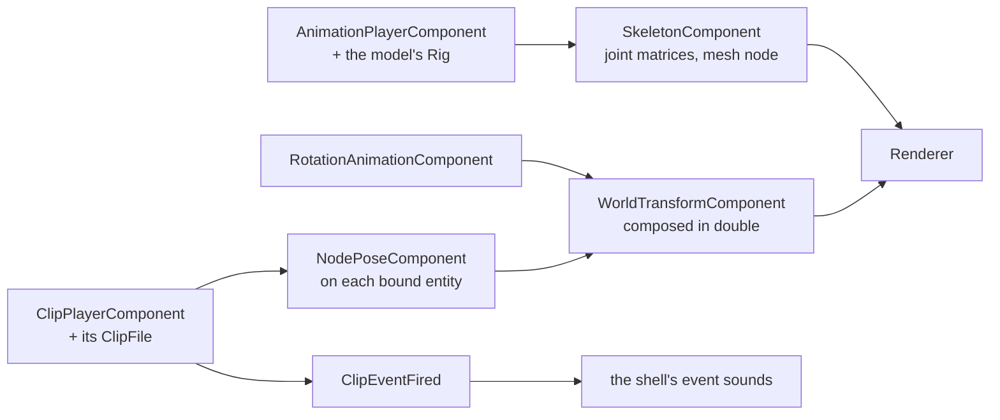
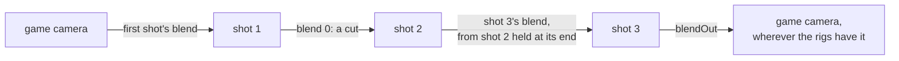
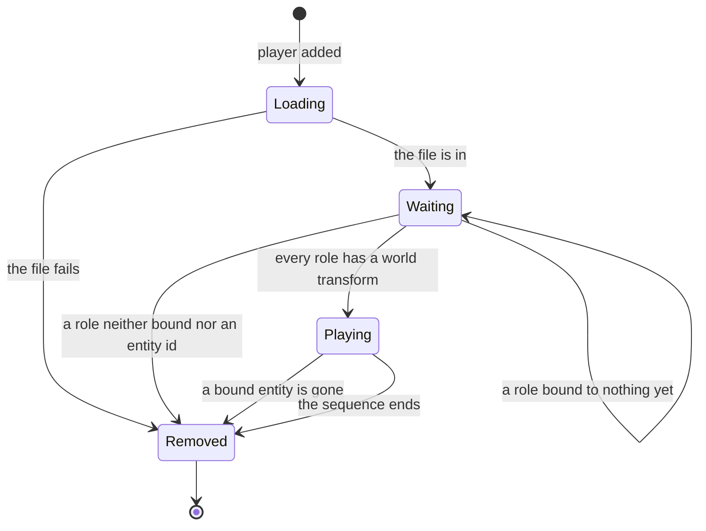

# Animation and cinematics

Animation moves parts of a [scene](glossary.md#scene) over time: a crate turning on its axis, a glTF
model's swinging arm, a rig of clamps built from scene entities. Cinematics take the camera for a
while: a sequence of shots on rails, with a fade and letterbox bars, then the camera handed back.
Both are [presentation](glossary.md#presentation) alone: nothing here touches the
[simulation](glossary.md#simulation), so an animation shows what happens in a game and never
decides it.

The code is in two modules. `engine/animation` holds clips, their sampling and their playback, and
reads glTF rigs and clip files. `engine/scene` holds the components that play them on a scene's
entities, and the sequencer (`scene/Sequence.h`).

## Concepts

| Term | Meaning |
| --- | --- |
| Track | Keyframes for one path (translation, rotation or scale) of one node, interpolated linearly, by steps or by cubic spline (`Animation::Track`) |
| Clip | Named tracks and, for a clip file's, named events, with a duration (`Animation::Clip`). Every kind of clip is sampled the same way (`Animation::Sample`) |
| Rig | A glTF model's node hierarchy, the skin's joints bound to it, and its clips (`Animation::Rig`), read from the model file apart from the renderer |
| Clip file | `animations/<name>.clip.yaml`: clips of tracks on named nodes, which a player binds to scene entities (`Animation::ClipFile`) |
| Binding | One of a clip file's node names tied to one scene entity (`Scene::ClipBinding`). A node may be bound to several entities, which then move alike |
| Clip event | A named moment in a clip, heard as playback crosses it (`Animation::ClipEvent`). The game gives the name its meaning. Not a simulation [event](glossary.md#event) |
| Rotation animation | A steady turn about an axis (`Animation::RotationAnimationComponent`) |
| Sequence | `cinematics/<name>.sequence.yaml`: shots of a camera on rails, a fade, letterbox bars and events on one timeline (`Scene::Sequence`) |
| Shot | A stretch of a sequence: a rail the camera flies along, a point it looks at, a field of view, and a blend from what came before (`Scene::SequenceShot`) |
| Rail | The points a shot's camera flies through, on a centripetal Catmull-Rom spline, in a role's frame |
| Role | A name a sequence uses for a scene entity (`pad`, `ship`). The game binds each role to an entity as it plays the sequence; rails ride that entity's [frame](glossary.md#frame-coordinates) |

## How it works

### Three ways to move an entity

The engine has three kinds of animation. Each is a component that the scene's update
(`Scene::SceneUpdateSystem`, the frame system `scene.update`) advances in the presentation phase.
The update then composes the world transforms ([scenes](scene.md#the-frame)).

| Kind | Component | In a scene file | Moves |
| --- | --- | --- | --- |
| A steady turn | `Animation::RotationAnimationComponent` | `transformAnimation: {axis, speed}` | The entity, about its axis, at `speed` radians a second |
| A glTF clip | `Animation::AnimationPlayerComponent` | `animation: {clip, speed, loop, playing}` on an entity with a model | The model's own nodes, joints and mesh placement |
| A clip file's clip | `Scene::ClipPlayerComponent` | `clip: {file, name, nodes, speed, loop, playing}` | The scene entities bound to the file's nodes |

This diagram shows how each kind reaches the screen and the speakers in one frame.



Every kind keeps its running state out of what is saved
([authored and runtime state](scene.md#authored-and-runtime-state)); a scene file that sets a
player's `time` is refused: `no saved field 'time'`.

The update clamps a frame's time to a tenth of a second, so a long frame (a load, a breakpoint)
plays as 0.1 s rather than jumping.

### Clips and sampling

A clip is the same structure whatever it moves (`animation/Clip.h`). Each track holds its keys'
times and values. A value is four floats: x, y, z, w for a rotation, the first three for a
translation or a scale. A cubic-spline track holds three values a key (in-tangent, value,
out-tangent), as glTF lays them out. `Sample` holds a track's first value before its first key and
its last after its last key. It slerps rotations the shorter way and normalises them.

### A glTF model's rig

A model's file carries its rig: the node hierarchy, the skin on its one mesh node, and its clips.
`Animation::ReadGltfRig` (`animation/RigLoader.h`) reads it through the resource manager, on the
I/O worker, from the file's one parse (`Animation::ModelFile`), which the renderer's geometry is
made from too, so the file is read once for both ([models](rendering.md#models-and-textures)).
Posing a rig on the CPU waits on no GPU device and needs no module that has one.

The model file's parse accepts a binary `.glb`, or a `.gltf` with its buffers embedded, since a
resource's decode is given only the file's own bytes. The rig loader refuses a file with no nodes,
or with other than one mesh node.

Each frame, the update advances the entity's `AnimationPlayerComponent`, wrapping a looping clip and
holding one that does not loop at its end. It then calls `Rig::EvaluateSkin`, which writes a matrix
for each joint, for the shaders' skinning, and the mesh node's transform, which places the mesh
within its file. So a clip also moves a model with no skin: its mesh node is posed. Until the rig
has loaded, the entity has no `SkeletonComponent` and the renderer does not draw the model. A clip
the rig does not have is reported once, and the model is posed at rest.

### Clip files

A clip file moves a rig built of the scene's own entities: a clamp's post, arm and jaw, each an
entity with a mesh. The file names nodes, and a player binds each name to entities. So one file
moves every rig built to the same names, and the rig needs no model. Where a berth's clamps close on
a docked vehicle, on its box's sides or on the shape of its collision file, is the docks'
(`Dock::Docks::FindClampGrips`, [docks](docks.md#where-the-clamps-grip)); the game's dressing places
and scales each clamp's rig there, and leaves a clamp with no grip stowed.

A file is read through the resource manager (`Animation::RegisterClipFileLoader`): the bytes on the
I/O worker, the YAML on the main thread, since the archive reads the reflection tables that thread
registers into. `ReadClipFile` checks the file as it reads it, and
throws `Serialise::FormatError` naming the file for any of these:

- a clip named twice, a track on no node, or a path given twice for one node in a clip;
- times that are not finite, are negative or do not rise, or a value missing for a time (three a
  time for a cubic track);
- a cubic rotation track, since a tangent to a rotation is not a turn about the axes;
- an event with no name, or outside its clip.

A rotation is written in radians about X, then Y, then Z, as the scene's transform turns. It is
slerped between keys the shorter way, so keys must be less than half a turn apart. A clip's
duration is its last key's or last event's time.

A `ClipPlayerComponent` sits on one entity and plays one clip of one file on the entities its
bindings name, which need not include its own. Each frame, the scene's update:

1. loads each file a player names the first time it is named, and holds it while the update lives;
2. checks the player's bindings once for each revision of the file and each clip the player is set
   to: the clip exists, every node it moves is bound, every binding names a node of the file, and
   every bound entity has a transform. What is wrong is reported once, and the rig is left as
   authored;
3. advances the player's time by the frame's time times its `speed` (a negative speed plays it
   backwards), and collects the events crossed;
4. samples every track and writes each bound entity's `NodePoseComponent`.

`NodePoseComponent` is made again every frame. For each path a clip moves, its value replaces the
authored transform's when the world transform is composed; every other path keeps the authored
value. An entity no clip is bound to any more is back as authored the next frame.

Because a file is checked again at each new revision, the players that use a clip file pick up a
reload of it ([files, packs and mods](files-and-mods.md#resources)).

### Clip events

Playback crosses each event once, in the order met (`Animation::AdvanceClip`):

- **Forwards**, an event fires as the time reaches it. One at the end of a clip that does not loop
  fires as the end is reached, and not again while the clip is held there.
- **Backwards** is the mirror: an event fires as the time comes back to it.
- **Looping**, a clip's end is its start, so an event at either fires as it wraps. A frame that
  passes over a whole lap fires each event once.
- **A time set outside the clip** is first taken to the nearer end, firing nothing. So a player
  whose time is set past its clip's end shows the rig at the end, without the events that would
  have brought it there. A rig first seen already closed looks so.

The update returns the events crossed in a frame as `Scene::ClipEventFired`: the entity whose player
crossed it, and the event's name. glTF has no place for events, so only a clip file's clips have
them.

The shell plays sounds for them by data. An event sound [definition](glossary.md#definition) in
`defs/sounds/` names a clip event with `clip:`, in place of a simulation event's type. The sound is
heard from where the player's entity is ([audio](audio.md)).

### Sequences

A sequence is a short film over the game. It takes the camera from the game's camera rigs, flies it
through its shots and hands it back. The rigs keep running under it the whole time, so it hands the
camera back to wherever they have it by then, not to where it took it from.

**Roles.** A shot's rail, and the point it looks at, are in the frames of roles. A role is a name
that the game binds to a scene entity as it plays the sequence (`SequencePlayerComponent::roles`).
A role the game does not bind is the scene's entity of that id, if there is one. The role's world
transform, with its scale taken off, is the frame. So a rail round a moving
[platform](glossary.md#platform) rides it as it moves, in double precision, as exact far from the
origin as near it. A shot with no `frame` has its rail in the scene's own coordinates.

**Rails.** A rail is a centripetal Catmull-Rom spline through its points (Barry and Goldman's form,
the ends' missing neighbours reflected through them). It neither overshoots nor loops where points
bunch. The camera flies it at an even speed, measured by a table of the spline's length at 32
samples a span (`kRailSamples`). The shot's easing (`Math::Easing`) spends the shot's time along
that length. A rail of one point holds the camera still. The camera's up is its frame's +Y.

**Looking.** The camera looks at `lookAt`, a point in the `look` role's frame, or in the shot's own
frame when there is no `look`. Its field of view goes from the shot's first value to its second.
With no `fov` it is the camera's own. The sequence writes the field of view to
`CameraPoseComponent::verticalFovDegrees`, which the renderer reads in place of
`CameraComponent`'s.

**Blends.** This diagram shows one sequence's timeline.



The game's camera is blended in over the first shot's `blend`, and back in over the sequence's
`blendOut`. A later shot blends from the one before, held where it ended. A blend of 0 is a cut.
Blends are eased in and out (cubic). A blend moves the camera along a straight line and the point it
looks at along another, with only the up slerped, so a shot's subject stays in view
([decided](decisions.md#animation-and-cinematics)). For the game's camera, that point is along its
view, as far out as the shot's subject is from the shot's camera. Because a blend is a straight
line, a rail should start on the game camera's side of what it circles.

**Weight, bars and fade.** The weight is how much of the camera is the sequence's, from 0 (the
game's) to 1, rising over the blend in and falling over the blend out; the letterbox bars follow
it. The fade is an amount keyed by time, linear between keys and held past them, in the
sequence's `fadeColor`.

**Events.** A sequence's events sit on a clip with no tracks (`Sequence::timeline`), so they are
crossed exactly as a clip's are. `SequenceSystem::Update` returns them as `SequenceEventFired`, with
the camera that played them.

### Playing a sequence

`Scene::SequenceSystem` runs as the frame system `camera.sequence`, after the camera rigs
(`camera.rig`) and before the audio listener (`audio.update`). A sequence plays on a camera entity
with a `SequencePlayerComponent`. The game adds the component; a scene file never holds one. This
diagram shows a player's life.



While loading or waiting, the player's time stays where it was set, so a game may bind a role to an
entity it has not shown yet. The first frame played shows the sequence at its set time, and the time
runs from the next. Each frame the system samples the sequence over the rigs' pose (or the camera's
authored one). It writes the camera's `CameraPoseComponent`, and
writes the fade, the bars and the weight into the player for the game to show. A problem is logged
once and the player removed, which leaves the camera to its rigs.

The shell shows the fade and the bars of the first player it finds, through `IRenderer::SetFade`
and `IRenderer::SetLetterbox`. A game's own fade, set later in the frame, wins over the sequence's.
The output pass draws both after the tonemap and the colour grade
([effects](rendering-effects.md#post-processing)). The shell starts a sequence three ways:

| Entry point | Does |
| --- | --- |
| `Shell::PlaySequence(name, from)` (`app/Game.h`) | Plays `cinematics/<name>.sequence.yaml` on the active camera, from `from` seconds |
| Console `sequence <name> [seconds]` | The same, from the console |
| Console `sequence stop`, or Escape | Removes every player and clears the bars. Escape does so only after the open panels and the game's own `Back` have had it |

## Using it

### A clip file and a rig that plays it

The test content's clamp (`source/test/content/animations/pad-clamp.clip.yaml`, shortened) moves its
nodes and fires an event as the jaws bite:

```yaml
version: 1
clips:
  - name: close
    tracks:
      - node: clamp
        path: scale
        interpolation: step
        times: [0]
        values: [[1, 1, 1]]
      - node: arm
        path: rotation
        times: [0.8, 1.2, 1.6]
        values: [[0, 0, 0], [0, 0, -1.0], [0, 0, -1.75]]
      - node: jaw
        path: translation
        times: [1.6, 2.0]
        values: [[0, 0.7, 0], [0, 0.85, 0]]
    events:
      - {time: 2.0, name: clamp.closed}
```

A scene binds it to two clamps from one player, so each node moves both clamps' parts alike
(`source/engine/scene/tests/SceneTests.cpp`, `kClampScene`, shortened):

```yaml
version: 3
entities:
  - id: pad
    clip:
      file: animations/pad-clamp.clip.yaml
      name: close
      nodes:
        - {node: clamp, entity: clamp-a}
        - {node: clamp, entity: clamp-b}
        - {node: arm, entity: arm-a}
        - {node: arm, entity: arm-b}
  - id: clamp-a
    parent: pad
    transform:
      translation: [5, 0, 0]
  - id: arm-a
    parent: clamp-a
    transform:
      translation: [0, -0.8, 0]
```

The scene's loader refuses a `file` that is not a virtual path, a clip with no `name`, and a binding
to an entity the scene does not have. The same test drives the update, reads the events, and then
switches the clip at run time:

```cpp
std::vector<ClipEventFired> events;
const SceneUpdateSystem update{&resources};
for (int frame = 0; frame < 30; ++frame)
	update.Update(registry, 0.1f, &events);
REQUIRE(events.size() == 1);
CHECK(events[0].name == "clamp.closed");

auto &opening = registry.get<ClipPlayerComponent>(Find(registry, "pad"));
opening.clip = "open";
opening.time = 0.0f;
```

To hear the event, a data file in `defs/sounds/` maps it to a sound
(`source/engine/app/tests/MountsTests.cpp`):

```yaml
version: 1
clip: clamp.closed
sound: effects/closed.wav
volume: 0.5
```

### A model's clip and a steady turn

The test content's main scene (`source/test/content/scene/main.yaml`, shortened) has both:

```yaml
  - id: turning-crate
    mesh:
      model: models/crate.glb
    transformAnimation:
      axis: [0, 1, 0]
      speed: 0.785398163
  - id: cargo-arm
    mesh:
      model: models/arm.glb
    animation:
      clip: Swing
      speed: 1
      loop: true
      playing: true
```

The scene's loader refuses a zero axis, and an `animation` on a mesh of a shape rather than a model.

### A sequence

The test content's docking sequence (`source/test/content/cinematics/dock.sequence.yaml`, the first
two shots) circles a vehicle on its pad, then cuts to a view from above:

```yaml
version: 1
letterbox: 0.11
blendOut: 2
shots:
  - duration: 4.5
    blend: 2
    frame: pad
    rail: [[12, 3.5, 9], [13, 2, -5], [3, 1.6, -15], [-8, 2.2, -12]]
    look: ship
    lookAt: [0, 1, 0]
    fov: [40, 34]
  - duration: 3
    frame: pad
    rail: [[0, 38, 9], [0, 26, 6]]
    easing: outQuad
    look: ship
    fov: [40]
```

The format's other fields (`fadeColor`, `fade` keys, `events`) are shown in the example in
`scene/Sequence.h`. `ReadSequence` refuses a sequence with no shots, a shot of no duration or with a
blend longer than itself, a rail with the same point twice in a row, a field of view outside 0 to
180 degrees, bars of half the frame or more, and fade keys out of order or outside 0 to 1.

In code, a game binds the roles and adds the player to its camera, as the sequence suite does
(`source/engine/scene/tests/SequenceTests.cpp`):

```cpp
auto &player = registry.emplace<SequencePlayerComponent>(camera);
player.file = "cinematics/dock.sequence.yaml";
player.roles = {{"pad", pad}, {"ship", ship}};

SequenceSystem system{resources};
std::vector<SequenceEventFired> events;
system.Update(registry, 0.1, &events);
```

From the shell, the `dock-sequence` [reference frame](glossary.md#reference-frame-image) plays it
1 s in on the orbit scene, whose entities with the ids `ship` and `pad` fill the roles unbound
(`source/test/frames/views.txt`). The same view by hand:

```bash
scripts/capture.sh build/dock.png --scene source/test/content/scene/orbit.yaml \
    --run "orbit 3.14 0.15 30 ship" --run "sequence dock 1"
```

### A game's camera under a sequence

A game whose own system places the camera orders it after `camera.rig` and before
`camera.sequence`, so a cinematic still goes over it, as the ground sample's does
([the frame](app-shell.md#the-frame)).

## Limits and open work

- A glTF clip has no events, and a clip changed part-way starts from the new clip's first pose
  rather than blending from where the rig is: [J54](roadmap.md#j54) and [J53](roadmap.md#j53).
- The shell does not collect a sequence's events, so none is heard yet; a shot has no roll or depth
  of field; a blend cannot steer round an obstacle; a sequence cannot blend between two colour
  grades: [J22](roadmap.md#j22).
- No blend shapes, blend spaces, layers or IK, and one mesh node a model: planned in
  [characters](characters.md), J51 to J60.

## Decisions

The settled decisions are in [decisions](decisions.md#animation-and-cinematics). How the modules
were built is in [history](history.md).

## Source

| Module | Key headers |
| --- | --- |
| `engine/animation` | `animation/Clip.h` (tracks, clips, sampling), `animation/Playback.h` (advancing a rotation, a player, a clip and its events), `animation/Components.h`, `animation/Rig.h`, `animation/ModelFile.h` (a model file's one parse), `animation/RigLoader.h`, `animation/ClipFile.h` (the clip file's format and loader) |
| `engine/scene` | `scene/Sequence.h` (the sequence's format, rails, sampling and loader), `scene/SceneSystems.h` (`SceneUpdateSystem`, `SequenceSystem`, `ClipEventFired`, `SequenceEventFired`), `scene/Components.h` (`ClipPlayerComponent`, `NodePoseComponent`, `SequencePlayerComponent`, `CameraPoseComponent`) |
| `engine/app` | `source/engine/app/src/Application.cpp` (the frame systems, `PlaySequence`, the `sequence` command, clip events to sounds) |

Headers are under `source/engine/<module>/include/jettison/`. The tests are
`source/engine/animation/tests/AnimationTests.cpp` (sampling, playback, events, clip files, the rig
loader), `source/engine/scene/tests/SequenceTests.cpp`, and the clip-player cases of
`source/engine/scene/tests/SceneTests.cpp`.
