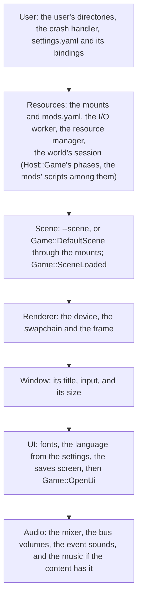
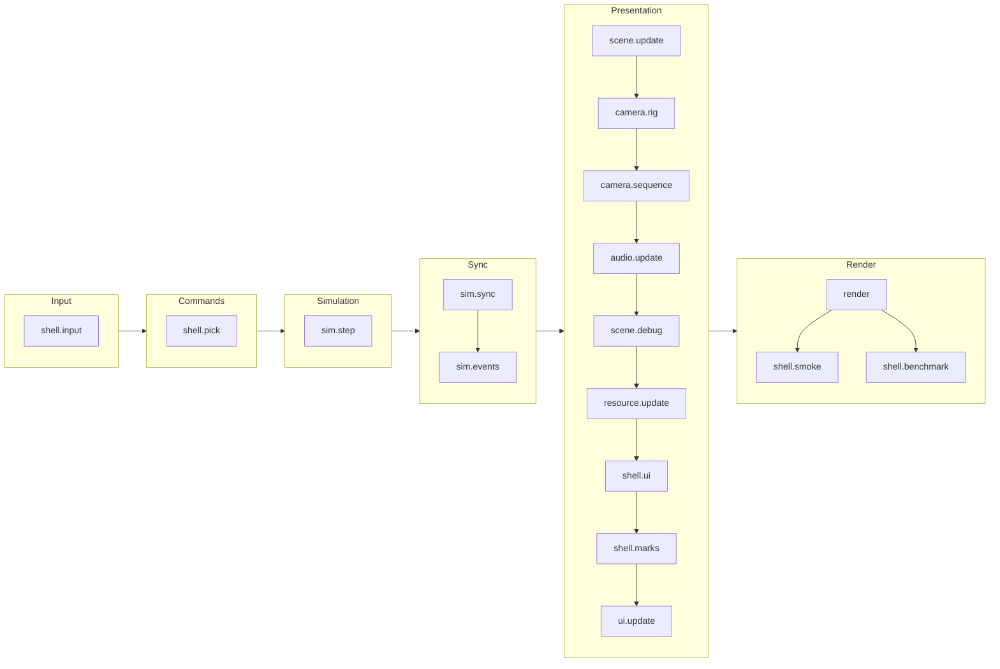

# The app shell and tools

The app shell is the engine as a running program. It opens a window, mounts the engine's assets and
a game's content, runs the frame loop, and tears everything down in order. Every graphical program
in the repository runs the same shell, differing only in the game composed into it and the content
it mounts. This document covers the shell, the seams a game plugs into, its command line, keys and
console, the render test, and the small tools beside it.

## Concepts

### The shell

The [shell](glossary.md#shell) is `App::Application` (`source/engine/app/src/Application.h`, private
to the module). A program reaches it through one call, `App::RunRenderApplication`
(`app/RenderApplication.h`), which parses the command line, builds the shell, runs it, and prints
whatever exception the run threw; it returns the program's exit status.

The shell owns the [simulation](glossary.md#simulation) world and the
[presentation](glossary.md#presentation) side. It runs the world as a local server: the game's
`Host::Game` started through a `Host::Session` ([the host session](simulation.md#the-host-session)),
as the game's server and tests start it, stepped 60 times a second with seed 0. The world is the
game's alone, so the shell's is the server's to the byte; with no game's world given, the shell's
own is [physics](physics.md) and the components it draws. The scene shows that world through [proxies](glossary.md#proxy) placed from
[snapshots](glossary.md#snapshot), and never holds a reference into it ([proxies of the
simulation](scene.md#proxies-of-the-simulation)). The renderer is held as `Render::IRenderer` alone,
so the shell includes no Vulkan header ([rendering](rendering.md)).

With no game composed into it, the shell is physics, the scene, the renderer, the UI, sound, saves
and the dev tools, and nothing of any genre; the app suite holds it to that
(`source/engine/app/tests/GameTests.cpp`).

### The game a program composes

A [game](glossary.md#game) composes itself into the shell twice over, each part once: its world as a
`Host::Game` (types, content, world and initial state, the same class its server starts), and its
presentation as an `App::Game` (`app/Game.h`). `RunRenderApplication` takes both.

The shell starts the `Host::Game` in its resources stage, in a session that runs the mods'
scripts, as a server's does ([host scripts in a game](scripts.md#host-scripts-in-a-game)). It adds
to the game only what the shell reads beside the world: where the world has physics, `Physics::Body`, `OnRails` and `LocalFrame` in the snapshots, for the pick and the
reasons, unless the world shows them already. A world the shell is to draw registers
`Sim::Transform` and `Sim::InFrame`, and attaches physics for what it picks; the ground sample's
`GroundWorld` does, and Manifest's world does. A start that fails is a `Host::StartupError`
naming its phase and source, which the run prints.

`App::Game` is a class of virtual hooks, each called at one point of the shell's life and doing
nothing by default, so a game overrides only those it needs. It reads and drives the shell through
`App::Shell`, an interface the shell implements.

| Hook | When the shell calls it | What a game does there |
| --- | --- | --- |
| `Register` | As the shell is made, before the world is | Defines its input actions |
| `AddCommands` | As the shell is made | Adds console commands |
| `RegisterFrame` | As the shell is made, after the shell's frame systems | Adds frame systems, ordered against the shell's by name |
| `DefaultScene` | Each scene load with no `--scene` | Names the scene to load; `scene/main.yaml` by default |
| `SceneLoaded`, `SceneUnloading` | After each scene loads, and before one is replaced | Builds onto the scene; releases what it built |
| `SyncProxies` | Each frame, in the sync phase | Places the scene's proxies itself, returning true; false leaves it to the shell |
| `OpenUi` | Once the game UI exists | Adds its data models and documents ([UI](ui.md)) |
| `PollInput`, `Back` | Each frame's input phase; on Escape | Reads its actions and sends commands; closes what it has open |
| `UpdateUi`, `DrawPanels` | Each frame's presentation phase | Refreshes its screens; draws its ImGui panels |
| `TakeEvent`, `Hears` | Each event of the steps | Reacts to the event; says whether the player hears its sound |
| `Describe`, `NameEntity`, `NameIdentifier` | When the log or a [reason](glossary.md#reason) names something | Gives the name; none leaves it to the shell |
| `PickIn`, `PickOrigin` | On a click, and when a hit is kept | Says which physics frame a click picks in; none means the shell does not pick |
| `WriteSave`, `ReadSave`, `Loaded` | Saving; before a load replaces the world; after it has | Adds its sections and details; refuses a save not its own; applies what it read |
| `DriveSmoke` | As the render test's sequence is made | Replaces the stages it drives itself |
| `ShuttingDown` | Before the shell releases the scene and resources | Releases what it holds of either; must not throw |

`App::Shell` gives the game what presentation needs: the command line, the world (and `Resync`
after changing it outside a step), the scene, the newest two snapshots with `Alpha` (the fraction
between them shown this frame), the active camera, debug lines, a screen fade, the assets and
resources, the console, input and the game's input context, the session's definitions, the scripts,
the local player's [controller](glossary.md#controller) (`App::kLocalPlayer`, which a world's
initial state seats where the player plays), the orbit framing, cinematics, the pick and the game
UI. What it returns is not kept past the call, but the shell outlives everything a hook registers
with it, so a frame system or a console command may keep a reference to it.

A program with no window starts the same `Host::Game` through `Host::Session` itself, with no
`App::Game` ([the host session](simulation.md#the-host-session)).

### The programs

| Program | Source | Game | Content mounted as `base` |
| --- | --- | --- | --- |
| `flotsam` | `source/tools/flotsam` | None | None: the engine alone, on an empty scene |
| `render_test` | `source/test/main.cpp` | None | The test content, `source/test/content`, as the build cooks it |
| `ground` | `source/samples/ground` | `Sample::GroundGame` | `source/samples/ground/assets` |
| `jettison_pack` | `source/tools/pack` | Not a shell program | Packs a directory into a [pack](glossary.md#pack) |
| `jettison_bake_collision` | `source/tools/collision` | Not a shell program | Bakes a model's [collision file](physics.md#a-models-collision-shape) |
| `jettison_cook` | `source/tools/cook` | Not a shell program | `jettison_cook <source> <output>` cooks a source tree into a game's asset tree once, failing on any source it refuses; with `--watch` it cooks again as the tree changes until stopped ([the cook](dense-geometry-and-ray-tracing.md#the-cook)) |
| `consumer` | `source/test/consumer` | A `Host::Game`, with no shell | Its own `content` |

Flotsam is the editor's entry point; today it is the shell with nothing composed into it.
render_test is the experimentation harness and the renderer's smoke test, over static scenes. The
ground sample and the consumer project are the engine's own [consumers](glossary.md#consumer)
([samples](sample-game.md), [guide](guide.md#composing-a-game-on-the-engine)). `jettison_pack`,
`jettison_bake_collision` and `jettison_cook` are built even with presentation off, so a CPU-only
build can pack content, bake collision files and cook.

## How it works

### Start-up

The shell is built in two parts. Its constructor defines the shell's input actions and console
commands, registers the simulation's types, and calls the game's `Register`, `AddCommands` and
`RegisterFrame`; the world comes later, in the resources stage. It then validates the frame's order, so a game's system that
names a missing system, or closes a cycle, fails before any window opens. `Init` then runs the
stages the diagram shows, with the game's hooks within them. A stage that throws ends the run with
its message (`RenderApplication.cpp`), which says what failed but not in which stage.



The scene loads before the renderer because it needs no device. A scene the content does not have is
not an error: the shell logs it and starts on an empty scene. `--save-scene <file>` writes the scene
straight back out once it has loaded.

The user stage installs the crash handler before anything else of the engine starts
([start-up](runtime.md#start-up)), and makes the data and configuration directories when they do not exist, durably and mode 0700
from the moment each is made, any missing directory above them included
(`Core::CreateDirectoriesDurably`, [durable writes](persistence.md#durable-writes)). The resources stage builds the mount stack
([the shell's mounts](files-and-mods.md#the-shells-mounts)); the session mounts the same sources by
the same names but the user's writable directory (`App::SessionMounts`), so definitions are read
from the content and the mods alone. The event sounds' definitions are presentation's, read through the whole tree
as the audio stage starts.

### The frame

`RunFrameLoop` runs `Tick` until the window closes. A tick runs the frame scheduler's six phases in
order on the scene's registry: input, commands, simulation, sync, presentation and render. Each of
the shell's systems names the one before it, so a game's system slotted between two leaves the rest
in order. The diagram shows the shell's systems by phase, and the table what each does.



| System | What it does |
| --- | --- |
| `shell.input` | Clears the debug lines, polls the window, reads the shell's keys, then `Game::PollInput` |
| `shell.pick` | Picks a click, and what the cursor is over for its outline, against the snapshots, reaching 50 km ([picking](physics.md#picking)) |
| `sim.step` | Advances the stepper by the frame's time: zero or more [fixed steps](glossary.md#fixed-step) |
| `sim.sync` | Places the proxies between the last two snapshots (`Game::SyncProxies` or `Scene::SyncSimProxies`) |
| `sim.events` | Gives each event to the scripts, the event sounds, the pick (logged as `Picked … at … m` or `Picked nothing`) and `Game::TakeEvent` |
| `scene.update` | World transforms, animation and rigs ([scenes](scene.md), [animation](animation.md)) |
| `camera.rig`, `camera.sequence` | The orbit and pilot cameras, then a cinematic over them |
| `audio.update` | The listener at the camera, clip events, sources and the mixer ([audio](audio.md)) |
| `scene.debug` | Each mesh's axes and each light, when F2 shows them |
| `shell.bodies` | The bodies of the frame the game picks in, as Jolt has their shapes, when the Scene panel's Physics bodies or `bodies on` shows them ([seeing the bodies](physics.md#seeing-the-bodies)) |
| `resource.update` | Finishes loads and hot reloads, so a reloaded file draws this frame |
| `scripts.reload` | Loads again a script whose module changed, where resources hot-reload ([scripts](scripts.md#loading-again)) |
| `render.reload` | Builds again the pipelines of a program whose SPIR-V changed, where resources hot-reload ([programs reloaded](rendering.md#programs-reloaded)) |
| `shell.ui`, `shell.marks`, `ui.update` | The dev tools and the pick's marker (where it hit, the surface's normal, and an overlay naming it and its distance); the outline on what is picked; the game UI: a document whose files changed read again, where resources hot-reload, then `Game::UpdateUi` ([reloading](ui.md#reloading-and-the-debugger)) |
| `render` | Draws the scene, the debug lines and the UI overlay |
| `shell.smoke`, `shell.benchmark` | Advance the render test's sequence and the benchmark, when asked for |

A game's system names its place. The ground sample's camera runs after `camera.rig` and before
`camera.sequence`, so a cinematic still wins over it:

```cpp
Ecs::SystemDescription camera{
    "ground.camera",
    Ecs::TickPhase::Presentation,
    Ecs::Access::Of<>().Writing<Scene::CameraPoseComponent>(),
    {"camera.rig"},
    [this, &shell](entt::registry &scene, double deltaTime)
    { PlaceCamera(scene, shell, deltaTime); }};
camera.before = {"camera.sequence"};
frame.Register(std::move(camera));
```

The scheduler's ordering rules are in [simulation](simulation.md#the-scheduler).

### Shutdown

`Shutdown` releases everything in the reverse order of `Init`: the input callbacks, the sound, the
UI and the renderer (which waits for the last frame first), then `Game::ShuttingDown`, the scene,
the resource manager and the I/O worker. It is idempotent and `noexcept`, and runs from the frame
loop's end and from the destructor, so a run that throws out of a frame is torn down too. No other
destructor in the shell releases a device object, so this order is the whole safety net.

### The command line

`App::ParseAppArguments` (`app/AppArguments.h`) reads the command line once into
`App::AppArguments`, a description of the run. A flag it does not understand prints the usage line
and ends the program with failure.

| Flag | Effect |
| --- | --- |
| `--assets <directory or pack>` | The engine's assets; by default the staged tree beside the program, or `assets.pack` there |
| `--content <directory or pack>` | The game's content; by default the program's own staged content, or its pack |
| `--scene <file>` | A scene file on disk in place of the game's default |
| `--save-scene <file>` | Writes the loaded scene back out |
| `--user-dir <directory>` | Settings in `<dir>/config`, saves and mods in `<dir>/data`, crash reports under `<dir>/state` |
| `--no-sound` | Plays to miniaudio's null backend: everything sounds as it would, unheard |
| `--gpu <name>` | Draws with the GPU whose name contains it ("5060", "llvmpipe"); fails, listing the GPUs, if none |
| `--no-meshlets`, `--no-ray-tracing`, `--no-mega-geometry` | Turns that optional render path off for the run, over the settings `render.meshlets`, `render.rayTracing` and `render.megaGeometry` (false turns one off for every run) |
| `--offscreen` | Draws with no display or window; console lines come only through `--run` |
| `--window <width>x<height>` | The window's size |
| `--depth-prepass` | Runs the opaque depth prepass even when nothing else needs it |
| `--ambient-occlusion`, `--no-ambient-occlusion` | Ambient occlusion on or off, in place of the renderer's choice for the device |
| `--bloom <strength>` | Bloom's strength, 0.04 by default; 0 for none |
| `--screenshot <file.png>` | Writes one frame and ends the run (below) |
| `--after-frames <n>` | The screenshot is taken after this many frames in a row with nothing loading (30) |
| `--frame-step <seconds>` | Moves both clocks this far each frame, and not at all while anything loads |
| `--run [@<frame> or @<seconds>s] <line>` | Runs a console line before the first frame, at a frame, or at a simulation time |
| `--benchmark <frames>` | Times this many frames after a warm-up, prints each pass's GPU time, and closes |
| `--smoke-test` | Runs the headless render test's sequence ([below](#the-render-test)) |

`--frame-step` with `--screenshot` makes a frame the same in every run: what it shows depends only
on how many frames have been drawn since the scene had everything it asked for, and hot reload is
off. The [reference frames](build-and-gates.md#reference-frames) are taken so.

A screenshot, from the flag or the console, is the swapchain image as the output pass left it, UI
included. A transfer pass copies it, and it is written as a PNG through stb once that frame's fence
has been waited on, or as the renderer is destroyed, so a run can end on the next frame.

A `--run` line the console refuses fails the run, since a frame captured from the wrong place is
worse than none. Lines due on one frame run in the order given.

### Keys

The shell's keys are in an input context of its own, `shell`, at the bottom of the
[context stack](ui.md#actions-contexts-and-bindings), under the game's
(`Shell::SetGameContext`). Each can be rebound with the console's `bind`.

| Key | Action |
| --- | --- |
| F1 | Shows or hides the dev tools: the Dev tools window (the console, ImGui's demo and metrics, the theme), the Renderer and Scene panels (the scene's layers, and Physics bodies), and the game's panels |
| ` (grave accent) | Opens or closes the console |
| Escape | Closes the first that is open: the console, the dev tools, the saves screen, the game's (`Game::Back`), a cinematic; otherwise ends the run |
| F2 | Shows or hides the scene's debug lines |
| F3, F4, F6 | The cluster heat map, the shadow cascades, ambient occlusion; pressed again, the shaded scene |
| W, A, S, D | Turn the orbit camera |
| Q, E, mouse wheel | Zoom the orbit camera |
| Right mouse button | Drag the orbit camera |
| C | Moves the orbit camera to the next target (`App::OrbitTarget`) |
| Left mouse button | Picks what is under the cursor, where `Game::PickIn` gives a frame |
| L | Shows or hides the saved games |
| F5, F9 | Saves to `quicksave`; loads it |

### The console

The [console](ui.md#the-console) captures the log from the shell's construction, so start-up's
messages are in it. A game adds its own commands in `Game::AddCommands`. The shell's own:

| Command | What it does |
| --- | --- |
| `quit` | Ends the run |
| `save [name]`, `load [name]` | Saves or loads by name, `quicksave` by default ([persistence](persistence.md#saving-in-the-shell)) |
| `saves [on or off]` | Lists the saves, or shows or hides their screen |
| `bind <context> <action> [bindings...]`, `unbind <context> <action>` | Rebinds an action, or says its bindings; puts it back. Either writes the settings |
| `volume [bus] [0 to 4]` | Sets a bus's volume and saves it, or lists them |
| `music [on or off]` | Starts or stops the music |
| `language [tag]` | Reads the screens in another language and keeps it in the settings, or lists the languages |
| `screenshot <file.png>` | Writes the next frame, UI and all, without ending the run |
| `view shaded, clusters, cascades or occlusion` | Shows the shaded scene or a debug view, as F3, F4 and F6 do |
| `lod_threshold [pixels]` | Sets the pixels a level of detail's error may cover where it is drawn, or says it ([rendering](rendering.md#collecting-and-culling)) |
| `orbit <yaw> <pitch> <distance> [target]` | Places the orbit camera at once, in radians and metres, about a target or a scene entity's id |
| `sequence <name> [seconds]`, `sequence stop` | Plays a cinematic from `cinematics/` on the active camera, or stops it |
| `grade <name> [strength]`, `grade off` | Grades the frame by a `.cube` table in `grades/` |
| `bodies [on or off]` | Draws the physics bodies as Jolt has their shapes, as the Scene panel's Physics bodies does ([physics](physics.md#seeing-the-bodies)) |
| `scripts` | Lists the loaded scripts, their calls, traps and fuel ([scripts](scripts.md)) |
| `script_bindings <directory>` | Writes the C and Rust bindings for this build's types |
| `crash fault, assert or exception` | Ends the run as a defect would, to see the crash report |

The dev tools' theme is bound as console variables under `dev.`, such as `dev.palette`, which the
game UI's screens follow too ([the game UI's palette](ui.md#the-game-uis-palette)).

### The user's directories

The shell's files go to the [user directories](runtime.md#user-directories) under `jettison`, or
under `--user-dir`. `settings.yaml` holds the bindings, the joysticks' names, the bus volumes and
the language ([settings apart from saves](persistence.md#settings-apart-from-saves)); saves are
written and read as [saving in the shell](persistence.md#saving-in-the-shell) describes.

### Reasons in words

`App::WordReason` (`app/Reasons.h`) words a refused command's `Sim::Reason` in the player's
language, naming entities and identifiers through `Game::NameEntity` and `Game::NameIdentifier`
([wording a reason](ui.md#wording-a-reason)).

### The render test

`--smoke-test` runs `App::SmokeSequence` (`app/SmokeSequence.h`): eleven stages that walk the paths
that have broken this engine before. Each runs four frames, or as many as a piloting or pick stage
needs, inside a 120-second watchdog. The sequence is a state machine driven once a frame, acting
through the callbacks of `App::SmokeActions`, which the shell binds to its window and scene, so it
names no GLFW, Vulkan or scene type.

| # | Stage | What it is there to catch |
| --- | --- | --- |
| 1, 2 | Grow, then shrink the window | Swapchain recreation |
| 3, 4 | Minimise, restore | A surface that reports no extent, and its return (the window manager call is skipped on Wayland) |
| 5 | Reload the scene | Models and resources freed while a frame in flight may read them; the environment bake and the frame sets rewritten after it |
| 6, 7 | Pilot from behind, then from the seat | What the game flies: its proxy, collisions, flight commands and the camera rig's transition |
| 8 | Pick | A ray from the camera through the window's middle, against the snapshots as drawn |
| 9 | Save and load | The world written to the user mount, flushed, and loaded back to the same state hash while the scene draws it |
| 10 | The game's screen | A document bound to the snapshot; its control sends a command, and the next step's answer is shown |
| 11 | Settle | Clean shutdown |

The saves screen is shown from the first frame, so the UI overlay is drawn through every resize and
the reload, and the save stage lists its save on it. Each stage acts, waits for its frames, then
advances. The validation layers and the
sanitisers judge what the frames did, so the sequence only has to reach the end. It must reach it
honestly: `Passed` is false if a stage ran with its action refused, and `Summary` names the
counters in the failure report.

The shell alone has nothing to pilot, pick or drive, so those stages pass with nothing done; a game
fills them in with `Game::DriveSmoke`. The ground sample drives its rover ahead and then turning,
each stage waiting until the rover shows it moved (`SmokeActions::piloting`,
[its tests](sample-game.md#its-tests)):

```cpp
actions.pilot = [this](bool turning)
{
	Physics::FlightControls controls;
	controls.linear.z = -1.0f;
	controls.angular.y = turning ? 1.0f : 0.0f;
	m_smokeControls = controls;
	return m_rover != entt::null;
};
```

A smoke run also opens at 640 × 480, shows the dev tools, the console and the debug lines, plays
sound to the null backend, and uses a scratch user directory it removes at the end unless
`--user-dir` names one. It fails if the sequence did not pass, if the game UI or the audio logged
any warning, or if the renderer's cluster check disagreed with the CPU or never saw a light.
`scripts/smoke-test.sh` runs it over the test scenes and then the ground sample, on the current
display, under Xvfb when there is none, or offscreen
([headless render test](build-and-gates.md#headless-render-test)).

## Using it

### A program's main

A program is a `main` that calls `RunRenderApplication` with its window title, the engine's assets,
its world (`Host::Game`), its game (`App::Game`) and its content. The two directories are where the build staged them, relative to the
executable: `JETTISON_ASSET_SUBDIRECTORY` and `JETTISON_CONTENT_SUBDIRECTORY`, defined by
`jettison_use_shared_assets` and `jettison_use_content`. Flotsam's is one line
(`source/tools/flotsam/main.cpp`):

```cpp
return Jettison::App::RunRenderApplication(argc, argv, "Flotsam", JETTISON_ASSET_SUBDIRECTORY);
```

The [guide](guide.md#a-game-in-the-shell-the-ground-sample) walks through the ground sample, from
its build to its hooks.

### Seeing a frame from the command line

Place the camera and write one frame, the same every run:

```bash
build/clang-debug/source/test/render_test --scene source/test/content/scene/orbit.yaml \
    --frame-step 0.0166666666666667 --run "orbit 0.8 -0.1 2.0e7 ostra" --screenshot ostra.png
```

This is the reference view `ostra` (`source/test/frames/views.txt`): Ostra whole from 20,000 km.
A line can also wait for a frame or a simulation time. This writes a frame of the ground sample two
simulated seconds in, without ending the run, and ends it a second later:

```bash
build/clang-debug/source/samples/ground/ground --frame-step 0.0166666666666667 \
    --run "@2s screenshot rover.png" --run "@3s quit"
```

`scripts/capture.sh <out.png> [render_test arguments...]` wraps the first form on lavapipe under
Xvfb, and `--references` runs every reference view; `--ground` runs the ground sample in its place,
for a frame of a game's world, such as its bodies with `--run "bodies on"`.

### Running the render test

```bash
./scripts/smoke-test.sh               # builds clang-headless; the current display, or Xvfb if none
./scripts/smoke-test.sh --packed      # from assets.pack and content.pack, as a shipped build
./scripts/smoke-test.sh --offscreen   # no display at all; on the GPU outside the sandbox
```

## Limits and open work

- The shell gives scripts no sender: a game names its own through `Scripts().SendCommandsTo`
  ([scripts](scripts.md#who-a-scripts-commands-are-from)).
- There is no prebuilt SDK, so a game builds the engine from source: [J18](roadmap.md#j18).
- No reference view holds the ground sample's frames: [J28](history.md#j28).
- The mods' scripts are the shell's, loaded beside the session's world, so a program that starts a
  session with no shell runs none of them.

## Decisions

The settled choices are in [decisions](decisions.md#the-app-shell-and-tools); how the shell came to
be is in [history](history.md).

## Source

| Module or tool | Key files |
| --- | --- |
| `app` (`source/engine/app`) | `app/RenderApplication.h` (the entry point), `app/Game.h` (`Game`, `Shell`, `kLocalPlayer`, `PickSpace`, `OrbitTarget`), `app/AppArguments.h`, `app/Mounts.h`, `app/Reasons.h`, `app/SmokeSequence.h`; private `src/Application.h`, `src/Settings.h`, `src/Saves.h` |
| Flotsam | `source/tools/flotsam/main.cpp` |
| The packer | `source/tools/pack/main.cpp`, `vfs/Pack.h` ([files, packs and mods](files-and-mods.md#packs)) |
| The render test | `source/test/main.cpp`, `source/test/CMakeLists.txt`, `scripts/smoke-test.sh`, `scripts/capture.sh` |
| Build functions | `source/CMakeLists.txt`: `jettison_use_shared_assets`, `jettison_add_assets`, `jettison_use_content`, `jettison_add_pack`, `jettison_add_script` |
| Tests | `source/engine/app/tests` (the `app` suite) |
