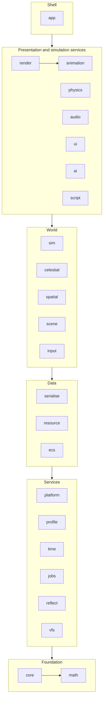

# Architecture

How the engine is laid out, how its parts depend on each other, and the handful of
architectural rules that are expensive to change later. The [scope](scope.md) says what is
built; the [roadmap](roadmap.md) says in what order.

## Repository layout

The layout as built. Phase 1 of the roadmap moved the existing code into it (`core`,
`animation`, `render`, `app`, the executables under `tools/` and `samples/`) and stubbed every
other in-scope module: each has its directory, target, public headers and a passing test, and
every function that needs an algorithm throws `JETTISON_NOT_IMPLEMENTED()` until its phase.

```
jettison/
├── CMakeLists.txt              project, warnings target, shader helper, package export
├── CMakePresets.json
├── cmake/                      jettison_add_module(), JettisonConfig.cmake.in
├── assets/                     sample and test content (Git LFS), staged beside executables
├── docs/                       this documentation
├── scripts/                    gates: ci.sh, format-check.sh, smoke-test.sh, tidy.sh
└── source/
    ├── external/               every third-party dependency, pinned, FetchContent
    ├── engine/
    │   ├── core/               assert, log, config, string IDs, handles, hashing
    │   ├── math/               GLM additions: bounds, rays, splines, easing, RNG, noise, orbits
    │   ├── platform/           OS layer: paths, crash handling, dynamic queries
    │   ├── profile/            Tracy wrapper (compiled out when disabled)
    │   ├── time/               clocks, fixed-step accumulator, time compression, calendar
    │   ├── jobs/               I/O worker now; job system later
    │   ├── reflect/            EnTT meta registration helpers
    │   ├── serialise/          YAML and binary archives over reflection
    │   ├── vfs/                virtual file system, mounts, packs
    │   ├── resource/           handles, async load, reference counts, hot reload
    │   ├── ecs/                scheduler, tick phases, events, FSM utility
    │   ├── sim/                simulation world, command queue, snapshots, definition registry
    │   ├── celestial/          celestial clock, on-rails orbits, system and galaxy frames
    │   ├── scene/              scene format, layers, system load and unload
    │   ├── spatial/            per-system spatial index, queries
    │   ├── input/              actions, contexts, bindings, devices
    │   ├── render/             renderer interface, frame, cameras, materials, debug draw
    │   │   └── vulkan/         the Vulkan backend (today's source/renderer/vulkan)
    │   ├── animation/          glTF clip player, TRS tracks, mechanical skins
    │   ├── physics/            Jolt integration
    │   ├── audio/              miniaudio integration
    │   ├── ui/                 RmlUi integration and data binding
    │   │   └── imgui/          ImGui backend, console, dev tools
    │   ├── ai/                 utility AI, behaviour trees, graph pathfinding, steering
    │   ├── script/             Wasm host
    │   └── app/                Application shell, argument parsing, smoke sequence
    ├── tools/
    │   └── flotsam/            editor
    ├── samples/
    │   └── jetsam/             runtime viewer: the engine with no game
    └── test/                   the render smoke harness (test executable)
```

Each engine module has the same shape:

```
engine/<module>/
├── CMakeLists.txt              jettison_add_module(<module> DEPENDS ...)
├── include/jettison/<module>/  public headers: #include <jettison/<module>/Thing.h>
├── src/                        implementation and private headers
└── tests/                      doctest unit tests, registered with CTest
```

Each module is a static library `jettison_<module>`, aliased `Jettison::<Module>`, in namespace
`Jettison::<Module>`, made by `jettison_add_module` (`cmake/JettisonModule.cmake`). The helper
refuses a `DEPENDS` edge on a module that has not been added yet, so the order of
`add_subdirectory` calls in `source/engine/CMakeLists.txt` is the dependency graph's topological
order, and an upward or sideways edge fails the configure rather than linking quietly.

### Parked code

Phase 1 moved code without changing what it does, and two things landed somewhere other than
their final home:

- **The scene graph is in `render`**, not `scene`. `Scene` loads models through the device,
  waits on it before destroying them, and hands `Model` pointers to the renderer, while the
  renderer reads the camera and light components back out of the scene registry. That is a
  cycle, and putting the scene below `render` means inventing the seams (an injected model
  loader, a forward-declared model) that phase 3's resource manager replaces anyway. The scene
  format and its round-trip test stay in `render` until phase 3 gives the scene handles instead
  of pointers; phase 6 then builds the per-system scene in `engine/scene`.
- **`render` depends on `animation`**, a sibling in its tier. The glTF loader fills an
  `Animation::Rig` (nodes, skin joints, clips), and the scene update system drives the rig's
  clip player. The edge points the right way: animation knows nothing about the device.

The executables keep the names they already have: **Flotsam** is the editor, **Jetsam** is the
runtime, now a sample viewer because the game has its own repository, and **render_test** is
the render smoke harness that the gate runs. It was `test` until CTest reserved that name (see
[build and gates](build-and-gates.md#unit-tests)).

### Consumption by the game repository

The game uses `FetchContent` with a pinned commit and links `Jettison::Engine`, an interface
target over every module, or the `Jettison::<Module>` targets it needs. The install export
(`JettisonTargets.cmake`, `JettisonConfig.cmake`, behind `JETTISON_INSTALL`) exists for a later
`find_package(Jettison)` consumer; [build and gates](build-and-gates.md#consuming-the-engine) says
what it still needs. Public headers are the
`include/jettison/` trees only; anything under `src/` is private. Third-party headers that
appear in public engine headers (GLM, EnTT) are public dependencies; the rest (Vulkan, Jolt,
RmlUi, miniaudio) stay private where the interface allows it, so the game does not compile
against the backends.

## Module dependencies

Dependencies point downward only. A module depends on modules in lower tiers, never on its own
tier's siblings unless the edge is listed, and never upward. A cycle is a build failure, not a
style question.



The rule that matters most: **`sim`, `celestial`, `spatial`, `physics` and `ai` never include
`render`, `ui`, `audio` or `input`**. Simulation code that can see the renderer eventually reads
from it, and then it is no longer deterministic or testable without a GPU.

## Simulation and presentation

The game is single-player, but the simulation runs as if it were a local server.

- **The simulation world** owns authoritative state in its own `entt::registry`: ships, cargo,
  stations, markets, orders, positions in double precision. It advances in fixed steps on
  simulation time, which is real time multiplied by the time-compression factor. It is
  deterministic: the same save and the same command stream produce the same state in every
  build of the engine, Debug and Release alike. It is everything a save contains.
- **The presentation world** owns what is drawn and heard, in its own registry: render proxies,
  interpolated float transforms, cameras, particles, UI state. It runs once per frame at the
  display rate and may be rebuilt from the simulation at any time.
- **Commands** flow from presentation to simulation through a queue: "buy 40 units at
  1,200", "plot route", "set throttle". The simulation applies them at the start of a step.
  The queue is the seam for replays, automated tests and any later networking.
- **Snapshots and events** flow back: transforms for interpolation, and events such as
  "docked", "trade filled" or "contact" that presentation turns into sound, effects and UI.

The piloted ship crosses this boundary every frame: input becomes flight commands, Jolt
advances in simulation steps, and presentation interpolates between the last two physics
states. When time compression is above 1×, piloting is suspended, as it is in every game of the
genre. Compression is refused near stations and other ships for the same reason.

## Coordinate frames and units

SI units: metres, seconds, kilograms, radians. Right-handed, Y-up, as the scene format already
is (`CameraComponent` documents it).

| Frame | Precision | Origin | Used by |
|---|---|---|---|
| Galaxy | graph | none: systems are nodes, jump lanes are edges | route planning, the galaxy map |
| System | `double` | the system's barycentre or primary star | simulation positions, orbits, Jolt (`JPH_DOUBLE_PRECISION`) |
| Local | `double` | a station or planet | docking approaches, station-relative traffic, the sun's shadow grid (`CameraView::frameOrigin`) |
| Render | `float` | the camera | everything submitted to the GPU |

Rendering is **camera-relative**: each frame subtracts the camera's double-precision position
from every object's before converting to float, so precision is always best where the player is
looking. This is the floating origin. It is never visible to simulation code. Depth is
**reversed-Z with an infinite far plane**, so a cockpit at half a metre and a planet at
forty thousand kilometres share a depth buffer. The existing `GLM_FORCE_DEPTH_ZERO_TO_ONE`
setting is the prerequisite for that.

## Rendering: clustered forward

The renderer is a **clustered forward** renderer (decided 2026-11-10, see the
[roadmap](roadmap.md#decided)). Lights are assigned to a 3D grid of view-space clusters by a
compute pass. Each surface is then shaded once, in its own material program, from the lights
listed for the cluster it falls in. There is no G-buffer. It was chosen over deferred shading
for what this game draws:

- **Material variety.** Hulls, planets, atmosphere shells, glass, emissive panels and engine
  plumes are each their own program. Forward shading puts no common G-buffer layout between them.
- **Transparency.** Canopies, station windows, particles and exhaust are lit by the same lights
  through the same code. A deferred renderer would still need a forward path for them.
- **Anti-aliasing.** MSAA works directly on the HDR target. Thin struts, antennae and distant
  ships against black space are where aliasing shows most.
- **Bandwidth.** No fat render targets, which matters on lavapipe, where the gate runs, and on
  laptops.
- **Many small lights.** Floodlights, docking bay lights, beacons and navigation lights add up to
  hundreds per station, but few of them reach any one pixel. Clustering keeps the cost per
  fragment at the lights that actually reach it.

### The frame

Each step is a node in the declared pass list (phase 4), and compute nodes sit beside graphics
nodes in it:

1. **Collect** (CPU). Active lights are converted to camera-relative float, like every other
   position, and written to a storage buffer for this frame in flight (5c). A light whose range
   ends short of the cluster range's far end, measured from the camera in double precision, is
   left out; frustum culling of lights arrives with the rest of culling in 5e.
2. **Shadows** (graphics, `sun-shadows`, 5d). The sun's four cascades, each a depth-only rendering
   of every mesh into one layer of the shadow map; see [sun shadows](#sun-shadows). A scene with no
   sun clears them and draws nothing, so the plan is the same either way. Spot and point shadows,
   when they arrive, render into an atlas, and each light's record carries its atlas slot.
3. **Depth prepass** (opaque only). Optional, and kept or dropped by measurement in phase 5. Light
   assignment does not need it. What it would buy is less overdraw of the PBR program.
4. **Cluster bounds** (compute, `cluster_bounds`, 5c). The view-space bounds of every cluster.
   They are rebuilt only in a frame whose projection, viewport or cluster range differs from the
   one they were built for; the pass's barriers are recorded either way, and the buffer keeps
   its contents between frames.
5. **Light assignment** (compute, `cluster_lights`, 5c). Each light's sphere, and a spot's cone,
   is tested against each cluster's bounds, one invocation per cluster. The output is an offset
   and a count per cluster into one global light-index list, whose first word is the allocator:
   a transfer pass zeroes it at the start of the frame, and each cluster reserves its share with
   one atomic add. The list holds 32 entries per cluster on average, a budget for the frame
   rather than a cap on any one cluster.
6. **Opaque** (graphics, into the MSAA HDR target). A fragment finds its cluster from its screen
   position and view distance, loops over that cluster's lights, then adds the sun, shadowed through
   its cascade, and image-based lighting.
7. **Sky.** Drawn last in the opaque pass's rendering rather than as a node of its own (5b): one
   full-screen triangle at depth 0, the far end of the reversed-Z range, tested against the depth
   buffer so it shades only what no surface covered. A node of its own would have to store the
   multisampled target and load it again, which the opaque pass keeps on chip.
8. **Transparent**, sorted back to front, using the same cluster lookup (phase 10).
9. **Resolve, bloom, tonemap** into the sRGB swapchain, then the UI. The tonemapper is Khronos PBR
   Neutral (5b), applied after exposure in the output pass: a base colour under white light of
   intensity one shows as authored, and highlights compress towards white without changing hue.
10. **Cluster readback** (transfer, 5c). The grid and the index list copied out for the cluster
    check, which compares them with a CPU reference once the frame's fence is waited on. It is in
    every frame's plan and records its copies only when the check is on, so the plan the gate's
    synchronization validation runs is the plan every run has.

### The environment

A star system's sky is drawn behind the scene and is also what the scene is lit by
(`render/vulkan/Environment.h`). Its starfield, galactic band and nebula are procedural, from the
scene's `SkyComponent` and a seed, and `sky.glsl` is the one function that draws them, both in the
frame and into a cube map. When a scene loads or its sky changes, that capture is baked into the
image-based lighting: GGX-prefiltered levels of the specular cube, one roughness each, and a
cosine-weighted irradiance cube, both by filtered importance sampling from the capture's mip
chain. The split sum's lookup table depends only on the BRDF and is made once. The bake is a run of
fragment passes on the graphics queue, recorded outside the frame's pass list as an upload is, and
it waits for the queue; the cubes it replaces are freed when it returns, and the frame sets are
rewritten to name the new ones. The sun is not in the capture: it lights the scene as the
directional light, and a disc in the environment would light it twice. Nor are the planets, so a
planet's reflected light is missing until a later phase adds it.

### The grid and the infinite far plane

The grid is screen tiles times depth slices, exponential in view distance. 16 × 9 × 24 is the
starting point, tuned by measurement in phase 5. Depth is reversed-Z with an infinite far plane,
so the slices are computed from view-space distance, never from the depth buffer. They span the
near plane to a finite **cluster range**. Past it, no local light is assigned, and a surface is lit
by the sun, image-based lighting and its own emission. A station's lights seen from tens of
kilometres away are emissive sprites, not lights. The cluster range is a setting
(`Renderer::SetClusterRange`), chosen with the light budget: 2 km to start with, tuned in 5e.

The grid's arithmetic is one file, `shaders/include/clusters.glsl`: the slices, the bounds, the
light-against-cluster tests and the windowed falloff. Like `brdf.glsl` it is written in the
subset of GLSL that GLM also compiles, and `render/Clusters.h` is that source compiled as C++.
The CPU reference built on it checks the GPU's assignment: in the headless render test every
frame's grid is read back and compared with it, cluster by cluster, as sets with a rounding
tolerance of a hundred-thousandth of the distances involved. The lights-per-cluster heat map (F3)
shows the same grid on screen, in place of the shaded surfaces.

### Sun shadows

The sun is shadowed by four cascaded shadow maps (5d), one layer each of a 2048 × 2048
reversed-depth array image shared by the frames in flight. The view is cut into four slices by
the practical split scheme, blending even and logarithmic splits (0.8 towards logarithmic), from
the near plane to the **shadow distance** (`Renderer::SetShadowDistance`, 400 m to start with,
tuned in 5e). Past it the sun casts no shadow. `render/Shadows.h` fits the cascades on the CPU each
frame, and `shaders/include/shadows.glsl`, which it compiles as C++ as `Clusters.h` does
`clusters.glsl`, is what the lighting include selects and looks up through.

- **Stable by construction.** Each cascade's map covers the bounding sphere of its slice of the
  view, plus a border of four texels, so its texel size depends only on the projection and turning
  the camera never changes it. The map's centre is snapped to whole texels in the sun's frame,
  whose axes come from the system's, never the camera's. The snap is measured from the camera's
  **frame origin** (`CameraView::frameOrigin`): the station or body an orbit camera circles, or the
  system's origin. A station moves at kilometres a second through the system, so a grid fixed to
  the system would slide under it by a fraction of a texel every frame and its shadows' edges would
  crawl; fixed to the station, a still caster lands on the same texels whatever the camera does.
  The snap is taken in double precision, and only the matrix from render space to the map becomes
  a float.
- **Casters between the sun and a map still shadow it.** The shadow pass clamps depth rather than
  clipping it (`depthClamp`, a required device feature), so whatever lies sunwards of a cascade's
  sphere, up to and including a planet, is drawn at the map's sun side.
- **Acne** is kept off by a slope-scaled depth bias in the shadow pass and by moving each receiver
  along its normal before the lookup, by one and a half texels of its cascade at a surface edge-on
  to the sun.
- **Lookup.** A fragment selects its cascade by view depth, takes nine bilinear comparison taps a
  texel apart (a 4 × 4 texel neighbourhood), and across the last tenth of each cascade blends into
  the next, or out of shadow past the last. Each cascade is fitted from the start of the previous
  one's band, so the blend's second lookup lands inside its map too.
- **Debug draw shows the cascades** (F4): each surface in its cascade's colour, lit by the sun
  alone and shadowed.

### Rules that follow

- **Every local light has a finite range.** Falloff is inverse-square, windowed to reach zero at
  that range ((1 - (d/r)^4)^2 / d^2), so culling a light against a cluster is exact.
  `LightComponent` is a point or a spot with a range and, for a spot, inner and outer cone
  angles as glTF's `KHR_lights_punctual` has them (5c); a scene file that leaves out a light's
  range is refused.
- **The sun is not a cluster light.** There is one directional light per star system, held in the
  frame constants and shadowed with cascades.
- **Light data lives in storage buffers**, one set per frame in flight, never in the frame UBO.
  The UBO carries only the light count and the grid's parameters.
- **One lighting implementation.** Every lit program includes the shared GLSL for the cluster
  lookup and the BRDF (`lighting.glsl`, over `brdf.glsl`). No material lights itself its own way.
  The BRDF and the tonemapper are written in the subset of GLSL that GLM also compiles, so the
  render suite compiles the shaders' own source as C++ and checks it against reference values.
- **No G-buffer.** Effects that need one stay out: screen-space reflections already are. If
  ambient occlusion is ever wanted, the depth prepass also writes normals for it.
- **Debug draw shows the grid**, as a lights-per-cluster heat map, so a light budget problem is
  visible rather than inferred.

The Vulkan features this needs are compute shaders and storage buffers, both core since 1.0, so
the headless render test on lavapipe covers every pass.

## Frame and tick structure

`Application::Tick` is a sequence of named phases (`engine/ecs`, `Ecs::kTickPhases`) that
systems register into, each declaring the components it reads and writes:

1. **Input**: poll devices and map them to actions in the active contexts.
2. **Commands**: turn actions and UI into simulation commands.
3. **Simulation**: zero or more fixed steps (commands, AI, economy, physics, orbits), as the
   accumulator allows.
4. **Sync**: copy simulation snapshots into presentation and interpolate.
5. **Presentation**: animation, cameras, audio, particles, UI layout.
6. **Render**: cull, collect lights, record the pass list (shadows, cluster light assignment,
   forward passes, post), submit, present. See [rendering](#rendering-clustered-forward).

Declared reads and writes are what let the job system parallelise later without a rewrite.

## Threading

To begin with: the main thread runs everything above, and one I/O worker thread reads files and
decodes assets for `resource`. Vulkan submission stays on the main thread. The job system is
deferred until a profile shows the need (see [scope](scope.md)). When it arrives, it runs whole
systems whose declared access does not conflict, not fine-grained tasks inside them.

## Lifetimes

The existing shell's rule stays: `Application::Init` builds subsystems in dependency order and
`Shutdown` destroys them in reverse. `Shutdown` is idempotent and `noexcept`, and
`~Application` calls it, so a frame that throws still releases the device. GPU objects are
released by explicit `Destroy()` calls in that order, because their lifetimes are bound to the
device's and to frames in flight rather than to C++ scope. Non-GPU types written from now on use
RAII. See [coding standards](coding-standards.md#ownership-and-lifetime).

GPU resources referenced by in-flight command buffers are destroyed only after the frame's
fence. The scene generation counter (`Scene::Generation`) is how the renderer learns that cached
resources keyed on model addresses are stale. The resource manager replaces address keys with
handles carrying a generation, which retires that hazard class.

## The engine today

The engine runs today. It renders a glTF scene through Vulkan with validation, and the gate
proves it headlessly. What exists:

- **App shell** (`engine/app`). `RunRenderApplication` is the entry point Flotsam,
  Jetsam and render_test call: it parses argv (`AppArguments.cpp`: `--smoke-test`, `--assets`,
  `--scene`, `--save-scene`), builds `Application`, and prints any exception the run threw.
  `Application::Init` stages are window, device and swapchain, scene (and the star system it
  names), renderer (with the I/O worker and resource manager it loads through), UI. The
  resource manager updates once a frame, before the render.
  `RunFrameLoop` runs `Tick` (the scheduler's phases, from input to render) until close.
- **Smoke sequence**. `SmokeSequence` is the render test's six stages (resize, resize,
  minimize, restore, scene reload, settle) as a state machine driven once per frame through
  five callbacks. It names no GLFW, Vulkan or scene type, and its counters (`Passed`,
  `Summary`) are the gate.
- **Scene** (`engine/render`, see [parked code](#parked-code)). An EnTT registry loaded from
  and saved to YAML (`assets/scene/main.yaml`, and `orbit.yaml` at real scale). It has
  transform, parent, world-transform, camera, light (a point or a spot, with a range), sun, sky
  and mesh components (a glTF model or a procedural shape - UV, ico or cube sphere, box, ring,
  cylinder - and optionally a material file, by virtual path), celestial bodies placed by the star
  system the scene names, an orbit camera rig, and the animation module's rotation-animation, skeleton and animation-player
  components. Translations and world transforms are doubles. Authored state and runtime state
  are kept apart: `RotationAnimationComponent::angle`, `AnimationPlayerComponent::time`, a
  body's `PlacementComponent` and a rig's `CameraPoseComponent` are never saved, and the render
  suite's round-trip tests hold the writer and the loader to that.
- **Animation** (`engine/animation`). `Rig` is a model's node hierarchy, skin joints and clips,
  with the clip player (`EvaluateSkin`) that used to be inside `Model`; `Playback.h` advances
  the rotation and clip-player components. Nothing in it touches the device, so it is tested
  without one.
- **Vulkan backend** (`engine/render/.../vulkan`), on Vulkan 1.3. `DeviceContext` holds the
  instance, device, debug-utils messenger (with synchronization validation in Debug), object
  names, and the VMA allocator every buffer and image comes from. `Swapchain` prefers an sRGB
  format and owns its image views. `Renderer` runs the frame as a declared pass list
  (`render/PassList.h`): the sun's [shadow cascades](#sun-shadows), the cluster passes (the index
  list's allocator zeroed by a transfer, then the cluster bounds and the light assignment in
  compute), an opaque pass into a 4× multisampled
  RGBA16F target, which draws the sky after the surfaces and is resolved into a single-sampled
  target as it ends, an output pass that applies exposure and tonemaps on its way to the swapchain
  and draws the UI over it, and the cluster check's copy. The barriers between passes are derived
  from each pass's declared uses once, at start-up, and recorded with dynamic rendering and
  synchronization2. The frame constants, skin palette, light list and command buffer exist once
  per frame in flight; the shadow map and the cluster grid's buffers are one set each, shared as the
  render targets are. The device has to offer depth clamp, which the shadow pass uses.
  `PipelineCache` makes graphics pipelines by program name and render state, and compute
  pipelines by program name, with the programs found through the asset VFS. Materials are data (`render/Material.h`): a material file
  names a program, whose descriptor (`shaders/<program>.program.yaml`) lists its parameters and
  texture slots, and sets them, some driven by presentation time. `MaterialCache` loads
  materials and their KTX 2 or stb textures through the resource manager (`Texture.h` decodes
  on the I/O worker; the loader's `finish` uploads), rebuilds a material's descriptor set when
  it or a texture reloads, and frees what a reload replaced once no frame in flight reads it; a
  model without a material draws with its own textures through the default `mesh` program.
  `Model` loads glTF through fastgltf. The `mesh` program is glTF's metallic-roughness model, lit
  by the sun, shadowed through its cascades, the [environment](#the-environment) and the local
  lights of the
  [cluster](#rendering-clustered-forward) the fragment falls in. `unlit` is for what is a light
  rather than lit by one.
- **ImGui** for a demo window, toggled with F1.
