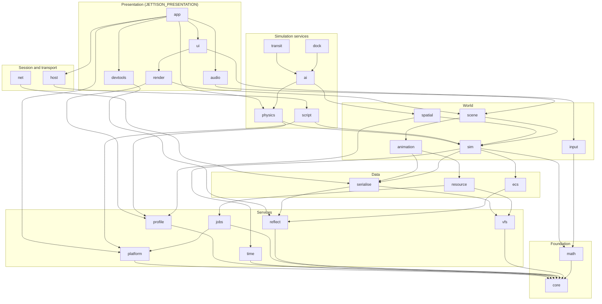
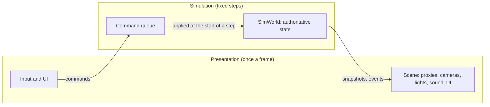
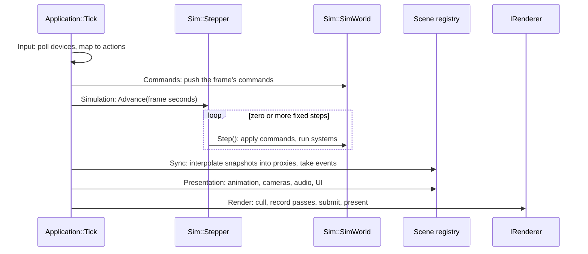

# Architecture

The map of the engine: its layout, how its modules depend on each other, and the rules that are
expensive to change later (the split between simulation and presentation, a frame's order, threads
and lifetimes). Each feature has its own document ([Features](#features)). [Scope](scope.md) says
what is in the engine, and the [roadmap](roadmap.md) what is still to build.

## Responsibility boundary

Jettison is a game engine for more than one kind of game. Manifest, its first production
consumer, owns its own gameplay and content, space included. The contract between the two is
[game integration](game-integration.md): Jettison provides reusable capabilities, after checking
what Manifest needs; Manifest builds its rules, prices and content on them.

The engine keeps a concept only when the concept has a neutral name and serves more than one
genre. So the engine has coordinate frames, [rails](glossary.md#rails), transit, portals and slots,
berths, steering, utility decisions, sky, atmosphere and large-world precision. Star systems, their
orbits, the galaxy, cruising, jump lanes, gates and routes are Manifest's `space` module, built on
those ([Manifest's space document](../../manifest/docs/space.md)).

The engine has its own [consumers](glossary.md#consumer), so every capability is used by something
that is not Manifest: the ground sample, the test content and the consumer project ([samples and
test consumers](sample-game.md)). The checks that hold the boundary are in [game
integration](game-integration.md#enforcement).

## Repository layout

```
jettison/
├── AGENTS.md, CLAUDE.md        orientation for coding agents; points into these documents
├── .claude/                    Claude Code's project settings and hooks (formats edited sources)
├── .mcp.json                   MCP servers for coding agents: Context7, for library documentation
├── CMakeLists.txt              project, options, warnings target, shader helper, Jettison::Engine
├── CMakePresets.json           clang-debug, clang-release, clang-headless, clang-asan, clang-cpu
├── cmake/                      jettison_add_module(), jettison_check_dependencies(),
│                               neutral-words.txt, JettisonConfig.cmake.in
├── assets/                     the engine's assets (Git LFS), staged beside executables: shaders,
│                               fonts, the saves screen, the engine modules' strings
├── docs/                       this documentation
├── scripts/                    the gate and tools: ci.sh, tidy.sh, format-check.sh, smoke-test.sh,
│                               capture.sh, cross-review.sh, comment-only.sh, symbolise-crash.sh,
│                               lib/headless.sh (Xvfb and lavapipe), the test assets' generators
└── source/
    ├── external/               every third-party dependency, pinned, through FetchContent
    ├── engine/
    │   ├── core/               assert, log, config, files, string IDs, handles, hashing
    │   ├── math/               GLM additions: bounds, intersection, splines, easing, random
    │   │                       numbers, noise, tangents
    │   ├── platform/           OS layer: paths, crash handling, CPU queries
    │   ├── profile/            Tracy wrapper (compiled out unless JETTISON_PROFILE is on)
    │   ├── time/               clocks, fixed-step accumulator, time compression, calendar
    │   ├── jobs/               the I/O worker thread
    │   ├── reflect/            EnTT meta registration helpers
    │   ├── vfs/                virtual file system, mounts, packs
    │   ├── serialise/          YAML and binary archives over reflection, migrations
    │   ├── resource/           resource handles, asynchronous loads, reference counts, reloads
    │   ├── ecs/                the scheduler, tick phases, the state machine utility
    │   ├── animation/          glTF rigs, clips and their player
    │   ├── sim/                the simulation world, commands, events, snapshots, saves,
    │   │                       definitions, reasons
    │   ├── spatial/            octree and per-frame spatial indices, queries
    │   ├── scene/              the presentation scene, its file, its systems, camera rigs,
    │   │                       sequences, proxies of the simulation's entities
    │   ├── input/              actions, contexts, bindings, devices
    │   ├── physics/            Jolt integration: bodies, frames, flight, picking
    │   ├── ai/                 utility AI, behaviour trees, graph pathfinding, courses, steering
    │   ├── transit/            motion profiles, passages, portals, slots
    │   ├── dock/               platforms' berths and the vehicles on them
    │   ├── script/             the WebAssembly host: scripts, their limits, bindings
    │   ├── host/               the CPU session a game starts through: content, definitions, world, scripts
    │   ├── net/                ENet server and client: handshake, tokens, framing, snapshots
    │   ├── render/             renderer interface, frame data, cameras, materials, debug draw
    │   │   └── src/vulkan/     the Vulkan backend, private, behind IRenderer.h
    │   ├── audio/              miniaudio integration
    │   ├── ui/                 RmlUi integration, data binding, string tables
    │   │   └── imgui/          the devtools module: ImGui console, views and theme
    │   └── app/                the shell: Application, arguments, mounts, smoke sequence, and
    │                           the game a program composes into it (App::Game, app/Game.h)
    ├── tools/
    │   ├── flotsam/            the editor's entry point (today the shell with no game)
    │   └── pack/               jettison_pack: a directory into a pack file
    ├── samples/
    │   └── ground/             a rover driven on the ground under gravity: its scene, keys,
    │                           chase camera and entry point (namespace Sample)
    └── test/
        ├── main.cpp            render_test, the shell with no game, which the smoke test runs
        ├── content/            static scenes, materials, textures, models, sounds, animations,
        │                       cinematics and grades, which the engine's suites read too
        ├── frames/             the reference frames and their views
        ├── consumer/           the consumer project: the CPU engine fetched as a game would
        ├── devtools_alone.cpp  devtools linked alone, with no Vulkan or GLFW
        └── dependency_probe.cpp  one executable calling every third-party library
```

Each engine module has the same shape:

```
engine/<module>/
├── CMakeLists.txt              jettison_add_module(<module> DEPENDS ...)
├── include/jettison/<module>/  public headers: #include <jettison/<module>/Thing.h>
├── src/                        implementation and private headers
└── tests/                      doctest unit tests, registered with CTest as <module>
```

`jettison_add_module` (`cmake/JettisonModule.cmake`) makes each module a static library
`jettison_<module>`, aliased `Jettison::<Module>`, in the C++ namespace `Jettison::<Module>`.
The one exception to the shape is `devtools`, which lives in `source/engine/ui/imgui` but is its
own module (`Jettison::Devtools`), with no dependency on `ui`. The helper's arguments:

| Argument | Effect |
| --- | --- |
| `NAMESPACE <Name>` | The alias and namespace; defaults to the name with a capital first letter |
| `DEPENDS <module>...` | Engine modules, linked publicly; each must already be added (below) |
| `DETERMINISTIC` | Compiles with `-ffp-contract=off` ([why](coding-standards.md#simulation-code)). The deterministic modules have it: `math`, `time`, `sim`, `spatial`, `physics`, `ai`, `transit`, `dock`, `script` |
| `HEADERS`, `SOURCES`, `TESTS` | The public header set, the sources and the suite's sources |
| `PUBLIC_LIBRARIES`, `PRIVATE_LIBRARIES` | Third-party targets, public only where a public header needs them |

A minimal module, `source/engine/jobs/CMakeLists.txt`:

```cmake
jettison_add_module(jobs
	DEPENDS
		core
	HEADERS
		include/jettison/jobs/IoWorker.h
	SOURCES
		src/IoWorker.cpp
	TESTS
		tests/JobsTests.cpp
	PRIVATE_LIBRARIES
		Threads::Threads
)
```

### Consumption by the game repository

A game fetches the engine with `FetchContent` at a pinned commit and links `Jettison::Engine`, an
interface target over every module, or only the `Jettison::<Module>` targets it needs. Public
headers are the `include/jettison/` trees; anything under `src/` is private. Third-party headers
that appear in public engine headers (GLM, EnTT, Tracy's client, ImGui for `devtools`) are public
dependencies. The rest (Vulkan, Jolt, RmlUi, miniaudio, ENet, WAMR) stay private, so a game does
not compile against the backends. A game's server builds the CPU engine alone, with
`JETTISON_PRESENTATION=OFF` ([consuming the engine](build-and-gates.md#consuming-the-engine)).

## Module dependencies

Dependencies point downward. The graph below is every module and its direct dependencies, as each
module's `CMakeLists.txt` lists them, with the edges that another path already implies left out
(`app`, for one, also lists `render`, `scene` and `sim`). An arrow reads "depends on".



The tiers are the groups of `add_subdirectory` calls in `source/engine/CMakeLists.txt`, lowest
first. `jettison_add_module` refuses a `DEPENDS` edge on a module that has not been added yet.
So the order of those calls is a topological order of the graph, and an edge upward, or sideways
to a sibling added later, stops the configure instead of linking quietly. CMake itself would link a
cycle between static libraries without complaint.

Within a tier, a module may depend on a sibling added before it. These are the sibling edges, and
why each exists:

| Edge | Why |
| --- | --- |
| `math` → `core` | The foundation's two modules; `math` uses `core`'s asserts |
| `scene` → `animation` | The scene's update drives the animation clip players |
| `scene` → `sim` | The scene's proxies of simulation entities are made from `Sim::Snapshot` (`scene/SimProxies.h`) |
| `spatial` → `sim` | A simulation system keeps each frame's spatial index from the world's components |
| `ai` → `physics` | Steering flies a vehicle through its flight controls and keeps it clear of bodies |
| `transit` → `ai`, `physics` | A passage takes an entity's body out of physics and gives it back, and gives up a steered entity's destination |
| `dock` → `ai`, `physics` | Steering flies a vehicle onto its berth, and physics holds it there |
| `ui` → `render` | The UI draws into `Render::Overlay`, a plain draw list, and decodes images with render's CPU decoder; it includes no Vulkan header |
| `app` → the rest | The shell composes every module it runs; it is the top of the graph |

Two edges cross the simulation and presentation line, and both point from presentation to
simulation: the scene reads `Sim::Snapshot` alone, never the world, and nothing in `sim` sees the
scene. `render` reads the scene; the scene names no device.

The rule that matters most: **the simulation modules (`sim`, `spatial`, `physics`, `ai`,
`transit`, `dock`, `script`) and the CPU host (`host`) never include `render`, `ui`, `audio` or
`input`.**
Simulation code that can see the renderer eventually reads from it, and is then no longer
deterministic or testable without a GPU. The add order enforces it for the presentation modules,
which come last, and the `JETTISON_PRESENTATION=OFF` build proves it. `input` is in the World
tier, so for `input` the rule is held by review.

## Simulation and presentation

The engine runs a game as if the simulation were a local server, even in single-player. It keeps
two separate worlds, each with its own `entt::registry`, and a narrow seam between them.



- **The [simulation](glossary.md#simulation)** (`Sim::SimWorld`) owns authoritative state: the
  game's entities and components, positions in double precision, physics' bodies. It advances in
  [fixed steps](glossary.md#fixed-step) of simulation time (real time multiplied by the
  time-compression factor), and the same save and commands give the same state in every build. A
  save is the simulation's state and nothing else.
- **The [presentation](glossary.md#presentation)** (`Scene::Scene`) owns what is drawn and heard:
  proxies, cameras, lights, particles, sound sources, UI state. It runs once a frame and can be
  rebuilt from the simulation at any time.
- **[Commands](glossary.md#command)** go from presentation into a queue that the next step applies
  at its start; the queue is the seam for replays, tests and networking.
- **[Snapshots](glossary.md#snapshot) and [events](glossary.md#event)** come back: presentation
  interpolates between the last two snapshots, and turns events into sound, effects and UI. A
  refusal carries a [reason](glossary.md#reason), a key and arguments, never English text.

[Simulation](simulation.md#the-seam-between-simulation-and-presentation) explains the seam, with a
game driving a world with no presentation at all; [scenes](scene.md) explains the presentation
scene, and [coordinate frames and units](coordinates.md) the frames positions are kept in.

## Frame and tick structure

`Application::Tick` runs one frame: six named phases (`Ecs::kTickPhases`, `ecs/Scheduler.h`)
that systems register into. The frame's systems run over the scene's registry; the simulation phase
advances the world, which runs its own systems over its own registry.



| Phase | What runs there |
| --- | --- |
| Input | Devices polled and mapped to actions in the active contexts |
| Commands | Actions and UI turned into simulation commands |
| Simulation | Zero or more fixed steps, as the accumulator allows (at most eight a frame by default) |
| Sync | Snapshots copied into the scene's proxies and interpolated; then the steps' events handled |
| Presentation | Animation, cameras, cinematics, audio, debug draw, finished loads, the UI |
| Render | The frame drawn and presented; then the smoke sequence and the benchmark judge it |

A game adds its own systems in `Game::RegisterFrame`, placed by name among the shell's
([the frame](app-shell.md#the-frame)). How systems are ordered, and what their declared reads and
writes are for, is in [the scheduler](simulation.md#the-scheduler); the render phase is in
[rendering](rendering.md).

## Threading

The main thread runs the frame loop above, every system, physics (Jolt runs with its
single-threaded job system) and all Vulkan submission. The other threads are each owned by one
module and touch no engine state:

| Thread | Owner | What it does |
| --- | --- | --- |
| The I/O worker | `Jobs::IoWorker` | Reads files and decodes assets for `resource`, one item at a time. Completions run on the main thread, in `Drain()`, once a frame. |
| The script watchdog | `script` (`ScriptHost.cpp`) | Terminates a script call that runs past its time limit. |
| Audio | miniaudio | Mixes and feeds the playback device; the null backend runs when there is none. |
| Tracy | Tracy's client | Sends profile data, only when `JETTISON_PROFILE` compiles it in. |

`net` starts no thread: a game's server and clients call `Poll` from their own loop. A general job
system is deferred until a profile shows the need ([scope](scope.md)). When it comes, it will run
whole systems whose declared access does not conflict, not fine-grained tasks inside them.

## Lifetimes

`Application::Init` builds the shell's subsystems in dependency order, and `Application::Shutdown`
releases them in reverse ([start-up](app-shell.md#start-up), [shutdown](app-shell.md#shutdown)).
`Shutdown` is idempotent and `noexcept`, and `~Application` calls it, so a frame that throws still
releases the device. GPU objects are released by explicit `Destroy()` calls in that order, because
their lifetimes are bound to the device's and to the frames in flight, not to C++ scope. Every other
type uses RAII ([coding standards](coding-standards.md#ownership-and-lifetime)).

A GPU resource that an in-flight command buffer references is destroyed only after that frame's
fence. Nothing the renderer caches is keyed on an address the scene owns. Models and named
materials are keyed on virtual paths (or a procedural shape's description) and held as resource
handles. What a reload or a release replaces waits out the frames in flight in a queue, rather
than the device idling. When the scene's contents are replaced, the renderer rebakes the
environment and releases what they no longer draw ([the scene and its
file](scene.md#the-scene-and-its-file)).

## Features

One document per major feature. Short definitions are in the [glossary](glossary.md), and settled
choices in [decisions](decisions.md), one heading per feature.

| Document | Covers | Modules |
| --- | --- | --- |
| [Simulation](simulation.md) | The authoritative world: fixed steps, commands, events, snapshots, reasons, quiet steps, the host session | `sim`, `ecs`, `time`, `host` |
| [Scenes](scene.md) | The presentation scene: its file, layers, proxies, camera rigs; spatial indices | `scene`, `spatial` |
| [Coordinate frames and units](coordinates.md) | Frames, local frames, units and large-world precision | `math`, `physics` |
| [Physics](physics.md) | Jolt in fixed steps: bodies, frames, flight, contacts, picking, saves of physics state | `physics` |
| [Transit](transit.md) | Travel of no genre: motion profiles, passages, portals, slots | `transit` |
| [Docks](docks.md) | Platforms' berths, and the vehicles given, queued and flown onto them | `dock` |
| [AI](ai.md) | Utility decisions, behaviour trees, pathfinding, courses and steering | `ai` |
| [Persistence](persistence.md) | Saves, sections, format versions, archives and reflection | `serialise`, `reflect`, `sim` |
| [Files, packs and mods](files-and-mods.md) | The virtual file system, packs, mods, patches, layering, resources | `vfs`, `resource` |
| [Scripts](scripts.md) | WebAssembly scripts: grants, fuel, the watchdog, bindings | `script` |
| [Networking](networking.md) | The ENet server and client: handshake, tokens, framing, snapshots | `net` |
| [Rendering](rendering.md) | The Vulkan frame: clustered forward lighting, shadows, environment, atmospheres, the budget | `render` |
| [Transparency, particles and post-processing](rendering-effects.md) | Glass, particles, ambient occlusion, bloom, masks, outlines, grading | `render` |
| [UI, input and localisation](ui.md) | RmlUi screens, the dev tools and console, input actions, string tables | `ui`, `devtools`, `input` |
| [Audio](audio.md) | miniaudio: sound sources, event sounds, the listener | `audio` |
| [Animation and cinematics](animation.md) | Rigs, clips and sequences | `animation`, `scene` |
| [Runtime: core and platform](runtime.md) | Logging, asserts, config, handles, paths, crashes, the I/O worker, profiling | `core`, `platform`, `jobs`, `profile` |
| [The app shell and tools](app-shell.md) | The shell, `App::Game`, arguments, console commands, the smoke sequence, the editor and packer | `app`, `tools` |
