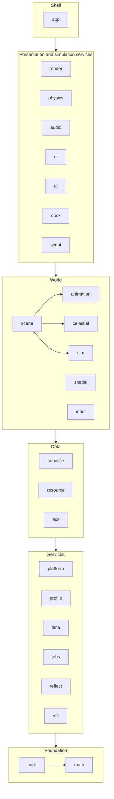

# Architecture

How the engine is laid out, how its parts depend on each other, and the handful of
architectural rules that are expensive to change later. The [scope](scope.md) says what is
built; the [roadmap](roadmap.md) says in what order.

## Repository layout

The layout as built. Phase 1 of the roadmap moved the existing code into it (`core`,
`animation`, `render`, `app`, the executables under `tools/` and `samples/`) and stubbed every
other in-scope module: each has its directory, target, public headers and a passing test, and
every function that needs an algorithm throws `JETTISON_NOT_IMPLEMENTED()` until its phase.

```
jettison/
├── CLAUDE.md                   orientation for Claude Code sessions; points into these documents
├── .claude/                    Claude Code's project settings and hooks (formats edited sources)
├── .mcp.json                   MCP servers for Claude Code: Context7, for library documentation
├── CMakeLists.txt              project, warnings target, shader helper, package export
├── CMakePresets.json
├── cmake/                      jettison_add_module(), JettisonConfig.cmake.in
├── assets/                     sample and test content (Git LFS), staged beside executables;
│                               the sample game's goods and markets (defs/) and screens (ui/)
├── docs/                       this documentation
├── scripts/                    gates: ci.sh, format-check.sh, smoke-test.sh, tidy.sh
└── source/
    ├── external/               every third-party dependency, pinned, FetchContent
    ├── engine/
    │   ├── core/               assert, log, config, string IDs, handles, hashing
    │   ├── math/               GLM additions: bounds, rays, splines, easing, RNG, noise, orbits
    │   ├── platform/           OS layer: paths, crash handling, dynamic queries
    │   ├── profile/            Tracy wrapper (compiled out when disabled)
    │   ├── time/               clocks, fixed-step accumulator, time compression, calendar
    │   ├── jobs/               I/O worker now; job system later
    │   ├── reflect/            EnTT meta registration helpers
    │   ├── serialise/          YAML and binary archives over reflection
    │   ├── vfs/                virtual file system, mounts, packs
    │   ├── resource/           handles, async load, reference counts, hot reload
    │   ├── ecs/                scheduler, tick phases, events, FSM utility
    │   ├── animation/          glTF rigs and clip player, TRS tracks, mechanical skins
    │   ├── sim/                simulation world, command queue, snapshots, definition registry
    │   ├── celestial/          celestial clock, on-rails orbits, system frames, the jump-lane graph
    │   ├── scene/              presentation scene, its file, update systems, camera rigs; layers
    │   ├── spatial/            per-system spatial index, queries
    │   ├── input/              actions, contexts, bindings, devices
    │   ├── render/             renderer interface, frame, cameras, materials, debug draw
    │   │   └── src/vulkan/     the Vulkan backend, private, behind IRenderer.h
    │   ├── physics/            Jolt integration
    │   ├── audio/              miniaudio integration
    │   ├── ui/                 RmlUi integration and data binding, drawn into render's overlay
    │   │   └── imgui/          ImGui backend, console, dev tools
    │   ├── ai/                 utility AI, behaviour trees, graph pathfinding, steering
    │   ├── dock/               stations' pads and the ships on them: given, queued, flown in, clamped
    │   ├── script/             Wasm host: scripts, their limits, bindings from reflection
    │   └── app/                Application shell, argument parsing, smoke sequence
    ├── tools/
    │   ├── flotsam/            editor
    │   └── pack/               jettison_pack: a directory into a pack file
    ├── samples/
    │   └── jetsam/             runtime viewer: the engine with no game
    └── test/                   the render smoke harness (test executable), its reference
                                frames and the data mod its packed run loads
```

Each engine module has the same shape:

```
engine/<module>/
├── CMakeLists.txt              jettison_add_module(<module> DEPENDS ...)
├── include/jettison/<module>/  public headers: #include <jettison/<module>/Thing.h>
├── src/                        implementation and private headers
└── tests/                      doctest unit tests, registered with CTest
```

Each module is a static library `jettison_<module>`, aliased `Jettison::<Module>`, in namespace
`Jettison::<Module>`, made by `jettison_add_module` (`cmake/JettisonModule.cmake`). The helper
refuses a `DEPENDS` edge on a module that has not been added yet, so the order of
`add_subdirectory` calls in `source/engine/CMakeLists.txt` is the dependency graph's topological
order, and an upward or sideways edge fails the configure rather than linking quietly.

### Parked code

Nothing is parked today. Phase 1 parked the scene graph in `render`, where it loaded models through
the device and handed the renderer `Model` pointers while the renderer read its camera and lights
back out of its registry, a cycle. Phase 6a took it out: the scene is `engine/scene`, names its
models by virtual path, and loads each model's rig through the resource manager; the renderer
resolves the same paths to device models through its own cache, behind `IRenderer.h`. The rig is
read from the glTF file by `animation`, which moved to the World tier, below `scene`, so the clip
player the scene drives is no longer a sibling edge of `render`'s.

The executables keep the names they already have: **Flotsam** is the editor, **Jetsam** is the
runtime, now a sample viewer because the game has its own repository, and **render_test** is
the render smoke harness that the gate runs. It was `test` until CTest reserved that name (see
[build and gates](build-and-gates.md#unit-tests)).

### Consumption by the game repository

The game uses `FetchContent` with a pinned commit and links `Jettison::Engine`, an interface
target over every module, or the `Jettison::<Module>` targets it needs. The install export
(`JettisonTargets.cmake`, `JettisonConfig.cmake`, behind `JETTISON_INSTALL`) exists for a later
`find_package(Jettison)` consumer; [build and gates](build-and-gates.md#consuming-the-engine) says
what it still needs. Public headers are the
`include/jettison/` trees only; anything under `src/` is private. Third-party headers that
appear in public engine headers (GLM, EnTT) are public dependencies; the rest (Vulkan, Jolt,
RmlUi, miniaudio) stay private where the interface allows it, so the game does not compile
against the backends.

## Module dependencies

Dependencies point downward only. A module depends on modules in lower tiers, never on its own
tier's siblings unless the edge is listed, and never upward. A cycle is a build failure, not a
style question.



The World tier's listed sibling edges are `scene`'s: on `animation`, whose clip players its update
drives, on `celestial`, whose star systems its system scenes are built from, and on `sim`, whose
snapshots its traffic layer is made from (6b); and `spatial`'s on `sim` (9b), whose components its
index of each system is kept from, by a simulation system. The scene reads `Sim::Snapshot` alone, never the
world, and nothing in `sim` sees the scene. `render` depends on
`scene` from the tier above, and reads it; the scene names no device. The Presentation tier's listed
sibling edges are `ui`'s on `render` (8b): the UI draws into `Render::Overlay`, a plain draw list in
render's public headers, and decodes a document's images with render's CPU texture decoder; it
includes no Vulkan header and the renderer no RmlUi one. Another is `ai`'s on `physics` (9a): a
ship coming out of a lane is put in a physics frame and stopped in it, and steering (9b) flies a
ship through its flight controls and keeps it clear of the bodies' shapes. The last are `dock`'s on
`ai` and `physics` (9c): steering flies a ship onto its pad, and physics holds it there.

The rule that matters most: **`sim`, `celestial`, `spatial`, `physics`, `ai` and `dock` never include
`render`, `ui`, `audio` or `input`**. Simulation code that can see the renderer eventually reads
from it, and then it is no longer deterministic or testable without a GPU.

## Simulation and presentation

The game is single-player, but the simulation runs as if it were a local server.

- **The simulation world** owns authoritative state in its own `entt::registry`: ships, cargo,
  stations, markets, orders, positions in double precision. It advances in fixed steps on
  simulation time, which is real time multiplied by the time-compression factor. It is
  deterministic: the same save and the same command stream produce the same state in every
  build of the engine, Debug and Release alike. It is everything a save contains.
- **The presentation world** owns what is drawn and heard, in its own registry: render proxies,
  interpolated float transforms, cameras, particles, UI state. It runs once per frame at the
  display rate and may be rebuilt from the simulation at any time.
- **Commands** flow from presentation to simulation through a queue: "buy 40 units at
  1,200", "plot route", "set throttle". The simulation applies them at the start of a step.
  The queue is the seam for replays, automated tests and any later networking.
- **Snapshots and events** flow back: transforms for interpolation, and events such as
  "docked", "trade filled" or "contact" that presentation turns into sound, effects and UI.

An event that says why something was refused or given up carries a reason (`sim/Reason.h`, 12c,
[decided](roadmap.md#decided)), never text: a key and its arguments, each an integer, an entity or
an identifier from the game's data. Each module's reasons are an enumeration registered with Reflect
as `<Module>.Reason` (`Dock.Reason`, `Ai.Reason`, the shell's `Shell.Reason`), whose enumerator names
the key, `reason.dock.no_pad_fits`, so two modules cannot make the same one; presentation words it
in the player's language ([localisation](#localisation)). The step makes no English for the player,
and a developer reads a reason as its key and arguments (`Sim::Describe`).

A star system's presentation is a **system scene** (`scene/SystemScene.h`, 6b), built onto the
scene from the system description, around whatever a scene file authored, and from the
simulation's snapshots. Its content is in **layers**: the environment (bodies, stations, the sky:
what the system places), traffic (the simulation's entities, through proxies a factory the game
supplies makes) and effects (markers, beacons). An entity's layer is its own or its parent's, and a
hidden layer is neither drawn nor lights the scene; the sun and the sky are always the system's.
What the system scene builds is never saved, so a scene file is only ever what its author wrote.

The simulation is the whole **galaxy's**, and presentation shows one system of it. Each entity's
`Sim::InSystem` names the system whose frame its `Transform` is in (the system's name hashed, so a
save keeps it), and an entity on a jump lane is in none. Snapshots carry it; a system scene's traffic
layer is the entities in its own system, and no interpolation runs across a change of system, whose
two positions are in different frames.

### Jumps

The galaxy (`celestial/Galaxy.h`, `assets/systems/galaxy.yaml`) is a graph: each system by name,
with its system file and, where one is authored, a scene file; each lane joining a jump point in one
system to a jump point in another, travelled both ways, with a transit time in simulation seconds.
A jump point is the end of one lane, so a gate says where it leads. Each system's file is checked
against the lanes that end in it when it is loaded.

A jump replaces the system shown with another, behind an effect, without the frame loop stalling or
the simulation stopping (`scene/JumpTransition.h`):

1. The effect rises, a fade to black in the output pass, mixed in after tonemapping and under the
   UI. Meanwhile the destination's system file and scene file are read on the I/O worker.
2. Once they are read they are parsed and checked on the main thread, since the archives read the
   reflection tables, which a registration on the main thread may be writing to
   ([decided](roadmap.md#decided)). A destination that fails is abandoned before anything is
   touched, and the effect lifts on the system the jump left.
3. With the effect covering the frame, the scene is replaced (`SceneFile`, already read and
   checked, or the system alone) and its system scene built.
4. What it draws streams in through the resource manager as always, and the effect is held until
   nothing is loading for the first time (`ResourceManager::Loading`), judged once a frame has been
   drawn of it, since the renderer asks for a model when it first draws it, or for 8 s at most.
5. The effect lifts.

The effect runs in real seconds, the same at any time compression. The simulation steps through
every frame of it, and the stepper is not resynced: the world did not change, and the new system's
traffic is made from the same snapshots.

That is presentation's jump, which changes what is shown. The simulation's (`ai/Lanes.h`, 9a)
carries an entity along a lane: the command `Ai::EnterLane` takes it out of its system through a jump
point (its `InSystem` none, an `Ai::OnLane` saying where it is going and the step it arrives), and
the system `lanes`, after physics, brings it out at the far jump point when the transit's whole
steps are run. A body comes out at rest in the frame of the station the gate keeps by, facing the
way the gate faces (`Celestial::JumpPointFacing`: its planet, with its station before it), with its
flight controls taken against nothing. It comes out clear of every body already there and of what
came out before it in the step: at the gate's centre, or at the first place clear on rings about it
across the way the gate faces, each a hull's breadth and 20 m further out (9f), so two traders
through one gate a moment apart do not come out in each other. What sends an entity along a lane is
the game's: the shell sends its ship as the scene jumps along the same lane, and the scene arrives at
the gate the ship comes out of, the transit's 40 s later; a trader's tree sends it once it is within
150 m of the gate's centre.

A route across the galaxy (`ai/Routes.h`) is A* over its jump points, each lane an edge at its transit
time and each pair of a system's gates an edge at what crossing the system costs, which the caller
says; `Ai::CrossingByCourse` says it from a course through the system's waypoints, round its star,
planets and moons, at a speed.

### Physics

Physics is part of the simulation's state, not a service beside it (`physics/PhysicsWorld.h`, 7a).
`PhysicsWorld::Attach` gives the world a `Sim::WorldService`: state the world keeps outside its
registry, which it owns, saves after the components and hashes with them, and loads in two halves,
read against the registry being loaded and then committed with it, so a save that does not fit
leaves world and physics as they were. A body is an entity with a `Physics::Body` (its kind, a
shape by name, its mass and material), a `Sim::Transform` and a `Sim::InSystem`; the game sees no
Jolt type. Shapes are definitions (`Physics::ShapeDefinition`, through the definition registry, so
a mod can replace one), built into Jolt shapes when they are defined, and a save names them.

Each **frame** of each star system with bodies is a Jolt world of its own (7b), made with its first
body and gone with its last (0.7 MB at the default capacities of 8,192 bodies). A frame is the
system's own, at rest at the primary, or the local frame of one of its bodies (`Physics::LocalFrame`,
a station or a planet): it moves with the body on its orbit and does not turn with it, as the
[local frame](#coordinate-frames-and-units) does. In it, Jolt's positions are metres from the body
and its velocities are relative to the body's motion; `Sim::Transform` stays in the system frame,
and `Physics::Velocity` is relative to the body's frame. Every system's positions are metres from its
own primary, so bodies of two systems at the same coordinates must never meet, and only bodies in one
frame meet each other. A body on a jump lane is in none; one that changes frame is made again in the
other's, its velocity carried across.

Frames are what let a ship meet a station at all. Highport moves at 30 km/s about the star, 500 m a
step. Jolt sweeps a fast body along its motion to find what it would pass through, but it finds what
to sweep against with that motion's absolute length, so a ship and a station both 500 m a step along
their orbit never find each other however slowly they close; its broadphase keeps bounds in floats,
8 km apart 150 million kilometres from the primary; and a float velocity at 30 km/s is 4 mm/s
between values. In the station's frame each of these is metres and metres a second
([decided](roadmap.md#decided)).

Star systems are definitions in physics, as shapes are (`PhysicsWorld::DefineStarSystem`): the shell
defines every system its galaxy lists. They put an entity on rails (`Physics::OnRails`), placing its
`Transform` where its celestial body is as each step ends, which is how a station's kinematic body
follows its orbit, and they give dynamic bodies their system's gravity, each body with a
gravitational parameter pulling as a point mass. Orbits stay on rails, so gravity moves only dynamic
bodies; a ship beside a station falls round the planet with it, as the station's rails carry it,
and is left with the tide. A frame's change of speed between two steps is taken off every dynamic
body in it, and within a station's frame what is left of the planet's 8.6 m/s² is the tide's few
ten-thousandths: a ship let drift beside Highport stays within 5 mm of where it was for a minute.

The flight model runs before physics, as the system `flight` (`physics/Flight.h`). A ship is a
dynamic body with `Physics::Thrusters` (accelerations along and about its axes, so its handling does
not change with its mass, and with flight assist the speed and rates it is held to) and
`Physics::FlightControls` (demands from -1 to 1, the assist, and the entity its velocity is taken
against), which the command `Physics::SetFlightControls` sets. With assist, a demand is a velocity
relative to the reference and a rate of turn, approached as fast as the thrusters allow; without, it
is an acceleration and the ship coasts. It changes the ship's `Velocity`, and physics then steps it,
so a ship flown into a station meets it as any body would. The system `physics` runs one fixed step:

1. Entities on rails are put where their bodies are as the step ends.
2. Bodies are made for entities that gained what makes one, and removed for those that lost it,
   changed system or frame or changed their `Body` (made again, with the velocity they had). Every
   entity on rails and every body to be made is checked first, and one that cannot be is refused
   before anything changes. A static body is in the system's frame: what a frame carries is
   kinematic.
3. What the game wrote is applied. A static or dynamic body whose `Transform` differs from where
   physics last placed it is put there; a dynamic body whose `Physics::Velocity` was written takes
   it; a kinematic body is moved towards its `Transform` over the step, so it pushes what it meets
   with the velocity that implies. Each dynamic body then gains its system's gravity over the step,
   from where the bodies are as it begins, less its frame's change of speed.
4. Each frame's world steps, in order of system and frame, on the simulation's one thread. A body
   marked `continuous` (the piloted ship) is swept rather than placed, so it cannot pass through a
   panel between two steps.
5. Each moving body's `Velocity`, and each dynamic body's `Transform`, are written back, which
   presentation interpolates like any other entity's.
6. What began and ended touching is worked out, for the simulation to read (below).

**Contacts** are the simulation's to read, not presentation's (7c, [decided](roadmap.md#decided)):
`PhysicsWorld::Contacts` is what the last step began and ended, in order of pair, and `Touching`
what touches a body now. A beginning carries where the two met, the normal from the first towards
the second and the speed they closed at, which is what a game judges an impact's damage or sound
by; a game's system ordered `after` `physics` reads the step's, and one before it the last step's.
Both are saved with the world, so either reads the same after a load. Two bodies touch while Jolt's
contact cache holds a contact between them once the step is over, which begins a couple of
centimetres before they meet; a body asleep on another still touches it, though Jolt drops a
sleeping body's contacts. A body removed, or made again, ends what it touched in the step that
removes it.

A **sensor** is a body marked `sensor` (`Physics::Body`): it meets nothing, reports the dynamic
bodies that enter and leave it as contacts, and never sleeps, so it still sees a ship that has come
to rest inside it: a gate's ring, or a zone a game's rule watches. Docking is not done with one: a
ship lands on a pad its station gives it and is clamped there ([docks](#docks)).

**Casts** (`CastRay`, `CastShape`) find the first body along a ray or a convex shape swept along a
direction, across every frame of a system, each cast in the frame's own coordinates; sensors and the
caster's own body are left out unless asked for. They read the world as the last step left it, and
are the simulation's to call; steering (9b) keeps clear of spheres instead, below. **Picking** is a command, since presentation
never reads the simulation's state: a click is a `Physics::Pick`, the ray through the cursor
(`Render::ScreenRay`) from the camera presentation drew, and the next step answers it with a
`Physics::Picked` event, a frame later. Presentation shows the world half a step behind on average,
and a station's frame moves 500 m a step about the star, so the pick carries the time it was drawn
at, and each frame is placed where its body was then (`CastOptions::framesAt`)
([decided](roadmap.md#decided)).

Jolt is deterministic across builds (`CROSS_PLATFORM_DETERMINISTIC`) given the same calls in the
same order and the same body identifiers. The calls are made in entity order. The identifiers are
the engine's, not Jolt's free list, whose order is history a save does not hold: the lowest free
index, with a sequence number per index that a save keeps. A save holds each world's frame (where it
was and how fast it moved over the last step), each body's record (what it was made from and last
placed at, and whether it sleeps) and Jolt's own state, positions, velocities, sleep and the
contact cache each step warm-starts from, under the version of Jolt that wrote it; a load makes the
same bodies with the same identifiers and restores it, and steps on to the same bytes as the world
saved.

That version is physics' layout 4 (12b, [decided](roadmap.md#decided)): Jolt's major, minor and
patch (`Physics::BuiltJoltVersion`, 5.6.0) and those of its feature bits that change what it saves
or how it steps, double precision, the cross-platform determinism and 32-bit object layers. The
others, assertions above all, differ between a Debug and a Release tree and change neither, so a
save moves between them with Jolt's state kept. A save of another Jolt, whose state this build
cannot read, is loaded by rebuilding its bodies from the records alone, each where it was placed,
moving as it was, and asleep if it was, and its Jolt state is passed over (the load logs it); saved
again, it is this build's. Layout 3, before the version was saved, is read as 5.6.0's, which every
save of it was. What a rebuild loses was measured by a save marked as another version
(`PhysicsWorld::SaveAsJoltVersion`): the contacts Jolt warm-starts each step from, and an awake
body's time at rest. What touches is kept, and the contacts Jolt finds again in the first step begin
nothing; a body asleep sleeps on where it lay, and one in flight goes where it would have to the
bit. Four crates thrusting in a row into a block give 1.2 mm in the first step without their
impulses and 7.1 mm by the tenth, and rest 4.6 mm from where they would have; the physics suite's
bay of thrown cargo, rebuilt at step 180 with three pairs touching, is 2 nm out after a step and
57 µm two seconds on, the same pairs beginning and ending in each step. A docked ship loses nothing:
it is a kinematic body on its station's rails, and the clamps are presentation's, so a ship rebuilt
on its way down onto its pad docks at the same step in the same place, and one rebuilt docked stays
there and undocks. The physics suite's recorded runs, every kind of body and
shape among them in one and, in the other, a ship flown through a station's docking zone into its
hub as the station goes round its orbit, at rest in the zone and picked, are pinned to state hashes
in Debug, Release and under the sanitisers. Jolt asserts in a Debug tree through the
engine's assertions, and its profiler zones are Tracy's.

The piloted ship crosses this boundary every frame (7b): the flight context's actions become a
`SetFlightControls` in the commands phase when a control moves, the flight model and Jolt advance in
simulation steps, and the ship's proxy in the traffic layer interpolates between the last two, which
the pilot camera's chase and cockpit rigs follow (`Scene::PilotCameraComponent`). When time
compression is above 1×, piloting is suspended, as it is in every game of the genre, and the assist
holds the ship. Compression is refused near stations and other ships for the same reason, by the
game.

### Steering

Steering (`ai/Steering.h`, 9b) flies a ship to a place: an `Ai::Destination`, a point in the ship's
frame or an offset from an entity in the entity's own axes, with a course's waypoints on the way, and
an `Ai::Steered` saying how far it keeps from what is near. Its behaviours (seek, arrive, avoid,
separate) are velocities rather than accelerations, since the flight model's assist already holds a
demanded velocity and reaches it as fast as the thrusters allow ([decided](roadmap.md#decided)): the
system `steering`, after `spatial` and before `flight`, sums them and sets the ship's
`FlightControls`, its velocity as a share of its top speed along each of its axes and a turn of the
nose towards it. Positions are in the system frame and velocities in the ship's frame, which is all
it steers about, as bodies in two frames never meet.

What is near comes from the **spatial index kept from the simulation** (`spatial/SystemIndices.h`):
one octree a system, of every entity with a `Transform` and an `InSystem`, brought up to the
registry by the system `spatial` as the step's systems begin. It is not state: it is made from the
components each step, so a save does not hold it and a world loaded from one has it from its next
step, and what a query returns depends on the positions alone. Every body but a sensor within reach
is an obstacle, the sphere about its origin that holds its shape
(`PhysicsWorld::ShapeRadius`), and the dynamic ones are neighbours to keep apart from. Avoidance turns
a ship aside from the first obstacle it would pass within its clearance of, and never lets it close
on any faster than it can stop from before the clearance; that limit is what keeps it off a hull,
and the turn what takes it round.

A station's sphere holds its pads, so a ship flown to one cannot keep clear of the station by its
sphere. A destination kept clear **by its hull** (`Destination::byHull`, 9c) leaves its entity out of
the obstacles, and every body on the same celestial body's rails with it (the station, and the ships
clamped to it), and sweeps the ship's own shape along its way instead
(`PhysicsWorld::CastShape`), closing on what the sweep meets no faster than it can stop from before
its clearance; what it meets beyond its target, the deck under a pad, is not in its way. A
destination may also give the ship a **facing** in its entity's axes, which it turns to about all
three axes, rolled too, rather than turning its nose to its velocity: a pad's heading as it lands.

### Docks

A station's pads are the simulation's (`dock/Docks.h`, 9c, catalogue entry 31,
[decided](roadmap.md#decided)): who holds a pad is authoritative state that every player is to see
the same, so it is given by commands in their order, saved, and nothing in the module assumes one
player. Its data are definitions: a hull (`defs/hulls`, `Dock::HullDefinition`) has a size, the
class of pad it lands on and its cargo hatch, and collides as the box of its size; a station's
layout (`defs/stations`, `Dock::StationLayout`), which a station names in its system's file
(`Celestial::Body::layout`), has its decks and piers as boxes, which the station collides as, its
pads (class, place, normal, heading, and whether it is for display, with the hull it shows) and its
cargo bays, each the middle of its door's sill on the deck. A layout is checked as it is defined:
every pad all on a deck or a pier, none overlapping another, nothing of the station over any, out to
the sphere that holds it all, and a ship shown only on a display pad. A display pad's ship is
presentation's, drawn on it and never a body: no ship is given the pad, and `Park` refuses it.

`Docks::MakeStation` builds a station: its kinematic body on its celestial body's rails, in its
frame, and an entity for each pad on the same rails at its place, free, reserved for a ship until
a step, or holding one. `RequestPad` gives a ship the smallest free pad its hull fits, the lowest
numbered of those, or a place at the back of the station's queue, and the queue is served from the
front, each ship the smallest free pad it fits, as pads come free; a reservation not landed on in
time lapses. `ReleasePad` gives a pad or a place up, or lets a docked ship go. Both carry their
sender (`Sim::Controller`, a player's slot or the AI), and a ship's `Sim::ControlledBy` refuses a
command from anyone else; a refusal says why, as an event, among the given, queued, lapsed, landed,
left and released.

A ship the docks fly in (`RequestPad::fly`) is steered in two legs: a course round the station's
sphere (`Ai::Waypoints`) to the point above its pad, outside the sphere along the pad's normal; then
down the normal, kept clear of the station by its hull and turned to the pad's heading, slowing to
stop a quarter of a metre above its resting height. The system `dock`, after physics, clamps a ship
within a clamp's reach of its own pad (2 m across it, a metre above or below, its top within 10° of
the normal and its nose within 15° of the heading, under half a metre a second), whether the docks
flew it or its pilot did: its body becomes kinematic, on the station's rails at its place on the pad,
so it is held in the station's frame and out of flight. A pad clamps only the ship it was given to.
Undocking makes the ship dynamic again and lifts it the same way back to the point above, where it
gives the pad up. Highport's shuttle from 10 km on its far side is over its pad in 111 s and clamped
24 s later, touching nothing on the way.

**The station dressing** (9d) is the layout drawn, in the shell (`app/src/Dressing.h`), under the
station's entity in the presentation scene as each system scene is built; none of it reaches a scene
file, and none of it is what the station collides as, which is its layout's decks and piers whatever
is drawn. A tall block of the layout (the hub) is drawn in the hull's plating and a flat one (a pier,
a wing) in deck plating. Each pad is a plate on the deck, painted in the effects layer with its
outline, a centre line with chevrons to the bow, the keep-clear box over its class's hatch and its
number in bar segments; floodlight poles stand along its long sides, at its corners and, past 120 m,
between them, each a spot aimed across the pad at half its class's largest hull's height with the
intensity that puts 1.6 on it (half the sun's irradiance), and a lamp under its head in the effects
layer showing the pad's state. The pads are shown in the snapshots (`Docks::Attach`), so the lamps
are turned from what presentation may see, never from the world: green free, amber reserved, red
holding a ship, blue on display. Each bay has its door, a panel up from its sill or a hatch in the
deck. A ship's proxy, a parked ship's or a display pad's, is its class's, made of procedural shapes
fitted to its hull's box, or the hull's own glTF model when it names one (`HullDefinition::model`).
Highport carries 104 floodlights: six on each L pad, eight on each XL and four on each S, every one
reaching no further than 900 m from the station's centre.

**Docking clamps** (10d) are the dressing's too, four to a pad (`App::PadClamps`): each a post that
telescopes out of the deck beside the hull, an arm that rises with it and swings over onto the
hull's side, and a jaw that slides out along the arm to bite, keyframed in a clip file
(`animations/pad-clamp.clip.yaml`, [animation](#animation)) whose `close` and `open` clips one
player on the pad's node plays on all four, each name bound to the four parts that bear it. They
are fitted to the hull they hold, two a side a quarter of its length fore and aft, and as tall as
two fifths of its height, as the proxies are fitted to their hulls; the docks therefore show each
ship's `Docking` and `Hull` in the snapshots. The clamps close while the pad's ship is at
`Stage::Docked` and open once it is let go, which is before the pad is given up, so a ship lifts
out of open clamps; clamps first seen are shown as they are, at the end of their clip and without
its events, so a ship parked as a world opens is held from its first frame and not heard closing. A
display pad's hold the ship it shows. Stowed, a clamp is put away at no size, and a mesh scaled to
nothing is neither drawn nor casts a shadow.

**Deck traffic** (9e, [decided](roadmap.md#decided)) carries a docked ship's cargo across the deck in
the simulation, so every player sees the same buggy at the same place and the buggies decide when
the ship may leave. A layout's roads (`dock/Roads.h`, `Dock::Roads`) are made from it as it is
defined, and are never state: a road down each pier's side, in the wider strip of its top beside its
pads; each pad's apron, the middle of its aft edge, and its hatch on its centre line; and straight
legs joining each bay and each apron to every road at its nearest point, and each bay to each apron,
wherever the leg lies on the deck, passes through nothing of the station and crosses no pad. Where
legs join a road are its nodes. Each pad is routed once, by A* (9a), from the bay nearest it by road,
and a layout with bays is refused if a pad ships land on is not reached. Highport's twelve pads are
each served from the bay at their pier's root, 90.6, 396.8 and 606.8 m to the hatch from the first
pad out to the third; Corva's S pads on its hub's top from the hatch between them.

A game's trade settles its crates and its price at once, then calls `Dock::Carry`, which gives the
docked ship a `Dock::Transfer`: crates in the bay still to go aboard and crates in the hold still to
come off, a purchase and a sale of the same crates before they cross netted against each other. The
docks' step then works each deck (`dock/Deck.cpp`): a `Dock::Buggy`, an entity with a Transform and
no body, comes out of the pad's bay while its ship has cargo for one and the pad has fewer out than
the layout gives it (`DeckTraffic::buggies`), carrying a trip's crates aboard or going to fetch them;
it drives its route at the layout's speed on the right of the road, never nearer the buggy ahead in
its lane than 8 m, and holds a node while it is within 6 m of it, so the next waits short of a node
another holds, in entity order; at the hatch it hands its crates aboard and takes a load off, at the
bay it leaves its load and goes out again or in. The transfer is done (`Dock::CargoCarried`) once
every crate for the ship is aboard and every one off it has been taken from its hatch, and until
then `ReleasePad` refuses to let it go. A station whose buggies are parked (`DeckTraffic::working`
false) has none in the simulation: its dressing draws them across each pad's stern, and a buggy's
load each way is moved at each round trip of the pad's road shared among its buggies, the rate
working ones would have. A pad no road reaches, at a station with no bays, has its cargo at once.
Buggies and transfers are shown in the snapshots: the shell draws each buggy (`MakeBuggyProxy`), a
flatbed tug whose bed carries the crates it has, interpolated as any entity is, and the market
screen says how many crates are still crossing.

### Decisions

An entity's choices are made in the simulation by two tools of `ai` (9f, catalogue entry 26), both
deterministic, both data, with what they weigh and do the game's.

**Utility AI** (`ai/UtilityAi.h`) is for choices that are scoring problems: which run a trader flies,
later which route or which upgrade. A decision (`defs/decisions`, `Ai::DecisionDefinition`) is a set
of actions, each weighed by considerations: an input of the game's, by name, brought into [0, 1] by
its range and shaped by a response curve (linear, power, logistic or a step, clamped, and inverted
on asking). An action's score is the product of its considerations, each made up for their number as
v + v(1 − v)(1 − 1/n) so that one weighed by many things is not marked down for each, times its
weight; one with no considerations scores its weight, a baseline the others have to beat. The game
offers options, each an action with its own inputs, and `Ai::Choose` scores them in order against the
best so far, asking an option for no more inputs once it cannot beat it: an input that costs (a route
plotted across the lanes) is worked out only for an option still in the running. The earliest of
equal options wins, and none is chosen when every one scores nothing.

**Behaviour trees** (`ai/BehaviourTree.h`) are for sequences: off the pad, to the gate, through it,
onto a pad, the trade, the wait for the cargo. A tree (`defs/behaviours`, `Ai::BehaviourDefinition`)
is nested nodes: the engine's sequence, selector, invert, succeed, repeat, loop and wait, and tasks,
the game's leaves, by name with arguments, defined with `Ai::Behaviours` before any tree that names
them and checked as the tree is. The system `behaviour` ticks every entity's tree each step, in
entity order, and runs first in the step, before `spatial` ([decided](roadmap.md#decided)): a tree
acts on the world where it is as the step begins, as the queue's commands do, and what a task sets (a
destination, a pad asked for) is flown and answered in the same step. Its composites remember their
running child, so a running node is resumed rather than entered again from the top, and is never
interrupted; a task needs no undoing, and an entity's place in its tree is a memory and a flag a node
(`Ai::Behaviour`), saved with the world. A repeat or a loop runs its child again at the next tick, so
a step's work is bounded however soon a child succeeds. A task acts through commands applied at once
(`Sim::SimWorld::Apply`), which meet the checks a player's do, carry the agent as their sender where
they carry one, and are not recorded: they are the state's own consequence, which a replay sends
again.

**The sample's traders** (`app/src/Traders.h`, [sample game](sample-game.md)) are the first to use
both. Each follows `defs/behaviours/trader.yaml` and chooses its run by `defs/decisions/trade.yaml`,
weighing a run's margin, the rivals after the same shelf and its credits a second over the route
(`Ai::PlotRoute`, crossing each system by course), and then flies it: off its pad, round the station
to the gate, through it, onto a pad or into the queue for one, held off the station in its place, the
trade, and the wait while the buggies carry its crates. Seven trade between Highport and Corva, whose
one free pad keeps a queue; in twenty minutes of the app suite they sell fourteen runs across the
lane, queue five times, and no two hulls come within 35 m in flight.

### Persistence

A save game (`sim/SaveGame.h`, 8a) is one file in its own format, `Jettison.Save`, holding parts
that are each versioned on their own: its `SaveInfo` (the player's name for it, the engine version
that wrote it, when, the world's step and time, the galaxy's file, the system shown and the mods
enabled with their versions), the world's save (`SimWorld::Save`, `Jettison.World`), and the game's
sections, each a binary archive in a format of the game's that the save holds and does not read:
what a save contains beyond the engine's state is the game's ([scope](scope.md)). The info comes
first, so a list of saves reads no further. A change to the world's layout is a step in the world's
migrations and leaves the save game's format and the game's sections alone. The shell's sections are
its own state (`Shell.State`) and what scripts keep by key (`Script.Store`, [scripts](#scripts)).

Every versioned format reads its earlier versions through a chain of migrations
(`serialise/Migration.h`), a step from each version to the next, written once, when its version is
current, and never changed after. A binary step edits the archive as a document: its table of names,
through which a field, a component, a command or an enumerator is renamed everywhere it is used, and
its payload, which the world's step from version 1 to 2 appends its services' empty state to. A
change inside a value needs the types that wrote it, and a step that has them reads the old version
with them and writes the new.

A component changes by a chain of its own (12a, [decided](roadmap.md#decided)). The world's save
(version 3) begins with each component storage's version, so a load knows them all before it reads
one, and a version newer than the component's chain is refused by the component's name before
anything else is read; a storage of an older save is at version 1, which the world's step from 2
sets by writing an empty table. A component registered with a chain
(`SimWorld::RegisterComponent<T>(Sim::ComponentMigrations)`, under its registered name) has each
value of an older storage read as its record (`Serialise::BinaryRecord`): the field table the binary
archive writes, each field's name and its bytes, which a step edits. A field removed is read, if the
step wants it, and taken out; a field retyped is decoded with the reader's primitives by the layout
the step knows, and set again; the record is then read as the type is now, by name as any value is.
So the old C++ type is never needed, and a struct inside a component is migrated by the component's
steps. Adding a field or renaming one needs no version: fields are found by name, and a rename is a
world step over the table of names. A YAML step edits the parsed tree, keeping the lines a mistake is
reported at. Definitions migrate the same way ([decided](roadmap.md#decided)). A version newer than
the build's, or one the chain does not reach, is refused by name before any step runs, and every
read leaves what it was reading into as it was when the data does not fit.

What a build wrote, every later build loads: the suites keep saves written by earlier versions as
fixtures (`sim/tests/data`), never regenerated. `world-v1.save` was written by the phase 6d build
(commit `a5d0c83`) and `world-v2.save`, the same world with a service's state, by phase 11's
(`cfb86e9`); each loads, through the world's migrations, into the state this build reaches at the
same step. `save-v1.save` is the save game's first version, written by phase 8a's.
`physics/tests/data/replay-layout3.save`, physics' layout 3 from phase 12a's build (`8177358`), loads
with Jolt's state kept and steps on to the bytes the run not saved reaches.

A save is written through the VFS to the user mount, the user's data directory
(`~/.local/share/jettison/saves/<name>.save`), whole and durably (`Core::WriteFileDurably`): to a
partial file beside it, flushed to the disk, renamed over it, and the directory flushed, so a crash
or a power cut leaves the save before it, and a save reported written is on the disk. Settings and
bindings are apart from saves, in the configuration directory (`~/.config/jettison/settings.yaml`),
written the same way whenever the player changes one, so loading a save changes none of them. A
binding's joystick is a number the player's bindings name after the device it was bound as
(`input/Joysticks.h`), by its GUID, so it follows the device rather than the slot it is plugged into.

Loading replaces the world only once the whole save has read: the info, the galaxy (a save of
another galaxy is refused), the game's sections and then the world, which itself commits only at the
end. A save made with other mods than the run's loads, the shell logging each difference
(`Sim::ModDifferences`: a mod saved with and not enabled, one enabled and not saved with, one at
another version, or the same mods in another order), since whether that makes another game of the
save is the player's to judge. Presentation then resynchronises its snapshots and makes the traffic layer's proxies again
(`SystemScene::ResetTraffic`), since a loaded world's identifiers may name other entities than they
did.

## Files, packs and mods

Everything the engine reads as content goes through `Vfs::FileSystem` (11a): ordered mounts, each a
directory or a pack file (`vfs/Pack.h`), a later mount shadowing an earlier one path by path. The
shell mounts, bottom to top (`App::MountAssets`): the assets as `base`, the staged directory or,
where a build has none, `assets.pack` beside it, or whichever `--assets` names; each of the user's
mods the player's list enables, the directories and `.pack` files under
`~/.local/share/jettison/mods`, as `mod:<identifier>`, a directory's name or a pack's without
`.pack`, so a mod is the same mod packed or not (a second of one identifier is reported and ignored,
the directory kept); and the user's data directory, writable and last,
where saves go. It logs the mounts in order. A mod that cannot be mounted is reported and left out,
and anything else in the mods directory is reported and ignored.

The list is `mods.yaml`, beside `settings.yaml` (12a, [decided](roadmap.md#decided)): the mods in
mount order, a later one winning, each enabled or not, written by the game's menu. A mod found and
not listed is added at the end, enabled, in the order of the names' bytes, and the list written
again, so a directory dropped in works and keeps its place; one listed and missing is reported and
keeps its place; a list that does not read is reported and left for the player to mend, every mod
found then mounting by identifier. Each mod may describe itself in a `mod.yaml` at its root: a name
to show, its `release`, which a save records it by,
the engine version it was written for, refused when newer than the engine's, and `requires`, the
mods it needs before it in the list, refused with the reason when one is missing or after it rather
than the list reordered. A mod with none mounts as before, of no release.
Nothing that reads content names a host path: the default scene is `scene/main.yaml` through the
mounts, and ImGui's fonts are read through them into memory (`--scene` alone still names a file on
disk, for the development scenes the reference views use).

A pack is a directory's files in one file, each stored as it is or compressed as one zstd frame
with its checksum, so a file is read on its own and a damaged one is caught as it is read; its index
is read and checked whole as it is mounted, and a pack that breaks its layout is refused naming what
is wrong. Its file is held open for the run and read with `pread`, so the I/O worker and the main
thread read at once, and a pack replaced on the disk is read as it was mounted. `jettison_pack`
writes one, and `jettison_add_pack` is the build's rule for it; the sample assets are
`jettison_assets_pack` (`build/<preset>/assets.pack`), which the smoke test runs from. The same
files give the same bytes. A file is compressed only where zstd at level 1 saves a thirty-second of
it, then at level 19: of the sample assets' 90.3 MB, the KTX 2 textures are zstd-supercompressed
already and the models and music barely shrink, so 127 of 136 files are compressed and the pack is
88.6 MB, written in about a second.

Definitions layer finer than a file ([decided](roadmap.md#decided)). Every mount's file for a
definition is read (`FileSystem::ReadLayers`), not the topmost alone: a whole file
(`defs/goods/beer.yaml`) replaces the definition and everything below it, and a patch beside it
(`defs/goods/beer.patch.yaml`) changes what it names and keeps the rest, merged in mount order over
the topmost whole file (`Serialise::YamlArchive::ReadLayered`): a mapping key by key, a null
removing a field so it reads as its default, a sequence replaced, appended to when tagged `!append`,
or merged element by element, matched by a field, when tagged `!merge=<field>`:

```yaml
version: 1
goods: !merge=good
  - {good: beer, target: 60}
  - {good: wine, stock: 10, production: 0, consumption: 1, target: 20}
```

So two mods can each change one market, and a mod copies nothing it does not change. Each layer is
migrated on its own before it is merged, which is why a YAML step edits only what the data has: a
step that filled a default in would set it over the layer below. The registry logs each definition a
mount changes, naming the mounts, and an error names the files and their mounts.

## Scripts

Behaviour a mod changes runs as WebAssembly (`script/ScriptHost.h`, 11b), in WAMR's fast
interpreter ([decided](roadmap.md#decided)). A script is a definition, `defs/scripts/<name>.yaml`,
loaded through the definition registry and so layered as any other: a mod adds one with a file and
changes another's grants or fuel with a patch. It names its module (a `.wasm` read through the VFS,
usually from the same mod), the fuel a call may spend, the pages its memory may grow to, what it is
granted, and which of its exports the host calls and for what:

```yaml
version: 1
module: scripts/smoke.wasm
capabilities: [log, store]
events:
  - {event: Shell.Traded, function: on_traded}
inputs:
  - {input: crowding, function: crowding}
```

**What a script sees is generated from reflection.** A type registered with `Reflect::Attribute::Script`
is one scripts see: an event a handler is given, or a command a script may be granted to send.
`Script::Bindings` lays each out as a C compiler or rustc lays out its struct for wasm32 (its fields in
registration order, each at its alignment): integers, floats and GLM vectors as themselves, an entity
as its 32-bit identifier, an enumeration as an integer of its size with its enumerators as constants,
a string or a vector as a pointer and a count, a registered class nested. A field of another kind (a
`std::optional`) is left out, and said to be. The host copies an event into a handler's memory in
that layout, and reads a command out of it, checking every pointer and count against the memory's
bounds, every bool and every enumerator; so nothing crosses the boundary but bytes, and a script reads
and writes plain structs. From the same layouts the host writes the bindings a script is built
against, a C header (`jettison_script.h`) and a Rust module (`jettison_script.rs`), each asserting
every size and offset, so a script built against another build's types fails to compile rather than
misreading. The shell's console writes both (`script_bindings <directory>`).

**Imports are capabilities.** The host's functions are in the import module `jettison`: `log`, granted
by `log`; `input`, for a script that answers inputs; `store` and `load`, granted by `store`; and
`send:<Command>` for each command it is granted, which the world must apply. As a script loads, every import its module makes is checked
against what its definition grants, and a module that imports anything else, from any other module or
not granted, is refused, naming the import. WAMR's built-in libc, which offers `printf`, `malloc` and
the rest to any module, is not built; WASI is not either.

**The calls.** The host calls a script from two places:

- **Events.** As presentation takes the simulation's events once a frame, the shell gives each to the
  host, which calls each script with a handler for its type, in the scripts' name order. A handler
  acts through the commands it is granted, which go into the world's queue, applied at the next step
  and recorded with the player's, so a replay needs no script to run. A handler's instance is kept
  from call to call, so it may count what it has seen, until a trap or a load makes it again.
- **Inputs.** A decision's consideration (entry 26) names an input; one a script answers is the
  script's, and `ScriptHost::WithScripts` wraps the game's inputs for an option so the script works it
  out, asking the game for the option's other inputs through `input`. The traders' choice of run is
  the first to use it: the smoke mod weighs a run by how crowded its shelf is. That call is inside the
  step, so it is held to the simulation's rules: each input call is made on an instance made afresh
  from the module, so its answer is a function of the option's inputs and of nothing a call before it
  did, and a world saved between two steps holds everything an input depends on. An input call sends
  nothing. Neither `ai` nor the decision knows of scripts; the game wraps its inputs. A decision that
  asks for an input neither a trader nor a script answers gives the shell no traders, logged.

**What a script keeps** (12a, [decided](roadmap.md#decided)). A handler's memory is not saved: it is
up to 16 MB a script, and a module rebuilt would no longer read it. A script keeps what should
outlast its instance by key instead, through `store`, which keeps bytes under a key (no bytes take
it away), and `load`, which copies them back and says how many there are, in an encoding the script
chooses and migrates itself, by a version of its own: the smoke mod's script counts the trades it has
heard under a key, a version byte and the count. The keys are each script's, kept by the host whether
the script is loaded or not, and are a section of the save game (`Script.Store`), not the world's
state, since handlers run outside the step: so not in its hash or a replay. Loading a save replaces
them and makes every handler's instance again, so what a script holds in memory is the loaded game's.
A script is held to 256 keys of 1 to 64 bytes and 64 KiB of keys and bytes together (`HostLimits`),
past which a store traps, as does a store or a load while it answers an input, which reads only its
inputs.

**The limits.** Fuel is WAMR's instruction metering: a call runs at most its definition's count of the
interpreter's instructions (100,000 by default, up to the host's 10 million), counted the same on
every run, so a call out of fuel traps at the same place in every build. The memory may grow to its
definition's pages (16 by default, up to 256), and bounds are checked in software, which installs no
signal handler under the sanitisers or the crash handler (11d). A watchdog thread looks at the call
running every 5 ms and terminates one past the host's time limit, 250 ms by default: fuel bounds
what a script does, and the time limit what fuel cannot see. A call that traps (out of fuel, out of
bounds, an unreachable, a call the host refuses) loses its result: a handler's effects stop where it
trapped and its instance is made again, since a trap leaves its stack where it was; an input reads as
nothing. The trap is logged, the first ten a script makes one by one, and the script stays loaded,
since it is deterministic and will do the same again. A call past the time limit stops the script for
the run, logged as an error: the one outcome that depends on the machine, which a call within its
fuel does not reach.

**The cost.** In a Release build on the development machine a call on a kept instance takes 0.27 µs
and an input call, with its fresh instance, 9 to 10 µs, of which WAMR's instance and environment are
nearly all. An input instance has no host heap, which only a handler needs, to copy its event into:
with one, the instance took 41 µs. A trader weighing its runs asks the smoke mod's script for 25
inputs in the first step, a quarter of a millisecond once, and a trader chooses again only when it is
idle.

**Writing one.** A script is C or Rust ([decided](roadmap.md#decided)), compiled for wasm32
freestanding against the bindings, and the shell's own are Rust. `jettison_add_script` builds one: C
by clang (the compiler Nix's wrapper wraps, which cannot compile for a second target) and wasm-ld, Rust
as a `no_std` cdylib for `wasm32-unknown-unknown` by rustc, linked by the same wasm-ld; both with a
16 KiB stack, placed first, below the data, so a stack that overflows runs off the bottom of memory and
traps rather than into the data. The script suite's modules are in both languages, the same calls
made from each.

## UI

The game UI is RmlUi behind `ui/UiSystem.h` (8b), which names no RmlUi type, so the game and the
shell include none. Documents, stylesheets, templates, fonts and images are read through the VFS
(the UI's file interface), so a mod restyles a screen by shipping its stylesheet over the base one;
a stylesheet is read once a run, so mods are mounted before the UI is made. Its messages go to the
log under `ui`, and the warnings and errors among them are counted, which the render test holds at
none. Fonts are FreeType's, one build that RmlUi's font engine and ImGui's rasteriser
(`imgui_freetype`) both link. The dev tools and the console stay on ImGui.

**Drawing.** What RmlUi draws is recorded into a `Render::Overlay` (`render/Overlay.h`): vertices in
the frame's pixels, colours encoded sRGB with alpha premultiplied as RmlUi gives them, indices, and
draws with a translation, a scissor and an optional transform; and textures (a font's atlas, an
image), held by identifiers never given out twice. RmlUi's compiled geometry is kept by the UI and
copied into the overlay each time it is drawn, a few thousand vertices for the market screen, which
the renderer writes into the frame slot's buffers. The renderer draws the overlay in the output pass,
after the tonemap and the jump's fade and before the dev tools, with the `overlay` program
(`vulkan/OverlayRenderer.h`); it uploads a texture the first time a draw names it and releases its
copy once the overlay no longer holds it and the frames in flight are done with it. Colours are
multiplied and filtered as encoded, as a browser does; on an sRGB swapchain the fragment is decoded
before it is written, so blending is in linear light, where a browser blends encoded values. Clip
masks, layers, filters and shaders are left to RmlUi's defaults, which draw nothing for them
([carried forward](roadmap.md#carried-forward)).

**Data.** A document reads the game's data through a data model (`ui/DataModel.h`): named
variables, bound by address to values presentation owns, and named events. A variable is any type
registered with Reflect, read through the reflection tables in place: a field's address is found
from its member pointer, which `Reflect::TypeBuilder::Field` records (`Reflect::AddressOf`), a
`std::vector` by its elements, and a leaf (a bool, an integer, a float, a string, a registered
enumeration by its name) as a value, so binding a type needs nothing beyond its registration, and a
type that cannot be shown is refused as it is bound. The values are presentation's copies of what
the simulation's snapshots carry: a world shows a component to presentation with
`SimWorld::ShowInSnapshots<T>()`, after which every snapshot holds every entity's copy of it
(`Snapshot::Components<T>`, `Snapshot::Get<T>`). Presentation builds a screen's data from a snapshot
when a step brings a new one, and tells the model only when what it shows has changed; an event a
document raises becomes a command the next step applies, and the step's answer, an event, is shown
in turn. Nothing in the UI reads the world.

**Input.** The shell feeds the UI the window's events in order, from GLFW callbacks chained over the
ImGui backend's: the cursor each frame, buttons, the wheel, keys and text. The dev tools come first:
what ImGui wants, the UI is not given. A document is the frame's size and lets the mouse through but
for its panels (`pointer-events`), so a click on a panel is the UI's (`UiSystem::WantsMouse`) and is
not a pick or a camera drag, and a click beside it is.

## Localisation

The text a player reads comes from string tables (`ui/StringTable.h`, 11d), read through the VFS:
every YAML file under `strings/<language>/`, a version and nested mappings joined into keys by dots
(`market.column.ask`). A language is read over its primary language (`pt-BR` over `pt`) and that over
the base, English, which has every key, so a translation that lacks a key reads English; a key no
table has reads as itself and is counted with the UI's problems, which the smoke test holds at none,
and a base with no tables at all is refused. The same file in several mounts is merged key by key,
the bottom mount's first, so a mod changes the strings it names, adds a file of its own for its own
screens, or adds a language as a directory; one key in two files of a language is refused, since
the files' order would settle it. Tables are not definitions: a table is one flat mapping, so a mod's
file is already a patch of it, and there is no `.patch.yaml`.

A document names a key as `[[market.buy]]`: RmlUi hands every text it reads to the system interface
(`TranslateString`), and the table replaces the keys before RmlUi parses the text for markup and
data expressions, so a translation may move `{{screen.used}}` within its sentence or wrap a word in a
span. The game's code formats its text with `Format`, std::format's positional arguments (`{0}`,
`{1:>8}`) so a translation orders them its own way, and `Plural`, which chooses `key.one`,
`key.few` or `key.other` by the CLDR's rule for a whole number in the language, the count `{0}`.
A translation that names an argument or a data expression its base text does not, or a brace that is
neither, is refused as it is read, and the base's text stands: a translation cannot make a format
throw or a document read a variable its screen does not bind. Numbers are grouped by the table's
`numbers.thousands`, in the documents' `thousands` transform and the shell's text alike
(`StringTable::Number`).

A reason the step gives ([simulation and presentation](#simulation-and-presentation)) is worded by
the shell (`app/src/Reasons.h`, 12c) from the table under its key, in `strings/<language>/reasons.yaml`
for the engine's and the sample's: each argument put in words first, an integer by `Number`, an
entity by its name in the snapshot (a market's station, or the body a station or gate rides the
rails of), a good by its name and any other identifier as the data gives it, then formatted by
position (`FormatArguments`); a key with plural forms is chosen by its first integer
(`PluralArguments`). The arguments are positional as the tables' are, so the check that holds a
translation to its base text holds it to the reason's. The app suite holds every reason of the
docks, the AI and the trade to a text in English and German.

The language is the player's setting (`ui.language`), not the environment's locale, so a run reads
the same on every machine until the player chooses; `UiSystem::SetLanguage` reads the tables and
reads every open document again, each keeping its handle and whether it is shown, since RmlUi
translates a document's text as it reads it. The console's `language [tag]` sets it. Developer text,
the log, the console and the dev tools, stays English. The sample ships English and German, a
good's name and crate in the tables (`goods.<definition>.name`), and a good no table names reads as
its definition's `displayName`, as a mod's new good does.

## Audio

The game's sound is miniaudio behind `audio/AudioSystem.h` (8c), which names no miniaudio type.
Sounds are read through the VFS (miniaudio's file callbacks over `Vfs::FileSystem`, a file read whole
as it is opened, since the VFS has no streaming read, from a directory or a pack), so a mod replaces a sound by shipping its file
over the base one. miniaudio decodes WAV, FLAC and MP3 itself; its Vorbis and Opus decoders, system
libraries, are off. Its messages go to the log under `audio`, a device's details at debug, and the
warnings and errors among them, with every sound that would not play, are counted, which the render
test holds at none.

**Buses.** Five sound groups: master, and under it music, effects, UI and voice. A bus's volume
scales what plays on it, and is eased over a few milliseconds rather than stepped, so a change does
not click. The shell keeps the volumes in the settings (`audio.master`, `audio.music`, ...), set by
the console's `volume`.

**Sources.** A sound is played flat (the UI's, heard alike wherever the listener is), positioned (in
the system frame in double precision, falling off with its distance as `minDistance / (minDistance +
rolloff × (distance − minDistance))`, held beyond `maxDistance`), or as music (streamed: decoded a
page at a time as it plays, on the music bus, one piece at a time). A short sound is decoded whole as
it starts and shared by every play of it at once. The listener is the active camera. Audio is
listener-relative as rendering is camera-relative: each frame `AudioSystem::Update` places every
positioned source at its position less the listener's, as a float, with the listener at miniaudio's
origin, so a station a hundred million kilometres from the primary is heard as precisely as one
beside it. Doppler is off, since nothing reports velocities. A source is a generational handle: one
that ended names nothing. `Audio::SoundSources` plays the presentation world's `SoundComponent`s, a
looping sound on an entity heard from its world transform, started as the entity gains the
component and stopped as it loses it or goes; the shell puts the station's hum on its station so.

**Events.** What a simulation event sounds like is data: an `Audio::EventSound` definition under
`defs/sounds`, through the definition registry, names the event's type as Reflect has it, a sound, a
bus, a volume, and the event's entity field the sound is placed at, if any. `Audio::EventSounds`
checks every definition against the types Reflect knows as it is made, and refuses one naming an
event or a field that is not there, by the definition's name. The game decides which events reach
it: the shell passes on those whose `ship` field is the player's ship, the screen's answers and the
dock's, and places a sound at an entity where presentation shows it, between the last two steps. A
sound placed at an entity presentation cannot place plays flat rather than not at all. A definition
may name a clip's event instead (`clip: clamp.closed`, [animation](#animation)), heard from the
entity whose clip crossed it, for every one crossed: the shipped docking sounds are a pad's clamps
closing and letting go (10d), heard from the pad whoever's ship it is, where they were the docks'
`Landed` and `Left` for the player's ship alone, heard from the station.

**Output.** To the machine's playback device, or to miniaudio's null backend when a device will not
open, or when asked (`--no-sound`, and always in the headless run): a device that plays to nowhere
at a sound card's pace, so sounds start and end as they would be heard, and the sound system is
never touched. With no device at all, the tests mix the output on their own thread (`Mix`), with the
decoding jobs run there too, so what they hear is the same every run. With a device, miniaudio
mixes on its device's thread and decodes streamed music on a job thread of its own.

## Animation

What moves a presentation entity over time without the simulation is `animation`'s
(`engine/animation`), sampled by the scene's update in the presentation phase: a rotation
animation's turn; a glTF model's clips, which pose its rig's nodes, its skin's joints and where its
mesh is drawn; and clip files (10d), keyframed tracks on the scene's own entities, for a mechanical
rig built of them. Clips are `Animation::Clip` in each case (`animation/Clip.h`): tracks on nodes,
each a path (translation, rotation or scale) keyed linearly, by steps or by cubic spline, sampled
alike (`Sample`); and events, which only a clip file's have, since glTF has no place for them.

**Clip files** (`animation/ClipFile.h`, `animations/<name>.clip.yaml`) hold named clips of tracks on
named nodes, checked as they are read, a rotation written as turns about X, then Y, then Z as the
scene's transform turns. They are resources, the bytes read on the I/O worker and the YAML parsed
on the main thread, since the archive reads the reflection tables that thread registers into
([decided](roadmap.md#decided)). A `Scene::ClipPlayerComponent` plays one of a file's clips on the
entities its nodes are bound to, which need not be its own, and a node bound to several moves them
alike; a scene file's `clip` binds them by entity id, and a builder in code by entity. The update
loads each file a player names and holds it while it lives, checks a player's bindings once for each
revision of the file and each clip it is set to (the clip there, every node it moves bound, every
binding a node of the file's, every entity bound with a transform), reporting what is wrong once and
leaving the rig as authored, and each frame makes every bound entity's `NodePoseComponent` again:
the paths the clip moves, which replace the authored transform's in composing its world transform,
so the authored transform is never written and a saved scene is what was authored.

**Events** are crossed as playback reaches them (`AdvanceClip`), each once, in the order met: going
forwards one fires as the time reaches it and one at the end of a clip that does not loop as the end
is reached, and not again while the clip is held there; backwards is the mirror, and a looping
clip's end is its start. A time set outside a clip is taken to its nearer end first without firing
anything, which is how a rig is shown at the end of a clip without the events that would have
brought it there. The update returns those crossed in a frame (`Scene::ClipEventFired`), the player's
entity and the event's name, and the game gives the name its meaning; the shell plays its sounds
([audio](#audio)).

## Cinematics

A cinematic is a sequence (11c, `scene/Sequence.h`), a file at `cinematics/<name>.sequence.yaml`:
shots of a camera on rails, cut or blended one into the next, over the game's own camera and back to
it, with a fade, letterbox bars and events on the same timeline. It is presentation alone, and the
game's camera rigs run under it the whole time, so it hands the camera back to wherever they have it
by then.

- **Roles.** A shot's rail and what it looks at are in the frames of roles, names the game binds to
  the scene's entities as it plays the sequence (`SequencePlayerComponent::roles`), their scale taken
  off. A rail round a pad rides the station as it orbits, in double precision, 10^8 m out as at the
  origin.
- **Shots.** A rail is a centripetal Catmull-Rom spline through its points (Barry and Goldman's
  form, the ends reflected), which neither overshoots nor loops where the points bunch, flown at an
  even speed by a table of its length at 32 samples a span; the shot's easing spends its time along
  it. The camera looks at a point in its frame, or in another role's, with its frame's +Y up, and its
  field of view goes from the shot's start to its end, or is the camera's own
  (`CameraPoseComponent::verticalFovDegrees`, which the renderer reads over `CameraComponent`'s).
- **Blends.** The game's camera is blended in over the first shot's blend and out over the last
  seconds, and a shot from the one before, held where it ended, over its own blend; none is a cut.
  A blend moves the camera along a line and the point it looks at along another, its up slerped
  ([decided](roadmap.md#decided)), so a shot's subject stays in view; the game camera's point is along
  its view. How much of the camera is the sequence's weighs the bars too.
- **Fade and events.** A fade's amount keyed by time, in the sequence's colour, which the shell shows
  unless a jump's is up; and named events, on a clip of no tracks, crossed as a clip's are
  (`Animation::AdvanceClip`, [animation](#animation)) and returned for the game to hear.

`SequenceSystem` runs after the camera rigs (`camera.sequence`, before the streaks and the audio's
listener): it loads a player's file as it is first named and holds it, waits at the player's time
until it is in and until every role is bound to an entity with a world transform, then advances it,
samples it over the pose the rigs left and writes the camera's pose. A file that fails, a role the
player has no binding for, or once started an entity that has gone, is reported once and the player
removed, the camera left to its rigs; so is a player whose sequence has ended. The shell binds
`ship`, `pad` (the pad its ship is clamped to) and `station` each frame, since the ship's proxy is made
by the sync, plays `cinematics/dock.sequence.yaml` as the ship lands on a pad, cuts a sequence short
on Escape, and hides its flight readout under one; the console's `sequence <name> [seconds] | stop`
plays one from a time, which is how the `dock-sequence` reference frame is placed.

## Coordinate frames and units

SI units: metres, seconds, kilograms, radians. Right-handed, Y-up, as the scene format already
is (`CameraComponent` documents it).

| Frame | Precision | Origin | Used by |
|---|---|---|---|
| Galaxy | graph | none: systems are nodes, jump lanes are edges (`celestial/Galaxy.h`) | jumps, route planning, the galaxy map |
| System | `double` | the system's barycentre or primary star | simulation positions, orbits, Jolt (`JPH_DOUBLE_PRECISION`) |
| Local | `double` | a station or planet | physics in the body's frame (`Physics::LocalFrame`), docking approaches, station-relative traffic, the sun's shadow grid (`CameraView::frameOrigin`) |
| Render | `float` | the camera | everything submitted to the GPU |

Rendering is **camera-relative**: each frame subtracts the camera's double-precision position
from every object's before converting to float, so precision is always best where the player is
looking. This is the floating origin. It is never visible to simulation code. Depth is
**reversed-Z with an infinite far plane**, so a cockpit at half a metre and a planet at
forty thousand kilometres share a depth buffer. The existing `GLM_FORCE_DEPTH_ZERO_TO_ONE`
setting is the prerequisite for that.

## Rendering: clustered forward

The renderer is a **clustered forward** renderer (decided 2026-11-10, see the
[roadmap](roadmap.md#decided)). Lights are assigned to a 3D grid of view-space clusters by a
compute pass. Each surface is then shaded once, in its own material program, from the lights
listed for the cluster it falls in. There is no G-buffer. It was chosen over deferred shading
for what this game draws:

- **Material variety.** Hulls, planets, atmosphere shells, glass, emissive panels and engine
  plumes are each their own program. Forward shading puts no common G-buffer layout between them.
- **Transparency.** Canopies, station windows, particles and exhaust are lit by the same lights
  through the same code. A deferred renderer would still need a forward path for them.
- **Anti-aliasing.** MSAA works directly on the HDR target. Thin struts, antennae and distant
  ships against black space are where aliasing shows most.
- **Bandwidth.** No fat render targets, which matters on lavapipe, where the gate runs, and on
  laptops.
- **Many small lights.** Floodlights, docking bay lights, beacons and navigation lights add up to
  hundreds per station, but few of them reach any one pixel. Clustering keeps the cost per
  fragment at the lights that actually reach it.

### The frame

Each step is a node in the declared pass list (phase 4), and compute nodes sit beside graphics
nodes in it:

1. **Collect and cull** (CPU). Every mesh's bounds are taken into render space in double
   precision, before anything becomes a float (`render/Culling.h`). Its level of detail is the
   coarsest whose geometric error, projected, covers under a pixel. The view keeps what is inside
   the frustum, not wholly behind a planet's horizon (a celestial body drawn as a sphere, shrunk
   by its level's error so the sphere is inside the mesh), and at least a pixel across: a draw's
   breadth, its model's radius times its transform's middle scale, projected at its nearest point,
   so a stroke of paint a metre wide is left out from a kilometre and a half at 480 lines however
   long it is, and the thin plate it is painted on is not (9d, `TooSmallToSee`); each cascade keeps the casters whose
   sphere reaches the prism its map shadows. What is kept is batched (`render/DrawBatches.h`): draws
   sharing a model, a level and a material are one instanced draw, the batches front to back, and
   every instance's transform goes into this frame's instance buffer. Active lights are converted
   to camera-relative float and written to a storage buffer for this frame in flight (5c); one
   whose reach ends short of the cluster range's far end, is outside the frustum, or is wholly
   behind a planet is left out (5e), since every surface it could light is too. A skinned draw's
   pose can leave its model's bounds, so it is never culled.
2. **Shadows** (graphics, `sun-shadows`, 5d). The sun's four cascades, each a depth-only rendering
   of its casters into one layer of the shadow map; see [sun shadows](#sun-shadows). A scene with no
   sun clears them and draws nothing, so the plan is the same either way. Spot and point shadows,
   when they arrive, render into an atlas, and each light's record carries its atlas slot.
3. **Depth prepass** (graphics, `depth-prepass`, 5e). The view's batches, laid down for the opaque
   pass to test against with greater-or-equal, so each pixel is shaded once, and beside the depth
   each surface's view-space normal and its object's ID (10c, `depth_prepass.frag`), multisampled as
   the depth is. Measured in 5e it cost more than it saved as a prepass alone, on hardware and on
   lavapipe, because the batches are front to back already; it runs in a frame that asks for it
   (`Renderer::SetDepthPrepass`), or has [ambient occlusion](#ambient-occlusion) on, or an
   [outline](#outlines) in view. Otherwise the node records nothing and the opaque pass clears the
   depth, under the same plan.
4. **Cluster bounds** (compute, `cluster_bounds`, 5c). The view-space bounds of every cluster.
   They are rebuilt only in a frame whose projection, viewport or cluster range differs from the
   one they were built for; the pass's barriers are recorded either way, and the buffer keeps
   its contents between frames.
5. **Light assignment** (compute, `cluster_lights`, 5c). Each light's sphere, and a spot's cone,
   is tested against each cluster's bounds, one invocation per cluster. The output is an offset
   and a count per cluster into one global light-index list, whose first word is the allocator:
   a transfer pass zeroes it at the start of the frame, and each cluster reserves its share with
   one atomic add. The list holds 32 entries per cluster on average, a budget for the frame
   rather than a cap on any one cluster.
6. **Particles** (compute, `particles`, 10b). Every emitter with anything alive steps its share of
   the particle pool in place, and makes this frame's births ([particles](#particles)), in view or
   not. The pool keeps its contents from frame to frame, as the cluster bounds do.
7. **Ambient occlusion** (graphics, `ambient-occlusion` and `-blur`, 10c). The share of the ambient
   light that reaches each pixel's opaque surface, from the prepass's depth and normals, before the
   opaque pass shades ([ambient occlusion](#ambient-occlusion)).
8. **Opaque** (graphics, into the MSAA HDR target). A fragment finds its cluster from its screen
   position and view distance, loops over that cluster's lights, then adds the sun, shadowed through
   its cascade, and image-based lighting under its pixel's ambient access. Every opaque draw writes
   its stencil bits ([masks](#masks)), and as the pass ends the depth and stencil are resolved to
   sample zero, with the colour.
9. **Sky.** Drawn after the surfaces in the opaque pass's rendering rather than as a node of its own (5b): one
   full-screen triangle at depth 0, the far end of the reversed-Z range, tested against the depth
   buffer so it shades only what no surface covered. A node of its own would have to store the
   multisampled target and load it again, which the opaque pass keeps on chip. After it, in the
   same rendering and on the same terms, the bodies' air and rings over the sky (10a,
   [atmospheres](#atmospheres)), when any body in the frame has either.
10. **Transparent** (10b, [transparency](#transparency)). The transparent draws and the particles,
   back to front, last in the opaque pass's rendering and on the sky's terms: lit through the same
   cluster lookup, tested against the surfaces' depth and writing none, and resolved with the rest.
11. **Bloom** (graphics, `bloom-down-1` to `-5` and `bloom-up-4` to `-1`, 10c), down a chain of
    levels from the resolved frame and back up it ([bloom](#bloom)).
12. **Outlines** (graphics, `outline-seeds`, `outline-flood-16` to `-1` and `outlines`, 10c), drawn
    over the resolved frame after bloom has read it, so they do not bloom ([outlines](#outlines)).
13. **Tonemap** into the sRGB swapchain, with bloom added where the stencil lets it, then the colour
    grade ([colour grading](#colour-grading)), the fade and a cinematic's bars, then the game UI's
    overlay and the dev tools over it ([UI](#ui)). The tonemapper is Khronos PBR Neutral (5b),
    applied after exposure in the output pass: a base colour under white light of intensity one
    shows as authored, and highlights compress towards white without changing hue.
14. **Cluster readback** (transfer, 5c). The grid and the index list copied out for the cluster
    check, which compares them with a CPU reference once the frame's fence is waited on. It is in
    every frame's plan and records its copies only when the check is on, so the plan the gate's
    synchronization validation runs is the plan every run has.

### The environment

A star system's sky is drawn behind the scene and is also what the scene is lit by
(`render/src/vulkan/Environment.h`). Its starfield, galactic band and nebula are procedural, from the
scene's `SkyComponent` and a seed, and `sky.glsl` is the one function that draws them, both in the
frame and into a cube map. When a scene loads or its sky changes, that capture is baked into the
image-based lighting: GGX-prefiltered levels of the specular cube, one roughness each, and a
cosine-weighted irradiance cube, both by filtered importance sampling from the capture's mip
chain. The split sum's lookup table depends only on the BRDF and is made once. The bake is a run of
fragment passes on the graphics queue, recorded outside the frame's pass list as an upload is, and
it waits for the queue; the cubes it replaces are freed when it returns, and the frame sets are
rewritten to name the new ones. The sun is not in the capture: it lights the scene as the
directional light, and a disc in the environment would light it twice.

The celestial bodies are (10a). The capture draws no mesh: each body about the camera at least a
fifth of a texel across, up to eight of the nearest, is a sphere of its mesh's colour, lit by the
sun through its air and in its rings' shadow, with its air and rings over it, by the same function
the frame's [atmosphere](#atmospheres) program uses (`body.glsl`). So a hull reflects the planet it
is over and its night side is lit by the planet's day side: Highport's hull, dark plating, goes
from about (12, 9, 11) of 255 to (17, 21, 21) in the orbit scene's opening frame, the blue-green of
Ostra's ground. A mesh's colour is what it shows without its material, Ostra's the mean of its
colour map; the capture has no clouds, which would about double the planet's albedo. The capture is
of where the camera is, so it is baked again when what lights it has moved by a texel of it
(`CaptureMoved`: a body's or the sun's direction by a hundredth of a radian, a body's size on the sky
by 2%, a body come or gone), but no more than every sixteen frames, since easing the camera to
another body turns the whole sky and a bake waits for the queue. A station in low orbit turns a
degree against its planet in fifteen seconds.

### Atmospheres

A celestial body drawn as a sphere can have air (`AtmosphereComponent`) and rings
(`RingsComponent`), given in a scene file (10a). Both are maths over a sphere rather than meshes or
tables: `atmosphere.glsl` and `rings.glsl`, written in the subset of GLSL that GLM compiles, so the
render suite runs the shaders' own source as C++ (`render/Atmosphere.h`) against integration by
brute force and against the geometry.

- **Air** is single scattering, Rayleigh (the air, which scatters blue the most) and Mie (haze,
  forwards, a glow about the sun), each of a density falling off exponentially with height, Earth's
  as Hillaire has them (2020) by default. The column of air along a ray is the Chapman function in
  closed form, fitted to 0.04%, so nothing is baked: an atmosphere is its parameters. A ray
  through it is integrated in sixteen samples bunched towards its lowest point, within 1.7% of the
  brute force from orbit. Multiple scattering is left out, which darkens a sky seen from the ground
  and matters little from orbit, where the camera is.
- **Rings** are an annulus in the body's equatorial plane, between two radii, of three rings as
  Saturn's are (a faint inner one, a dense one out to a wide gap, a lesser one with a narrow gap)
  under bands of noise from a seed. Seen slantwise they stop more of the light, face on their
  opacity; their bands are faded to their mean where a pixel spans them, and their coverage averaged
  over the pixel where it spans much of their width, which is also what keeps their shadow, with the
  sun near their plane and every band crowded into a strip thinner than a pixel, from aliasing into
  a line of dots. They are lit whole by the sun, darker seen from the side away from it, and the
  body's shadow on them has a penumbra as wide as the sun.

The frame's body list (`GpuBody`, binding 12) holds every such body drawn, in view or not, and a
body's instance carries its index. Three programs read it. The planet program (`planet.frag`)
reddens the sunlight on its surface by the air it comes through, which is the terminator's colour,
darkens it in the rings' shadow, adds the haze between the surface and the camera, and draws the
rings where they are in front of the surface. The atmosphere program (`atmosphere.frag`) is a
full-screen triangle after the sky, at depth 0, so it draws only where no surface was: the limb,
the sky from inside the air, and the rings over space, blended as premultiplied alpha (what is
picked up, and one minus the mean of what gets through, so stars behind the limb are dimmed alike
in every colour). The environment's capture is the third. A mesh in front of a body's air is not
hazed by it, which is right for a station in orbit and wrong for a ship in the air; the bodies are
not sorted, which is wrong only where two bodies' air or rings overlap on the screen.

The planet program also draws clouds and the lights of cities from noise, since the planet pack
has maps of neither: clouds over a share of the sky, warped by a coarser copy of the noise so they
swirl, drifting east by a time-driven parameter, white and rough, with their shadow a little way
sunwards; and on the night side, clusters of lights on the land, broken into towns and streets
each faded to its mean from afar, with a glow about each town, dimmed by the cloud over them, which
bloom (10c) spreads no further than a few pixels from orbit and so does not stand in for.

### Transparency

A program says how its surfaces meet what is behind them (`ProgramBlend`, in its descriptor): opaque,
as every program before 10b is, or transparent, as glass is (10b). A transparent material's draws
leave the view's batches. They are sorted with the emitters in view, furthest first by their bounds'
centres (`BuildBackToFront`, `render/DrawBatches.h`), and a run of neighbours of one model, level and
material whose level is one primitive is one instanced draw, its instances still furthest first; a
level of more is a draw an instance, since an instanced draw lays down each primitive for every
instance before the next. They are drawn last in the opaque pass's rendering, after the sky and the
air, rather than in a node of their own, which would store the multisampled target and load it
again, and so they are multisampled as the surfaces are. They test the surfaces' depth and write
none, draw both faces, cast no shadow and are not in the depth prepass.

Every transparent program writes two colours, blended by dual-source blending
(`BlendMode::Transmissive`, the device's `dualSrcBlend`, which lavapipe and the RTX cards have and
the renderer requires): the light it adds, and what it lets through of what is behind it, by colour,
so the target becomes what is added plus what gets through times what was there. Coloured glass tints
what is behind it, which premultiplied alpha's one opacity could not; and where what gets through is
near white, as through clear glass, the order of two surfaces matters only to how much of the far
one's reflection the near one tints, so a closed shape's two faces, drawn in its triangles' order,
come out alike either way.

**Glass** (`glass.frag`) is a thin dielectric pane: shaded through `ShadeSurface` with a black base
colour, so the BRDF's specular lobe alone, the sun's highlight, the clusters' lights and the
environment reflected; and letting through its tint times what the split sum says it does not reflect
(`SpecularReflectance`), so it lets through less and reflects more towards its edges. Nothing bends
on its way through: refraction wants a copy of the frame behind the glass, which the opaque pass's
resolved target could give it if the transparent draws were a node of their own after it. The ships' canopies and a buggy's windscreen are glass
(`materials/glass.material.yaml`). The air of a planet is not over a transparent draw, as it is not
over an opaque mesh ([atmospheres](#atmospheres)).

### Particles

A particle emitter (`ParticleEmitterComponent`, a scene file's `particles`) sends sprites along its
entity's -Z within a cone, from a sphere about it, at a rate and in bursts (when it is first drawn,
and each time a game counts its pulses up), each living its lifetime, slowed by drag, and mixing its
size and colour from its birth's to its death's. A sprite adds its colour times its intensity, hides
its opacity's share of what is behind it, and, with an albedo, is lit as well.

The particles are the GPU's (10b). A pool of 2^17 slots of 32 bytes, device-local and shared by the
frames in flight, is stepped in place once a frame by `particles.comp`, one dispatch an emitter, one
invocation a slot. The CPU keeps each emitter's share of it, a ring of its capacity starting at a
multiple of the workgroup, and what it has made (`ParticlePool`, `render/Particles.h`): each frame it
tells the GPU how many are born, from which slot, and the serial number of the first, and nothing is
read back. A new emitter empties its share before its first births, so the pool is never cleared;
one with nothing alive, a parked ship's plume, is neither stepped nor drawn. A frame's births are
spread through its seconds, each from where the emitter was at its moment and moved on since, so a
moving emitter leaves an even trail rather than a clump a frame; each particle's draws are a hash of
its emitter's seed and its serial number, and drag is applied in closed form, so a capture with the
clocks stepped a fixed step is the same every run (`particles.glsl`, which the render suite runs as
C++). A pool too full for an emitter leaves it out, once logged.

Particles are at rest in a frame: the emitter's own entity by default, so they keep to it as it moves
and turns, or the entity it names, whose position and turn they are kept in without its scale, so a
particle's metres are small numbers there wherever the frame is. An emitter moving through its
particles' frame gives each particle its own velocity in it: a ship's plume is in the frame of the
station it flies by, and is drawn out behind it.

They are drawn as transparent draws ([transparency](#transparency)), each emitter in its place in the
order: one instance a slot, six vertices from the vertex index, a quad facing the camera, drawn out
behind a particle along its path over the emitter's stretch, in perspective, so a streak coming at
the camera points out from where its path does, with its light spread along the streak, as a moving
light is in a photograph. A sprite fades as (1 - r^2)^2 from its middle
to its edge. A lit one is a small Lambertian sphere (`ShadeVolume` in `lighting.glsl`, by Lambert's
phase law for a sphere, which the render suite checks against the integral over its disc), under the
sun through its cascades, the lights of its cluster and the sky. Within an emitter the particles are
drawn in their slots' order, not sorted: one of light alone needs no order, its additions being the
same in any, and a smoky one is soft enough that its order shows little, which a sort on the GPU
would fix. Nor are they soft where they meet a surface, which wants the depth the opaque pass is
still writing.

The shell gives each ship proxy of the simulation's a plume at each nozzle, as dense and bright as
its flight controls ask for ahead (`ShowEngines`; physics shows `FlightControls` in the snapshots for
it), and a jump its streaks: an emitter kept ahead of the camera, sending them past it as the effect
rises and lifts, which then passes through a blue-white flash on its way to black and back. The
streaks' emitter is placed after the camera's rig has moved it, its world transform written then:
the camera moves tens of kilometres a second with the system's bodies, and an emitter placed by the
last frame's pose was left hundreds of metres behind it, its streaks out of sight.

### Post-processing

A chain of passes in the pass list on the single-sampled targets the opaque pass resolves, each a
full-screen triangle into one target, reading its images through a set of its own (`post-set`) and
taking a few numbers as push constants (10c). Their arithmetic is one file, `post.glsl`, written in
the subset of GLSL that GLM compiles, so the render suite runs it as C++ (`render/PostProcess.h`):
the view position from a reversed infinite depth, against the projection; the obscurance of a flat
surface and of a corner; the bloom filters on a flat image and on one bright pixel; and the jump
flood over random seeds, against a search of every seed. Each pass records nothing in a frame that
does not have its effect, under the same plan. The colour grade is the output pass's, after the
tonemap ([colour grading](#colour-grading)), and so are a cinematic's letterbox bars.

### Ambient occlusion

The share of the ambient light that reaches each pixel's opaque surface (10c), before the opaque
pass shades, so that it dims the image-based light alone (`lighting.glsl`'s `EnvironmentLighting`),
not the sun or the clusters' lights, which have their own shadows or none: a docking bay's corners,
the deck under racked cargo, the joints between hull modules, where the sky's light reached in full.
The diffuse light is scaled by it, and the specular by Lagarde and de Rousiers' fit (2014), as much
of it as the lobe is wide, so a smooth hull looked at square on still mirrors the planet.

It is Scalable Ambient Obscurance's estimator (McGuire, Mara and Luebke, 2012) from the depth
prepass's depth and view-space normals, read at sample zero, which is what a resolve to sample zero
would leave without the copy. Twelve samples on a spiral of seven turns, as wide on the screen as two
metres are at the pixel's depth, each occluding as far as it is above the pixel's tangent plane and
falling off to nothing at two metres; the spiral turned a pixel's own way in a 4 x 4 pattern, which
the blur after it averages out, its neighbours weighed by how near their depth is so the occlusion
keeps to its surface. A pixel whose two metres are under three pixels across, or past a kilometre,
is not occluded, fading over the last fifth. Transparent draws and particles are not under it: the
image is of the opaque surfaces. F6 (`view occlusion`) shows it as grey. It is on by default, except
on a CPU device, where the prepass it runs costs too much ([the budget](#the-budget)); the dev tools
and `--ambient-occlusion` turn it on there.

In space the sky is dark and the sun is most of the light. On the test bench (`scene/post.yaml`)
the debug view has the deck's corners at about half the open deck's access and the deepest, between
the stacked crates, at a fifth, and the shaded frame changes by little; it is the planet's light on a
hull, and a station's bays out of the sun, where it shows.

### Bloom

Jimenez's chain (2014): five levels below the frame, each half the one above, each filtered down from
the one above by thirteen bilinear taps as five overlapping boxes, the first weighing its boxes by
the inverse of their brightness so a star or a glint spreads no more light than a few pixels would;
then back up, each level adding a tent over the one below it. The output pass mixes the top level,
over the levels, with the frame by the bloom's strength (`Renderer::SetBloom`, 0.04 by default), so
nothing is brighter for being blurred: what bright things spread is taken from them. There is no
threshold, as light in a lens has none; the sun's disc, at its clamped radiance, is let in as it is
drawn. A pixel whose stencil says post-processing leaves it alone has none added.

### Masks

The depth target is `D32_SFLOAT_S8_UINT` (decided 2026-11-11, a float depth for reversed-Z and a
stencil beside it), its depth and its stencil each a resource of the pass list's, so each has its own
layout (`separateDepthStencilLayouts`, which the renderer requires): ambient occlusion reads the
depth while the stencil is untouched, and the post passes test the stencil while its depth is left
as it was. Every opaque draw writes its stencil byte, a batch's reference, so draws that differ in
it are not one draw (`BatchKey::stencil`): bits 0 to 2 the engine's, the cockpit the camera sits in
(`MaskComponent::cockpit`), the outlined, and what post-processing leaves alone
(`MaskComponent::unprocessed`, as a display a game draws in the world wants), and 3 to 7 the game's
(`MaskComponent::game`). A mesh takes its nearest mask and outline, its own or an ancestor's. The
opaque pass resolves the depth and the stencil to sample zero as it ends, together, since lavapipe
cannot resolve one without the other (`independentResolveNone`), and the post passes test the
resolved stencil read-only, so the hardware skips what a full-screen pass masks out before shading
it.

### Outlines

What a game selects or targets is outlined on the screen (`OutlineComponent`), a mesh and every mesh
under it as one shape, at any distance, since both kinds are measured in pixels (10c):

- **Selected**: a line a pixel wide just outside the shape, by the stencil: a pixel with an outlined
  neighbour, in the colour of the outline that neighbour's object ID names.
- **Targeted**: a glow that fades as a square over its width, up to 24 pixels, by Rong and Tan's
  jump flood (2006) from the object IDs: the targeted shapes' pixels are seeds, and five steps with
  strides from 16 to 1 give every pixel within 31 of one its nearest, which the render suite finds
  within a pixel of a search of every seed.

Both are drawn by one pass over the frame, premultiplied (the line covers, the glow adds), tested
against the stencil so the hardware skips the outlined shapes, the cockpit and what post-processing
leaves alone. An object's ID is the depth prepass's, written by no material program: its draw's
index plus one and its outline's index plus one, a whole number in a float (`render/PostProcess.h`'s
`ObjectId`), since a device need not have multisampled integer targets and lavapipe has none. The
frame's outlines are listed from the draws the view keeps, by the entity that has each. The shell
outlines what is picked, as selected, or while flying as the ship's target, and marks the hull it is
flown from as the cockpit (`MarkScene`).

### Colour grading

A scene's look is a grade (11c, `Scene::ColourGradeComponent`, one a scene): a `.cube`'s 3D table
(`render/ColourGrade.h`), 2 to 65 entries a side, applied by the output pass after the tonemap and
before the fade, the bars and the UI, by a strength from 0 to 1 that mixes the graded colour with
the ungraded. The table is looked up with the display's colour encoded sRGB, what a screenshot holds
and a grading tool shows ([decided](roadmap.md#decided)), so a grade made in Resolve or Photoshop
from a capture of the frame is the frame graded: the orbit scene graded by the sample's table
(`grades/cold-light.cube`) is within one level, at every pixel, of its ungraded capture put through
the table on the CPU (`Render::SampleLut`). The table is a resource, parsed on the I/O worker and
uploaded as a 3D image of half floats, which waits for the queue, as the environment's bake does, so
the output set names it at once; a reload is uploaded over it. It is sampled by the device's
trilinear filter at its texels' centres (`post.glsl`'s `LutCoordinate`), which the render suite
holds to the CPU's lookup. Until the table is in, and without one, the output pass grades nothing and
is as it was, so every earlier reference frame is the same to the byte. A grade costs the output
pass 0.7 ms on lavapipe at 960 × 540. The console's `grade <name> [strength] | off` sets the scene's,
on its active camera, which a scene saved from the Scene panel keeps.

### The grid and the infinite far plane

The grid is screen tiles times depth slices, exponential in view distance: 32 × 18 × 48, tuned in
5e against a station of 265 lights (`scripts/make-light-budget-scene.py`), where it shaded the
opaque pass a fifth faster than the 16 × 9 × 24 it started at, on hardware and on lavapipe alike
([decided](roadmap.md#decided)). Depth is reversed-Z with an infinite far plane,
so the slices are computed from view-space distance, never from the depth buffer. They span the
near plane to a finite **cluster range**. Past it, no local light is assigned, and a surface is lit
by the sun, image-based lighting and its own emission. A station's lights seen from tens of
kilometres away are emissive sprites, not lights. The cluster range is a setting
(`Renderer::SetClusterRange`), chosen with the light budget: 2 km, which 5e kept, its lights all
being within 200 m of the camera.

The grid's arithmetic is one file, `shaders/include/clusters.glsl`: the slices, the bounds, the
light-against-cluster tests and the windowed falloff. Like `brdf.glsl` it is written in the
subset of GLSL that GLM also compiles, and `render/Clusters.h` is that source compiled as C++.
The CPU reference built on it checks the GPU's assignment: in the headless render test every
frame's grid is read back and compared with it, cluster by cluster, as sets with a rounding
tolerance of a hundred-thousandth of the distances involved. The lights-per-cluster heat map (F3)
shows the same grid on screen, in place of the shaded surfaces.

### Sun shadows

The sun is shadowed by four cascaded shadow maps (5d), one layer each of a 2048 × 2048
reversed-depth array image shared by the frames in flight. The view is cut into four slices by
the practical split scheme, blending even and logarithmic splits (0.8 towards logarithmic), from
the near plane to the **shadow distance** (`Renderer::SetShadowDistance`, 400 m to start with,
tuned in 5e). Past it the sun casts no shadow. `render/Shadows.h` fits the cascades on the CPU each
frame, and `shaders/include/shadows.glsl`, which it compiles as C++ as `Clusters.h` does
`clusters.glsl`, is what the lighting include selects and looks up through.

- **Stable by construction.** Each cascade's map covers the bounding sphere of its slice of the
  view, plus a border of four texels, so its texel size depends only on the projection and turning
  the camera never changes it. The map's centre is snapped to whole texels in the sun's frame,
  whose axes come from the system's, never the camera's. The snap is measured from the camera's
  **frame origin** (`CameraView::frameOrigin`): the station or body an orbit camera circles, or the
  system's origin. A station moves at kilometres a second through the system, so a grid fixed to
  the system would slide under it by a fraction of a texel every frame and its shadows' edges would
  crawl; fixed to the station, a still caster lands on the same texels whatever the camera does.
  The snap is taken in double precision, and only the matrix from render space to the map becomes
  a float.
- **Casters between the sun and a map still shadow it.** The shadow pass clamps depth rather than
  clipping it (`depthClamp`, a required device feature), so whatever lies sunwards of a cascade's
  sphere, up to and including a planet, is drawn at the map's sun side.
- **Acne** is kept off by a slope-scaled depth bias in the shadow pass and by moving each receiver
  along its normal before the lookup, by one and a half texels of its cascade at a surface edge-on
  to the sun.
- **Lookup.** A fragment selects its cascade by view depth, takes nine bilinear comparison taps a
  texel apart (a 4 × 4 texel neighbourhood), and across the last tenth of each cascade blends into
  the next, or out of shadow past the last. Each cascade is fitted from the start of the previous
  one's band, so the blend's second lookup lands inside its map too.
- **Debug draw shows the cascades** (F4): each surface in its cascade's colour, lit by the sun
  alone and shadowed.

### The budget

The frame's GPU time is measured, not guessed: `GpuProfiler` writes a timestamp either side of
every declared pass, in a query pool per frame in flight, and reads them back once the frame's fence
is waited on; with Tracy compiled in, the same spans are GPU zones named after the passes. The dev
tools' Renderer panel shows the last and mean time of each pass and the frame's counts, and
`render_test --benchmark <frames>` prints them after a warm-up ([build and
gates](build-and-gates.md#benchmark)). The budgets, for what phase 5 draws:

| Device | Frame | Budget | `orbit.yaml` | With 265 lights |
|---|---|---|---|---|
| RTX 5060 Ti | 1248 × 1358 (the compositor's tile) | 4 ms, a quarter of a 60 Hz frame | 0.30 ms | 0.47 ms |
| lavapipe, 24 threads | 640 × 480 | 50 ms | 33 ms | 46 ms |

A quarter on hardware leaves the rest of the frame for phase 10's atmosphere, transparency and
post-processing and the UI. Lavapipe's budget is the gate's: it keeps a smoke run in the tens of
seconds. Neither is enforced by the gate, whose runners' times vary too much to fail on; a change
that matters to them is measured with the benchmark and recorded. Two measurements in 5e shaped the
frame. Lavapipe decodes BC7 in software at every texel fetch, and the orbit scene's opaque pass took
469 ms in BC7 and 23 ms in RGBA8, so a CPU device is given RGBA8. And the planet, drawn into two
cascades whole, was most of the shadow pass until casters were culled exactly against each map's
prism: 15.5 ms to 4.2 ms on lavapipe, most of what is left being the four 2048² clears.

Ostra Highport dressed (9d), 925 meshes and 104 floodlights, measured the frame again. On the RTX
5060 Ti it is 0.32 ms from the orbit camera's 1.5 km, 0.53 ms from 1.1 km over the station and
0.66 ms from 320 m over its hub. On lavapipe it first took 84 ms, the opaque pass 73 ms against 9c's
22, and not for its lights, which cost 1.5 ms of it: two things a CPU does in software did. Each
texel of a material's 16x anisotropic filter, nine fetched a pixel by the triplanar program, on the
display wing's round hulls seen at grazing angles: a CPU device's material sampler now takes no
anisotropy, as it takes RGBA8 rather than BC7, which took the opaque pass to 31 ms. And each of
hundreds of sub-pixel triangles (paint, poles, lamps) shading a block of the lit program: leaving
out what is under a pixel across took it to 22 ms, and the frame to 33 ms, 9c's, from every view
measured. Hardware still filters at 16x, and from 1.5 km at its 1338 lines leaves out 26 meshes.

The transparent pass (10b) was measured on its test bench (`scene/effects.yaml`, two glass shapes,
three emitters of 512 slots in all) and against variants of it without the glass and without the
particles. On the RTX 5060 Ti at 1243 × 1338 the bench's frame is 0.72 ms, its glass 0.09 ms of it
and its particles 0.03 ms; on lavapipe at 640 × 480 it is 25 to 27 ms, its glass about 2 ms and its
particles about 4 ms, most of them the smoke's large sprites, lit, overlapping. The particle pass
itself takes 0.002 ms on hardware; on lavapipe it shows 0.2 to 0.4 ms with or without an emitter to
step, its barriers' and timestamps' cost. The orbit scene, whose parked ships' plumes have nothing
alive and are neither stepped nor drawn, is 0.29 ms on hardware and 36 ms on lavapipe.

The post chain (10c) was measured on the orbit scene, the transparent pass's bench and its own
(`scene/post.yaml`), each with ambient occlusion and bloom on and with both off. On the RTX 5060 Ti at
1243 × 1338 the orbit scene's frame is 0.64 ms against 0.42 ms, the prepass 0.08 ms, ambient
occlusion 0.08 ms and bloom 0.06 ms of the difference; the transparent pass's bench 1.32 ms against
0.77 ms and the post bench 1.58 ms against 0.89 ms, ambient occlusion 0.41 ms and 0.55 ms of those,
dearest close up, where its two metres cover hundreds of pixels and its samples scatter through the
depth. The outlines, a line and a glow, take 0.27 ms on the post bench, the flood's five steps 0.22 ms
of it. On lavapipe at 640 × 480, measured the same day against 10b's commit (the orbit scene 35 to
36.5 ms, its opaque pass 25.4 ms): with both off, 41.3 ms, the opaque pass 26.5 ms for the stencil it
writes and the depth and stencil it resolves, and most of the rest the seventeen new passes, which
record nothing and still cost lavapipe their barriers and timestamps, as 10b's particle pass did;
with bloom, 44.2 ms; and with ambient occlusion too, 53 ms, over the budget, the prepass 11.2 ms of it
for the dressed station's 925 meshes and their two multisampled targets. So a CPU device starts with
ambient occlusion off (`RendererOptions::ambientOcclusion`), as it starts with RGBA8 rather than BC7,
and the gate's runs draw without it except where a view asks for it. The transparent pass's bench is
34.7 ms by default there (10b: 25 to 27 ms), and the post bench 31.6 ms, 34.8 ms with ambient
occlusion.

### Rules that follow

- **Every local light has a finite range.** Falloff is inverse-square, windowed to reach zero at
  that range ((1 - (d/r)^4)^2 / d^2), so culling a light against a cluster is exact.
  `LightComponent` is a point or a spot with a range and, for a spot, inner and outer cone
  angles as glTF's `KHR_lights_punctual` has them (5c); a scene file that leaves out a light's
  range is refused.
- **The sun is not a cluster light.** There is one directional light per star system, held in the
  frame constants and shadowed with cascades.
- **Light data lives in storage buffers**, one set per frame in flight, never in the frame UBO.
  The UBO carries only the light count and the grid's parameters.
- **One lighting implementation.** Every lit program includes the shared GLSL for the cluster
  lookup and the BRDF (`lighting.glsl`, over `brdf.glsl`). No material lights itself its own way.
  The BRDF and the tonemapper are written in the subset of GLSL that GLM also compiles, so the
  render suite compiles the shaders' own source as C++ and checks it against reference values.
- **No G-buffer.** Effects that need one stay out, and screen-space reflections are one: they
  would need each pixel's roughness, metalness and a scene colour to march through, and fall back
  to the environment cube at a seam black space makes plain (reconsidered 2026-11-11,
  [decided](roadmap.md#decided)). Ambient occlusion is in (10c): the depth prepass writes
  view-space normals for it, and it attenuates the image-based light alone. The prepass writes
  object IDs too, for outlines, beside a stencil on the depth target (10c): masks that no material
  program writes.
- **Debug draw shows the grid**, as a lights-per-cluster heat map, so a light budget problem is
  visible rather than inferred.

The Vulkan features this needs are compute shaders and storage buffers, both core since 1.0;
dual-source blending for the transparent draws ([transparency](#transparency)); and a
`D32_SFLOAT_S8_UINT` depth target with separate depth and stencil layouts ([masks](#masks)). Lavapipe
has them all, so the headless render test on lavapipe covers every pass.

## Frame and tick structure

`Application::Tick` is a sequence of named phases (`engine/ecs`, `Ecs::kTickPhases`) that
systems register into, each declaring the components it reads and writes:

1. **Input**: poll devices and map them to actions in the active contexts.
2. **Commands**: turn actions and UI into simulation commands: the shell's `shell.flight`, the
   pilot's controls.
3. **Simulation**: zero or more fixed steps (commands, AI, economy, physics, orbits), as the
   accumulator allows.
4. **Sync**: a jump's stage first, which may replace the scene, then copy simulation snapshots into
   presentation and interpolate, and place the bodies on their orbits.
5. **Presentation**: animation, cameras, audio, particles, UI layout.
6. **Render**: cull, collect lights, record the pass list (shadows, cluster light assignment,
   forward passes, post), submit, present. See [rendering](#rendering-clustered-forward).

Declared reads and writes are what let the job system parallelise later without a rewrite.

## Threading

To begin with: the main thread runs everything above, and one I/O worker thread reads files and
decodes assets for `resource`. Vulkan submission stays on the main thread. The job system is
deferred until a profile shows the need (see [scope](scope.md)). When it arrives, it runs whole
systems whose declared access does not conflict, not fine-grained tasks inside them.

## Lifetimes

The existing shell's rule stays: `Application::Init` builds subsystems in dependency order and
`Shutdown` destroys them in reverse. `Shutdown` is idempotent and `noexcept`, and
`~Application` calls it, so a frame that throws still releases the device. GPU objects are
released by explicit `Destroy()` calls in that order, because their lifetimes are bound to the
device's and to frames in flight rather than to C++ scope. Non-GPU types written from now on use
RAII. See [coding standards](coding-standards.md#ownership-and-lifetime).

GPU resources referenced by in-flight command buffers are destroyed only after the frame's
fence. Nothing the renderer caches is keyed on an address the scene owns: models and named
materials are keyed on virtual paths (or a procedural shape's description) and held as resource
handles, and what a reload or a release replaces waits out the frames in flight in a queue
rather than the device idling. `Scene::Generation` says only that the scene's contents were
replaced, so the renderer rebakes the environment and releases what the new contents no longer
draw.

## Crashes

A fatal signal (SIGSEGV, SIGBUS, SIGFPE, SIGILL, and SIGABRT, which a failed assertion and
`std::terminate` end in) writes a report (`platform/Crash.h`, 11d), which the shell installs as its
user directories are resolved, before anything else of the engine starts, into the state directory's
`crashes/` (`crash-<UTC time>-<process id>.txt`): the signal and the kernel's account of its cause and
address, the thread, the build and its command line, the stack's frames as a module and an offset into
it, the same frames named with their functions, files and lines, and the log's tail. Its head and
frames go to stderr as well, and then the signal is raised again under its default action, so the
process ends with the status and core dump it would have had. A `std::terminate` handler logs the
exception that went uncaught at Fatal first, so the tail says what it was.

The tail is the log's last 64 KiB as the file has its lines (`Core::LogTail`), kept in memory whether
or not there is a file, published by a count written after its bytes so a handler reads it without
the log's lock. Everything the handler does until the frames are named is async-signal-safe: system
calls into buffers made as it is installed, the frames from glibc's `backtrace` (its unwinder loaded
at installation), their modules found by reading `/proc/self/maps`, since `dladdr` takes the loader's
lock. A crash inside malloc or with the log's lock held still writes its report. The names come from
a symboliser, `addr2line` found on the PATH at installation, run per module by `vfork` and `exec`,
which run none of the fork handlers that would take malloc's locks, after the frames are on the disk;
SIGALRM ends the process if the handler has not finished in 30 seconds. A machine without one, a
player's, writes modules and offsets, which `scripts/symbolise-crash.sh` names against the build
that wrote them. The handler runs on a stack of its own on the main thread, so its stack overflowing is
reported; another thread's is not ([carried forward](roadmap.md#carried-forward)). Under the address
sanitiser nothing is installed: its report names more. Tracy's own handler is compiled out
(`TRACY_NO_CRASH_HANDLER`), so there is one. The console's `crash fault | assert | exception` crashes
the shell each way, to see a report.

## The engine today

The engine runs today. It renders a glTF scene through Vulkan with validation, and the gate
proves it headlessly. What exists:

- **App shell** (`engine/app`). `RunRenderApplication` is the entry point Flotsam,
  Jetsam and render_test call: it parses argv (`AppArguments.cpp`: `--smoke-test`, `--assets`,
  `--scene`, `--system`, `--galaxy`, `--save-scene`, `--user-dir`, `--no-sound`, and for a frame
  written to a file, `--screenshot`, `--after-frames`, `--frame-step` and `--run`), builds
  `Application`, and prints any exception the run threw. A screenshot (10a) is the swapchain image
  as the output pass left it, UI and all, copied out by a transfer pass of the plan in the frame
  asked for one and written as a PNG through stb once the frame's fence is waited on, or as the
  renderer is destroyed, so a run can end on the next frame. `--screenshot` takes the frame after
  `--after-frames` in a row with nothing loading and ends the run; `--frame-step` moves the clocks
  a fixed step a frame, none while anything loads, so the same frame is drawn however long frames
  take; `--run` runs console lines before the first frame, failing the run on one the console
  refuses. The console's `screenshot <file>` writes one without ending the run, and `orbit <yaw>
  <pitch> <distance> [body]` places the orbit camera at once.
  `Application::Init` stages are user (the XDG data and configuration directories, or the ones under
  `--user-dir`, the crash handler into the state directory ([crashes](#crashes)), and the settings
  and bindings read from them), resources (the asset VFS, the base,
  the user's mods and the user's data directory writable over them ([files](#files-packs-and-mods)),
  the I/O worker, the resource manager and the rig loader, the definitions and the mods' scripts
  ([scripts](#scripts)), which hear every event the shell takes), scene (the galaxy, `systems/galaxy.yaml` unless `--galaxy` names another,
  and the system scene of the star system the scene names, read through the VFS, or of the one
  `--system` names with nothing authored), renderer, and window (its title and
  size). The shell holds the renderer as `Render::IRenderer` alone and
  includes no Vulkan header. The resource manager updates once a frame, before the render.
  `RunFrameLoop` runs `Tick` (the scheduler's phases, from input to render) until close.
- **Jumps**. J jumps out through the next of the shown system's lanes, so jumping again tours them;
  the console's `jump <system>` and the Scene panel jump along a lane, or straight to any system.
  The cameras frame the jump point arrived at. A jump along a lane takes the ship, when it is in the
  system shown, along the simulation's lane (9a): it comes out of the far gate at rest 5 km from the
  station there, is flown again if it was flown in, and is bound to that station, which the docks
  built to its layout at the start, to dock at and trade with. The
  console's `route <system>` logs the way from the ship to a system, its jumps and its time at the
  ship's 150 m/s across each system.
- **Piloting** (7b). The shell plays the game's part: a ship docked on a pad of the first station of
  the system it opens on, both in the station's frame. P flies it and lets it go,
  V switches between the chase and cockpit cameras, Z the flight assist; the keyboard, the first
  gamepad and joystick 1 (a HOTAS) are bound by default, and a HOTAS's throttle on a joystick of its
  own is a rebind (`app/src/Piloting.h`). An overlay gives the speed and distance from the station, and
  whether the ship is docked. The console's `undock` lifts it clear of its pad, and `dock` asks the
  station for a pad and flies it onto the one given, or, with `dock manual`, leaves the landing to
  the pilot, and the clamps take it once it is on the pad (9c).
- **Picking** (7c). A left click on the scene, not on a window over it, picks what is under the
  cursor, through a `Physics::Pick` the next step answers; the hit is marked where it was, with the
  surface's normal, and named in an overlay, and the log says what was picked and how far off.
- **Saves and settings** (8a). F5 saves to `quicksave` and F9 loads it; the console's `save
  [name]`, `load [name]` and `saves` do the same by name and list them ([persistence](#persistence)).
  A save holds the world and the shell's own section, which entities are its ship and station.
  The console's `bind <context> <action> [bindings...]` rebinds an action, or says what it is bound
  to, and `unbind` puts it back; either writes the settings file, so a rebinding survives a restart.
- **Cinematics and grading** (11c). The ship landing on a pad plays the docking sequence, which
  Escape cuts short; the console's `sequence <name> [seconds] | stop` plays one, and `grade <name>
  [strength] | off` grades the scene ([cinematics](#cinematics), [colour grading](#colour-grading)).
- **Scripts** (11b). The console's `scripts` says which mods' scripts are loaded, how often each was
  called and how it trapped, and `script_bindings <directory>` writes the bindings this build's types
  make for a script's author, in C and in Rust ([scripts](#scripts)).
- **Sound** (8c). Music plays from the start (the console's `music` stops and starts it), the
  station the ship is bound to hums as the camera nears it, the clamps sound from the station as the
  ship lands on its pad and is let go, and the market screen's answers sound on the UI bus
  ([audio](#audio)). The console's `volume [bus] [volume]` sets a bus's volume and saves it with the
  settings, or lists them.
- **Smoke sequence**. `SmokeSequence` is the render test's twelve stages (resize, resize,
  minimize, restore, scene reload, pilot from behind, pilot from the seat, pick, save and load,
  trade, jump, settle) as a state
  machine driven once per frame through the callbacks of `SmokeActions`. It names no GLFW, Vulkan or scene type, and its counters (`Passed`,
  `Summary`) are the gate.
- **Scene** (`engine/scene`). An EnTT registry loaded from and saved to YAML
  (`assets/scene/main.yaml`, and `orbit.yaml` at real scale) through `serialise`'s archives, at
  file version 2: a field the file does not know is refused, naming its path and line, and the
  loader and the writer share one check of what a file may say. It has transform, parent,
  world-transform, camera, light (a point or a spot, with a range), sun, sky, colour grade and mesh
  components (a glTF model by virtual path or a procedural shape - UV, ico or cube sphere, box, ring, cylinder
  - and optionally a material file, by virtual path), celestial bodies placed by the star system
  the scene names (a virtual path too), an orbit camera rig, and the animation module's
  rotation-animation, skeleton and animation-player components, a clip file's player
  (`ClipPlayerComponent`) and an entity's layer. It names no device: a model mesh holds its rig as a
  resource handle (`RigComponent`), and `SceneUpdateSystem` poses the model once the rig is in,
  reporting a clip the rig lacks once and posing it at rest, and poses the entities a clip file's
  clip is bound to, returning the events it crossed. Translations and world
  transforms are doubles. Authored state and runtime state are kept apart: a rotation's angle, a
  clip player's time, a clip's pose (`NodePoseComponent`), a body's `PlacementComponent`, a rig's
  `CameraPoseComponent` and the rig handle are never saved, and the scene suite's round-trip tests hold the writer and the loader
  to that. `SystemScene` builds the rest of a star system's scene around the file (each body it
  does not present, a sky, a camera), places every body on its orbit, and keeps the traffic
  layer's proxies; what it builds is never saved. The scene's layers are shown and hidden through
  `Scene::SetLayerVisible`, which the update applies and the renderer honours.
- **Animation** (`engine/animation`, [animation](#animation)). `Clip.h` is a clip's tracks and
  events and their sampling; `Rig` is a model's node hierarchy, skin joints and clips, with the clip
  player (`EvaluateSkin`) that used to be inside `Model`; `ClipFile.h` reads clip files, keyframed
  tracks on named scene nodes, as resources; `Playback.h` advances the rotation and clip-player
  components and a clip with its events (`AdvanceClip`). `RigLoader.h` reads a rig from a glTF file
  through fastgltf, as a resource decoded on the I/O worker. The renderer reads the same file's
  geometry for its `Model`, so a model file is parsed twice, once for each. Nothing in it touches
  the device, so it is tested without one.
- **Vulkan backend** (`engine/render/src/vulkan`, private), on Vulkan 1.3, behind
  `render/IRenderer.h`: `CreateRenderer` makes the window, the device, the swapchain, the frame
  and the UI, and the interface is what the shell calls. `DeviceContext` holds the
  instance, device, debug-utils messenger (with synchronization validation in Debug), object
  names, and the VMA allocator every buffer and image comes from. It draws with the GPU
  `vulkan/DeviceChoice.h` chooses ([decided](roadmap.md#decided)): of the devices that can present to
  the window and have what the renderer needs, the one with a monitor connected, as its DRM card's
  connectors say, then a discrete GPU over an integrated one over the CPU; `--gpu <name>` asks for
  one, and the log lists every device and why it was or was not chosen. `Swapchain` prefers an sRGB
  format and owns its image views. `Renderer` runs the frame as a declared pass list
  (`render/PassList.h`): the sun's [shadow cascades](#sun-shadows), the depth prepass (off), the
  cluster passes (the index
  list's allocator zeroed by a transfer, then the cluster bounds and the light assignment in
  compute), an opaque pass into a 4× multisampled
  RGBA16F target, which draws the sky after the surfaces and the bodies' air and rings over it, and
  is resolved into a single-sampled
  target as it ends, an output pass that applies exposure and tonemaps on its way to the swapchain
  and draws the UI over it, and the cluster check's copy. The barriers between passes are derived
  from each pass's declared uses once, at start-up, and recorded with dynamic rendering and
  synchronization2. Draws are culled, given a level of detail and batched into instanced draws on
  the CPU before anything is recorded (["The frame"](#the-frame)), and each pass is timed on the GPU
  ([the budget](#the-budget)). The frame constants, skin palette, light list, instance buffer and
  command buffer exist once per frame in flight, and so does the body list; the shadow map and the cluster grid's buffers are one set each, shared as the
  render targets are. The device has to offer depth clamp, which the shadow pass uses.
  `PipelineCache` makes graphics pipelines by program name and render state, and compute
  pipelines by program name, with the programs found through the asset VFS. Materials are data (`render/Material.h`): a material file
  names a program, whose descriptor (`shaders/<program>.program.yaml`) lists its parameters and
  texture slots, and sets them, some driven by presentation time. `MaterialCache` loads
  materials and their KTX 2 or stb textures through the resource manager (`Texture.h` decodes
  on the I/O worker; the loader's `finish` uploads), rebuilds a material's descriptor set when
  it or a texture reloads, and frees what a reload replaced once no frame in flight reads it; a
  model without a material draws with its own textures through the default `mesh` program.
  `Model` loads glTF through fastgltf, as one level of detail, and a procedural shape as five, in
  one vertex and index buffer, with a bounding sphere either way. `ModelCache` resolves what a
  mesh names: a model file is a resource, decoded on the I/O worker, uploaded by its loader's
  `finish` and reloaded when its file changes; a procedural shape is made on first use. A model
  file's mesh is not drawn until its rig has posed it, since the rig places the mesh within its
  file. The `mesh` program is glTF's metallic-roughness model, lit
  by the sun, shadowed through its cascades, the [environment](#the-environment) and the local
  lights of the
  [cluster](#rendering-clustered-forward) the fragment falls in. `unlit` is for what is a light
  rather than lit by one. `planet` reads a body's maps by longitude and latitude, worked out per
  fragment from the direction out of its centre (+Y its spin axis, as `UvSphere` lays its texture
  coordinates), with the tangent frame from the same direction, so it normal-maps without tangents
  in the vertex; a detail layer repeats over the maps, kept to the land by the height map's sea
  level, and clouds, city lights, air and rings are drawn over it ([atmospheres](#atmospheres)). A
  program takes up to eight texture slots.
- **ImGui** for a demo window, toggled with F1, and the Renderer panel: the frame's counts and
  each pass's GPU time. Its fonts are rasterised by FreeType, as the game UI's are.
- **Game UI** (`engine/ui`, 8b). RmlUi drawn through the renderer's overlay, documents and styles
  through the VFS, data models bound to reflected types ([UI](#ui)). The shell's two screens are the
  market (M) and the saved games (L), whose Load loads a save as F9 does.
- **The sample game** (8b, [sample game](sample-game.md)). The shell plays the game's part as it
  does for piloting and docking: the first slice of Manifest's plan. Eight goods
  from its data, traded by the crate (an IBC cube) in whole credits, a market at each of the
  galaxy's two stations that makes and uses its goods each market tick (ten seconds) and prices each
  by scarcity, either side of the price by its listing fee; the ship starts with an empty hold of
  twenty crates and 250,000 credits, and trades at the market of the station it is docked at
  (`app/src/Trading.h`). The credits are the owner's (12c): a `Purse` on an entity of its own with
  an `Owner`, the player's and each trader's, found by the controller its ships are commanded by
  (`Sim::ControlledBy`), so a fleet's ships share it, and a trade carries its sender and is refused
  from one that does not command the ship; a save from before keeps each purse on its ship, which
  the shell's load moves to the owner. The market screen shows the station's goods, the ship's hold
  and its owner's credits, and the best bid among the other markets; its Buy and Sell send a
  `Trade`, which the step fills or refuses, with a reason the screen words.
- **Physics** (`engine/physics`, 7a). Jolt in double precision as a service of the simulation world,
  [as above](#physics): rigid, kinematic and static bodies of box, sphere, capsule, cylinder,
  convex-hull and mesh shapes, a Jolt world per frame of each star system, rails and gravity from the
  systems defined in it, and the flight model (7b), stepped in the fixed step and saved with the
  world. The shell attaches it, for its ship.
- **AI** (`engine/ai`, 9a). A* over a graph of indexed nodes (`Pathfinding.h`); routes across the
  galaxy over its jump points, and courses across a system round its star, planets and moons
  (`Routes.h`); the simulation's jump, lane travel ([as above](#jumps), `Lanes.h`); and steering
  ([as above](#steering), `Steering.h`, 9b), over the spatial index kept from the simulation
  (`spatial/SystemIndices.h`), all attached by the shell after physics, whose console's `traffic`
  sends shuttles to hold station about the station; and utility AI and behaviour trees
  ([as above](#decisions), 9f), by which the sample's seven traders choose and fly their runs, and
  which the console's `traders` reports on.
- **Docks** (`engine/dock`, 9c to 9e). Hulls and station layouts as definitions, stations built to
  them with their pads, pads given, queued and lapsing, the approach and the clamp, and the deck's
  roads and buggies carrying a docked ship's cargo ([as above](#docks)). The shell builds every
  station of the galaxy that names a layout at the start, Ostra Highport with twelve L pads and
  Corva Refinery with four M and two S, parks three ships at each, and dresses each layout
  (`app/src/Dressing.h`, 9d), its roads painted and its buggies drawn from the snapshots; a trade's
  crates cross the deck before the ship may leave.
