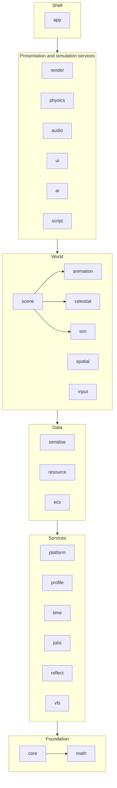

# Architecture

How the engine is laid out, how its parts depend on each other, and the handful of
architectural rules that are expensive to change later. The [scope](scope.md) says what is
built; the [roadmap](roadmap.md) says in what order.

## Repository layout

The layout as built. Phase 1 of the roadmap moved the existing code into it (`core`,
`animation`, `render`, `app`, the executables under `tools/` and `samples/`) and stubbed every
other in-scope module: each has its directory, target, public headers and a passing test, and
every function that needs an algorithm throws `JETTISON_NOT_IMPLEMENTED()` until its phase.

```
jettison/
├── CLAUDE.md                   orientation for Claude Code sessions; points into these documents
├── .claude/                    Claude Code's project settings and hooks (formats edited sources)
├── .mcp.json                   MCP servers for Claude Code: Context7, for library documentation
├── CMakeLists.txt              project, warnings target, shader helper, package export
├── CMakePresets.json
├── cmake/                      jettison_add_module(), JettisonConfig.cmake.in
├── assets/                     sample and test content (Git LFS), staged beside executables;
│                               the sample game's goods and markets (defs/) and screens (ui/)
├── docs/                       this documentation
├── scripts/                    gates: ci.sh, format-check.sh, smoke-test.sh, tidy.sh
└── source/
    ├── external/               every third-party dependency, pinned, FetchContent
    ├── engine/
    │   ├── core/               assert, log, config, string IDs, handles, hashing
    │   ├── math/               GLM additions: bounds, rays, splines, easing, RNG, noise, orbits
    │   ├── platform/           OS layer: paths, crash handling, dynamic queries
    │   ├── profile/            Tracy wrapper (compiled out when disabled)
    │   ├── time/               clocks, fixed-step accumulator, time compression, calendar
    │   ├── jobs/               I/O worker now; job system later
    │   ├── reflect/            EnTT meta registration helpers
    │   ├── serialise/          YAML and binary archives over reflection
    │   ├── vfs/                virtual file system, mounts, packs
    │   ├── resource/           handles, async load, reference counts, hot reload
    │   ├── ecs/                scheduler, tick phases, events, FSM utility
    │   ├── animation/          glTF rigs and clip player, TRS tracks, mechanical skins
    │   ├── sim/                simulation world, command queue, snapshots, definition registry
    │   ├── celestial/          celestial clock, on-rails orbits, system frames, the jump-lane graph
    │   ├── scene/              presentation scene, its file, update systems, camera rigs; layers
    │   ├── spatial/            per-system spatial index, queries
    │   ├── input/              actions, contexts, bindings, devices
    │   ├── render/             renderer interface, frame, cameras, materials, debug draw
    │   │   └── src/vulkan/     the Vulkan backend, private, behind IRenderer.h
    │   ├── physics/            Jolt integration
    │   ├── audio/              miniaudio integration
    │   ├── ui/                 RmlUi integration and data binding, drawn into render's overlay
    │   │   └── imgui/          ImGui backend, console, dev tools
    │   ├── ai/                 utility AI, behaviour trees, graph pathfinding, steering
    │   ├── script/             Wasm host
    │   └── app/                Application shell, argument parsing, smoke sequence
    ├── tools/
    │   └── flotsam/            editor
    ├── samples/
    │   └── jetsam/             runtime viewer: the engine with no game
    └── test/                   the render smoke harness (test executable)
```

Each engine module has the same shape:

```
engine/<module>/
├── CMakeLists.txt              jettison_add_module(<module> DEPENDS ...)
├── include/jettison/<module>/  public headers: #include <jettison/<module>/Thing.h>
├── src/                        implementation and private headers
└── tests/                      doctest unit tests, registered with CTest
```

Each module is a static library `jettison_<module>`, aliased `Jettison::<Module>`, in namespace
`Jettison::<Module>`, made by `jettison_add_module` (`cmake/JettisonModule.cmake`). The helper
refuses a `DEPENDS` edge on a module that has not been added yet, so the order of
`add_subdirectory` calls in `source/engine/CMakeLists.txt` is the dependency graph's topological
order, and an upward or sideways edge fails the configure rather than linking quietly.

### Parked code

Nothing is parked today. Phase 1 parked the scene graph in `render`, where it loaded models through
the device and handed the renderer `Model` pointers while the renderer read its camera and lights
back out of its registry, a cycle. Phase 6a took it out: the scene is `engine/scene`, names its
models by virtual path, and loads each model's rig through the resource manager; the renderer
resolves the same paths to device models through its own cache, behind `IRenderer.h`. The rig is
read from the glTF file by `animation`, which moved to the World tier, below `scene`, so the clip
player the scene drives is no longer a sibling edge of `render`'s.

The executables keep the names they already have: **Flotsam** is the editor, **Jetsam** is the
runtime, now a sample viewer because the game has its own repository, and **render_test** is
the render smoke harness that the gate runs. It was `test` until CTest reserved that name (see
[build and gates](build-and-gates.md#unit-tests)).

### Consumption by the game repository

The game uses `FetchContent` with a pinned commit and links `Jettison::Engine`, an interface
target over every module, or the `Jettison::<Module>` targets it needs. The install export
(`JettisonTargets.cmake`, `JettisonConfig.cmake`, behind `JETTISON_INSTALL`) exists for a later
`find_package(Jettison)` consumer; [build and gates](build-and-gates.md#consuming-the-engine) says
what it still needs. Public headers are the
`include/jettison/` trees only; anything under `src/` is private. Third-party headers that
appear in public engine headers (GLM, EnTT) are public dependencies; the rest (Vulkan, Jolt,
RmlUi, miniaudio) stay private where the interface allows it, so the game does not compile
against the backends.

## Module dependencies

Dependencies point downward only. A module depends on modules in lower tiers, never on its own
tier's siblings unless the edge is listed, and never upward. A cycle is a build failure, not a
style question.



The World tier's listed sibling edges are `scene`'s: on `animation`, whose clip players its update
drives, on `celestial`, whose star systems its system scenes are built from, and on `sim`, whose
snapshots its traffic layer is made from (6b). The scene reads `Sim::Snapshot` alone, never the
world, and nothing in `sim` sees the scene. `render` depends on
`scene` from the tier above, and reads it; the scene names no device. The Presentation tier's listed
sibling edge is `ui`'s on `render` (8b): the UI draws into `Render::Overlay`, a plain draw list in
render's public headers, and decodes a document's images with render's CPU texture decoder; it
includes no Vulkan header and the renderer no RmlUi one.

The rule that matters most: **`sim`, `celestial`, `spatial`, `physics` and `ai` never include
`render`, `ui`, `audio` or `input`**. Simulation code that can see the renderer eventually reads
from it, and then it is no longer deterministic or testable without a GPU.

## Simulation and presentation

The game is single-player, but the simulation runs as if it were a local server.

- **The simulation world** owns authoritative state in its own `entt::registry`: ships, cargo,
  stations, markets, orders, positions in double precision. It advances in fixed steps on
  simulation time, which is real time multiplied by the time-compression factor. It is
  deterministic: the same save and the same command stream produce the same state in every
  build of the engine, Debug and Release alike. It is everything a save contains.
- **The presentation world** owns what is drawn and heard, in its own registry: render proxies,
  interpolated float transforms, cameras, particles, UI state. It runs once per frame at the
  display rate and may be rebuilt from the simulation at any time.
- **Commands** flow from presentation to simulation through a queue: "buy 40 units at
  1,200", "plot route", "set throttle". The simulation applies them at the start of a step.
  The queue is the seam for replays, automated tests and any later networking.
- **Snapshots and events** flow back: transforms for interpolation, and events such as
  "docked", "trade filled" or "contact" that presentation turns into sound, effects and UI.

A star system's presentation is a **system scene** (`scene/SystemScene.h`, 6b), built onto the
scene from the system description, around whatever a scene file authored, and from the
simulation's snapshots. Its content is in **layers**: the environment (bodies, stations, the sky:
what the system places), traffic (the simulation's entities, through proxies a factory the game
supplies makes) and effects (markers, beacons). An entity's layer is its own or its parent's, and a
hidden layer is neither drawn nor lights the scene; the sun and the sky are always the system's.
What the system scene builds is never saved, so a scene file is only ever what its author wrote.

The simulation is the whole **galaxy's**, and presentation shows one system of it. Each entity's
`Sim::InSystem` names the system whose frame its `Transform` is in (the system's name hashed, so a
save keeps it), and an entity on a jump lane is in none. Snapshots carry it; a system scene's traffic
layer is the entities in its own system, and no interpolation runs across a change of system, whose
two positions are in different frames.

### Jumps

The galaxy (`celestial/Galaxy.h`, `assets/systems/galaxy.yaml`) is a graph: each system by name,
with its system file and, where one is authored, a scene file; each lane joining a jump point in one
system to a jump point in another, travelled both ways, with a transit time in simulation seconds.
A jump point is the end of one lane, so a gate says where it leads. Each system's file is checked
against the lanes that end in it when it is loaded.

A jump replaces the system shown with another, behind an effect, without the frame loop stalling or
the simulation stopping (`scene/JumpTransition.h`):

1. The effect rises, a fade to black in the output pass, mixed in after tonemapping and under the
   UI. Meanwhile the destination's system file and scene file are read on the I/O worker.
2. Once they are read they are parsed and checked on the main thread, since the archives read the
   reflection tables, which a registration on the main thread may be writing to
   ([decided](roadmap.md#decided)). A destination that fails is abandoned before anything is
   touched, and the effect lifts on the system the jump left.
3. With the effect covering the frame, the scene is replaced (`SceneFile`, already read and
   checked, or the system alone) and its system scene built.
4. What it draws streams in through the resource manager as always, and the effect is held until
   nothing is loading for the first time (`ResourceManager::Loading`), judged once a frame has been
   drawn of it, since the renderer asks for a model when it first draws it, or for 8 s at most.
5. The effect lifts.

The effect runs in real seconds, the same at any time compression. The simulation steps through
every frame of it, and the stepper is not resynced: the world did not change, and the new system's
traffic is made from the same snapshots.

### Physics

Physics is part of the simulation's state, not a service beside it (`physics/PhysicsWorld.h`, 7a).
`PhysicsWorld::Attach` gives the world a `Sim::WorldService`: state the world keeps outside its
registry, which it owns, saves after the components and hashes with them, and loads in two halves,
read against the registry being loaded and then committed with it, so a save that does not fit
leaves world and physics as they were. A body is an entity with a `Physics::Body` (its kind, a
shape by name, its mass and material), a `Sim::Transform` and a `Sim::InSystem`; the game sees no
Jolt type. Shapes are definitions (`Physics::ShapeDefinition`, through the definition registry, so
a mod can replace one), built into Jolt shapes when they are defined, and a save names them.

Each **frame** of each star system with bodies is a Jolt world of its own (7b), made with its first
body and gone with its last (0.7 MB at the default capacities of 8,192 bodies). A frame is the
system's own, at rest at the primary, or the local frame of one of its bodies (`Physics::LocalFrame`,
a station or a planet): it moves with the body on its orbit and does not turn with it, as the
[local frame](#coordinate-frames-and-units) does. In it, Jolt's positions are metres from the body
and its velocities are relative to the body's motion; `Sim::Transform` stays in the system frame,
and `Physics::Velocity` is relative to the body's frame. Every system's positions are metres from its
own primary, so bodies of two systems at the same coordinates must never meet, and only bodies in one
frame meet each other. A body on a jump lane is in none; one that changes frame is made again in the
other's, its velocity carried across.

Frames are what let a ship meet a station at all. Highport moves at 30 km/s about the star, 500 m a
step. Jolt sweeps a fast body along its motion to find what it would pass through, but it finds what
to sweep against with that motion's absolute length, so a ship and a station both 500 m a step along
their orbit never find each other however slowly they close; its broadphase keeps bounds in floats,
8 km apart 150 million kilometres from the primary; and a float velocity at 30 km/s is 4 mm/s
between values. In the station's frame each of these is metres and metres a second
([decided](roadmap.md#decided)).

Star systems are definitions in physics, as shapes are (`PhysicsWorld::DefineStarSystem`): the shell
defines every system its galaxy lists. They put an entity on rails (`Physics::OnRails`), placing its
`Transform` where its celestial body is as each step ends, which is how a station's kinematic body
follows its orbit, and they give dynamic bodies their system's gravity, each body with a
gravitational parameter pulling as a point mass. Orbits stay on rails, so gravity moves only dynamic
bodies; a ship beside a station falls round the planet with it, as the station's rails carry it,
and is left with the tide. A frame's change of speed between two steps is taken off every dynamic
body in it, and within a station's frame what is left of the planet's 8.6 m/s² is the tide's few
ten-thousandths: a ship let drift beside Highport stays within 5 mm of where it was for a minute.

The flight model runs before physics, as the system `flight` (`physics/Flight.h`). A ship is a
dynamic body with `Physics::Thrusters` (accelerations along and about its axes, so its handling does
not change with its mass, and with flight assist the speed and rates it is held to) and
`Physics::FlightControls` (demands from -1 to 1, the assist, and the entity its velocity is taken
against), which the command `Physics::SetFlightControls` sets. With assist, a demand is a velocity
relative to the reference and a rate of turn, approached as fast as the thrusters allow; without, it
is an acceleration and the ship coasts. It changes the ship's `Velocity`, and physics then steps it,
so a ship flown into a station meets it as any body would. The system `physics` runs one fixed step:

1. Entities on rails are put where their bodies are as the step ends.
2. Bodies are made for entities that gained what makes one, and removed for those that lost it,
   changed system or frame or changed their `Body` (made again, with the velocity they had). Every
   entity on rails and every body to be made is checked first, and one that cannot be is refused
   before anything changes. A static body is in the system's frame: what a frame carries is
   kinematic.
3. What the game wrote is applied. A static or dynamic body whose `Transform` differs from where
   physics last placed it is put there; a dynamic body whose `Physics::Velocity` was written takes
   it; a kinematic body is moved towards its `Transform` over the step, so it pushes what it meets
   with the velocity that implies. Each dynamic body then gains its system's gravity over the step,
   from where the bodies are as it begins, less its frame's change of speed.
4. Each frame's world steps, in order of system and frame, on the simulation's one thread. A body
   marked `continuous` (the piloted ship) is swept rather than placed, so it cannot pass through a
   panel between two steps.
5. Each moving body's `Velocity`, and each dynamic body's `Transform`, are written back, which
   presentation interpolates like any other entity's.
6. What began and ended touching is worked out, for the simulation to read (below).

**Contacts** are the simulation's to read, not presentation's (7c, [decided](roadmap.md#decided)):
`PhysicsWorld::Contacts` is what the last step began and ended, in order of pair, and `Touching`
what touches a body now. A beginning carries where the two met, the normal from the first towards
the second and the speed they closed at, which is what a game judges an impact's damage or sound
by; a game's system ordered `after` `physics` reads the step's, and one before it the last step's.
Both are saved with the world, so either reads the same after a load. Two bodies touch while Jolt's
contact cache holds a contact between them once the step is over, which begins a couple of
centimetres before they meet; a body asleep on another still touches it, though Jolt drops a
sleeping body's contacts. A body removed, or made again, ends what it touched in the step that
removes it.

A **sensor** is a body marked `sensor` (`Physics::Body`): it meets nothing, reports the dynamic
bodies that enter and leave it as contacts, and never sleeps, so it still sees a ship that has come
to rest inside it. A docking zone is one, kinematic and on rails at its place on the station
(`Physics::OnRails::offset`), in the station's frame. What docking means is a game's: the shell
docks a ship that is in a station's port and moving under 2 m/s relative to it (`app/src/Docking.h`,
the simulation system `shell.docking`), and raises `ShipDocked` and `ShipUndocked` for presentation.

**Casts** (`CastRay`, `CastShape`) find the first body along a ray or a convex shape swept along a
direction, across every frame of a system, each cast in the frame's own coordinates; sensors and the
caster's own body are left out unless asked for. They read the world as the last step left it, and
are the simulation's to call, as steering will (9b). **Picking** is a command, since presentation
never reads the simulation's state: a click is a `Physics::Pick`, the ray through the cursor
(`Render::ScreenRay`) from the camera presentation drew, and the next step answers it with a
`Physics::Picked` event, a frame later. Presentation shows the world half a step behind on average,
and a station's frame moves 500 m a step about the star, so the pick carries the time it was drawn
at, and each frame is placed where its body was then (`CastOptions::framesAt`)
([decided](roadmap.md#decided)).

Jolt is deterministic across builds (`CROSS_PLATFORM_DETERMINISTIC`) given the same calls in the
same order and the same body identifiers. The calls are made in entity order. The identifiers are
the engine's, not Jolt's free list, whose order is history a save does not hold: the lowest free
index, with a sequence number per index that a save keeps. A save holds each world's frame (where it
was and how fast it moved over the last step), each body's record (what it was made from and last
placed at) and Jolt's own state, positions, velocities, sleep and the contact cache each step
warm-starts from; a load makes the same bodies with the same identifiers and restores it, and steps
on to the same bytes as the world saved. The physics suite's recorded runs, every kind of body and
shape among them in one and, in the other, a ship flown through a station's docking zone into its
hub as the station goes round its orbit, at rest in the zone and picked, are pinned to state hashes
in Debug, Release and under the sanitisers. Jolt asserts in a Debug tree through the
engine's assertions, and its profiler zones are Tracy's.

The piloted ship crosses this boundary every frame (7b): the flight context's actions become a
`SetFlightControls` in the commands phase when a control moves, the flight model and Jolt advance in
simulation steps, and the ship's proxy in the traffic layer interpolates between the last two, which
the pilot camera's chase and cockpit rigs follow (`Scene::PilotCameraComponent`). When time
compression is above 1×, piloting is suspended, as it is in every game of the genre, and the assist
holds the ship. Compression is refused near stations and other ships for the same reason, by the
game.

### Persistence

A save game (`sim/SaveGame.h`, 8a) is one file in its own format, `Jettison.Save`, holding parts
that are each versioned on their own: its `SaveInfo` (the player's name for it, the engine version
that wrote it, when, the world's step and time, the galaxy's file and the system shown), the world's
save (`SimWorld::Save`, `Jettison.World`), and the game's sections, each a binary archive in a format
of the game's that the save holds and does not read: what a save contains beyond the engine's state
is the game's ([scope](scope.md)). The info comes first, so a list of saves reads no further. A
change to the world's layout is a step in the world's migrations and leaves the save game's format
and the game's sections alone.

Every versioned format reads its earlier versions through a chain of migrations
(`serialise/Migration.h`), a step from each version to the next, written once, when its version is
current, and never changed after. A binary step edits the archive as a document: its table of names,
through which a field, a component, a command or an enumerator is renamed everywhere it is used, and
its payload, which the world's step from version 1 to 2 appends its services' empty state to. A
change inside a value needs the types that wrote it, and a step that has them reads the old version
with them and writes the new. A YAML step edits the parsed tree, keeping the lines a mistake is
reported at. Definitions migrate the same way ([decided](roadmap.md#decided)). A version newer than
the build's, or one the chain does not reach, is refused by name before any step runs, and every
read leaves what it was reading into as it was when the data does not fit.

What a build wrote, every later build loads: the suites keep saves written by earlier versions as
fixtures (`sim/tests/data`), never regenerated. `world-v1.save` was written by the phase 6d build
(commit `a5d0c83`) and loads, through the world's migration, into the state this build reaches at
the same step; `save-v1.save` is the save game's first version, written by phase 8a's.

A save is written through the VFS to the user mount, the user's data directory
(`~/.local/share/jettison/saves/<name>.save`), whole and durably (`Core::WriteFileDurably`): to a
partial file beside it, flushed to the disk, renamed over it, and the directory flushed, so a crash
or a power cut leaves the save before it, and a save reported written is on the disk. Settings and
bindings are apart from saves, in the configuration directory (`~/.config/jettison/settings.yaml`),
written the same way whenever the player changes one, so loading a save changes none of them. A
binding's joystick is a number the player's bindings name after the device it was bound as
(`input/Joysticks.h`), by its GUID, so it follows the device rather than the slot it is plugged into.

Loading replaces the world only once the whole save has read: the info, the galaxy (a save of
another galaxy is refused), the game's sections and then the world, which itself commits only at the
end. Presentation then resynchronises its snapshots and makes the traffic layer's proxies again
(`SystemScene::ResetTraffic`), since a loaded world's identifiers may name other entities than they
did.

## UI

The game UI is RmlUi behind `ui/UiSystem.h` (8b), which names no RmlUi type, so the game and the
shell include none. Documents, stylesheets, templates, fonts and images are read through the VFS
(the UI's file interface), so a mod restyles a screen by shipping its stylesheet over the base one;
a stylesheet is read once a run, so mods are mounted before the UI is made. Its messages go to the
log under `ui`, and the warnings and errors among them are counted, which the render test holds at
none. Fonts are FreeType's, one build that RmlUi's font engine and ImGui's rasteriser
(`imgui_freetype`) both link. The dev tools and the console stay on ImGui.

**Drawing.** What RmlUi draws is recorded into a `Render::Overlay` (`render/Overlay.h`): vertices in
the frame's pixels, colours encoded sRGB with alpha premultiplied as RmlUi gives them, indices, and
draws with a translation, a scissor and an optional transform; and textures (a font's atlas, an
image), held by identifiers never given out twice. RmlUi's compiled geometry is kept by the UI and
copied into the overlay each time it is drawn, a few thousand vertices for the market screen, which
the renderer writes into the frame slot's buffers. The renderer draws the overlay in the output pass,
after the tonemap and the jump's fade and before the dev tools, with the `overlay` program
(`vulkan/OverlayRenderer.h`); it uploads a texture the first time a draw names it and releases its
copy once the overlay no longer holds it and the frames in flight are done with it. Colours are
multiplied and filtered as encoded, as a browser does; on an sRGB swapchain the fragment is decoded
before it is written, so blending is in linear light, where a browser blends encoded values. Clip
masks, layers, filters and shaders are left to RmlUi's defaults, which draw nothing for them
([carried forward](roadmap.md#carried-forward)).

**Data.** A document reads the game's data through a data model (`ui/DataModel.h`): named
variables, bound by address to values presentation owns, and named events. A variable is any type
registered with Reflect, read through the reflection tables in place: a field's address is found
from its member pointer, which `Reflect::TypeBuilder::Field` records (`Reflect::AddressOf`), a
`std::vector` by its elements, and a leaf (a bool, an integer, a float, a string, a registered
enumeration by its name) as a value, so binding a type needs nothing beyond its registration, and a
type that cannot be shown is refused as it is bound. The values are presentation's copies of what
the simulation's snapshots carry: a world shows a component to presentation with
`SimWorld::ShowInSnapshots<T>()`, after which every snapshot holds every entity's copy of it
(`Snapshot::Components<T>`, `Snapshot::Get<T>`). Presentation builds a screen's data from a snapshot
when a step brings a new one, and tells the model only when what it shows has changed; an event a
document raises becomes a command the next step applies, and the step's answer, an event, is shown
in turn. Nothing in the UI reads the world.

**Input.** The shell feeds the UI the window's events in order, from GLFW callbacks chained over the
ImGui backend's: the cursor each frame, buttons, the wheel, keys and text. The dev tools come first:
what ImGui wants, the UI is not given. A document is the frame's size and lets the mouse through but
for its panels (`pointer-events`), so a click on a panel is the UI's (`UiSystem::WantsMouse`) and is
not a pick or a camera drag, and a click beside it is.

## Audio

The game's sound is miniaudio behind `audio/AudioSystem.h` (8c), which names no miniaudio type.
Sounds are read through the VFS (miniaudio's file callbacks over `Vfs::FileSystem`, a file read whole
as it is opened, since the VFS has no streaming read), so a mod replaces a sound by shipping its file
over the base one. miniaudio decodes WAV, FLAC and MP3 itself; its Vorbis and Opus decoders, system
libraries, are off. Its messages go to the log under `audio`, a device's details at debug, and the
warnings and errors among them, with every sound that would not play, are counted, which the render
test holds at none.

**Buses.** Five sound groups: master, and under it music, effects, UI and voice. A bus's volume
scales what plays on it, and is eased over a few milliseconds rather than stepped, so a change does
not click. The shell keeps the volumes in the settings (`audio.master`, `audio.music`, ...), set by
the console's `volume`.

**Sources.** A sound is played flat (the UI's, heard alike wherever the listener is), positioned (in
the system frame in double precision, falling off with its distance as `minDistance / (minDistance +
rolloff × (distance − minDistance))`, held beyond `maxDistance`), or as music (streamed: decoded a
page at a time as it plays, on the music bus, one piece at a time). A short sound is decoded whole as
it starts and shared by every play of it at once. The listener is the active camera. Audio is
listener-relative as rendering is camera-relative: each frame `AudioSystem::Update` places every
positioned source at its position less the listener's, as a float, with the listener at miniaudio's
origin, so a station a hundred million kilometres from the primary is heard as precisely as one
beside it. Doppler is off, since nothing reports velocities. A source is a generational handle: one
that ended names nothing. `Audio::SoundSources` plays the presentation world's `SoundComponent`s, a
looping sound on an entity heard from its world transform, started as the entity gains the
component and stopped as it loses it or goes; the shell puts the station's hum on its station so.

**Events.** What a simulation event sounds like is data: an `Audio::EventSound` definition under
`defs/sounds`, through the definition registry, names the event's type as Reflect has it, a sound, a
bus, a volume, and the event's entity field the sound is placed at, if any. `Audio::EventSounds`
checks every definition against the types Reflect knows as it is made, and refuses one naming an
event or a field that is not there, by the definition's name. The game decides which events reach
it: the shell passes on those whose `ship` field is the player's ship, the screen's answers and the
dock's, and places a sound at an entity where presentation shows it, between the last two steps. A
sound placed at an entity presentation cannot place plays flat rather than not at all.

**Output.** To the machine's playback device, or to miniaudio's null backend when a device will not
open, or when asked (`--no-sound`, and always in the headless run): a device that plays to nowhere
at a sound card's pace, so sounds start and end as they would be heard, and the sound system is
never touched. With no device at all, the tests mix the output on their own thread (`Mix`), with the
decoding jobs run there too, so what they hear is the same every run. With a device, miniaudio
mixes on its device's thread and decodes streamed music on a job thread of its own.

## Coordinate frames and units

SI units: metres, seconds, kilograms, radians. Right-handed, Y-up, as the scene format already
is (`CameraComponent` documents it).

| Frame | Precision | Origin | Used by |
|---|---|---|---|
| Galaxy | graph | none: systems are nodes, jump lanes are edges (`celestial/Galaxy.h`) | jumps, route planning, the galaxy map |
| System | `double` | the system's barycentre or primary star | simulation positions, orbits, Jolt (`JPH_DOUBLE_PRECISION`) |
| Local | `double` | a station or planet | physics in the body's frame (`Physics::LocalFrame`), docking approaches, station-relative traffic, the sun's shadow grid (`CameraView::frameOrigin`) |
| Render | `float` | the camera | everything submitted to the GPU |

Rendering is **camera-relative**: each frame subtracts the camera's double-precision position
from every object's before converting to float, so precision is always best where the player is
looking. This is the floating origin. It is never visible to simulation code. Depth is
**reversed-Z with an infinite far plane**, so a cockpit at half a metre and a planet at
forty thousand kilometres share a depth buffer. The existing `GLM_FORCE_DEPTH_ZERO_TO_ONE`
setting is the prerequisite for that.

## Rendering: clustered forward

The renderer is a **clustered forward** renderer (decided 2026-11-10, see the
[roadmap](roadmap.md#decided)). Lights are assigned to a 3D grid of view-space clusters by a
compute pass. Each surface is then shaded once, in its own material program, from the lights
listed for the cluster it falls in. There is no G-buffer. It was chosen over deferred shading
for what this game draws:

- **Material variety.** Hulls, planets, atmosphere shells, glass, emissive panels and engine
  plumes are each their own program. Forward shading puts no common G-buffer layout between them.
- **Transparency.** Canopies, station windows, particles and exhaust are lit by the same lights
  through the same code. A deferred renderer would still need a forward path for them.
- **Anti-aliasing.** MSAA works directly on the HDR target. Thin struts, antennae and distant
  ships against black space are where aliasing shows most.
- **Bandwidth.** No fat render targets, which matters on lavapipe, where the gate runs, and on
  laptops.
- **Many small lights.** Floodlights, docking bay lights, beacons and navigation lights add up to
  hundreds per station, but few of them reach any one pixel. Clustering keeps the cost per
  fragment at the lights that actually reach it.

### The frame

Each step is a node in the declared pass list (phase 4), and compute nodes sit beside graphics
nodes in it:

1. **Collect and cull** (CPU). Every mesh's bounds are taken into render space in double
   precision, before anything becomes a float (`render/Culling.h`). Its level of detail is the
   coarsest whose geometric error, projected, covers under a pixel. The view keeps what is inside
   the frustum and not wholly behind a planet's horizon (a celestial body drawn as a sphere, shrunk
   by its level's error so the sphere is inside the mesh); each cascade keeps the casters whose
   sphere reaches the prism its map shadows. What is kept is batched (`render/DrawBatches.h`): draws
   sharing a model, a level and a material are one instanced draw, the batches front to back, and
   every instance's transform goes into this frame's instance buffer. Active lights are converted
   to camera-relative float and written to a storage buffer for this frame in flight (5c); one
   whose reach ends short of the cluster range's far end, is outside the frustum, or is wholly
   behind a planet is left out (5e), since every surface it could light is too. A skinned draw's
   pose can leave its model's bounds, so it is never culled.
2. **Shadows** (graphics, `sun-shadows`, 5d). The sun's four cascades, each a depth-only rendering
   of its casters into one layer of the shadow map; see [sun shadows](#sun-shadows). A scene with no
   sun clears them and draws nothing, so the plan is the same either way. Spot and point shadows,
   when they arrive, render into an atlas, and each light's record carries its atlas slot.
3. **Depth prepass** (graphics, `depth-prepass`, 5e). The view's batches, depth only, laid down for
   the opaque pass to test against with greater-or-equal, so each pixel is shaded once. Measured in
   5e it cost more than it saved, on hardware and on lavapipe, because the batches are front to
   back already; it is kept, and off (`Renderer::SetDepthPrepass`), as the place screen-space
   ambient occlusion will take its depth and normals from (phase 10c). Off, the node records
   nothing and the opaque pass clears the depth, under the same plan.
4. **Cluster bounds** (compute, `cluster_bounds`, 5c). The view-space bounds of every cluster.
   They are rebuilt only in a frame whose projection, viewport or cluster range differs from the
   one they were built for; the pass's barriers are recorded either way, and the buffer keeps
   its contents between frames.
5. **Light assignment** (compute, `cluster_lights`, 5c). Each light's sphere, and a spot's cone,
   is tested against each cluster's bounds, one invocation per cluster. The output is an offset
   and a count per cluster into one global light-index list, whose first word is the allocator:
   a transfer pass zeroes it at the start of the frame, and each cluster reserves its share with
   one atomic add. The list holds 32 entries per cluster on average, a budget for the frame
   rather than a cap on any one cluster.
6. **Opaque** (graphics, into the MSAA HDR target). A fragment finds its cluster from its screen
   position and view distance, loops over that cluster's lights, then adds the sun, shadowed through
   its cascade, and image-based lighting.
7. **Sky.** Drawn last in the opaque pass's rendering rather than as a node of its own (5b): one
   full-screen triangle at depth 0, the far end of the reversed-Z range, tested against the depth
   buffer so it shades only what no surface covered. A node of its own would have to store the
   multisampled target and load it again, which the opaque pass keeps on chip.
8. **Transparent**, sorted back to front, using the same cluster lookup (phase 10).
9. **Resolve, bloom, tonemap** into the sRGB swapchain, then the game UI's overlay and the dev tools
   over it ([UI](#ui)). The tonemapper is Khronos PBR
   Neutral (5b), applied after exposure in the output pass: a base colour under white light of
   intensity one shows as authored, and highlights compress towards white without changing hue.
10. **Cluster readback** (transfer, 5c). The grid and the index list copied out for the cluster
    check, which compares them with a CPU reference once the frame's fence is waited on. It is in
    every frame's plan and records its copies only when the check is on, so the plan the gate's
    synchronization validation runs is the plan every run has.

### The environment

A star system's sky is drawn behind the scene and is also what the scene is lit by
(`render/src/vulkan/Environment.h`). Its starfield, galactic band and nebula are procedural, from the
scene's `SkyComponent` and a seed, and `sky.glsl` is the one function that draws them, both in the
frame and into a cube map. When a scene loads or its sky changes, that capture is baked into the
image-based lighting: GGX-prefiltered levels of the specular cube, one roughness each, and a
cosine-weighted irradiance cube, both by filtered importance sampling from the capture's mip
chain. The split sum's lookup table depends only on the BRDF and is made once. The bake is a run of
fragment passes on the graphics queue, recorded outside the frame's pass list as an upload is, and
it waits for the queue; the cubes it replaces are freed when it returns, and the frame sets are
rewritten to name the new ones. The sun is not in the capture: it lights the scene as the
directional light, and a disc in the environment would light it twice. Nor are the planets, so a
planet's reflected light is missing until a later phase adds it.

### The grid and the infinite far plane

The grid is screen tiles times depth slices, exponential in view distance: 32 × 18 × 48, tuned in
5e against a station of 265 lights (`scripts/make-light-budget-scene.py`), where it shaded the
opaque pass a fifth faster than the 16 × 9 × 24 it started at, on hardware and on lavapipe alike
([decided](roadmap.md#decided)). Depth is reversed-Z with an infinite far plane,
so the slices are computed from view-space distance, never from the depth buffer. They span the
near plane to a finite **cluster range**. Past it, no local light is assigned, and a surface is lit
by the sun, image-based lighting and its own emission. A station's lights seen from tens of
kilometres away are emissive sprites, not lights. The cluster range is a setting
(`Renderer::SetClusterRange`), chosen with the light budget: 2 km, which 5e kept, its lights all
being within 200 m of the camera.

The grid's arithmetic is one file, `shaders/include/clusters.glsl`: the slices, the bounds, the
light-against-cluster tests and the windowed falloff. Like `brdf.glsl` it is written in the
subset of GLSL that GLM also compiles, and `render/Clusters.h` is that source compiled as C++.
The CPU reference built on it checks the GPU's assignment: in the headless render test every
frame's grid is read back and compared with it, cluster by cluster, as sets with a rounding
tolerance of a hundred-thousandth of the distances involved. The lights-per-cluster heat map (F3)
shows the same grid on screen, in place of the shaded surfaces.

### Sun shadows

The sun is shadowed by four cascaded shadow maps (5d), one layer each of a 2048 × 2048
reversed-depth array image shared by the frames in flight. The view is cut into four slices by
the practical split scheme, blending even and logarithmic splits (0.8 towards logarithmic), from
the near plane to the **shadow distance** (`Renderer::SetShadowDistance`, 400 m to start with,
tuned in 5e). Past it the sun casts no shadow. `render/Shadows.h` fits the cascades on the CPU each
frame, and `shaders/include/shadows.glsl`, which it compiles as C++ as `Clusters.h` does
`clusters.glsl`, is what the lighting include selects and looks up through.

- **Stable by construction.** Each cascade's map covers the bounding sphere of its slice of the
  view, plus a border of four texels, so its texel size depends only on the projection and turning
  the camera never changes it. The map's centre is snapped to whole texels in the sun's frame,
  whose axes come from the system's, never the camera's. The snap is measured from the camera's
  **frame origin** (`CameraView::frameOrigin`): the station or body an orbit camera circles, or the
  system's origin. A station moves at kilometres a second through the system, so a grid fixed to
  the system would slide under it by a fraction of a texel every frame and its shadows' edges would
  crawl; fixed to the station, a still caster lands on the same texels whatever the camera does.
  The snap is taken in double precision, and only the matrix from render space to the map becomes
  a float.
- **Casters between the sun and a map still shadow it.** The shadow pass clamps depth rather than
  clipping it (`depthClamp`, a required device feature), so whatever lies sunwards of a cascade's
  sphere, up to and including a planet, is drawn at the map's sun side.
- **Acne** is kept off by a slope-scaled depth bias in the shadow pass and by moving each receiver
  along its normal before the lookup, by one and a half texels of its cascade at a surface edge-on
  to the sun.
- **Lookup.** A fragment selects its cascade by view depth, takes nine bilinear comparison taps a
  texel apart (a 4 × 4 texel neighbourhood), and across the last tenth of each cascade blends into
  the next, or out of shadow past the last. Each cascade is fitted from the start of the previous
  one's band, so the blend's second lookup lands inside its map too.
- **Debug draw shows the cascades** (F4): each surface in its cascade's colour, lit by the sun
  alone and shadowed.

### The budget

The frame's GPU time is measured, not guessed: `GpuProfiler` writes a timestamp either side of
every declared pass, in a query pool per frame in flight, and reads them back once the frame's fence
is waited on; with Tracy compiled in, the same spans are GPU zones named after the passes. The dev
tools' Renderer panel shows the last and mean time of each pass and the frame's counts, and
`render_test --benchmark <frames>` prints them after a warm-up ([build and
gates](build-and-gates.md#benchmark)). The budgets, for what phase 5 draws:

| Device | Frame | Budget | `orbit.yaml` | With 265 lights |
|---|---|---|---|---|
| RTX 5060 Ti | 1248 × 1358 (the compositor's tile) | 4 ms, a quarter of a 60 Hz frame | 0.30 ms | 0.47 ms |
| lavapipe, 24 threads | 640 × 480 | 50 ms | 33 ms | 46 ms |

A quarter on hardware leaves the rest of the frame for phase 10's atmosphere, transparency and
post-processing and the UI. Lavapipe's budget is the gate's: it keeps a smoke run in the tens of
seconds. Neither is enforced by the gate, whose runners' times vary too much to fail on; a change
that matters to them is measured with the benchmark and recorded. Two measurements in 5e shaped the
frame. Lavapipe decodes BC7 in software at every texel fetch, and the orbit scene's opaque pass took
469 ms in BC7 and 23 ms in RGBA8, so a CPU device is given RGBA8. And the planet, drawn into two
cascades whole, was most of the shadow pass until casters were culled exactly against each map's
prism: 15.5 ms to 4.2 ms on lavapipe, most of what is left being the four 2048² clears.

### Rules that follow

- **Every local light has a finite range.** Falloff is inverse-square, windowed to reach zero at
  that range ((1 - (d/r)^4)^2 / d^2), so culling a light against a cluster is exact.
  `LightComponent` is a point or a spot with a range and, for a spot, inner and outer cone
  angles as glTF's `KHR_lights_punctual` has them (5c); a scene file that leaves out a light's
  range is refused.
- **The sun is not a cluster light.** There is one directional light per star system, held in the
  frame constants and shadowed with cascades.
- **Light data lives in storage buffers**, one set per frame in flight, never in the frame UBO.
  The UBO carries only the light count and the grid's parameters.
- **One lighting implementation.** Every lit program includes the shared GLSL for the cluster
  lookup and the BRDF (`lighting.glsl`, over `brdf.glsl`). No material lights itself its own way.
  The BRDF and the tonemapper are written in the subset of GLSL that GLM also compiles, so the
  render suite compiles the shaders' own source as C++ and checks it against reference values.
- **No G-buffer.** Effects that need one stay out, and screen-space reflections are one: they
  would need each pixel's roughness, metalness and a scene colour to march through, and fall back
  to the environment cube at a seam black space makes plain (reconsidered 2026-11-11,
  [decided](roadmap.md#decided)). Screen-space ambient occlusion is in (10c): the depth prepass
  writes view-space normals for it, and it attenuates the image-based light alone. The prepass
  writes object IDs too, for outlines, beside a stencil on the depth target (10c): masks that no
  material program writes.
- **Debug draw shows the grid**, as a lights-per-cluster heat map, so a light budget problem is
  visible rather than inferred.

The Vulkan features this needs are compute shaders and storage buffers, both core since 1.0, so
the headless render test on lavapipe covers every pass.

## Frame and tick structure

`Application::Tick` is a sequence of named phases (`engine/ecs`, `Ecs::kTickPhases`) that
systems register into, each declaring the components it reads and writes:

1. **Input**: poll devices and map them to actions in the active contexts.
2. **Commands**: turn actions and UI into simulation commands: the shell's `shell.flight`, the
   pilot's controls.
3. **Simulation**: zero or more fixed steps (commands, AI, economy, physics, orbits), as the
   accumulator allows.
4. **Sync**: a jump's stage first, which may replace the scene, then copy simulation snapshots into
   presentation and interpolate, and place the bodies on their orbits.
5. **Presentation**: animation, cameras, audio, particles, UI layout.
6. **Render**: cull, collect lights, record the pass list (shadows, cluster light assignment,
   forward passes, post), submit, present. See [rendering](#rendering-clustered-forward).

Declared reads and writes are what let the job system parallelise later without a rewrite.

## Threading

To begin with: the main thread runs everything above, and one I/O worker thread reads files and
decodes assets for `resource`. Vulkan submission stays on the main thread. The job system is
deferred until a profile shows the need (see [scope](scope.md)). When it arrives, it runs whole
systems whose declared access does not conflict, not fine-grained tasks inside them.

## Lifetimes

The existing shell's rule stays: `Application::Init` builds subsystems in dependency order and
`Shutdown` destroys them in reverse. `Shutdown` is idempotent and `noexcept`, and
`~Application` calls it, so a frame that throws still releases the device. GPU objects are
released by explicit `Destroy()` calls in that order, because their lifetimes are bound to the
device's and to frames in flight rather than to C++ scope. Non-GPU types written from now on use
RAII. See [coding standards](coding-standards.md#ownership-and-lifetime).

GPU resources referenced by in-flight command buffers are destroyed only after the frame's
fence. Nothing the renderer caches is keyed on an address the scene owns: models and named
materials are keyed on virtual paths (or a procedural shape's description) and held as resource
handles, and what a reload or a release replaces waits out the frames in flight in a queue
rather than the device idling. `Scene::Generation` says only that the scene's contents were
replaced, so the renderer rebakes the environment and releases what the new contents no longer
draw.

## The engine today

The engine runs today. It renders a glTF scene through Vulkan with validation, and the gate
proves it headlessly. What exists:

- **App shell** (`engine/app`). `RunRenderApplication` is the entry point Flotsam,
  Jetsam and render_test call: it parses argv (`AppArguments.cpp`: `--smoke-test`, `--assets`,
  `--scene`, `--system`, `--galaxy`, `--save-scene`, `--user-dir`, `--no-sound`), builds
  `Application`, and prints any exception the run threw.
  `Application::Init` stages are user (the XDG data and configuration directories, or the ones under
  `--user-dir`, and the settings and bindings read from them), resources (the asset VFS with the
  user's data directory mounted writable over the base, the I/O worker, the resource manager and the
  rig loader), scene (the galaxy, `systems/galaxy.yaml` unless `--galaxy` names another,
  and the system scene of the star system the scene names, read through the VFS, or of the one
  `--system` names with nothing authored), renderer, and window (its title and
  size). The shell holds the renderer as `Render::IRenderer` alone and
  includes no Vulkan header. The resource manager updates once a frame, before the render.
  `RunFrameLoop` runs `Tick` (the scheduler's phases, from input to render) until close.
- **Jumps**. J jumps out through the next of the shown system's lanes, so jumping again tours them;
  the console's `jump <system>` and the Scene panel jump along a lane, or straight to any system.
  The cameras frame the jump point arrived at.
- **Piloting** (7b). The shell plays the game's part: a ship holds station off the dock of the first
  station of the system it opens on, both in the station's frame, the station's collision mesh made
  from the shapes the scene draws it with (1,812 triangles for Highport). P flies it and lets it go,
  V switches between the chase and cockpit cameras, Z the flight assist; the keyboard, the first
  gamepad and joystick 1 (a HOTAS) are bound by default, and a HOTAS's throttle on a joystick of its
  own is a rebind (`app/src/Piloting.h`). An overlay gives the speed and distance from the station. A
  jump leaves the ship behind, since the simulation has no jump of its own yet. The station has a
  docking port (7c), a sensor 40 m on a side before its dock, and the ship docks in it below 2 m/s
  and undocks as it leaves, which the overlay and the log say.
- **Picking** (7c). A left click on the scene, not on a window over it, picks what is under the
  cursor, through a `Physics::Pick` the next step answers; the hit is marked where it was, with the
  surface's normal, and named in an overlay, and the log says what was picked and how far off.
- **Saves and settings** (8a). F5 saves to `quicksave` and F9 loads it; the console's `save
  [name]`, `load [name]` and `saves` do the same by name and list them ([persistence](#persistence)).
  A save holds the world and the shell's own section, which entities are its ship, station and port.
  The console's `bind <context> <action> [bindings...]` rebinds an action, or says what it is bound
  to, and `unbind` puts it back; either writes the settings file, so a rebinding survives a restart.
- **Sound** (8c). Music plays from the start (the console's `music` stops and starts it), the
  station the ship is bound to hums as the camera nears it, the dock's clamps sound from the station
  as the ship docks and undocks, and the market screen's answers sound on the UI bus
  ([audio](#audio)). The console's `volume [bus] [volume]` sets a bus's volume and saves it with the
  settings, or lists them.
- **Smoke sequence**. `SmokeSequence` is the render test's twelve stages (resize, resize,
  minimize, restore, scene reload, pilot from behind, pilot from the seat, pick, save and load,
  trade, jump, settle) as a state
  machine driven once per frame through the callbacks of `SmokeActions`. It names no GLFW, Vulkan or scene type, and its counters (`Passed`,
  `Summary`) are the gate.
- **Scene** (`engine/scene`). An EnTT registry loaded from and saved to YAML
  (`assets/scene/main.yaml`, and `orbit.yaml` at real scale) through `serialise`'s archives, at
  file version 2: a field the file does not know is refused, naming its path and line, and the
  loader and the writer share one check of what a file may say. It has transform, parent,
  world-transform, camera, light (a point or a spot, with a range), sun, sky and mesh components
  (a glTF model by virtual path or a procedural shape - UV, ico or cube sphere, box, ring, cylinder
  - and optionally a material file, by virtual path), celestial bodies placed by the star system
  the scene names (a virtual path too), an orbit camera rig, and the animation module's
  rotation-animation, skeleton and animation-player components, and an entity's layer. It names no
  device: a model mesh holds its rig as a resource handle (`RigComponent`), and `SceneUpdateSystem` poses the model once
  the rig is in, reporting a clip the rig lacks once and posing it at rest. Translations and world
  transforms are doubles. Authored state and runtime state are kept apart: a rotation's angle, a
  clip player's time, a body's `PlacementComponent`, a rig's `CameraPoseComponent` and the rig
  handle are never saved, and the scene suite's round-trip tests hold the writer and the loader
  to that. `SystemScene` builds the rest of a star system's scene around the file (each body it
  does not present, a sky, a camera), places every body on its orbit, and keeps the traffic
  layer's proxies; what it builds is never saved. The scene's layers are shown and hidden through
  `Scene::SetLayerVisible`, which the update applies and the renderer honours.
- **Animation** (`engine/animation`). `Rig` is a model's node hierarchy, skin joints and clips,
  with the clip player (`EvaluateSkin`) that used to be inside `Model`; `Playback.h` advances
  the rotation and clip-player components. `RigLoader.h` reads a rig from a glTF file through
  fastgltf, as a resource decoded on the I/O worker. The renderer reads the same file's geometry
  for its `Model`, so a model file is parsed twice, once for each. Nothing in it touches the
  device, so it is tested without one.
- **Vulkan backend** (`engine/render/src/vulkan`, private), on Vulkan 1.3, behind
  `render/IRenderer.h`: `CreateRenderer` makes the window, the device, the swapchain, the frame
  and the UI, and the interface is what the shell calls. `DeviceContext` holds the
  instance, device, debug-utils messenger (with synchronization validation in Debug), object
  names, and the VMA allocator every buffer and image comes from. It draws with the GPU
  `vulkan/DeviceChoice.h` chooses ([decided](roadmap.md#decided)): of the devices that can present to
  the window and have what the renderer needs, the one with a monitor connected, as its DRM card's
  connectors say, then a discrete GPU over an integrated one over the CPU; `--gpu <name>` asks for
  one, and the log lists every device and why it was or was not chosen. `Swapchain` prefers an sRGB
  format and owns its image views. `Renderer` runs the frame as a declared pass list
  (`render/PassList.h`): the sun's [shadow cascades](#sun-shadows), the depth prepass (off), the
  cluster passes (the index
  list's allocator zeroed by a transfer, then the cluster bounds and the light assignment in
  compute), an opaque pass into a 4× multisampled
  RGBA16F target, which draws the sky after the surfaces and is resolved into a single-sampled
  target as it ends, an output pass that applies exposure and tonemaps on its way to the swapchain
  and draws the UI over it, and the cluster check's copy. The barriers between passes are derived
  from each pass's declared uses once, at start-up, and recorded with dynamic rendering and
  synchronization2. Draws are culled, given a level of detail and batched into instanced draws on
  the CPU before anything is recorded (["The frame"](#the-frame)), and each pass is timed on the GPU
  ([the budget](#the-budget)). The frame constants, skin palette, light list, instance buffer and
  command buffer exist once per frame in flight; the shadow map and the cluster grid's buffers are one set each, shared as the
  render targets are. The device has to offer depth clamp, which the shadow pass uses.
  `PipelineCache` makes graphics pipelines by program name and render state, and compute
  pipelines by program name, with the programs found through the asset VFS. Materials are data (`render/Material.h`): a material file
  names a program, whose descriptor (`shaders/<program>.program.yaml`) lists its parameters and
  texture slots, and sets them, some driven by presentation time. `MaterialCache` loads
  materials and their KTX 2 or stb textures through the resource manager (`Texture.h` decodes
  on the I/O worker; the loader's `finish` uploads), rebuilds a material's descriptor set when
  it or a texture reloads, and frees what a reload replaced once no frame in flight reads it; a
  model without a material draws with its own textures through the default `mesh` program.
  `Model` loads glTF through fastgltf, as one level of detail, and a procedural shape as five, in
  one vertex and index buffer, with a bounding sphere either way. `ModelCache` resolves what a
  mesh names: a model file is a resource, decoded on the I/O worker, uploaded by its loader's
  `finish` and reloaded when its file changes; a procedural shape is made on first use. A model
  file's mesh is not drawn until its rig has posed it, since the rig places the mesh within its
  file. The `mesh` program is glTF's metallic-roughness model, lit
  by the sun, shadowed through its cascades, the [environment](#the-environment) and the local
  lights of the
  [cluster](#rendering-clustered-forward) the fragment falls in. `unlit` is for what is a light
  rather than lit by one.
- **ImGui** for a demo window, toggled with F1, and the Renderer panel: the frame's counts and
  each pass's GPU time. Its fonts are rasterised by FreeType, as the game UI's are.
- **Game UI** (`engine/ui`, 8b). RmlUi drawn through the renderer's overlay, documents and styles
  through the VFS, data models bound to reflected types ([UI](#ui)). The shell's two screens are the
  market (M) and the saved games (L), whose Load loads a save as F9 does.
- **The sample game** (8b, [sample game](sample-game.md)). The shell plays the game's part as it
  does for piloting and docking: the first slice of the Civilisation Simulation's plan. Eight goods
  from its data, traded by the crate (an IBC cube) in whole credits, a market at each of the
  galaxy's two stations that makes and uses its goods each market tick (ten seconds) and prices each
  by scarcity, either side of the price by its listing fee; the ship starts with an empty hold of
  twenty crates and 250,000 credits, and trades at the market of the station it is docked at
  (`app/src/Trading.h`). The market screen shows the station's goods, the ship's hold and credits, and
  the best bid among the other markets; its Buy and Sell send a `Trade`, which the step fills or
  refuses, saying why.
- **Physics** (`engine/physics`, 7a). Jolt in double precision as a service of the simulation world,
  [as above](#physics): rigid, kinematic and static bodies of box, sphere, capsule, cylinder,
  convex-hull and mesh shapes, a Jolt world per frame of each star system, rails and gravity from the
  systems defined in it, and the flight model (7b), stepped in the fixed step and saved with the
  world. The shell attaches it, for its ship.
