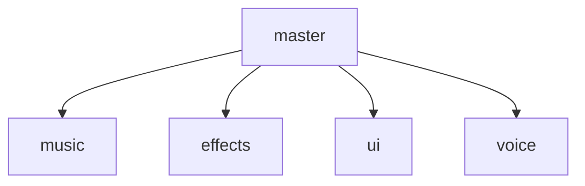
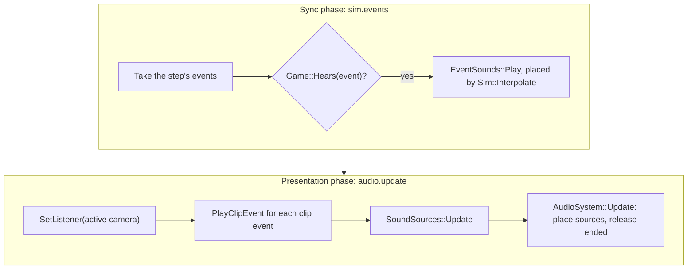

# Audio

The audio module plays a game's sound: music, the UI's sounds, and sounds placed in the world that
fall off with distance from the listener. It is [miniaudio](https://miniaud.io) behind an engine
interface, `Audio::AudioSystem`, that names no miniaudio type. Sounds are files read through the
virtual file system, so a [mod](glossary.md#mod) replaces a sound by shipping a file at the same
path. What a simulation [event](glossary.md#event) sounds like is data, not code.

Audio is [presentation](glossary.md#presentation). The [simulation](glossary.md#simulation) never
sees it: it raises events, and presentation decides what the player hears
([simulation](simulation.md#the-seam-between-simulation-and-presentation)).

## Concepts

| Term | What it is |
| --- | --- |
| Bus | A mixer group (`Audio::Bus`): master, and under it music, effects, UI and voice. A bus's volume scales everything that plays on it, and master's scales everything. |
| Source | One sound playing, named by a generational `Audio::SourceHandle`. A handle to a sound that has ended names nothing. |
| Flat sound | A sound with no position, heard alike wherever the listener is: the UI's (`PlayFlat`). |
| Positioned sound | A sound at a point in the [frame](glossary.md#frame-coordinates), quieter with distance from the listener (`Play`). |
| Music | A streamed piece on the music bus, one at a time (`PlayMusic`). |
| Listener | Where the player hears from: the active camera. |
| Falloff | How a positioned sound fades with distance (`Audio::Falloff`: `minDistance`, `maxDistance`, `rolloff`, in metres). |
| Event sound | A [definition](glossary.md#definition) (`Audio::EventSound`, under `defs/sounds`) mapping a simulation event's type, or a clip's event by name, to a sound. |
| Sound component | `Audio::SoundComponent`: a looping sound on a presentation [entity](glossary.md#entity), heard from where the entity is. |
| Output | Where the mix goes (`Audio::Output`): the playback device, miniaudio's null backend, or none. |

## How it works

### Buses

Every sound plays on one bus. The five buses are miniaudio sound groups, with master the parent of
the other four:



A bus's volume is a linear gain, 1 being the sound as it was made, clamped to [0, 4] by
`SetBusVolume`. A change eases in over 50 ms (`kBusVolumeEaseMilliseconds`, miniaudio's volume
smoothing on each bus's sound group), so muting a bus or setting it back does not click; a source's
own volume still steps. The ease runs as the bus mixes: a bus with nothing playing on it eases under
the next sound to start, and one that has never mixed, as at start-up, takes the volume at once.
`BusVolume` is the volume set, which the bus may still be easing to. The names `master`, `music`,
`effects`, `ui` and `voice` (`BusName`, `BusFromName`) are the ones the settings and the console
use. A source also has a volume of its own (`SetVolume`), under its bus's.

### Sources

There are three ways to play a sound:

| Call | Position | Decoding | Bus |
| --- | --- | --- | --- |
| `Play(path, bus, position, loop, falloff)` | a point in the frame, `double` | whole, as it starts | the one given |
| `PlayFlat(path, bus, loop)` | none | whole, as it starts | the one given |
| `PlayMusic(path, loop)` | none | streamed, a page at a time | music |

A short sound is decoded whole when it starts, to the mixer's format and rate, and every play of the
same file at once shares that copy until the last ends. Music is decoded a little at a time as it
plays, never whole. One piece plays at a time; a second `PlayMusic` replaces the first, with no
crossfade.

A source handle is an index into a table of slots and the slot's generation. When a sound ends or is
stopped, the generation moves on, so calls on the old handle do nothing. `AudioSystem::Update`
releases the sounds that have reached their end; a looping sound never does, and plays until `Stop`.
Index 0 is the empty handle, which `Play` returns when a sound cannot be played.

A positioned sound falls off with the inverse model. It is at full volume within `minDistance`,
then its gain is `minDistance / (minDistance + rolloff × (distance − minDistance))`, held from
`maxDistance` out. The defaults are 100 m, 20 000 m and 1. A positioned sound should be mono:
miniaudio places a stereo sound's two channels about the point.

Doppler is off for every sound. Nothing reports velocities to presentation, and a shift worked out
from positions alone would jump whenever the listener's origin does.

### Listener-relative placement

Positions in a frame are `double` and can be far from its origin, while miniaudio works in `float`,
whose step a hundred million kilometres out is about eight kilometres. So audio is
listener-relative, as rendering is camera-relative ([coordinates](coordinates.md#render-space)).
miniaudio's listener stays at its origin and is given only the listener's orientation. Each frame,
`Update` places every positioned source at its position less the listener's, taken in `double`
and only then made `float`. A sound beside a listener far from the origin is heard exactly as one
beside a listener at the origin; a test holds the two the same to the sample.

`SetListener` takes the listener's position and a rotation from the listener's axes to the frame.
The listener looks down -Z with +Y up, as a camera does, so +X is to its right. When a source moves
or the listener turns, miniaudio eases the change of pan and distance gain over about 8 ms (its
default), so the move does not click.

### Event sounds

What a simulation event sounds like is an `Audio::EventSound` definition under `defs/sounds`,
loaded through the [definition registry](glossary.md#definition-registry). Each definition names
either a simulation event or a clip's event, never both:

| Field | Meaning |
| --- | --- |
| `event` | The event's type, as Reflect names it (`AudioTests.Docked`). |
| `clip` | Instead of `event`: a clip's event by name (`clamp.closed`). |
| `sound` | The sound file's virtual path. |
| `bus` | `Master`, `Music`, `Effects` (the default), `Ui` or `Voice`. |
| `at` | For a simulation event: the event's field holding the entity the sound is placed at. Empty: flat. |
| `volume` | The sound's own gain (default 1). |
| `minDistance`, `maxDistance` | The falloff, when the sound is placed (defaults 100 and 20 000). |

`Audio::EventSounds` is built from every loaded definition and checks each against the types Reflect
knows. It throws `std::runtime_error`, naming the definition, for an unregistered event type, an
`at` that is not one of the event's fields holding an entity, both `event` and `clip` or neither,
and a clip's event placed `at` a field, so a mistake in the data is a start-up error. Several
definitions may name one event; each plays, in the order of their names.

`EventSounds::Play` plays what an event's type maps to. It reads the `at` field from the event
and asks the caller where presentation shows that entity (`Audio::PositionOf`). A sound whose
entity is null, or that presentation cannot place, plays flat rather than not at all: the player
still hears that the event happened. `PlayClipEvent` plays what a clip's event maps to, from the
position of the entity whose clip crossed it, or flat when there is none
([animation](animation.md)).

The [game](glossary.md#game) chooses which simulation events the player hears. The
[shell](glossary.md#shell) asks `Game::Hears` for each event it takes, and plays its sounds only
when the game says yes: the player's own trades, say, and not every trader's. The default answers
no. Clip events do not go through `Hears`.

### Sounds on entities

`Audio::SoundSources` plays the presentation world's `SoundComponent`s, each a looping sound
heard from its entity's world transform (`Scene::WorldTransformComponent`). A source starts when
an entity has both, follows the entity each frame, and stops when the entity loses either or is
destroyed. A component whose `sound` changes starts again with the
new file. A file that will not play is reported once and not tried again every frame. Presentation
is rebuilt from the simulation at will, so nothing here is saved; `Clear` stops every source as a
scene is torn down.

### In the frame

The diagram shows where the shell turns events and entities into sound in one frame. Simulation
events are taken in the sync phase. Everything else runs in the presentation phase as the
`audio.update` system, after the scene's update (the world transforms and the clips' events) and
after the camera's sequence, so the listener is where this frame's camera is
([scene](scene.md#the-frame)).



An event's entity is placed where presentation shows it this frame: interpolated between the last
two steps, as the scene's proxies are ([simulation](simulation.md#snapshots-and-the-stepper)).

### Output and threads

The output is chosen when the system is made (`AudioOptions::output`):

| Output | What it does | Who uses it |
| --- | --- | --- |
| `Device` | The machine's playback device. If none will open (no sound server, no sound card), the null backend instead, with a warning in the log. | The shell, by default. |
| `Null` | miniaudio's null backend: a device that plays to nowhere at a sound card's pace. Sounds start and end as they would be heard, and no sound system is touched. | The shell with `--no-sound`, and always in the [smoke test](glossary.md#smoke-test). |
| `None` | No device. Nothing is mixed until `Mix` asks, on the caller's thread, so the output is the same every run. | The audio suite. |

With a device, null or real, miniaudio mixes on its device's thread and decodes streamed music on a
job thread of its own. With none, the decoding jobs run inside `Mix` too, between chunks of 1024
frames, well under a page of streamed sound. `Mix` throws `std::logic_error` when there is a
device. Everything else in `AudioSystem` is for the main thread only.

### Files and formats

miniaudio opens files through callbacks over `Vfs::FileSystem`, from a directory or a
[pack](glossary.md#pack) alike ([files, packs and mods](files-and-mods.md)). The file system has no
streaming read, so a file is read whole as it is opened. Music is then decoded a page at a time from
that copy in memory. A path that is not a valid virtual path (`../outside.wav`) is refused.

miniaudio decodes WAV, FLAC and MP3 itself. Its Vorbis and Opus decoders are off, because each is a
system library found on one machine and not another ([build and gates](build-and-gates.md)). A file
is checked before miniaudio reads it ([what a loader checks](files-and-mods.md#what-a-loader-checks)),
and one refused is logged, naming it, and counted as a sound that could not be played.

### Problems and counters

miniaudio's messages go to the engine's log under the `audio` category: a device's details at
debug, and one line at info saying which backend plays at what rate. `Problems` counts the
warnings and errors among them, plus every sound that could not be played; the smoke test fails
when it is not zero, since each is a sound the player would not hear.
`AudioCounters` (`Counters`) counts the sounds started on each bus and the sounds that failed.

## Using it

### Playing sounds in code

From `source/engine/audio/tests/AudioTests.cpp`, with the test content's sounds mounted and no
device:

```cpp
AudioSystem audio(scratch.Files(), {.output = Audio::Output::None});
audio.SetListener({0.0, 0.0, 0.0}, glm::dquat{1.0, 0.0, 0.0, 0.0});
const Audio::Falloff falloff{.minDistance = 10.0f, .maxDistance = 100000.0f, .rolloff = 1.0f};

// A UI sound, flat; a positioned one to the listener's right; streamed music.
const Audio::SourceHandle chime = audio.PlayFlat("ui/trade-filled.wav", Bus::Ui);
audio.Play("effects/docked.wav", Bus::Effects, {10.0, 0.0, 0.0}, false, falloff);
const Audio::SourceHandle music = audio.PlayMusic("music/drift.flac");

audio.SetBusVolume(Bus::Ui, 0.5f);
std::vector<float> buffer(2 * 4800);
audio.Mix(buffer);  // interleaved stereo, only with no device
audio.Update();     // once a frame: place sources, release the ones that ended
```

### Mapping an event to sounds

Two definitions on one event, from the same test: the docking sound placed at the event's
`station` entity, and a chime on the UI bus, flat, at half volume. `defs/sounds/docked.yaml`:

```yaml
version: 1
event: AudioTests.Docked
sound: effects/docked.wav
bus: Effects
at: station
minDistance: 10
```

`defs/sounds/docked-chime.yaml`:

```yaml
version: 1
event: AudioTests.Docked
sound: ui/trade-filled.wav
bus: Ui
volume: 0.5
```

The event type must be registered with Reflect, with `station` a field holding an entity. The
definitions are loaded, then played:

```cpp
Audio::RegisterTypes();
Sim::DefinitionRegistry definitions(scratch.Files());
definitions.Load<Audio::EventSound>(Audio::kEventSoundDirectory, {Audio::kEventSoundVersion});
const Audio::EventSounds sounds(definitions);  // throws on a definition that names nothing

// Where presentation shows an entity; none plays the sound flat.
const Audio::PositionOf positionOf = [&](entt::entity entity) -> std::optional<glm::dvec3>
{
    if (entity == station)
        return glm::dvec3{10.0, 0.0, 0.0};
    return std::nullopt;
};
sounds.Play(Sim::SimEvent{1, entt::meta_any{TestDocked{ship, station, 1}}}, audio, positionOf);
```

A clip's event names the clip's event in place of `event`, and has no `at`:

```yaml
version: 1
clip: clamp.closed
sound: effects/docked.wav
bus: Effects
minDistance: 10
```

In the shell, a game says which events the player hears by overriding this `App::Game` member
(`source/engine/app/include/jettison/app/Game.h`); the shell loads the definitions and plays the
rest:

```cpp
virtual bool Hears(const Sim::SimEvent &event) const;
```

### A mod that changes a sound

Event sounds are definitions, so a mod [patches](glossary.md#patch) one like any other. From
`source/engine/app/tests/MountsTests.cpp`, the content ships `defs/sounds/closed.yaml` with a
volume of 0.5, and a mod in the user's directory raises it with
`user/mods/louder/defs/sounds/closed.patch.yaml`:

```yaml
version: 1
volume: 0.9
```

A mod replaces a sound file itself by shipping a file at the same virtual path
([layering](files-and-mods.md#layering-definitions)).

### A sound on an entity

From the same audio suite: a looping sound on an entity, which starts once the entity has a world
transform and stops when the component is removed.

```cpp
Audio::SoundSources sources;
registry.emplace<Audio::SoundComponent>(
    station, Audio::SoundComponent{"effects/docked.wav", Bus::Effects, 1.0f, {.minDistance = 10.0f}});
auto &world = registry.emplace<Scene::WorldTransformComponent>(station);
world.matrix[3] = glm::dvec4{10.0, 0.0, 0.0, 1.0};
sources.Update(registry, audio);  // after the world transforms, before AudioSystem::Update
audio.Update();
```

### In the shell

The shell makes the audio system at start-up, sets each bus from the settings (`audio.master`,
`audio.music`, ... in the config's user layer, 1 when unset), and plays `audio/music/drift.flac`
if the content has it, as the test content does. Two console commands drive it:

```text
volume                 # prints every bus's volume
volume music 0.25      # sets the music bus, 0 to 4, and saves it in the settings
music off              # stops the music; "music on" starts it, "music" toggles
```

`--no-sound` plays to the null backend; `scripts/capture.sh` passes it
([app shell](app-shell.md)).

## Limits and open work

- Music crossfades and a playlist, Doppler, a vehicle's own sounds, occlusion, and a sound streamed
  from its mount rather than read whole: [J21](roadmap.md#j21).
- The voice bus has nothing on it yet.
- WAV, FLAC and MP3 only.
- The test content and the ground sample ship no `defs/sounds`; only the suites exercise event
  sounds.

## Decisions

The settled decisions on audio are in [decisions](decisions.md#audio).

## Source

- `source/engine/audio`: the module. Its dependencies are `core`, `reflect`, `vfs`, `sim` (it
  reads events and definitions, and nothing in `sim` sees it) and `scene` (world transforms).
  miniaudio is a private library.
- `source/engine/audio/include/jettison/audio/AudioSystem.h`: buses, sources, falloff, the
  listener, output, `Mix`, counters.
- `source/engine/audio/include/jettison/audio/EventSounds.h`: `EventSound` and `EventSounds`.
- `source/engine/audio/include/jettison/audio/SoundSources.h`: `SoundComponent` and
  `SoundSources`.
- `source/engine/audio/tests/AudioTests.cpp`: the suite, mixed with no device.
- `source/engine/app/src/Application.cpp`: the shell's use (`InitAudio`, `UpdateAudio`,
  `PlayEventSound`, the `volume` and `music` commands).
- `source/external/CMakeLists.txt`: miniaudio's version and build options.
- `source/test/content/audio`: the test content's three sounds, synthesised by
  `scripts/make-sample-sounds.py` (which also writes ones the test content no longer keeps).
