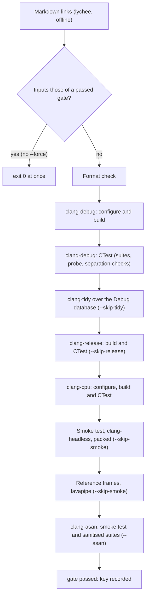

# Build and gates

How to build Jettison, how a game consumes it, and what the gate checks before a push. The rules the
code follows are in [coding standards](coding-standards.md); why a tool was chosen is in
[decisions](decisions.md#build-and-platform).

Everything here runs inside the devenv shell (`devenv.nix`, loaded by `.envrc`). It supplies the
compilers, CMake, Ninja, the Vulkan SDK, the profilers and every script's tools; nothing is
installed system-wide.

## Quick start

```bash
cmake --preset clang-debug                       # configure (once; fetches the dependencies)
cmake --build --preset clang-debug               # build
ctest --preset clang-debug -R '^physics$'        # one suite (the suites are named per module)
build/clang-debug/source/test/render_test        # the shell over the test content, from the root
./scripts/ci.sh --werror --asan --log build/gate.log   # the gate, before a push
```

Large media (`.glb`, images, fonts, audio) is in Git LFS. The devenv shell runs `git lfs install`
for you; a checkout without LFS gives the render test 132-byte pointer files.

## Dependencies

There are no submodules. Every third-party library is pinned in `source/external/CMakeLists.txt` and
downloaded by `FetchContent` on the first configure. Each pin's comment says why it is configured as
it is, and why it is held back where it is older than upstream's newest release. Versions were last
reviewed on 2026-11-10; ENet and libsodium were added on 2026-11-20, meshoptimizer on 2026-11-28.

| Library | Pin | Linked by | Note |
|---|---|---|---|
| EnTT | v4.0.0 | `reflect`, `ecs` and the modules above | Requires C++20 and CMake 3.28 |
| GLM | 1.0.3 | `math` and most modules | Geometry ABI asserted by the dependency probe |
| GLFW | 3.5.1 | `render`, `app` | Upstream skipped 3.5.0 (bad tag); one window backend a tree |
| Dear ImGui | v1.93.0 (commit) | `devtools`, `render` | GLFW and Vulkan backends from the same release; fonts through `imgui_freetype` |
| stb | master, 2026-11-10 (commit) | `render`, `jettison_cook` | No releases; fetched in every tree |
| yaml-cpp | 0.9.0 | `core`, `serialise` and others | |
| fastgltf | v1.0.1 | `geometry`, `render`, `animation` | Downloads its own simdjson 5.1.0 and simdutf; `geometry` reads its extras through that simdjson |
| spdlog | v1.17.0 | `core` | `SPDLOG_USE_STD_FORMAT` |
| doctest | v2.5.3 | the suites | Fetched in every tree |
| Tracy | v0.13.1 | `profile` | **Held back** from 0.15.0 to match devenv's profiler ([profiling](#profiling)) |
| Vulkan Memory Allocator | v3.5.0 | `render`, privately | Header-only; `render` compiles the implementation |
| FastNoiseLite | v1.1.1 | `math` | Header-only; output pinned by recorded values |
| MikkTSpace | 2020 (only commit) | `math` | |
| meshoptimizer | v1.3 | `geometry`, privately | Its vertex and index codecs are `EXT_meshopt_compression`'s ([the cooked model](rendering.md#the-cooked-model)) |
| Jolt Physics | v5.6.0 | `physics`, privately | Double precision, deterministic across build types |
| FreeType | 2.15.0 | `ui`, RmlUi, ImGui | Answers RmlUi's `find_package(Freetype)` |
| RmlUi | 6.3 | `ui`, privately | |
| miniaudio | 0.11.26 | `audio`, privately | Vorbis and Opus off; backends loaded at run time |
| KTX-Software | v4.4.2 | `render` (`ktx_read`), `jettison_cook` (`ktx`, the encoder), never both in one program | **Held back** from v5.0.0-rc2, a release candidate on 2026-11-11; fetched in every tree; both built against the engine's zstd; two patches, a deterministic encoding and a leak (`source/external/CMakeLists.txt`) |
| WAMR | 2.4.5 | `script`, privately | Fast interpreter with instruction metering; no libc or WASI ([scripts](scripts.md)) |
| zstd | v1.5.7 | `vfs`, privately; `ktx_read` and `ktx` | The library alone, static |
| ENet | v1.3.18 | `net`, privately | Reliable and unreliable channels over UDP ([networking](networking.md)) |
| libsodium | robinlinden/libsodium-cmake 9b2848d | `net`, privately | libsodium 1.0.20 (stable branch) through a CMake wrapper, static |

Three tool sets come from the devenv shell, not from `FetchContent`:

- **Vulkan**: the headers, the loader, the validation layers and `glslc`.
- **The scripts' compilers**: lld's `wasm-ld`, which links every script; clang for scripts in C;
  rustc for scripts in Rust, with the `wasm32-unknown-unknown` library nixpkgs ships with it; and
  WAMR's ahead-of-time compiler, `wamrc`, built by `nix/wamrc.nix` from WAMR's release above
  against LLVM 18, since nixpkgs' `wamr` builds only the runtime. The two releases move together.
- **The profilers** ([profiling](#profiling)).

A tree configured without the scripts' compilers builds everything but the scripts, whose targets
then fail saying what is missing.

### Scripts in the build

`jettison_add_script` (`source/CMakeLists.txt`) builds a WebAssembly [script](glossary.md#script)
from C or Rust. Under Nix's compiler wrapper it compiles C with the clang the wrapper wraps, because
the wrapper adds the host's flags and target to anything it compiles.

The script suite's test modules (`source/engine/script/tests/scripts`) are:

| Module | Languages |
|---|---|
| `limits` | Rust |
| `rogue` | Rust |
| `events` | C and Rust |
| `keys` | C and Rust |

They are built with the tree, not as the suite's dependency, so a change to a reflected type still
builds the suite that reports the bindings out of date. The suite compares the bindings its modules
are built against (`jettison_script.h`, `jettison_script.rs`) byte for byte with what its types
generate. On a difference it writes the generated files into the build tree, to copy over. The
generated C header is left out of the format check. How bindings are generated is in
[scripts](scripts.md#what-a-script-sees-is-generated-from-reflection).

### Planned dependencies and the probe

`JETTISON_PLANNED_DEPENDENCIES` (ON by default) proves a library links with the rest before any
module depends on it: the library is fetched early, `EXCLUDE_FROM_ALL`, and built only for
`dependency_probe` until the engine links it. The planned set is empty today (WAMR was the last to
leave it); the option still builds the probe.

`dependency_probe` (`source/test/dependency_probe.cpp`) is one executable that links
`Jettison::App`, `Jettison::Physics` and every third-party library, ENet and libsodium included. It
makes at least one real call into each (it runs a WebAssembly function, creates a Jolt shape and a
KTX texture, generates tangents) and asserts the GLM geometry ABI. The gate runs it with the Debug
suites. A new dependency is added to it ([coding standards](coding-standards.md#dependencies)).

The `clang-headless`, `clang-asan` and `clang-cpu` presets turn the option off, needing no probe.
Every library the engine links is built in every tree regardless.

### Integration rules the set follows

Each rule keeps every library linkable into one executable, and was learned from a library in the
set:

| Rule | Why |
|---|---|
| **Static only.** `BUILD_SHARED_LIBS` is OFF for the dependency directory. | RmlUi declares it as an option defaulting to ON, which would make every later dependency shared. |
| **One copy of each library.** Before adding a dependency, check whether it compiles its own copy of another (`grep` its build for vendored `.c` files). | libktx compiles zstd 1.5.5 with public symbols, so `ktx_read` and `ktx` are built against the engine's own zstd instead (the KTX block in `source/external/CMakeLists.txt`). |
| **Options in a `block()`.** Options are plain variables inside a `block()` around the dependency they are for. `CMAKE_POLICY_DEFAULT_CMP0077` is NEW, so a dependency declaring an old CMake honours them. | Jolt's options are called `DOUBLE_PRECISION`, `ENABLE_INSTALL` and `INTERPROCEDURAL_OPTIMIZATION`; a cache entry would configure every other dependency reading the same name. Tracy 0.13.1 silently discarded options before CMP0077. |
| **The project's language features.** No dependency builds without RTTI or exceptions when the engine derives from its classes. | Jolt defaults to both off. |
| **No system libraries found by accident.** Optional codecs (FreeType's zlib, PNG and HarfBuzz; miniaudio's libvorbis and libopus) are off. `OVERRIDE_FIND_PACKAGE` answers a dependency's `find_package` for a library the set provides. | Each is found on a developer's machine and missing on a runner. |
| **No executable stack.** WAMR's trampoline is assembled with `--noexecstack`. Check: `readelf -lW dependency_probe \| grep GNU_STACK` says `RW`. | An assembly file without `.note.GNU-stack` marks the whole process as needing an executable stack. |
| **A dependency's warnings are not the gate.** Third-party includes are `SYSTEM`, and a dependency's own `-Werror` is turned off. | astc-encoder's breaks on glibc 2.44's `_FORTIFY_SOURCE` warning in Debug. |
| **Instruction sets stay contained.** `physics` links Jolt privately. | Jolt adds `-mavx2 -mbmi -mpopcnt -mlzcnt -mf16c` as public options, so they reach only `physics`'s own units. The engine's minimum CPU is x86-64 with AVX2 ([decided](decisions.md#build-and-platform)); a dependency that would raise it further (AVX-512, say) is a new decision, not a default. |
| **No OpenGL headers.** `imgui_backends` defines `GLFW_INCLUDE_NONE`. | The engine draws with Vulkan, and a runner has no `GL/gl.h`. |

## Building

You need Clang, CMake 3.28 or newer, Ninja, Git, the Vulkan development libraries, `glslc` and the
Wayland development libraries. `devenv.nix` supplies all of them.

### Presets

| Preset | Build type | What it is for | Options it sets |
|---|---|---|---|
| `clang-debug` | Debug | Development, on Wayland | the base: tests, presentation and the planned set ON, GLFW X11 OFF |
| `clang-release` | Release | Holding Release to Debug's results; benchmarks | as `clang-debug`, with `-gline-tables-only`: file and line for a crash report, the machine code unchanged |
| `clang-headless` | Debug | The smoke test and reference frames under Xvfb | `JETTISON_GLFW_X11=ON`, planned set OFF |
| `clang-asan` | Debug | `clang-headless` with AddressSanitizer and UndefinedBehaviorSanitizer | `-fsanitize=address,undefined -fno-omit-frame-pointer -fno-sanitize-recover=all` |
| `clang-cpu` | Debug | The CPU engine a game's server builds | `JETTISON_PRESENTATION=OFF`, `CMAKE_DISABLE_FIND_PACKAGE_Vulkan=ON`, planned set OFF |

Each tree is `build/<preset>`, and every preset has a build preset of its name. Only `clang-debug`
has a test preset; for another tree, use `ctest --test-dir build/<preset>`.

### CMake options

| Option | Default | Effect |
|---|---|---|
| `JETTISON_BUILD_TESTS` | ON when Jettison is the top-level project, OFF as a dependency | Builds each module's doctest suite and registers it with CTest. A game's build does not compile the engine's tests. |
| `JETTISON_PRESENTATION` | ON | Builds the renderer, UI, audio and the shell (`render`, `audio`, `ui`, `devtools`, `app`), the assets and shaders, Flotsam, the ground sample and the render harness, and fetches what only they use (Vulkan and `glslc`, GLFW, FreeType, RmlUi, miniaudio, ImGui, VMA). OFF leaves the CPU modules, the host, their suites, the packer, the collision baker and the cook. |
| `JETTISON_PLANNED_DEPENDENCIES` | ON | Fetches libraries planned for later work and builds `dependency_probe` ([above](#planned-dependencies-and-the-probe)). |
| `JETTISON_WERROR` | OFF | Adds `-Werror` to the project's warnings ([warnings](#warnings)). `ci.sh --werror` sets it. |
| `JETTISON_CCACHE` | ON | Compiles through ccache when it is on the `PATH` ([compiler cache](#compiler-cache)). A `CMAKE_CXX_COMPILER_LAUNCHER` you set wins. |
| `JETTISON_GLFW_X11` | OFF | Builds GLFW with its X11 backend instead of Wayland, for Xvfb ([sanitisers](#sanitisers)). |
| `JETTISON_PROFILE` | OFF | Compiles the Tracy client in (`TRACY_ENABLE`) ([profiling](#profiling)). |
| `JETTISON_INSTALL` | OFF | Adds install rules and the `Jettison` package; not yet a supported path ([consuming the engine](#consuming-the-engine)). |

### What the build produces

- **Shaders** compile to SPIR-V as part of the build (`jettison_compile_shaders`); `glslc`'s
  depfiles rebuild only the programs whose includes changed.
- **The engine's assets** are staged beside the executable, and `jettison_assets_pack` packs them
  into `build/<preset>/assets.pack`. The shell mounts the pack when there is no directory, as in a
  shipped build ([files, packs and mods](files-and-mods.md)).
- **The test content** (`source/test/content`) is staged with the dense test meshes generated
  beside it, cooked (`jettison_test_content`) and packed (`jettison_test_content_pack`), under
  `build/<preset>/source/test`, in every tree that builds `render_test`
  ([the engine's content](dense-geometry-and-ray-tracing.md#the-cook)).
- **Executables**: `render_test` (the shell with no game, `source/test`), `ground` (the ground
  sample, `source/samples/ground`), `flotsam`, `jettison_pack`, `jettison_bake_collision` and
  `jettison_cook` (`source/tools`), and `jettison_test_meshes`, the build's generator of the dense
  test meshes (`source/test`). Their command-line arguments are in [the app shell](app-shell.md).

The render harness is `render_test`, not `test`: CMake reserves `test` once testing is enabled, and
Ninja's phony `source/test/test` would collide with it.

### Editors

`.vscode/` holds `tasks.json.example` and `launch.json.example`: copy them without `.example`. The
default build task builds `clang-debug`, and the `Debug test` launch configuration builds and runs
`render_test` under LLDB (CodeLLDB). Run VS Code inside the devenv shell so it finds the tools. For
clangd, `compile_commands.json` at the root links to a tree's database.

## Consuming the engine

A game builds the engine from source with `FetchContent`, pinned to a commit, and links
`Jettison::Engine` (every module the build has), the `Jettison::<Module>` targets it needs, or, for
a rendered game, `Jettison::App`. The worked example is the consumer project's build, in [the
guide](guide.md#bring-in-the-engine). A game server also sets `JETTISON_PRESENTATION OFF`, and may
set `CMAKE_DISABLE_FIND_PACKAGE_Vulkan ON` to prove nothing looks for Vulkan. How Manifest uses the
engine is in [game integration](game-integration.md).

### The consumer check

`source/test/consumer` is that build at its smallest: the engine's independent
[consumer](glossary.md#consumer) of the CPU engine, a race game with nothing of space in it, run
through `Host::Session` and served over loopback by `Net::Server`, where a bad token, a wrong
version, another server's key and a flood are refused ([samples](sample-game.md#the-consumer-project)). It is not in the
gate, because it fetches and compiles the dependency set a second time. Run it when the module
layout, the host or the public interface changes:

```bash
cmake -S source/test/consumer -B build/consumer -G Ninja \
  -DCMAKE_C_COMPILER=clang -DCMAKE_CXX_COMPILER=clang++ \
  -DJETTISON_SOURCE_DIR="$PWD"
cmake --build build/consumer && ctest --test-dir build/consumer --output-on-failure
```

It takes `-DJETTISON_SOURCE_DIR=<checkout>` for a working tree or `-DJETTISON_GIT_TAG=<commit>`, and
refuses to configure with neither, so a check always names its revision, never a branch that moves.

`-DCONSUMER_ASSETS=ON` configures the engine with presentation (more to fetch, nothing of it compiled)
and adds `consumer_assets`, an executable that calls `jettison_use_shared_assets` from the
consumer's own scope and, as the `consumer_assets` test, finds the engine's staged `fonts`, `strings`
and `ui` where the definition says. Run it when that function or the assets' staging changes.

### Installing (not yet supported)

`JETTISON_INSTALL=ON` adds install rules and the `Jettison` package (`JettisonConfig.cmake`,
`JettisonTargets.cmake`) for `find_package(Jettison)`. It does not work yet: CMake refuses to export
a target whose link interface names one outside the export set, and the modules link FetchContent
dependencies (GLM, EnTT, GLFW, ImGui, yaml-cpp, fastgltf) that are not installed. The fix is to
install each public dependency's export, or to vendor import targets in
`cmake/JettisonConfig.cmake.in`; it is [J18](roadmap.md#j18), for when a game needs a prebuilt
engine.

### Separation checks

These keep the engine neutral and its layers apart. Why each exists is in [game
integration](game-integration.md#enforcement); this table says where each runs.

| Check | What fails it | Where it runs |
|---|---|---|
| `jettison_check_dependencies` (`cmake/JettisonModule.cmake`) | An engine module with a sample's target anywhere in its link closure, or a link expression the check cannot read | Every configure |
| `neutral_words` (CTest; `cmake/CheckNeutralWords.cmake`) | A space-setting word (station, ship, cargo, galaxy, ...) in an engine module's code outside string literals, unless `cmake/neutral-words.txt` allows it for that file; or an allowance no longer needed | Every tree with tests |
| `devtools_alone` (CTest; `source/test/CheckDevtoolsAlone.cmake`) | `Jettison::Devtools` alone needing a Vulkan loader or GLFW (its `NEEDED` entries), or failing to run | Trees with presentation |
| The `clang-cpu` tree | A CPU module, the host or a suite needing presentation, or anything calling `find_package(Vulkan)` | The gate |
| The consumer check | The public interface failing a game with no space in it | By hand ([above](#the-consumer-check)) |

`neutral-words.txt` is empty, and the check keeps it so. To see what the tree would need:

```bash
cmake -DENGINE=source/engine -DALLOWED=cmake/neutral-words.txt -DWRITE=ON \
  -P cmake/CheckNeutralWords.cmake
```

The development environment's three files (`devenv.nix`, `devenv.yaml`, `devenv.lock`) are kept
identical to Manifest's. Desktop tools stay out of that shared shell, and nothing in it becomes a
runtime dependency of a release.

## The gate

The [gate](glossary.md#gate-ci) is `scripts/ci.sh`: every check a commit must pass, in one local
command. It runs with `--werror --asan` once a batch's pieces are merged into `feature-base`, and
passes before a push ([batches](#batches), [coding standards](coding-standards.md#commits)). It holds the [lanes](#lanes)' lock while it
runs, so a gate or build started in another worktree waits for it. Hooks run parts of it:

| Where | What runs |
|---|---|
| Worktrunk `pre-commit` (`.config/wt.toml`) | `./scripts/format-check.sh` |
| Worktrunk `pre-merge` | `./scripts/ci.sh --skip-release --werror --llvmpipe` |
| GitHub Actions | Not the gate: a build and a smoke test ([CI](#ci)) |

```bash
./scripts/ci.sh --werror --asan --log build/gate.log   # the full gate, quiet
./scripts/ci.sh --skip-smoke                           # no display or driver: no smoke test,
                                                       # reference frames or sanitised run
./scripts/ci.sh --llvmpipe                             # the smoke test on lavapipe under Xvfb
```

### Stages

The stages run in this order, and a stage that fails ends the run:



- **Markdown links**: `lychee --offline --include-fragments` over every tracked `*.md`, checking
  links between the repository's files and to their headings. As the one check of the Markdown, it
  runs on every run, in under a second. The cache that follows is
  [below](#a-gate-that-passed-is-not-run-again).
- **clang-tidy** checks the Debug tree alone ([clang-tidy](#clang-tidy)): Release differs by
  inlining, and the same source's diagnostics are not wanted twice.
- **Release**: the simulation's state hashes are [pinned](glossary.md#pin) in the suites, so running
  them in Release holds Release to the Debug build's results.
- **Smoke test**: from the packed assets, offscreen on the GPU or on lavapipe ([headless render
  test](#headless-render-test)). The reference frames always use lavapipe.
- **Sanitised run** (`--asan`): the smoke test under ASan and UBSan on lavapipe, then these suites,
  built in `clang-asan`:

| Sanitised suite | Why it runs under the sanitisers |
|---|---|
| `sim`, `spatial`, `physics`, `ai`, `dock`, `transit` | Their state hashes are pinned, and must be the same under the sanitisers; `transit`'s passages are saved and loaded mid-way |
| `vfs` | Packs are bytes from a [mod](glossary.md#mod) |
| `script` | Script modules are bytes from a mod (its test modules are built explicitly) |
| `serialise` | The binary reader parses every save and its truncations |
| `resource` | A loader's callback can load more and move the resource manager's slots |
| `host` | A failed start-up and a teardown release what each phase built |
| `net` | It reads a peer's packets |
| `geometry` | Its reader decodes a model file a mod can ship, and its cook copies vertices by index |
| `animation`, `ui`, `bake_collision`, `render` | They refuse a mod's malformed clips, translations, models and textures |

### Reading the result

The run ends with a summary, a line per stage (`ok` with its seconds, `skip` or `FAIL`), then
`gate passed` or `gate FAILED`. With `--log <file>` the build's own output goes to the file alone,
and the terminal gets the stages, the summary and, for a failed stage, its error lines (a compiler's
`error:`, Ninja's `FAILED:`, an assertion, a `[vulkan:error]`) and its last lines. That is the form
for when only the verdict matters, as for an agent: a passing `--werror --asan` gate is about 20
lines.

Run the gate as a background task and wait for it to end. Warm, it takes three to four minutes, two
thirds of it the lavapipe smoke tests and reference frames (223 s on 2026-11-14); with cold caches,
several minutes more.

### A gate that passed is not run again

A run whose inputs are those of a gate that passed says so
(`gate passed: the inputs are those of the gate passed <time>`) and exits 0 at once, so committing
documentation, or a second run before a commit, costs nothing. `--force` runs it anyway.

The key is a SHA-256 over:

- the working tree's files, tracked or untracked but not ignored, less `*.md` (whose check always
  runs), read through a scratch copy of the Git index so the real one is never touched;
- the versions of clang, clang-format, clang-tidy and CMake;
- the gate's options. The presets set every build option a stage reads, so no cached setting escapes
  the key.

The key is recorded under `build/gate-passed` only if it is the same at the end of the run as at the
start, so a tree edited while the gate ran is not recorded. CI's checkout has none.

### `ci.sh` options

| Flag | Effect |
|---|---|
| `--skip-smoke` | Skip the smoke test and the reference frames (no display or driver) |
| `--skip-release` | Skip the Release build and its tests |
| `--skip-tidy` | Skip clang-tidy |
| `--werror` | Configure every tree with `JETTISON_WERROR=ON` |
| `--asan` | Add the sanitised smoke test and suites |
| `--llvmpipe` | Run the smoke test on lavapipe under Xvfb, through the swapchain; implied with no `/dev/dri` |
| `--preset NAME` | The Debug preset (default `clang-debug`) |
| `--log FILE` | Full output to the file; stages, summary and a failure's errors to the terminal |
| `--force` | Run even when the inputs are those of a passed gate |

Environment: `CTEST_PARALLEL_LEVEL` overrides the suites' parallelism (default `nproc`);
`JETTISON_CI_HEADLESS_PRESET` overrides the smoke test's preset (default `clang-headless`).

### Machine-specific concurrency

Nothing bounds parallelism, here or on CI: the builds run Ninja's default (the machine's threads
plus two), the suites `nproc`, and clang-tidy a copy per thread. The memory this costs, measured on
2026-11-17 (`VmHWM` summed over the process tree):

| Process | Peak on the widest unit (`Application.cpp`) | Typical across the widest units |
|---|---|---|
| clang | 1,051 MiB | 522 MiB (five widest) |
| clang-tidy | 1,151 MiB | 691 MiB (six widest) |

So 26 copies of clang want 27 GiB at the worst. Read `MemAvailable`
(`grep MemAvailable /proc/meminfo`) before a full-parallel gate. Well above about 27 GiB, run at the
defaults; otherwise lower the machine's load or this run's job counts (`CMAKE_BUILD_PARALLEL_LEVEL`,
`CTEST_PARALLEL_LEVEL`, `JETTISON_TIDY_JOBS`). Do not commit a bound.

On the development machine the question is one process, the user's local AI (`strata-host`, about 57
GiB, not always running): with it up, 3.4 GiB was free on 2026-11-17, and a full run thrashes.

A one-off compiler crash on a file that then builds alone is the machine's fault, not the load's:
retry it rather than build around it. Run nothing else beside a build or clang-tidy.

### Unit tests

Each engine module has a doctest executable, `jettison_<module>_tests`, built from the files its
`jettison_add_module(... TESTS ...)` names and registered with CTest under the module's name. CTest
also has:

| Test | What it is |
|---|---|
| `sample-ground` | The ground sample's suite (`source/samples/ground`) |
| `neutral_words`, `devtools_alone` | [Separation checks](#separation-checks) |
| `dependency_probe` | [The probe](#planned-dependencies-and-the-probe) |

The gate runs `ctest --test-dir build/<preset> --output-on-failure --no-tests=error -j <nproc>`, so
a tree that registered nothing fails. Each suite writes only under a temporary directory named for
its process, so suites run side by side.

```bash
ctest --test-dir build/clang-debug -R '^physics$' --output-on-failure      # one suite
build/clang-debug/source/engine/physics/jettison_physics_tests -tc='*contact*'  # one case
```

One case is sensitive to load: `jobs`' "Jobs: a completion can enqueue more work" can read the next
stage number when a starved worker runs the second item before `WaitIdle()`/`Drain()` returns. A
gate that fails only that case is the load: run it again. The race is the suite's to fix.

Formats change in place until player testing ([decided](decisions.md#persistence)), so the gate
loads every file of a format the two repositories hold, and no old save is kept as a fixture.

### Warnings

Each project target links the `jettison_warnings` interface library privately (top-level
`CMakeLists.txt`):

```text
-Wall -Wextra -Wpedantic -Wshadow -Wconversion -Wsign-conversion -Wshorten-64-to-32
-Wimplicit-int-float-conversion -Wnon-virtual-dtor -Wextra-semi
-Winconsistent-missing-destructor-override -Wcast-qual -Wcast-align -Wunreachable-code
-Wdocumentation
```

The flags sit on an interface target because `CMAKE_CXX_FLAGS` would reach every FetchContent
dependency, whose diagnostics are not ours to fix. The tree is clean under them, so
`JETTISON_WERROR=ON` (`--werror`) can add `-Werror`; a developer's build leaves it off, so an edit
in progress still builds. `-Wold-style-cast` is left out: in a GLM codebase it costs more than it
finds.

### clang-tidy

`.clang-tidy` holds a curated set of checks, with the measurements behind its exclusions. A check
earns its place by being clean over the sources, or by finding something that gets fixed ([coding
standards](coding-standards.md#language-and-toolchain)). `scripts/tidy.sh` runs it, through
`scripts/tidy.py`, over the project's own sources from a built tree's compile database.

**What is checked.** A *unit* is one translation unit: a source file and its compile command.
`tidy.py` checks only the units matching `source/(engine|tools|samples|test)/.*\.(cpp|h)$`, about a
quarter of a tree's units, never those under `build/<preset>/_deps`. `HeaderFilterRegex` in
`.clang-tidy` keeps findings in dependency headers out of the output, though each unit is still
parsed through the headers it includes.

**The cache.** A full check is about 1,500 CPU-seconds, so `tidy.py` skips a unit that came out
clean before and has not changed since. A unit's key digests clang-tidy's version, `.clang-tidy`,
the unit's compile command and the contents of every file it includes, as the built tree's
dependency record (`ninja -t deps`) lists them. Paths under the repository are made relative, so one
worktree reuses another's results.

Only clean units are cached, so a finding is reported every run until it is fixed. A unit with no
dependency record, or with a file changed since its object was built, is always checked and never
cached, since the edit may include something the record does not name. The cache is
`~/.cache/jettison/tidy` (or `JETTISON_TIDY_CACHE`). With nothing changed a run takes under a
second; with one source changed, it checks that unit.

**Output.** A plain run prints the actionable lines (`file:line:col: severity: message [check]`), at
most 20 distinct ones, since every unit that includes a header reports its finding. The whole text
(notes, source excerpts, every unit's copy) goes to `<build-dir>/tidy-diagnostics.log`, which the
run names. The gate uses `--summary`: one line when clean.

| `tidy.sh` flag | Effect |
|---|---|
| `--build-dir DIR` | The built tree with `compile_commands.json` (default `build/clang-debug`) |
| `--summary` | Print the summary lines only |
| `--all` | Check every unit, cached as clean or not |
| `--show N` | Print at most N distinct diagnostic lines (default 20; 0 for none) |
| `--full` | Print clang-tidy's whole output |
| `--fix` | Apply safe fixes over every unit through `run-clang-tidy`, so two units' fixes to one header apply once; start from a clean tree to review them |

Environment: `JETTISON_TIDY_JOBS` (default: one copy per thread), `JETTISON_TIDY_CACHE`.

```bash
./scripts/tidy.sh --summary                              # one line when clean
./scripts/tidy.sh                                        # the first 20 findings
clang-tidy -p build/clang-debug source/engine/core/src/Log.cpp 2>&1 \
  | grep -E ': (warning|error): .*\['                    # one unit, the project's findings only
```

Raw clang-tidy on one unit prints hundreds of thousands of generated, suppressed and macro-expanded
warnings; the `grep` keeps the project's own.

### Compiler cache

Every compile goes through ccache when it is on the `PATH`, as the devenv shell puts it, so the
fetched dependencies, most of the build, are cached too. A new worktree starts with no build trees
(worktrunk copies none), and a full `--asan` gate builds five: debug, release, cpu, headless and
asan. Through the cache, a clean Release tree built before rebuilds in 17 s against 75 s compiling
(2026-11-12).

`devenv.nix` sets the cache up:

- `CCACHE_BASEDIR` is the checkout's parent, where the worktrees are, so paths are hashed relative
  to it and one worktree finds what another compiled.
- A tree with debug information also hashes its build directory (ccache's `hash_dir`), so each
  object's recorded source paths stay true to its tree: Debug trees share within a worktree, Release
  across them.
- `CCACHE_MAXSIZE` is 10 GB; four trees' objects were about 1.2 GB before compression.

`compile_commands.json` leaves the launcher out, so clang-tidy and clangd see the compiler's own
command.

### Formatting

`scripts/format-check.sh` fails if clang-format would rewrite any tracked C++ file but the generated
`jettison_script.h`. It needs clang-format 20 or newer (`.clang-format` sets `BinPackParameters` to
a string); the shell has LLVM 21. The style is in [coding
standards](coding-standards.md#language-and-toolchain). The tree has been clean since the format
commit in `.git-blame-ignore-revs`; register that file once so `git blame` skips it:

```bash
git config blame.ignoreRevsFile .git-blame-ignore-revs
```

Claude Code formats a C++ file as soon as it writes or edits one, through a hook in
`.claude/settings.json` (`.claude/hooks/format-edited.sh`). It formats only the project's sources,
and does nothing outside the devenv shell, which may lack a new enough clang-format.

### Sanitisers

`clang-asan` builds ASan and UBSan into the headless tree with `-fno-sanitize-recover=all`, so the
first finding stops the run.

```bash
./scripts/smoke-test.sh --preset clang-asan --llvmpipe    # the sanitised smoke test alone
```

- **It always runs on lavapipe.** NVIDIA's driver (615.71) fails `vkCreateInstance` under ASan, and
  LeakSanitizer then reports the driver's allocations as leaks.
- **Its GLFW is X11 only.** With both backends compiled in, an X11 run still loads libwayland, and
  LeakSanitizer reports 192 bytes in libwayland-client 1.26.0 at disconnect; a suppression would
  hide the findings the preset exists for.
- **X11 is loaded at run time.** GLFW `dlopen`s the X11 libraries, so they must be on
  `LD_LIBRARY_PATH`, which `devenv.nix` builds in `enterShell`. An older shell fails with
  `X11: Failed to load Xlib`, and `smoke-test.sh` says which library and variable.

## Declaration spacing

The blank lines above declarations and above a comment that follows code
([coding standards](coding-standards.md#declaration-spacing)) are not in the gate: the check took about 50 s a run, for whitespace. Run it by hand from time to time,
after a Debug build, whose compile database and module maps it reads:

```bash
./scripts/space-declarations.py --check            # names the files missing them; exit 1 if any
./scripts/space-declarations.py                    # adds them
./scripts/space-declarations.py --build build/clang-release   # read another build
./scripts/space-declarations.py --root ../manifest  # another repository, its own build/clang-debug
```

Commit what it changes as its own formatting commit.

## Headless render test

The [smoke test](glossary.md#smoke-test), `scripts/smoke-test.sh`, runs the shell through the stages
that have broken this engine, with the Vulkan validation layers on and no desktop session. It fails
on a non-zero exit, any validation error or warning, or a stage that did not happen.

It makes three runs:

1. `render_test --smoke-test` over the test content's `scene/main.yaml` (glTF models, a skinned
   clip, a point light, debug lines; no sun, so the shadow pass clears and draws nothing).
2. The same over `scene/orbit.yaml` (a station over a planet at real scale under the sun: four
   shadow cascades, a hundred clustered lights, hundreds of instanced draws).
3. `ground --smoke-test`, the [ground sample](sample-game.md#the-ground-sample), from its own
   content.

In a Debug tree it first checks that a missing validation layer and a missing shader each exit 1
cleanly, with no validation error.

```bash
./scripts/smoke-test.sh --llvmpipe                       # build, then lavapipe (Xvfb if no DISPLAY)
./scripts/smoke-test.sh --offscreen --packed             # no display at all, on the GPU, from packs
./scripts/smoke-test.sh --no-build --xvfb                # the existing tree, on a virtual display
./scripts/smoke-test.sh --icd /path/to/lvp_icd.x86_64.json   # pin a driver explicitly
```

| Flag | Effect |
|---|---|
| `--preset NAME` | Preset to build and run (default `clang-headless`) |
| `--build-dir DIR` | Build tree (default `build/<preset>`) |
| `--build` / `--no-build` | Configure and build `render_test` and `ground` first (the default), or run the tree as it is |
| `--werror` | Configure with `JETTISON_WERROR=ON` |
| `--llvmpipe` | Pin [lavapipe](glossary.md#lavapipe), Mesa's software Vulkan driver |
| `--icd PATH` | Pin an ICD manifest instead of finding lavapipe |
| `--xvfb` | Run under a virtual X server (default: only when `DISPLAY` is unset) |
| `--no-xvfb` | Run on the current display: opens windows on your desktop |
| `--screen WxHxD` | Xvfb's screen (default `1280x720x24`; software rendering is fill-rate bound) |
| `--offscreen` | `render_test --offscreen`: no display, Xvfb or window ([offscreen](#offscreen)) |
| `--gpu NAME` | Part of the name of the device to draw with |
| `--packed` | Run from `assets.pack` and `content.pack`, as a shipped build has them |

Environment: `VK_SMOKE_VERBOSE` says so when validation reported nothing; `JETTISON_LAVAPIPE_ICD`
(set by the shell) is where `scripts/lib/headless.sh` looks for lavapipe first.

### Offscreen

`--offscreen` unsets `DISPLAY` and `WAYLAND_DISPLAY` and runs `render_test --offscreen`, which draws
on the GPU with no window anywhere ([why and how](rendering.md#the-vulkan-backend)). The gate's
plain smoke test runs so. On the user's workstation (`uname -n` is `lythir`) the script adds
`--gpu 5060`, the card with the monitor, so nothing runs on the 5070 Ti kept for inference;
elsewhere the renderer chooses, and `--gpu` names one.

Where there is no `/dev/dri` the gate falls back to lavapipe under Xvfb. Claude Code's sandbox is
such a place: its bubblewrap call mounts a fresh `/dev`, so no setting gives it a GPU's device
nodes. Run `ci.sh` and `smoke-test.sh` outside the sandbox to test on the GPU.

### Packed

With `--packed` the script builds `jettison_assets_pack` and `jettison_test_content_pack`, and runs
each test-content scene with `--assets build/<preset>/assets.pack` and
`--content build/<preset>/source/test/content.pack`. The run fails unless the shell says, once a
scene, that it mounted both as [packs](glossary.md#pack) and read the content's description. The
gate's smoke test is packed, while the sanitised run and the reference frames read the
directories, so every gate draws from both kinds of mount. The ground sample reads its staged
content either way. A smoke run without `--user-dir` has a scratch user directory ([the app
shell](app-shell.md#the-render-test)).

### What it walks

The smoke sequence walks eleven stages (window resizes, minimise and restore, a scene reload,
piloting, a pick, a save and load, the game's screen, and a clean close), each one a path that has
broken this engine before. The stages, what each is there to catch and what fails a run are in [the
app shell](app-shell.md#the-render-test). A rover that never moves in the ground sample's piloting
stages is stopped by the 120-second watchdog.

## Reference frames

A [reference frame](glossary.md#reference-frame-image) is a committed PNG of a view that the gate
compares a fresh capture with, so a change that alters a picture fails until it is meant to.
`scripts/capture.sh` captures `render_test` frames, or the ground sample's, from inside the frame
loop, on lavapipe under Xvfb: on one machine the same to the byte every run, whatever the load.

```bash
./scripts/capture.sh out.png --scene $PWD/build/clang-headless/source/test/content/scene/orbit.yaml \
    --run "orbit 0.8 -0.1 2.0e7 ostra"                  # one frame, camera placed by a console line
./scripts/capture.sh --references                       # compare every view with its reference
./scripts/capture.sh --references corva                 # one view
./scripts/capture.sh --references --update graded       # record a change meant to change a frame
```

| Flag | Effect |
|---|---|
| `<out.png> [render_test arguments...]` | Capture one frame |
| `--ground` | Capture the ground sample (`source/samples/ground`) in `render_test`'s place, with its own content |
| `--references [name...]` | Capture and compare the views (all, or those named) |
| `--update` | With `--references`: write the captures as the new references |
| `--preset NAME` | Preset to build and run (default `clang-headless`) |
| `--no-build` | Run the tree as it is |
| `--window WxH` | The frame's size (default `960x540`) |
| `--frames N` | Frames with nothing loading before the one captured (default 30) |
| `--icd PATH` | Pin an ICD manifest instead of finding lavapipe |

### How a capture is made the same every time

| Rule | Why |
|---|---|
| `--frame-step 1/60`: the clocks move a fixed sixtieth of a second a frame, and hold while anything loads | Simulation time does not follow the machine's speed |
| The frame captured is the one after 30 in a row with nothing loading, unless the view says otherwise (`--after-frames`) | Loads finish before the shot |
| A fixed step settles every load where it is drained (`ResourceOptions::settleLoads`, hot reload off) | A slow I/O worker cannot move a load to the next tick |
| An out-of-date acquire recreates the swapchain until the frame draws (`RendererOptions::drawEveryFrame`; eight tries, then the run fails) | The X server's first resize cannot skip a frame's draw |
| `LP_NATIVE_VECTOR_WIDTH=256` | A runner with wider vectors compiles the same shaders |
| An empty user directory of its own, and `--no-sound` | No one's settings or saves are in the frame |
| The frame is the swapchain's, written by `--screenshot` | Exact to the frame, unlike grabbing the screen after a wait |

The run logs where it shot (`Screenshot at frame ..., fixed time ...`), so a frame that moves shows
its tick.

### The views

`source/test/frames/views.txt` lists the views, one a line: a name, then `render_test`'s arguments.
`$CONTENT` stands for the test content the tree cooked (`build/<preset>/source/test/content`), `$PWD`
for the repository, and `|` for a space within one argument (a console line given to
`--run`). The reference is `source/test/frames/<name>.png`. The scenes are the test content's static
scenes (`source/test/content/scene`), but for a view whose arguments start with `--ground`, which runs
the ground sample over its own content with the rest, so a game's look is held as the test
content's is. For example:

```text
ostra --scene $CONTENT/scene/orbit.yaml --run orbit|0.8|-0.1|2.0e7|ostra
effects --scene $CONTENT/scene/effects.yaml --after-frames 180
dock-sequence --scene $CONTENT/scene/orbit.yaml --run orbit|3.14|0.15|30|ship --run sequence|dock|1
ground --ground
```

A console line given to `--run` as `@<frame> <line>` runs at the start of that frame, and as
`@<seconds>s <line>` at the first frame the simulation's clock reaches it, so a view can show what
happens after a while (`--run @2s|sequence|dock`). The console's commands are in [the app
shell](app-shell.md#the-console). `orbit-offscreen` is `orbit` drawn with `--offscreen`, against a
copy of `orbit.png`.

### What fails the stage

The gate's stage (`capture.sh --references`) captures every view at once on one display, then fails
if, for any view:

- its program exits non-zero;
- the validation layer reported anything;
- there is no reference;
- any pixel differs from the reference by more than 2% (`magick compare -metric AE -fuzz 2%`). The
  fuzz absorbs another machine's lavapipe rounding a little differently; since a capture does not
  vary with load, a pixel past it is a change.

The captures, their logs and their difference images are kept in `build/<preset>/frames`.

Run one capture at a time on a display: the script stops the Xvfb it started when it ends, under any
other capture still drawing.

## Benchmark

`render_test --benchmark <frames>` measures the frame. It draws 60 frames to warm up (the pipelines
a material builds on its first draw, the textures' uploads), then the frames asked for, and prints
the GPU's mean time in each declared pass and the frame's, the wall time per frame, and the last
frame's counts, then closes. The counts are the meshes and what culling left out, by reason; the
draws and their triangles; each cascade's casters; the lights and those listed; the transparent
draws; the emitters and their particle slots; and the outlines. The options that change what is
drawn (`--window`, `--depth-prepass`, `--ambient-occlusion`, `--bloom`) are in [the app
shell](app-shell.md#the-command-line). A tiling compositor may overrule `--window`; the report says
what it got.

```bash
# Hardware: a Release tree, on the desktop session. NVIDIA's driver cannot present to Xvfb.
build/clang-release/source/test/render_test \
    --scene build/clang-release/source/test/content/scene/orbit.yaml --benchmark 600
# Lavapipe: the headless tree on Xvfb, at the smoke test's size.
VK_DRIVER_FILES=<lvp_icd.x86_64.json> DISPLAY=:<n> build/clang-headless/source/test/render_test \
    --scene build/clang-headless/source/test/content/scene/orbit.yaml --benchmark 60 --window 640x480
# A station with 265 more lights, written beside the orbit scene in a build tree.
python3 scripts/make-light-budget-scene.py build/clang-release/source/test/content/scene/orbit.yaml
```

The frame budgets are in [rendering](rendering.md).

The spatial index has a benchmark of its own, a doctest case the gate skips: 1,000 to 100,000 points
stepped 60 times, each moved in the index every step, timing each kind of query for several octree
leaf sizes and loosenesses and a walk over every position. What it showed is in
[decisions](decisions.md#scenes).

```bash
build/clang-release/source/engine/spatial/jettison_spatial_tests --no-skip -tc='Spatial benchmark*'
```

## Profiling

`JETTISON_PROFILE=ON` compiles the Tracy client in (`TRACY_ENABLE`); what it costs, on and off, and
the macros are in [runtime](runtime.md#profiling). Tracy is fetched in every tree, because `profile`
links it. The profiler must be the client's version: nixpkgs' `tracy` at the current devenv lock is
0.13.1, which is why the client is pinned there.

```bash
cmake --preset clang-release -B build/profile -DJETTISON_PROFILE=ON && cmake --build build/profile
tracy-capture -o run.tracy -s 3 &      # start before the run, without the profiler's window
build/profile/source/test/render_test --scene build/profile/source/test/content/scene/orbit.yaml
tracy-csvexport -g run.tracy           # the GPU zones, one per declared pass a frame
```

The shell's other profilers:

| Tool | Use |
|---|---|
| `perf` | Sampling. At `perf_event_paranoid` 2, `perf record -e task-clock --call-graph fp --user-callchains` samples user space with stacks, where plain `-g` fails. Claude Code's sandbox blocks perf events, so it runs outside it. |
| `hotspot` | Browsing `perf` data |
| `heaptrack` | Allocations |
| `valgrind` (callgrind) and `kcachegrind` | Instruction counts, so two commits compare without wall-clock noise |

## Lanes

Three worktrees of each repository, kept from task to task. The primary checkout is where work is
merged and where the agent orchestrates from; the two lanes beside it hold the work, so one can wait
on the gate or a cross-review while the next task starts in the other.

| Lane | Jettison | Manifest | Role |
| --- | --- | --- | --- |
| Primary | `~/projects/jettison` | `~/projects/manifest` | On `feature-base`, clean: merges, and the orchestration |
| B | `~/projects/jettison.lane-b` | `~/projects/manifest.lane-b` | A task, written and checked there, gated with its batch |
| C | `~/projects/jettison.lane-c` | `~/projects/manifest.lane-c` | A task, written and checked there, gated with its batch |

- **Starting a task.** `scripts/lanes.sh` lists every lane of both repositories: its branch, how
  far it is from `feature-base`, the files its work changes and its note. A task goes to a free lane
  (detached at `feature-base`, nothing changed), with `git switch -c <task> feature-base`.
- **Clashes, before the work starts.** The task's plan names the files and modules it will change
  and compares them with what `lanes.sh` lists for the other lane, the same repository's and the
  other repository's: the same file, the same module or a public header the other's work includes.
  Any overlap is told to the user before the work begins, with how it would be resolved (wait, take
  the other lane's branch first, or merge by hand). The roadmap, the history and the decisions are
  edited by most tasks, so a clash there is expected and resolved at the merge.
- **Merging.** In the primary checkout, `git merge --ff-only <task>`, then the branch is deleted and
  its lane parked with `git switch --detach feature-base`. A task cut before another merged is
  rebased onto `feature-base` in its lane, its suites run again, and then it merges. Only work merged
  and gated on `feature-base` is pushed, and only that is a candidate for `main`, which the user
  decides.
- <a id="batches"></a>**Batches** (the user's, 2026-11-27). Asked to continue with the roadmap, the
  orchestrator reads `lanes.sh`: which lanes are free, and whether each one's work is committed and
  merged so its lane can be parked and used again. It picks two to four pieces that can be done at
  once with little risk of a clash (other modules and files, no public header in common), and they
  are done together; a lane gone idle may take a smaller piece, finished and committed to merge with
  the rest. In a lane, a piece is ready to merge when it builds and a local check shows it complete
  and working: its suites, or the program run. No clang-tidy, format check or gate runs in a lane.
  Once every piece is merged, the gate runs once on `feature-base`, tidy and the format check with
  it, and what they find is fixed there as one batch, then pushed. Fewer gates make the cycle
  faster; small, low-clash batches keep the merges orderly.
- **Kept, not made per branch.** A lane is never removed, so its build trees stay warm, Debug ones
  included, which ccache shares within a tree only ([compiler cache](#compiler-cache)). A switch
  rebuilds what the branches change.
- **Under `~/projects`.** `CCACHE_BASEDIR` is the checkout's parent, so a lane beside the
  checkout shares the cache, as worktrunk's `worktree-path` (`~/projects/<repo>.<branch>`) keeps any
  worktree it makes.
- **Heavy work takes turns.** `scripts/heavy.sh <command>` runs a command holding one lock for
  every lane of both repositories (`~/.cache/jettison/heavy.lock`, or `JETTISON_HEAVY_LOCK`), and
  `scripts/ci.sh` takes it itself, so a second gate or build waits behind the first rather than
  sharing the cores and the memory ([the gate](#the-gate)). Editing, reading and a cross-review's
  own reasoning need no lock; the reviewer builds through `heavy.sh`.
- **What a lane holds.** `build/lane.md` in each lane, ignored as `build/` is, says what it is on
  and what it waits for; `lanes.sh` prints it.
- **Manifest's lanes** build against the engine's pin, or against the engine lane of the same
  letter with `-DJETTISON_SOURCE_DIR=~/projects/jettison.lane-<letter>`.

A lane's first gate builds its trees cold, its Release ones through the shared cache: 18 minutes
for each of lanes B and C (2026-11-26), against about 2 warm.

## Cross-review

A [cross-review](glossary.md#cross-review) is another model reviewing a change adversarially after
the gate: Claude writes, Codex (the `codex` CLI) reviews. The gate shows that the change builds and
its tests pass; the review looks for what the tests miss, against `AGENTS.md`, the coding standards,
the design documents and the change's roadmap row. Git is the medium, not a chat: the reviewer reads
the tree, builds, runs suites and writes reproductions.

**When.** When a stage of work closes, over its commits, not after each task. When a major stage of
development closes, a review of the whole codebase follows, Jettison's then Manifest's, its brief
aimed at what cuts across stages (determinism and replay, save compatibility, trust boundaries,
files and permissions, the documents against the code), which a review of one diff misses.

**How a review runs:**

1. Write a brief: what the change is for, its roadmap row, what was measured, and what you believe
   holds. The reviewer attacks those claims.
2. Run round 1 with `--brief`. Do not edit the tree while it runs (about ten minutes): the script
   compares the tree, uncommitted work included, before and after, and discards a review that
   changed it.
3. Answer each finding by number in a reply: fixed, and what proves it; or disputed, with the
   evidence. Write the reply outside `build/reviews/<branch>/`, since the script copies it there.
4. Run the next round with `--reply`. The reviewer sees what changed since the last round and marks
   each earlier finding resolved, open or withdrawn.
5. After three rounds, what is still open goes to the user. Record what the review changed in the
   commit body.

```bash
./scripts/cross-review.sh --brief ../brief.md --gate-log build/gate.log   # round 1
./scripts/cross-review.sh --reply ../reply.md --gate-log build/gate.log   # round 2, after fixing
```

| Flag | Effect |
|---|---|
| `--brief FILE` | Round 1's brief |
| `--reply FILE` | A later round: the answer to the last round's findings |
| `--base REF` | What the change is measured against (default `feature-base`, where work is merged before `main`); kept for later rounds |
| `--gate-log FILE` | A gate log for the reviewer to read |
| `--model NAME` | The Codex model (default: Codex's own configuration) |
| `--effort LEVEL` | Reasoning effort (default `high`; Codex's own default is `none`) |
| `--max-rounds N` | Refuse a round past N (default 3) |
| `--no-post` | Do not post the round's summary to Discord |
| `--new` | Discard this branch's earlier rounds and start again |

| Exit status | Meaning |
|---|---|
| 0 | Approved |
| 1 | Changes asked for |
| 2 | Usage error, or a round past the limit |
| 3 | The review failed, or changed the tree and was discarded |

Codex runs with `workspace-write`, so it can build and run suites in `build/` but not change the
source tree. Rounds are kept in `build/reviews/<branch>/`: `brief.md`, `round-N.md` (the review),
`round-N.log` (the transcript), `reply-N.md` and `scratch/` (the reviewer's reproductions). The
prompt is `scripts/cross-review-prompt.md`. A Discord webhook in `JETTISON_REVIEW_WEBHOOK` or
`~/.config/jettison/review-webhook` gets each round's verdict and finding titles.

## CI

The workflow (`.github/workflows/ci.yml`) is not the gate: every commit has passed that locally. It
shows that a clean checkout builds and runs on another distribution, on a push to `main` and by
hand, with a 45-minute timeout. Why it was cut down from the full gate is in [history](history.md).

1. Check out with LFS, on Ubuntu 24.04.
2. Install Nix, enable the public `devenv` Cachix cache (no token is needed to read it), and install
   devenv 2.4.0, following the [devenv GitHub Actions
   guide](https://devenv.sh/integrations/github-actions/).
3. In the devenv shell, build `clang-headless` with `JETTISON_WERROR=ON`.
4. Run `smoke-test.sh --xvfb --llvmpipe --packed --werror`.
5. Upload `ci.log`.

It installs no toolchain with apt: the shell from `devenv.nix` and `devenv.lock` is the toolchain,
as locally. Nothing bounds its parallelism; a log showing an out-of-memory kill
(`c++: fatal error: Killed signal terminated program`, or a suite dying with no assertion) is when
to bound it.

```bash
gh workflow run ci --ref <branch>                        # start a run
gh run list --branch <branch> --limit 1                  # find it
gh run view <id> --json jobs -q '.jobs[].steps[] | select(.conclusion=="failure") | .name'
gh run view <id> --log-failed | tail -40
gh run watch <id> --interval 30 --exit-status
```

## Other scripts

| Script | What it does |
|---|---|
| `scripts/format-check.sh` | The format check ([formatting](#formatting)) |
| `scripts/comment-only.sh [revision] [pathspec...]` | Fails, naming each line, if the diff against a revision (default `HEAD`) changes anything but comments and blank lines. A comment-only change runs this and the format check instead of the gate. Markdown is left out unless named. |
| `scripts/space-declarations.py` | [Declaration spacing](#declaration-spacing) |
| `scripts/symbolise-crash.sh <report> [build dir]` | Names the frames of a crash report written with no symboliser (a player's machine), with `addr2line` against the build that wrote it ([runtime](runtime.md)) |
| `scripts/lib/headless.sh` | Sourced by `smoke-test.sh` and `capture.sh`: finds and pins lavapipe (`VK_DRIVER_FILES`, `VK_ICD_FILENAMES`), and starts Xvfb on a free display from `:99`, stopping it on exit |
| `scripts/import-planet-textures.sh <source-dir> <name>` | Encodes a planet's TGA maps as KTX 2 (UASTC, zstd, mipmapped) under `source/test/content/textures/planets/<name>/` |
| `scripts/make-grid.py`, `make-sample-textures.py` | Rebuild the debug floor grid and the panel textures as PNG; the header of each gives the `ktx create` line that encodes them |
| `scripts/make-sample-sounds.py` | Synthesises the test content's sounds, so none is anyone else's work |
| `scripts/make-test-models.py` | Rebuilds the test models in Blender, headless (`blender -b --factory-startup --python ...`) |
| `scripts/make-light-budget-scene.py` | Writes the light-budget scene ([benchmark](#benchmark)) |
| `scripts/brdf-reference.py` | Computes the reference values the render suite checks the BRDF against (about a minute) |
| `scripts/record-claude.sh`, `scripts/cast2mp4-4k` | Record a Claude Code session in the repository, and render a recording as video |
