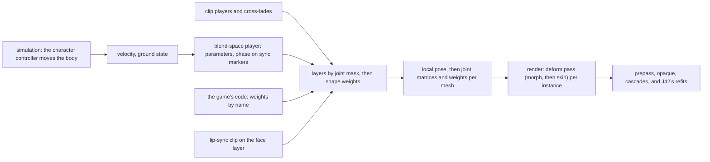
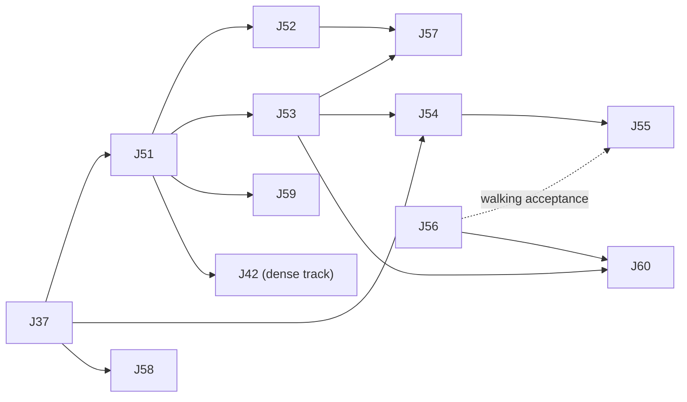

# Characters: blend shapes, blend spaces, skin and hair

The plan, agreed on 2026-11-25, for animated people:

- faces that talk and emote through blend shapes;
- walking driven by blend spaces over a character controller;
- skin, eyes and hair cards to shade them.

It is a track of its own, J51 to J60, scheduled apart from the backlog until the user places it, and none of it is started. The [roadmap](roadmap.md#a-separate-track-characters) carries one row per stage. This document holds the decisions, the facts they rest on, the design, the stages and their exit criteria, and the risks.

It began from a Gemini transcript. Every claim in it was checked against this repository, the glTF specification, the Blender exporter's source and the libraries' own repositories; [what was checked](#facts-checked) says which held.

## Summary

- **What it gives a game:**
  - Blend shapes (glTF morph targets), driven by clips, by the game's code by name, and by lip-sync clips the cook makes from dialogue.
  - 1D and 2D blend spaces kept in step on sync markers.
  - Cross-fades and layers masked by joint.
  - A character controller in the simulation that walking reads.
  - Skin, eye and hair-card materials.
  - Two-bone IK and a look-at later.
- **What it costs the core:**
  - No new runtime dependency. The cook runs Rhubarb Lip Sync (MIT) as an outside program.
  - One new compute pass, which [J42](roadmap.md#j42) was going to build anyway.
  - The animation module's sampler grows from one clip to a blend of poses.
  - Physics gains a controller over Jolt's `CharacterVirtual`, which the pinned Jolt already ships.
- **What stays as it is:**
  - Animation is presentation alone ([animation](animation.md)). Locomotion plays in place, its rate matched to the speed the simulation moves the character at, and no clip moves the simulation.
  - The forward renderer and its pass list stay, as do the clip and clip-file formats (extended, not replaced) and the engine's own sampler (ozz-animation stays out).
- **The consumers:**
  - Manifest: portraits in its panels, people walking in stations and ships, seated pilots.
  - The ground sample: a walker beside its rover.
  - The test content: generated characters.
  - The art team's mechanical morphs: hull damage, folding parts.

## How it was decided

The user's answers in the planning interview, 2026-11-25:

| Question | Answer |
| --- | --- |
| Who needs it | Manifest, a future game, the engine's test content, and mechanical morphs |
| Manifest's uses | Portraits (faces close up), people walking in interiors, seated pilots. Not crowds |
| What drives a face | Authored clips, the game's code by name, and lip sync |
| Lip sync | Made by the cook from each dialogue line's audio, as a clip |
| Locomotion | In place: the simulation moves the character, and the blend space follows its velocity at a matched rate |
| Combining animation | Components (players, cross-fades, layers by joint mask), chosen by the game's code; no state machine or graph |
| Blend spaces | 1D and 2D, kept in step on sync markers |
| Inverse kinematics | Two-bone IK later, as the track's last stage; the look-at comes with it |
| Where morphing and skinning run | One compute pass, built in this track, which J42 reuses |
| Mesh nodes per model | Several (body, eyes, teeth, clothing), sharing one hierarchy and its clips |
| Face shading | Skin, eyes and hair: pre-integrated skin, an eye material, alpha-tested hair cards; strands out |
| Shape-key names | ARKit's 52 names for faces |
| Character controller | The engine's, in physics, in this track |
| ozz-animation | Not adopted; the engine's sampler is extended |
| When | After the cook ([J37](history.md#j37)), before or beside J42 |

## What exists today

| Part | Today | Where |
| --- | --- | --- |
| Rig | One node hierarchy, one skin, one mesh node; a model with more mesh nodes is refused | `animation/Rig.h`, `RigLoader.cpp` |
| Clips | Tracks of translation, rotation and scale; values are four floats; linear, step and cubic | `animation/Clip.h` |
| Morph channels | Skipped: the rig loader passes over a `weights` channel | `RigLoader.cpp:62` |
| Playback | One clip per entity (`AnimationPlayerComponent`), no blending; a changed clip starts from its first pose ([J20](roadmap.md#j20)) | `animation/Components.h` |
| Skinning | In the vertex shaders, up to eight joints a vertex (`joints`, `joints1`), from a palette written each frame; a skinned draw is never culled | `render/Mesh.h`, `FrameData.h` |
| Clip events | Clip files have them; glTF clips have none ([J20](roadmap.md#j20)) | `animation/ClipFile.h` |
| Materials | glTF metallic-roughness and materials as data; no alpha test; transparent draws cast no shadow | [rendering](rendering.md) |
| Characters in physics | None; Jolt's `CharacterVirtual` is in the pinned source, unused | `_deps/joltphysics-src/Jolt/Physics/Character` |

## Facts checked

Checked on 2026-11-25.

| Claim | Verdict | Source |
| --- | --- | --- |
| Morph targets are deltas applied before skinning, weighted per mesh, defaulting to `mesh.weights` or zeros | Holds, but a node's `weights` override its mesh's for that instance; the transcript left that out | glTF 2.0 specification, "Morph Targets" and "Instantiation" |
| Shape names are in `mesh.extras.targetNames` | Holds, as a convention many tools follow; the specification names no field | The same section's implementation note |
| Every primitive of a mesh with targets has the same number, and one set of weights serves them all | Holds | The same |
| Morph deltas can be quantised | Holds: `KHR_mesh_quantization` allows byte and short positions, normalised byte and short normals and tangents | Its README |
| Blender's "Apply Modifiers" drops shape keys | Holds: the option's own text says it prevents exporting them | glTF-Blender-IO `__init__.py` (5.4.18) |
| Set Animation Mode to "NLA Tracks" for one clip per action | Unneeded: the default, "Actions", exports every action, active or on an NLA track, as its own animation | The same |
| (Not in the transcript) Blender exports shape keys as sparse accessors when smaller, and tangent deltas only if asked | Both by default (`export_try_sparse_sk` on, `export_morph_tangent` off), so the loader reads sparse accessors and the cook makes tangent deltas | The same |
| (Not in the transcript) Blender exports no timeline markers to glTF | No marker export in the exporter's source | glTF-Blender-IO, searched |
| Store deltas in a storage buffer, not vertex attributes | Holds, but deltas sparse by vertex, not dense per shape; see [blend shapes](#blend-shapes) | Design |
| Morph in the vertex shader | Rejected: it repeats in every pass (prepass, opaque, each cascade) and J42 needs posed vertices anyway | [Dense geometry](dense-geometry-and-ray-tracing.md#ray-tracing) |
| Blend three poses by `slerp` | Rejected: chained slerps depend on their order; a weighted, sign-aligned normalised lerp is used | Design |
| Normalised time keeps gaits in step | Only when every clip has the same steps and starts on the same foot; sync markers are used | Design |
| Delaunay triangulation for 2D blend spaces | Holds; run at load over a handful of samples | Design |
| "1 to 3 weeks", "a few days with Claude Code" | Not used: [the stages](#stages) are estimated at this repository's bar | |
| fastgltf reads targets, mesh weights and sparse accessors | Holds | `fastgltf/types.hpp`, `tools.hpp` (1.0.1, pinned) |
| Rhubarb Lip Sync: MIT, permissive dependencies, maintained, Linux build | Holds: v1.14.0, April 2025; PocketSphinx for English, a phonetic recogniser for other languages; a dialogue text file improves it; 6 basic and 3 extended mouth shapes | Its LICENSE.md, README, releases |
| ozz-animation: MIT, maintained | Holds: 0.17.0, August 2026 | Its LICENSE.md, releases |
| Jolt has a character controller | Holds: `CharacterVirtual` | Pinned Jolt source |

## Design

### Where the code goes

| Part | Module | Depends on |
| --- | --- | --- |
| Morph targets read and cooked; sync markers, clip speeds and lip-sync clips made | `geometry` and `jettison_cook` ([dense geometry](dense-geometry-and-ray-tracing.md#where-the-code-goes)) | Rhubarb, as an outside program the cook runs |
| Poses, blending, layers, masks, blend spaces, sync, shape weights, later IK and look-at | `animation` | `geometry` (the cooked reader), `serialise` (blend-space files) |
| The players' components | `animation` and `scene`, as today | |
| The deform pass, skin, eye and hair materials, alpha test | `render` | |
| The character controller | `physics` | Jolt |

Animation stays presentation. The controller is simulation, deterministic like the rest of physics, and its state is saved as other bodies' is.

### One frame

### Rigs with several meshes

A model may have several mesh nodes, each with its own skin or none, sharing one node hierarchy and one set of clips. Shape weights are addressed by name across the model, so `eyeBlinkLeft` set once moves the face mesh and the eyelashes alike; a mesh without the name ignores it. The renderer draws each mesh node's primitives, as it draws primitives now.

### Blend shapes

- **Read.** The cooked reader takes each primitive's targets (positions, normals, tangents), sparse or not, the default weights and `targetNames`. A node's own `weights` override its mesh's, so two nodes sharing one mesh keep their own authored shapes; weights are held per mesh node, and an animation's weights channel moves its own node's. A model whose targets have no names gets `0`, `1` and so on, with a warning.
- **Cooked.** The cook remaps the targets with the vertices whenever it reorders them (vertex cache and fetch optimisation), keeps them on every level of detail (`meshopt_simplify` keeps a subset of the original vertices, so their deltas carry over), quantises them as `KHR_mesh_quantization` allows, and makes tangent deltas by running MikkTSpace on each target's shape and subtracting the base's.
- **Stored by vertex, sparse.** Shapes touch few vertices (a blink, a jaw). The model's deltas are one storage buffer laid out by vertex: for each vertex, the list of shapes that move it and their deltas. The deform pass reads a vertex's own list and multiplies each delta by its shape's weight. That needs no atomics and does no work for vertices no shape moves.
- **Weights.** A weights channel becomes one scalar track per shape, so `Sample` serves it as it serves the others (a value in `x`). A clip, a lip-sync clip and the game's code all write weights. The game's, through a `ShapeWeightsComponent` keyed by name, override a layer's value for that name while set.
- **Bounds.** A skinned draw is never culled, as today. A morphed draw that is not skinned has its bounds made each frame from its current weights: the rest bounds widened by each shape's largest delta (from the min and max glTF requires on every `POSITION` target) times the absolute value of its weight. That holds for any weight, negative or above one, which glTF does not forbid and cubic tracks overshoot to.

### The deform pass

One compute pass, early in the frame, writes each animated instance's posed vertices into a buffer of its own. It applies the shapes, then the joints, up to eight a vertex, as the vertex shaders do now. Every pass reads those vertices, and the vertex shaders stop skinning. [J42](roadmap.md#j42) refits each instance's bottom-level structure from the same buffer, so ray tracing builds no skinning of its own. Each animated instance holds a copy of its vertices, so crowds stay out: dozens of characters, not hundreds.

### Poses, cross-fades and layers

- **A pose** is each node's local translation, rotation and scale, with the model's shape weights. Sampling a clip writes a pose; joint matrices are made from the final pose once.
- **Blending** is a weighted sum. Translations, scales and weights are summed by weight. Rotations are summed after each is turned into the hemisphere of the heaviest pose's rotation, then normalised; an exact tie in weight goes to the pose listed first in the blend space's file or the layer list, which is fixed. So the result does not depend on the order poses are evaluated in. It is close to slerp for rotations within about 90 degrees of each other, as a locomotion blend's are; rotations further apart blend poorly by any linear method, and a blend space whose samples differ that much at a joint is reported when it is loaded.
- **Cross-fades** take J20's row: a player's clip changed part-way fades from the pose the rig is in, over a time the change gives.
- **Animation layers** (not a scene's [layer](glossary.md#layer)) are listed on the entity, each a source (a clip or a blend space), a weight and a joint mask, applied in order. A mask names joints and their children. A face layer moves only shape weights, so it needs no mask: weight tracks and joint tracks do not meet.
- **The game's code** picks what each layer plays. No state machine or graph is built.

### Sync markers and clip speed

- **Markers** are clip events of a kind the engine knows: `foot.left` and `foot.right`. glTF has no events and Blender exports no markers, so the cook makes them. It finds each contact from the foot joints the settings name, as the moments the foot is lowest and slowest. A clip's settings may list them instead, by time. The cook writes them as the clip's events in the cooked GLB's extras. That is J20's glTF-clip-events row, done generally: any clip can carry events listed in its settings.
- **Velocity.** The cook measures each locomotion clip's velocity, in the character's frame, from how fast and which way a planted foot travels back: walking forward and strafing are different vectors at one speed. It writes it beside the markers. A clip's settings may set it.
- **In step.** Clips in a blend space share a sync group. The heaviest clip leads, and the others follow its phase between markers, each mapped onto its own segment between the same markers. A clip with no markers in a group falls back to normalised time, with a warning naming it.
- **Events from blends.** A sync group delivers events in its own phase, measured in marker segments, so blended clips give one footstep per contact, not one per clip. The leader's events are delivered as the group's phase crosses them. The group remembers the phase it has delivered up to, so when the lead passes to another clip mid-segment, the new leader delivers only the events after that phase: none is repeated and none is lost. A loop's wrap follows `AdvanceClip`'s rule. A source at zero weight delivers nothing. A cross-fade's outgoing clip stops delivering when the fade begins, and a layer outside any group delivers its own clip's events as today.

### Blend spaces

- **A file**, `animations/<name>.blendspace.yaml`, read through the resource manager and reloaded like a clip file. It names the model, one or two axes (names and ranges) and samples, each a clip at a point. A layer plays it with its parameters set by the game's code, usually the controller's locomotion velocity: its velocity relative to what supports it, in the character's frame (see [the character controller](#the-character-controller)).
- **1D** blends the two samples either side of the parameter. **2D** triangulates the samples by Delaunay at load. A handful of points takes microseconds, with a fixed order so the result never changes. It blends the triangle's three by barycentric weights. A parameter outside the samples' hull is moved to the nearest point on it. Samples all on one line are refused, naming the file.
- **Playback rate** comes after synchronisation and keeps direction. Syncing on markers retimes each follower to the leader's segments, so a sample's effective velocity is its cooked velocity times its retimed rate. The blend's velocity is the weighted sum of those vectors. The playback rate is the scale that best matches it to the locomotion velocity: their dot product over the blend's squared length. A diagonal blend of forward and strafe, moving diagonally, then plays at rate one, as it should. Where the blend's velocity is near zero (idle alone, or idle with a little walk), the rate is one and the idle plays as authored. Animation never moves the body.

### Lip sync

- **Authored.** A dialogue line's audio in the source tree may have a settings file. It gives the line's text, its language, and the model's mouth mapping if not the default.
- **Cooked.** The cook runs Rhubarb on the audio, given the text, with PocketSphinx for English and the phonetic recogniser otherwise. It maps Rhubarb's mouth shapes to ARKit-named weights through a table in the engine's defaults, which a game may override. It writes a clip file of weight tracks named after the audio. Rhubarb's version, from `rhubarb --version`, is part of a line's cook key. A machine without Rhubarb records the line as cooked without lip sync and deletes any lip-sync clip an earlier cook left, with a warning, so the rest of the cook still runs. A later cook with Rhubarb present sees a key change and cooks the line again. The clip file format gains weight tracks, addressed by shape name rather than node.
- **Played** on the face layer. The clip's time follows the voice's play position, which audio reports, or J57 adds.

### Skin, eyes and hair

- **Skin** is pre-integrated (Penner and Borshukov, *GPU Pro 2*, 2011). A lookup texture of scattering by light angle and curvature is generated at build time, and the forward shader reads it. Curvature is cooked per vertex, so no pass or buffer is added. Thin ears in backlight are its known weakness.
- **Eyes** have a material of their own: refraction of the iris under the cornea by parallax, and a wet highlight.
- **Hair** is alpha-tested cards; strands stay out. These are the engine's first alpha-tested materials:
  - an alpha-tested variant of the prepass, the opaque pass and the cascades;
  - alpha to coverage under MSAA until [J49](roadmap.md#j49) replaces MSAA, then a dither that temporal AA resolves;
  - for ray queries, hair's geometry is flagged non-opaque, and the query loop tests each candidate's alpha and confirms or skips it. No any-hit shader is needed with ray queries.
- **Off the meshlet path.** Hair and every other skinned draw stay on the indexed path, as [J40](roadmap.md#j40) already has it.

### The character controller

`Physics` gains a character controller over Jolt's `CharacterVirtual`, neutral of genre:

- a capsule moved by a wanted velocity;
- steps and a steepest slope;
- the ground under it and its state;
- standing on a moving body, such as a ship's deck or a turning platform, carried by the ground's velocity, which Jolt reports at the contact (`GetGroundVelocity`); a [local frame](glossary.md#local-frame) translates and does not rotate, so rotation comes from the body.
- a **locomotion velocity**: its velocity minus the ground's, in the character's frame, published in the snapshot. A passenger standing still on a turning deck has none, though it moves through the frame, so the blend space plays its idle.

Its state is saved and replayed with the simulation's. The game decides what makes it move; the blend space reads its locomotion velocity and ground state.

### Later: two-bone IK and look-at

The track's last stage, built when a consumer asks:

- two-bone IK on chosen chains, for feet on steps and slopes and hands on controls. The capsule's one supporting contact cannot say where each foot lands, and presentation reads only the snapshot. So the controller sweeps a grid of cells down around the capsule each step, in the character's frame: each cell's footprint is a box swept down with `CastShape`, which finds the highest surface anywhere under the cell, however narrow, where a ray could fall between. Each cell's height and normal go into the snapshot. The grid's size (about a stride each way) and spacing come from the character's definition. Presentation places each animated foot, wherever the pose puts it, so strides stay free, at the highest of the cells its sole overlaps. A foot therefore never ends inside a surface, a strip narrower than a cell included. The error is one-sided: a foot may stand above the ground by at most the rise within one cell, which the spacing bounds. The grid is fixed in size, so it costs the same every step, replicates like the rest of the snapshot, and needs no command;
- a look-at on chosen joints (eyes, head, neck), with angle limits and a blend weight.

Both run after the layers, as presentation. ozz-animation's solvers are read as a reference.

### Test content

Generated at build time, as the dense test meshes are, so nothing large is committed and nothing carries another's licence:

- a jointed figure with several mesh nodes;
- a face with a subset of the ARKit shapes;
- walk, run and strafe clips with foot contacts the cook finds;
- hair-card strips.

The art team's assets serve Manifest's acceptance scenes.

## Stages

Effort is for one developer at this repository's bar: tests, documents, a green gate and cross-review.

| ID | Stage | Needs | Effort |
| --- | --- | --- | --- |
| J51 | The deform pass and rigs with several meshes | J37 | 2 to 3 weeks |
| J52 | Blend shapes | J51 | 2 to 3 weeks |
| J53 | Poses, cross-fades and layers | J51 | 1 to 2 weeks |
| J54 | Clip events from the cook, sync markers and clip velocity | J37, J53 | 1 to 2 weeks |
| J55 | Blend spaces | J54 | 2 to 3 weeks |
| J56 | The character controller | | 2 to 3 weeks |
| J57 | Lip sync at cook time | J52, J53 | 1 to 2 weeks |
| J58 | Skin and eyes | J37 | 2 to 3 weeks |
| J59 | Hair cards and alpha-tested materials | J51 | 2 to 3 weeks |
| J60 | Two-bone IK and look-at, later | J53, J56 | 2 weeks |

About 4 to 6 months in all. J56 stands apart, so it can be built at any time; J55's walking acceptance waits on it. [J42](roadmap.md#j42) now needs J51.

### J51. The deform pass and rigs with several meshes

- **Delivers.**
  - The compute pass that skins each animated instance into its own vertex buffer, with every pass reading it; the vertex shaders' skinning removed.
  - Several mesh nodes per model in the rig and the renderer.
  - Its memory in `GetFrameStats`, as part of the geometry budget's fixed share, with the budget's two steps for animated instances: deform a coarser level, then draw at rest. Before J43 delivers the budget, the pass reports its memory alone.
- **Exit criterion.**
  - The skinned reference views unchanged, to the reference fuzz.
  - A generated figure of several meshes, skinned, in a new view.
  - Synchronisation validation clean in the smoke test.
  - The pass's time for ten figures recorded on the 5060 Ti.
  - Once the budget exists ([J43](roadmap.md#j43)), many instances of one figure under a small budget deform coarser levels, then the farthest draw at rest, each step logged, and the total stays within the budget.

### J52. Blend shapes

- **Delivers.**
  - Targets read, sparse included, with their names.
  - The cook's remapping, levels of detail, quantisation and tangent deltas.
  - The by-vertex delta buffer and the morph in the deform pass.
  - Weight tracks.
  - `ShapeWeightsComponent` by name, with a console line to set one.
  - Morph-only bounds.
- **Exit criterion.**
  - The `geometry` suite round-trips targets through the cook, with weights applied on the CPU matching the source's within quantisation.
  - The animation suite samples a weights clip.
  - Reference views of the generated face at rest, with `jawOpen` at 1, and mid-clip.
  - A generated stress model, with many shapes over one mesh, read and drawn.

### J53. Poses, cross-fades and layers

- **Delivers.**
  - Local poses and their blend.
  - Cross-fades on a changed clip (J20's row).
  - Layers with joint masks.
  - Joint matrices made once from the final pose.
- **Exit criterion.**
  - The animation suite proves the blend gives the same result for every order of its poses, ties included, and is normalised.
  - A cross-fade starts from the current pose.
  - A masked layer leaves the other joints as the layer below has them.
  - The existing clip reference views unchanged.

### J54. Clip events from the cook, sync markers and clip speed

- **Delivers.**
  - Events from a clip's settings into the cooked GLB (J20's other row).
  - Foot contacts found from named joints.
  - Each clip's speed.
  - glTF clip events heard as clip-file events are.
  - Event delivery from blends and cross-fades, by [the rule above](#sync-markers-and-clip-speed).
- **Exit criterion.**
  - The cook suite finds the generated walk's contacts within a frame of where the generator put them, and its velocity within 5%.
  - A clip's listed events override what is found.
  - A glTF clip's event fires a sound in a test.
  - The animation suite proves a walk and run blended give one `foot.left` per contact; a lead changing mid-segment repeats and loses none; a loop's wrap fires once; a zero-weight source fires none.

### J55. Blend spaces

- **Delivers.**
  - The blend-space file and its reader.
  - 1D and 2D blending, with Delaunay triangulation, clamping to the hull, and refusing collinear 2D samples.
  - Sync groups on markers.
  - The playback rate from speed.
  - The ground sample's walker, a controller (J56) with a blend space.
- **Exit criterion.**
  - The animation suite proves the barycentric weights sum to one, and the same parameter gives the same pose every run.
  - Feet stay in step across a walk-to-run sweep (contacts' phase within a tolerance). A planted foot's slide stays within a tolerance at a blend of walk and run, and at a diagonal blend of forward and strafe, the rate taken after sync.
  - The ground sample's walker standing on a turning platform plays its idle.
  - Reference views of the walker at three speeds and while strafing.
  - The ground sample's smoke-test stage walks it.

### J56. The character controller

- **Delivers.**
  - `CharacterVirtual` behind the physics interface: walking, steps, slopes and ground state.
  - Carriage on a moving body by the ground's velocity.
  - The locomotion velocity in the snapshot.
  - Its saved state.
- **Exit criterion.**
  - The physics suite walks a capsule up steps and stops it at a steep slope.
  - It carries the capsule on a rotating deck, the same to the bit across two runs, and a capsule standing still on it reports a locomotion velocity of zero.
  - A save and load mid-walk replays identically.

### J57. Lip sync at cook time

- **Delivers.**
  - Rhubarb run by the cook, with text and language from the line's settings.
  - The default mouth mapping to ARKit names.
  - Weight tracks in clip files.
  - Playback following the voice's position.
  - Rhubarb added to the devenv shell, or the skip with its warning.
- **Exit criterion.**
  - The cook suite turns a short fixture line into a clip whose mouth shapes match Rhubarb's output for it.
  - A reference view of the face mid-line.
  - The cook with Rhubarb missing warns, finishes and deletes a stale clip; a cook after Rhubarb is installed cooks the line again.

### J58. Skin and eyes

- **Delivers.**
  - The skin material and its lookup texture, generated at build.
  - Cooked curvature.
  - The eye material.
  - Both as material definitions with their parameters, per [materials as data](rendering.md).
- **Exit criterion.** Reference views of the generated face under a key light and in backlight, with the eye material at two angles.

### J59. Hair cards and alpha-tested materials

- **Delivers.**
  - Alpha-tested variants of the prepass, opaque and cascade programs.
  - Alpha to coverage under MSAA.
  - Non-opaque geometry and the candidate test in the ray-query loop, when J42 has landed, or with it.
  - The dither to replace alpha to coverage, built with [J49](roadmap.md#j49).
- **Exit criterion.**
  - Reference views of the generated hair cards, lit and shadowed by the cascades.
  - With ray tracing on, their ray-traced shadow matching the cards' cut-outs.

### J60. Two-bone IK and look-at, later

- **Delivers.** The controller's ground grid, published in the snapshot; two-bone IK on named chains, fed by it; the look-at with limits and weight.
- **Exit criterion.**
  - The animation suite proves the solver reaches reachable targets and stops at limits.
  - In a test, a walker's stride across a tread's edge puts the foot on the tread, never below its surface, and above it by no more than the rise within one cell; a strip narrower than a cell under the foot lifts it onto the strip.
  - Reference views of the walker on a step and of a seated figure looking at a target.

## How it is tested

- **Suites.**
  - `geometry` and `cook`: targets, markers, speeds and lip sync.
  - `animation`: poses, blends, layers, sync, blend spaces and IK.
  - `physics`: the controller.
  - `render`: the deform pass against a CPU reference built from the same code.
- **Reference views** of the generated figure, face and hair, each feature also forced off where it has a fallback (the deform pass has none: it replaces vertex skinning).
- **The ground sample's** walker is the independent engine consumer. Manifest adds its portraits, interiors and pilots as it takes each stage up ([game integration](game-integration.md#provisioning-a-capability)).

## Where it meets the existing roadmap

| Item | How |
| --- | --- |
| [J20](roadmap.md#j20) | Its glTF-clip-events row moves to J54 and its cross-fade row to J53; its clamps and vehicle rigs stay |
| [J37](history.md#j37) | Relies on it: the cooked reader, the cook's settings and its records. J52 and J54 add processors to it |
| [J40](roadmap.md#j40) | Skinned, morphed and hair draws stay on the indexed path |
| [J42](roadmap.md#j42) | Now needs J51: it refits from the deform pass, and builds no compute skinning of its own |
| [J44](roadmap.md#j44) | Hair's non-opaque geometry is the shadow rays' first candidate test |
| [J49](roadmap.md#j49) | Hair's alpha to coverage gives way to a dither temporal AA resolves |
| [J21](roadmap.md#j21) | Lip sync needs a voice's play position from audio |
| [J28](history.md#j28) | Its skinned reference frames are recorded again in J51 if they move |
| [Dense geometry](dense-geometry-and-ray-tracing.md) | Its "no alpha-tested geometry" holds until J59; its deforming meshes come from J51 |

## Expected issues

| Issue | Effect | What is done |
| --- | --- | --- |
| Blender's "Apply Modifiers" drops shape keys | A face exports without them | The artists' notes say so; the cook warns when a model named as a face in its settings has no targets |
| Simplification ignores shapes | A face's shapes coarsen at a distance | Faces usually keep their finest level by their settings; measured on the art team's heads |
| Feet slide in blends between speeds | Visible on floors | Speed-matched rate and markers; IK in J60 |
| Rhubarb is weaker outside English | Mouths looser in French, German, Japanese | The text file given always; a game can hand-author a line's clip |
| Alpha-tested cards shimmer | Hair flickers in motion | Alpha to coverage now, dither and temporal AA from J49 |
| A copy of the vertices per animated instance | Memory grows with characters | Part of the geometry budget's fixed share, with steps of its own in its [overflow order](dense-geometry-and-ray-tracing.md#memory): a coarser level deformed, then the farthest drawn at rest; crowds stay out |
| Quaternion signs in blends | A limb flips through a blend | Every rotation aligned to the first's hemisphere before summing |
| A controller on a moving deck | Jitter as the frame turns | Moved in the frame's coordinates, as the simulation's bodies are; the rotating-deck test |
| Pre-integrated skin on thin parts | Ears too dark in backlight | Accepted; a transmission term if art asks |

## Sources

- glTF 2.0 specification, Morph Targets: https://registry.khronos.org/glTF/specs/2.0/glTF-2.0.html#morph-targets
- KHR_mesh_quantization: https://github.com/KhronosGroup/glTF/tree/main/extensions/2.0/Khronos/KHR_mesh_quantization
- glTF-Blender-IO, export options: https://github.com/KhronosGroup/glTF-Blender-IO/blob/main/addons/io_scene_gltf2/__init__.py
- Rhubarb Lip Sync: https://github.com/DanielSWolf/rhubarb-lip-sync
- ozz-animation: https://github.com/guillaumeblanc/ozz-animation
- Apple, ARFaceAnchor.BlendShapeLocation (the 52 names): https://developer.apple.com/documentation/arkit/arfaceanchor/blendshapelocation
- Penner and Borshukov, "Pre-Integrated Skin Shading", *GPU Pro 2*, 2011
- Jolt Physics, `CharacterVirtual`: the pinned source, `Jolt/Physics/Character/CharacterVirtual.h`
