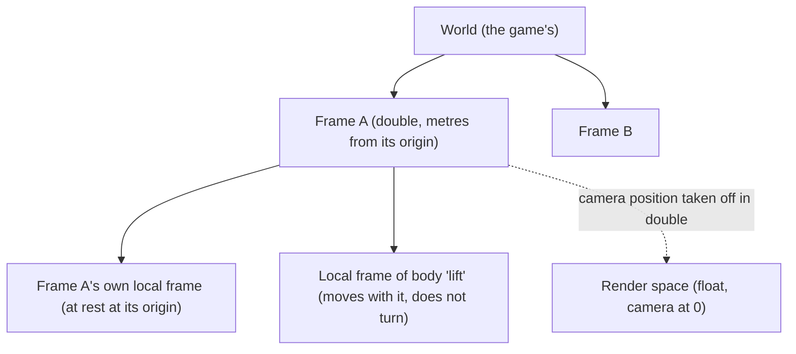
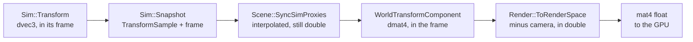

# Coordinate frames and units

Jettison is built for worlds far larger than a float can address. A 32-bit float has about seven
significant digits, so a position four thousand kilometres from its origin is already a quarter of
a metre coarse. This document says how the engine measures things, which coordinate system each
number is in, and how a position travels from the simulation to the screen without losing
precision on the way.

## Concepts

### Units and handedness

Every quantity is in SI units: metres, seconds, kilograms and radians. Coordinates are
right-handed with +Y up. A camera looks down its local -Z, with +X to its right
(`Render::CameraView`, `Scene::CameraComponent`). One exception: a scene file's camera field of
view, `fov`, is in degrees (`CameraComponent::verticalFovDegrees`).

### The four levels

A position means nothing without the origin it is measured from. The engine has four levels of
origin, each nested in the one above.

| Level | Precision | Origin | Used by |
| --- | --- | --- | --- |
| World | the game's | the game's own, if it has one | moving between frames, through portals or the game's own means |
| [Frame](glossary.md#frame-coordinates) | `double` | the frame's origin | simulation positions (`Sim::Transform`), [rails](glossary.md#rails), the spatial index, Jolt |
| [Local frame](glossary.md#local-frame) | `double` positions, `float` velocities | a named body of the frame: a [platform](glossary.md#platform) or a moving deck | physics near that body, steering, the sun's shadow grid |
| Render | `float` | the camera | everything submitted to the GPU |

The diagram shows the nesting: a local frame rides on one body inside a frame, and render space is
rebuilt around the camera every frame.



### The world

The engine has no world coordinates of its own. A game that needs them keeps them: in Manifest the
galaxy is a graph of star systems placed in light years
([Manifest's space document](../../manifest/docs/space.md)). Moving an entity between frames is
the game's decision, made through a [portal](glossary.md#portal) or by changing its `Sim::InFrame`
([Transit](transit.md)).

### Frames

A frame is a partition of the world with its own origin. A game of one place, such as the ground
sample, has one frame; in Manifest each star system is a frame. An entity says which frame it is in
with `Sim::InFrame`, whose `frame` is the frame's name hashed (`Sim::FrameId("ground")`). A save
keeps the hash, so renaming a frame in the game's data moves its entities nowhere rather than into
another frame.

Positions in two frames are not comparable: two entities at the same coordinates in different
frames are nowhere near each other, and never collide. An entity between frames, such as one passing
through a portal, is in no frame (`Sim::kNoFrame`, which is 0) until it arrives. So is an entity
with no `Sim::InFrame`, even in a game of one frame: physics gives it no body and the spatial index
leaves it out.

`Sim::Transform` holds a position in metres from the frame's origin and an orientation, both
`double` (`glm::dvec3`, `glm::dquat`). This is the position the
[simulation](glossary.md#simulation) owns, physics writes and presentation interpolates.

### Local frames

A local frame is the frame of reference of one named body of a frame: it moves with the body and
does not turn with it. A body with no `Physics::LocalFrame` is in the frame's own local frame, at
rest at the frame's origin. The bodies a local frame can name come from the game's
`Physics::FrameModel`.

A local frame exists for physics: Jolt keeps velocities and broadphase bounds in floats, which far
from the frame's origin are too coarse for a vehicle to meet a fast-moving platform
([why local frames](physics.md#why-local-frames)). In a local frame, Jolt's positions are metres
from the body and `Physics::Velocity` is relative to the body's motion, while `Sim::Transform` stays
in the frame's coordinates. Velocities in different local frames are not comparable.

### Render space

Render space is the frame with the camera at its origin. The renderer subtracts the camera's
`double` position from each object's position, and only then converts to `float`, so precision is
always best where the player looks. This is the floating origin; simulation code never sees it.

## How it works

### From the simulation to the screen

A position stays a `double` from the simulation to the last step before the GPU. The diagram
shows where it changes form.



1. After each [step](glossary.md#step) the [snapshot](glossary.md#snapshot) copies every
   entity's `Sim::Transform` and the frame it is in (`Sim::TransformSample`).
2. `Scene::SyncSimProxies` writes each [proxy](glossary.md#proxy)'s position, interpolated
   between two snapshots, in double precision and in its frame. Which frame a scene shows is the
   game's choice.
3. The scene composes each entity's `Scene::WorldTransformComponent`, a `glm::dmat4` in the
   frame.
4. `Render::ToRenderSpace` takes the camera's position off the translation in `double`, then
   makes the matrix a `float`. `Render::RenderViewMatrix` is then the camera's rotation alone.

### Depth: reversed-Z with an infinite far plane

The projection is `Render::ReversedInfinitePerspective`. A point on the near plane has depth 1,
and depth falls towards 0 as near / distance, with no far plane. Depth is cleared to 0 and tested
with GREATER.

Reversing depth pairs a float's dense values near 0 with the far distances, where a conventional
mapping would waste them, so a cockpit half a metre away and a planet forty thousand kilometres away
share one depth buffer. Two settings support it:

- GLM is built with `GLM_FORCE_DEPTH_ZERO_TO_ONE` (on the `glm` target in
  `source/external/CMakeLists.txt`), Vulkan's 0-to-1 depth range.
- The depth target is `D32_SFLOAT_S8_UINT`. A 24-bit fixed-point depth would lose the precision
  reversing gains ([decisions](decisions.md#rendering)).

With the far plane at infinity, the renderer's culling frustum (`Render::ViewFrustum`,
`render/Culling.h`) has five planes, the near plane and the four sides, and no far one
([rendering](rendering.md#collecting-and-culling)).

### Precision in the maths library

Each bounding shape in `source/engine/math/include/jettison/math/Bounds.h` comes in two
precisions: the float ones (`Aabb`, `Sphere`, `Ray`, ...) for culling and picking in render space,
the double ones (`DAabb`, `DSphere`, `DRay`, ...) for the simulation's frames.
`Render::ScreenRay` returns a `Math::DRay` from the camera, in the frame, which is what a pick
casts.

### How physics uses frames

Physics gives each frame with bodies, and each local frame in it, a Jolt world of its own. What
moves a frame's named bodies, and what gravity acts there, is the game's `Physics::FrameModel`;
each step physics moves every local frame's origin to its body and takes the frame's change of
velocity off the dynamic bodies in it, so a vehicle beside a moving platform stays beside it. The
full account is in [Physics](physics.md#frames-and-local-frames).

### The sun's shadow grid

The sun's shadow maps snap to whole texels measured from the camera's frame origin
([sun shadows](rendering.md#sun-shadows)). `Render::ActiveCameraView` sets that origin
(`Render::CameraView::frameOrigin`) to what an orbit camera circles or, for a pilot camera, to the
entity its vehicle flies by (`Scene::PilotCameraComponent::frame`): the origin of the local frame
the camera moves in. A grid fixed to the frame's origin would slide under a fast-moving platform by
a fraction of a texel every frame.

## Using it

### A frame and its entities

The ground sample has one frame, named `ground` (`source/samples/ground/src/Ground.cpp`). Its
`GroundModel` has no named bodies and gives a constant 9.81 m/s² down (a frame model is shown in
[Physics](physics.md#a-frame-model)). The sample defines the frame once and names it beside each
entity's transform:

```cpp
std::uint64_t GroundFrame()
{
	return Sim::FrameId("ground");
}

// At start-up:
physics.DefineFrame(GroundFrame(), std::make_unique<GroundModel>());

// Each entity names its frame beside its transform:
registry.emplace<Sim::Transform>(rover, Sim::Transform{{0.0, kRoverHalfExtents.y, 0.0}});
registry.emplace<Sim::InFrame>(rover, GroundFrame());
```

A local frame on a moving body, the physics suite's lift, is under [rails and a local
frame](physics.md#rails-and-a-local-frame).

### Camera-relative drawing

`Render::ToRenderSpace` keeps a millimetre's detail 150 million kilometres from the origin
(`source/engine/render/tests/CameraTests.cpp`):

```cpp
const glm::dvec3 camera{1.496e11, 1.0e3, -2.0e10};
glm::dmat4 world{1.0};
world[3] = glm::dvec4{camera + glm::dvec3{0.001, 12.5, -40.0}, 1.0};
const glm::mat4 relative = ToRenderSpace(world, camera);
CHECK(relative[3].x == doctest::Approx(0.001f).epsilon(1e-2));
CHECK(relative[3].y == 12.5f);
```

`source/engine/render/tests/LargeWorldTests.cpp` checks the whole path: a station orbits an
Earth-sized planet 150 million kilometres from the origin, followed by an orbit camera for ten
seconds of frames. Every sampled point is drawn within a hundredth of a pixel of its
double-precision reference; the same frames made floats before the camera is taken off are more
than a hundred pixels out.

## Limits and open work

- The engine does not convert positions or velocities between frames or local frames; a flight
  reference in another frame is the game's mistake (`Physics::FlightControls`).
- Some comments still say "system frame" for the frame: `render/Shadows.h`, `render/Particles.h`,
  `render/DebugDraw.h`, `audio/AudioSystem.h` (twice), `audio/EventSounds.h`,
  `scene/src/CameraRigs.cpp` and `render/tests/LargeWorldTests.cpp`. The term is the frame.

## Decisions

Settled decisions on frames, precision and depth are in
[decisions](decisions.md#coordinate-frames-and-units); those on physics in frames are under
[Physics](decisions.md#physics).

## Source

| Module | Headers |
| --- | --- |
| sim | `source/engine/sim/include/jettison/sim/Snapshot.h` (`Transform`, `InFrame`, `FrameId`, `kNoFrame`) |
| physics | `source/engine/physics/include/jettison/physics/PhysicsWorld.h` (`FrameModel`, `DefineFrame`, `FrameOrigin`), `Components.h` (`LocalFrame`, `OnRails`, `Velocity`) |
| scene | `source/engine/scene/include/jettison/scene/SimProxies.h`, `Components.h` (`WorldTransformComponent`, `CameraComponent`) |
| render | `source/engine/render/include/jettison/render/Camera.h` (`CameraView`, `ToRenderSpace`, `ReversedInfinitePerspective`, `ScreenRay`), `Culling.h`, `Shadows.h` |
| math | `source/engine/math/include/jettison/math/Bounds.h` |
| spatial | `source/engine/spatial/include/jettison/spatial/FrameIndices.h` (one index per frame) |
