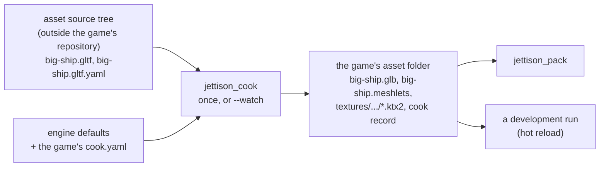
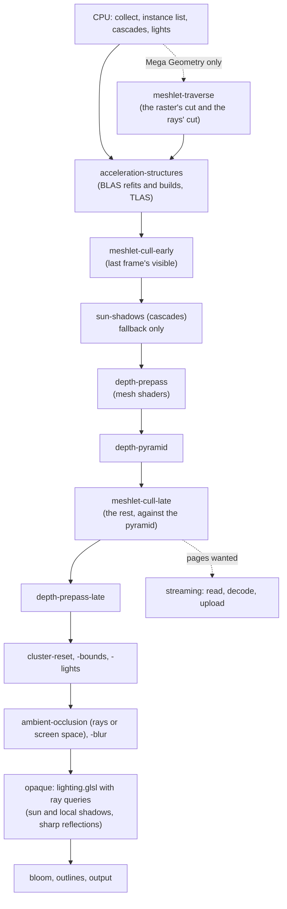
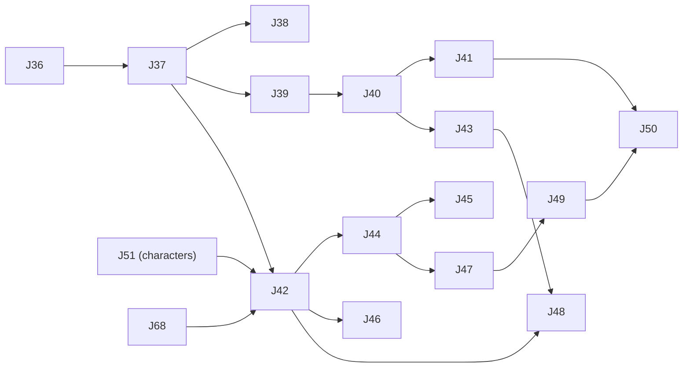

# Dense geometry and ray tracing

The plan for meshlet levels of detail drawn by mesh shaders, an asset cook, geometry streaming and
ray-traced shadows, ambient occlusion and reflections, with RTX Mega Geometry as an optional
accelerator. Agreed with the user on 2026-11-25; J36 and J68 are built. Its stages are
[J36 to J50 and J68](roadmap.md#a-separate-track-dense-geometry-and-ray-tracing) on the roadmap, a track
scheduled apart from Manifest's queue until the user places it. The settled choices are also in
[decisions](decisions.md#rendering), each linking back here; the research this plan replaces
(the Nanite study of 2026-11-25) is folded into it.

## Summary

- **Why.** Manifest's art needs dense content: ship and station kits authored at high detail,
  fields of many instances (asteroids, debris, cargo) and dense asteroid meshes. The art team has
  asked for reflections. Today a glTF model has one level of detail, every draw is recorded by the
  CPU, only the sun casts shadows, and reflections are the environment cube's alone.
- **What it delivers.**
  1. An asset **cook**: artists' glTF and images, kept in a source tree outside the game's
     repository, cooked by `jettison_cook` into the game's asset folder, once or as a watching
     daemon, with per-asset settings in a YAML file beside each source.
  2. **Meshlets**: each model cooked into a hierarchy of small triangle clusters with errors, drawn
     by task and mesh shaders after GPU culling (frustum, normal cone, level of detail, occlusion),
     and streamed in pages.
  3. **Ray tracing** on `VK_KHR_ray_query`: the sun's shadows, opt-in point and spot light shadows,
     ambient occlusion and sharp reflections, each a switch with today's path as its fallback.
  4. **RTX Mega Geometry** (`VK_NV_cluster_acceleration_structure`) on NVIDIA only, so ray tracing
     sees the same meshlets the raster draws.
  5. Later: a temporal foundation with temporal AA in place of MSAA and glossy reflections, then a
     visibility buffer and software raster.
- **What it costs the core.** One new CPU module (`geometry`), one new tool (`jettison_cook`) and
  one new dependency (meshoptimizer, MIT). Every GPU feature is optional and checked per device;
  a game with no dense content runs today's paths and pays for a small library compiled in.
- **What stays as it is.** Clustered forward shading, `lighting.glsl` as the one lighting
  implementation, MSAA, the light grid, the pass list, cascaded shadows and screen-space ambient
  occlusion (as the fallback), Linux only.

## How it was decided

The user's answers, 2026-11-25. A transcript of a conversation with another assistant started it;
every claim in it was checked against the headers, the registry, the library sources and the
devices before it was used ([what was checked](#facts-checked)).

| Question | Answer |
| --- | --- |
| Ray tracing (scope said Out) | In: ray queries on plain KHR acceleration structures, which lavapipe runs; Mega Geometry an accelerated path on NVIDIA |
| Windows | Near the end of this development phase ([decisions](decisions.md#build-and-platform)); designed for Linux until then, every dependency chosen portable |
| What justifies the work | Manifest content: ship and station kits, many instances, dense asteroid meshes (no terrain system) |
| Anti-aliasing against a visibility buffer | Temporal AA, replacing MSAA in [J49](roadmap.md#j49) (decided 2026-11-25); the visibility buffer follows in J50 |
| Ray-traced effects | Sun shadows, local light shadows, ambient occlusion; reflections added at the art team's request |
| Reflections | Sharp first, with no denoiser; glossy with a denoiser a later stage |
| Devices without ray queries or mesh shaders | Keep today's paths as their fallback, kept under test |
| Verifying Mega Geometry, which lavapipe lacks | A check script on Lythir's RTX 5060 Ti, outside the gate |
| Vulkan version | Move to 1.4 as the first step |
| Occlusion culling (scope said Out) | In, as a regular stage |
| Streaming | In the plan, as a regular stage |
| Which local lights cast shadows | Opt-in per light, a bounded number per pixel |
| Where device-free mesh work lives | A new CPU module, `geometry` |
| Assets | Cooked from a source tree outside the game's repository by a watching tool, with a settings file beside each source (`big-ship.gltf.yaml`) |
| A cooked model | A normalised GLB and a meshlet page file beside it |
| A glTF that was not cooked | Drawn on the indexed path, with a warning naming the cook |
| What the cook takes | Models and the images their materials use; other files are copied through |
| The engine's own test content | Cooked at build time, as shaders are compiled; nothing cooked is committed |
| The engine's dense test meshes | Generated at build time, so no large binaries are committed |
| Blend spaces and blend shapes | Planned in [characters](characters.md), J51 to J60 |

## What exists today

| Area | Today | What this plan changes |
| --- | --- | --- |
| Level-of-detail metric | `SelectLod` (`render/Culling.h`): a level is chosen when its error, projected, is within the threshold's pixels (`kDefaultLodThreshold = 1.0`, `IRenderer::SetLodThreshold`), kept across frames inside a hysteresis band ([rendering](rendering.md#collecting-and-culling)); the same rule Nanite applies per cluster | The same rule and threshold, per meshlet, on the GPU |
| Levels of detail | Procedural shapes have five; a glTF model has its file's: a cooked file's levels, or one of error 0, with a warning naming the cook, for a file that was not cooked (`ModelGltf.cpp`) | The cook makes levels for every model ([J37](history.md#j37)) and a meshlet hierarchy ([J39](roadmap.md#j39)) |
| Model loading | glTF, cooked or not, read and parsed once at run time on the I/O worker by `geometry`'s `GltfFile` (`animation`'s `ModelFile`), and `render`'s geometry and `animation`'s rig made from that parse | The meshlet page file read beside the cooked GLB |
| Vertex | One 108-byte `Vertex` for every mesh, with two joint and weight sets | Meshlet vertices in a compact static layout; skinned meshes keep the current vertex |
| Culling | CPU, per draw, in double precision: frustum, horizon, `TooSmallToSee`, `CastsInto` per cascade | GPU culling per instance and per meshlet, camera-relative in float, which render space already is |
| Drawing | `vkCmdDrawIndexed` per batch and primitive, front to back | Task and mesh shaders for meshlet models; the indexed path stays |
| Occlusion | The horizon test against bodies only | Two-pass occlusion culling against a depth pyramid ([J41](roadmap.md#j41)) |
| Shading | Clustered forward, one pipeline and descriptor set per material, MSAA up to 4x | Unchanged; ray queries added inside `lighting.glsl` behind a variant |
| Depth prepass | Kept and off by decision; on when ambient occlusion or outlines need it | Also on when a ray-traced effect is on, so rays are not traced for hidden fragments; measured in [J44](roadmap.md#j44) |
| Shadows | The sun's four 2048² cascades; no point or spot shadows | Ray-traced sun shadows and opt-in local shadows where the device has ray queries; cascades otherwise |
| Ambient occlusion | The `ambient-occlusion` pass from the prepass's depth and normals, then a blur | The same pass, inputs and blur, sampling the scene with rays ([J46](roadmap.md#j46)) |
| Reflections | The environment cube; screen-space reflections out by decision | Ray-traced sharp reflections below a roughness cut-off ([J47](roadmap.md#j47)); screen-space reflections stay out |
| Assets | `jettison_pack` packs files as they are; textures made by import scripts (`scripts/import-planet-textures.sh`, `ktx create`) | `jettison_cook` cooks models and textures before packing |
| Device | Vulkan 1.3, dynamic rendering and synchronization2 required; no optional features | Vulkan 1.4; one table of optional capabilities, each logged and overridable ([J36](history.md#j36)) |
| Shaders | `glslc --target-env=vulkan1.3`, with variants built by `jettison_compile_shader_variant` | Variants for mesh shaders and ray queries, from the same sources |

## Facts checked

Measured or read on 2026-11-25. Claims from the transcript that did not hold are marked.

### Devices

| Feature | RTX 5060 Ti (driver 615.78.08) | Lavapipe (Mesa 26.2.5, the gate's) |
| --- | --- | --- |
| Vulkan | 1.4 | 1.4 |
| `VK_EXT_mesh_shader` (task and mesh) | yes; 256 vertices and 256 primitives at most, preferred workgroup 32 | yes; 256 and 256, preferred workgroup 128 |
| `VK_KHR_acceleration_structure`, `VK_KHR_ray_query`, `VK_KHR_ray_tracing_pipeline` | yes | yes, and `VK_KHR_ray_tracing_position_fetch` |
| `VK_NV_cluster_acceleration_structure`, `VK_NV_partitioned_acceleration_structure` | yes | **no** |
| `VK_EXT_cluster_acceleration_structure` | **no** (the transcript said driver 615.71.09 and later have it) | no |
| 64-bit atomics (`shaderBufferInt64Atomics`, `shaderImageInt64Atomics`), `multiDrawIndirect`, `drawIndirectCount`, `bufferDeviceAddress`, `descriptorIndexing`, `samplerFilterMinmax` | yes | yes |

The RTX 5070 Ti is kept for inference and is never drawn with. `vulkaninfo` does not print the
cluster extension's properties, so the engine reads `maxVerticesPerCluster` and
`maxTrianglesPerCluster` itself ([J36](history.md#j36)).

No AMD device is at hand, so AMD's support is read from RADV's source (Mesa 26.3.1,
`radv_physical_device.c` and `ac_gpu_info.c`, 2026-11-26), not a device. Mesh and task shaders
need GFX10.3 (RDNA 2, RX 6000) or later; ray queries and acceleration structures are native from
GFX10.3 too, and emulated on older chips only behind an experimental flag; 64-bit buffer and image
atomics are on every chip. An RX 5000 (RDNA 1) or older card therefore runs with neither meshlets
nor ray tracing, as does an NVIDIA card before Turing.

Descriptor indexing ([J68](history.md#j68)) is not among the core versions' required features: from
1.2 it is required only of a driver that also exposes `VK_EXT_descriptor_indexing` (the
specification's feature requirements, read 2026-11-27). Mesa's drivers (main, 2026-11-27): RADV has
it on every GCN and RDNA chip, NVK on every chip it gives 1.3 (Maxwell onwards), ANV on Skylake
onwards; `hasvk`, Intel's Ivy Bridge to Broadwell driver, has none of it, yet reports 1.3 on
Broadwell, so a Broadwell is the one device the 1.3 check accepted that J68 refuses. The
Roadmap 2022 profile requires it, and AMD's Windows driver claims that profile on RX Vega and RDNA.
NVIDIA's own driver is not checked: no source, and no device older than the 5060 Ti at hand.

### Extensions and versions

- **`VK_NV_cluster_acceleration_structure`** (revision 4, not ratified, NVIDIA's) depends on
  `VK_KHR_acceleration_structure` only. Two commands: `vkGetClusterAccelerationStructureBuildSizesNV`
  and `vkCmdBuildClusterAccelerationStructureIndirectNV`. Its operations are
  `BUILD_TRIANGLE_CLUSTER_NV` (a CLAS from a cluster's triangles), `BUILD_CLUSTERS_BOTTOM_LEVEL_NV`
  (a bottom-level structure from CLAS references; the transcript's `BUILD_BLAS_FROM_CLUSTERS_NV` does
  not exist), templates and instantiation, and `MOVE_OBJECTS_NV`. A CLAS is never put in a TLAS
  itself; the bottom-level structure built from CLAS references is. Cluster structures cannot be
  serialised, so they are built on the device every run and cannot be cooked. Limits are device
  properties, with alignments for scratch, clusters, templates and bottom-level structures.
- **GLSL**: `GL_NV_cluster_acceleration_structure` (`#version 460`) gives `gl_ClusterIDNV` in hit
  shaders and `rayQueryGetIntersectionClusterIdNV(q, committed)` with `GL_EXT_ray_query`. glslang
  16.6.0 here compiles such a shader at `--target-env=vulkan1.3`; the 1.4.363 headers have every
  symbol.
- **Not available elsewhere.** No Khronos `EXT` or `KHR` cluster extension is in the registry or
  the 1.4.363 headers. A Khronos news item reports an `EXT` name in an NVIDIA driver, unconfirmed
  in the registry. AMD's `VK_AMDX_dense_geometry_format` (provisional, in `vulkan_beta.h`) builds
  acceleration structures from compressed triangle blocks for future AMD hardware, on a Windows
  preview driver; it is not a cluster equivalent. Cross-vendor clustered geometry exists only in
  DirectX Raytracing, as a preview (October 2026). No RADV or Intel work was found.
- **64-bit atomics** are optional in every version up to 1.4. `shaderBufferInt64Atomics` is a 1.2
  feature (`VkPhysicalDeviceVulkan12Features`, from `VK_KHR_shader_atomic_int64`), optional when
  that extension is absent, and missing from the features 1.4 makes required.
  `shaderImageInt64Atomics` belongs to `VK_EXT_shader_image_atomic_int64`, promoted to no core
  version (the 1.4.363 headers; the specification's versions appendix). The 5060 Ti, lavapipe and
  RADV have both, so the visibility buffer ([J50](roadmap.md#j50)) asks the capability table for
  one, as any optional path does. Which form Unreal's Nanite needs was not checked: the transcript
  and a forum thread say the buffer form, unconfirmed in Epic's source.
- **Vulkan 1.4** promotes push descriptors (required), `scalarBlockLayout` (required),
  maintenance5 and 6, dynamic rendering local read, host image copy and line rasterisation. It
  requires neither mesh shaders nor ray queries. Every device with both reports 1.4 on a current
  driver: NVIDIA Turing and later, RADV on GFX8 and later from Mesa 25.0, Intel Arc, lavapipe.
  Devices whose drivers stop at 1.3 (GCN 1 and 2, Mesa before 25.0) lose the engine.
- **Moving to 1.4** touches `kApiVersion` (`DeviceContext.h`), the device check and its reason in
  `DeviceContext.cpp`, `DeviceChoiceTests.cpp` and the version line in [rendering](rendering.md).
  glslc's target may stay, since 1.3 and 1.4 share SPIR-V 1.6. VMA 3.5 picks the version up from
  the headers.

### Libraries, samples and SDKs

| Project | Licence | Use here |
| --- | --- | --- |
| meshoptimizer v1.3 | MIT | **The dependency.** Simplification, meshlets (`meshopt_buildMeshlets`, `...Spatial` for ray tracing), bounds and cones, codecs, and `demo/clusterlod.h` (a single-header hierarchy builder maintained with the library: `clodBuild`, `clodBuildHierarchy`, `clodDefaultConfig` and `clodDefaultConfigRT`, up to 256 triangles a cluster) |
| gltfpack (in meshoptimizer) | MIT | A reference for normalising glTF; not run by the cook, which needs tangents and a meshlet hierarchy gltfpack does not make |
| nvpro-samples `vk_lod_clusters` | Apache-2.0 | The reference for the whole plan: a lightly modified `clusterlod.h`, GPU traversal, mesh-shader and compute raster, streaming, CLAS. Read, never linked |
| `vk_animated_clusters`, `vk_tessellated_clusters`, `vk_raytracing_tutorial_KHR`, `vk_mini_samples` | Apache-2.0 | References: CLAS for deforming meshes (64 triangles and 64 vertices recommended there), ray-query shadows and AO, mesh shaders, position fetch |
| `vk_partitioned_tlas` | none in the repository | Not reusable |
| `nv_cluster_lod_builder`, `nv_cluster_builder`, `vk_raytrace` | Apache-2.0, archived | Not used (the transcript recommended the builders) |
| `nvpro_core2` | Apache-2.0 | The samples' framework; not a dependency |
| NVIDIA RTX SDKs: NRD, RTXDI, RTXGI, RTXMG, Streamline | NVIDIA RTX SDKs licence | **Refused**: its section 4e forbids use that would put the SDK under an open-source licence. NRD is also HLSL only |
| AMD FidelityFX SDK v2 | binary redistribution only | Refused: closed, Windows builds, no ray-tracing effects |
| AMD FidelityFX SDK v1.1.4 | MIT | Shadow and reflection denoisers, SSSR and CACAO, with the GLSL its Vulkan backend compiles; the last v1 release. The denoisers are [J49](roadmap.md#j49)'s first candidate, as shader sources |
| AMD Capsaicin, HIP RT, DGF SDK | MIT or unclear | Not usable: DirectX 12 only, not Vulkan, and future hardware |

NVIDIA's and FidelityFX 2's denoisers are refused for their licences. FidelityFX v1.1.4's are not:
when J49 needs a denoiser, their GLSL is vendored, pinned and compiled by the engine's `glslc`,
fed by the engine's own passes rather than the SDK's runtime, and an in-house filter is written
only where they do not fit, with the reason recorded. The first stages use effects that need none.

### Cost

No published timing exists for an RTX 5060 Ti or any AMD card. From the nearest figures:
Lumen's hardware-traced reflections took 1.56 ms on an RTX 2080 Ti and 2.3 to 4.6 ms on a PS5 at
1080p; Battlefield V's reflections 6.29 ms in all; NRD's diffuse and specular denoising 2.55 ms on
an RTX 4080 at 1440p; hard ray-traced shadows beat shadow maps with four lights and lost with one
(*Ray Tracing Gems*, chapter 13, on an RTX 2080 Ti). The common ways to keep the cost down are one
ray a pixel, a roughness cut-off, opaque rays, shadow rays that stop at the first hit, a TLAS rebuilt every
frame, and simple shading where a reflected ray lands.

## Design

### Names

The light grid already owns **cluster** (`ClusterRange`, `cluster_bounds.comp`). The geometry's
units are **meshlets**, their levels the **meshlet hierarchy**, in code and documents. NVIDIA's
names keep their own words where they are the API's: a CLAS is a cluster acceleration structure.

### Where the code goes

| Part | Where | Depends on |
| --- | --- | --- |
| `geometry` | A new module in the Data tier, CPU only, built with presentation off: triangle meshes read from glTF, levels of detail, the meshlet hierarchy, the cooked formats' readers and writers | `math` (mikktspace through it); fastgltf, meshoptimizer |
| `jettison_cook` | `source/tools/cook`, beside the packer; CPU only | `geometry`, `serialise` (settings), the collision baker's library, `platform` (the watch, J38), libktx (`ktx`, its encoder), stb_image |
| Drawing, culling, acceleration structures | `render` | `geometry` (readers only) |
| Rig and clips | `animation`, reading the cooked GLB through `geometry`'s reader | `geometry` (the reader) |

`render` and `animation` sit above the Data tier, so each edge points down. The builder code
(simplification, the hierarchy, compression) runs in the cook only; the runtime decodes. Physics
reads the collision file the cook bakes ([J12](history.md#j12)), not `geometry`, so J12 asks nothing
of `geometry`'s determinism. The cook links `ktx`, never `ktx_read` beside it
(`source/external/CMakeLists.txt` says why).

### The cook

- **Two modes.** `jettison_cook <source> <output>` cooks a tree once: what the build and a release
  run. `--watch` is the artists' daemon: inotify on the source tree, changes debounced, each changed
  source cooked again on the tool's own threads (a tool's threads, not a job system, which stays
  Deferred in [scope](scope.md)). A development run hot-reloads what lands in its asset folder, as
  the `ResourceManager` already does for loose files.
- **Output mirrors the source tree.** A source's relative path is its output's, with the cooked
  extension. A file the cook has no processor for is copied through.
- **Settings in layers.** The engine's defaults, then the game's `cook.yaml` at the source root, then
  a source's own settings file (`big-ship.gltf.yaml`), merged as definition patches are
  ([layering definitions](files-and-mods.md#layering-definitions)), so one reader and its error
  messages serve all three. Settings include the level-of-detail error steps, the meshlet size, the
  ray-tracing level's error, quantisation and texture encoding.
- **What it checks.** File names follow the [content-file rule](coding-standards.md#content-files),
  and a source that breaks it is refused, naming the file; a glTF the cook cannot read is refused
  with fastgltf's error and the path; a settings key it does not know is an error, not ignored.
- **The cook record.** A file in the output names each source with its cook key: hashes of the
  source, of every file it references (a glTF's buffers and images), of each settings layer that
  applies (the engine's defaults, `cook.yaml`, its own settings file) and the cook's version. A
  source whose key matches is skipped; an output whose source has gone is deleted; a version change
  cooks everything again. The record keeps each source's references, so a changed buffer, image or
  `cook.yaml` cooks again every source that uses it, in the watch as in a one-shot run. Outputs are
  written to a temporary name and renamed, so a running game never reads half a file, and a model's
  page file is written before its GLB ([the pair](#cooked-formats)).
- **The same bytes.** The same sources, settings and cook give the same output, byte for byte, so
  cooked files committed to a game's repository do not churn and the engine's reference frames hold.
  meshoptimizer is pinned; the tool sorts whatever it walks.
- **Models.** fastgltf reads the source. Per mesh: tangents by mikktspace where the source has
  none; meshoptimizer's vertex cache and fetch optimisation; levels of detail by
  `meshopt_simplify` with locked borders, each with its error; the meshlet hierarchy by
  `clusterlod.h`; attributes quantised. The cooked GLB keeps the nodes, skins, clips and extras the
  rig and docks read, and is written by fastgltf.
- **Textures.** The images a model's materials name, and loose images, become KTX 2 with the import
  script's settings (UASTC for colour and normal maps), through libktx's encoder. A cooked GLB
  names them through `KHR_texture_basisu`, with no PNG fallback, so the reader enables that
  extension too, the model loader takes the extension's image index, and the material cache decodes
  KTX 2 through `Texture`'s existing reader instead of `DecodeImage` (stb_image).
- **Formats.** No version numbers or migrations until player testing
  ([formats in place](decisions.md#persistence)): a format change cooks everything again.
- **The engine's own content** (`source/test/content`) is cooked by CMake into the build tree, as
  shaders are compiled, and the packs are made from that. The dense test meshes are generated at
  build time before the cook: displaced icospheres for asteroids and kit pieces for a station
  ([J37](history.md#j37)).
- **The engine and the game.** The tool, its formats and defaults are the engine's. The source
  tree's location, the game's `cook.yaml`, its content and how its source tree is versioned are the
  game's.

**Built (J37c): one-shot mode.** `jettison_cook <source> <output>` (`source/tools/cook`, the
library `Cook::CookTree`, `CookTree.h`, which documents the contract); the watch is
[J38](roadmap.md#j38), the meshlet page file [J39](roadmap.md#j39), the engine's own content cooked
at build time below. As built:

- **Outputs.** A model (`.gltf`, `.glb`) becomes `.glb` through `Geometry::CookModel`, every one of
  its images KTX 2 inside it; an image (`.png`, `.jpg`, `.jpeg`, `.tga`) no model references
  becomes `.ktx2`; anything else is copied. A model's collision file is baked by `Bake::CollisionShape`
  at the path [physics](physics.md#a-models-collision-shape) gives it (`models/rover.gltf`'s at
  `collision/rover.collision`), written before its GLB. A model's buffers and images are beside it
  or below it, never `..` (`GltfFile::Parse` reads a `.gltf`'s buffers from its directory and
  refuses one outside it). Hidden files (a leading dot) are not sources, so a source tree can be a
  git checkout.
- **Settings.** `Cook::Settings` (`Settings.h`): `lod` (`maxLevels`, `reduction`, `maxError`,
  `Geometry::LodSettings`) and `textures` (`quality`, `rdo`, `zstdLevel`, `mipmaps`: UASTC level
  2, rate-distortion optimised, zstd 19, mipmapped, the import script's `ktx create` line). A
  layer is a YAML document with `version: 1`; the first layer whose patch puts a value out of range
  is named.
- **Colour.** A model's image is sRGB when a material names it as base colour or emission, data
  otherwise (one named as both is refused); a loose image is sRGB when its map is `color` or
  `emissive` (not `detail-color`, which the import script encodes as data). Mipmaps are a box
  filter, in linear light for colour, where `ktx create` uses its own resampler. Normal maps are
  taken with green up, as the [content-file rule](coding-standards.md#content-files) says.
- **The record** is `cook-record.yaml` in the output, each source's key a 64-bit FNV-1a
  (`Core::Fnv1a64`, `HashCombine`) of its bytes, its references' paths and bytes, its settings
  layers' names and text and `Cook::kCookVersion`. A copied file has no settings layers, so
  `cook.yaml` cooks again only what it applies to. A model whose bytes are unchanged is checked
  against the files its record entry lists without being parsed.
- **The same bytes.** libktx encodes on one thread with RDO's multithreading off, which its header
  documents as deterministic, and with Basis Universal's RDO pass patched to hash no padding, which
  made one run in six differ by a block (`source/external/CMakeLists.txt`); the suite cooks one
  tree twice into identical outputs, and the test content cooks to the same bytes in the Debug and
  sanitised trees.
- **Checked by** the `cook` suite (`source/tools/cook/tests`), over a tree it writes: layered and
  refused settings, the record, refused names and glTF, skipping, deletion, cooking again on a
  changed buffer, image or `cook.yaml`, the same bytes twice, copies and collision files.

**Built (J37d): the engine's content cooked by the build.** `source/test/CMakeLists.txt` stages
`source/test/content` as the cook's source tree, `build/<preset>/source/test/content-source`;
`jettison_test_meshes` (`source/test/test_meshes.cpp`) writes the dense test meshes into it; and
`jettison_test_content` cooks it into `build/<preset>/source/test/content` on every build, as the
packer runs, the record making a run with nothing changed cheap. That tree is what `render_test`
mounts, the pack is made of, and the smoke test and the reference views name their scenes in
(`$CONTENT` in `views.txt`); the engine's suites read the sources, as fixtures. Nothing cooked is
committed, and the content logs no uncooked model.

- **The dense test meshes**, under `models/asteroids` and `models/station`, GLB with positions,
  texture coordinates and a material, no normals: two asteroids, icospheres subdivided six and five
  times (81,920 and 20,480 triangles), lumped, cratered and stretched; and a station's kit, a ribbed
  corridor with its inner wall (18,624), a junction of two crossed (37,248) and a grooved panel
  (32,768). Each cooks to five levels, halving, their errors growing. Nothing random or timed, and
  built without FMA contraction, so every build type writes the same bytes.
- **Cost**, measured 2026-11-28 over the whole tree (77 MB, 42 sources, the planet's 75 MB of KTX 2
  copied): a cold cook 3.0 s in Debug and 7.9 s under the sanitisers, the generator 0.1 s; a build
  with nothing changed 0.44 s and 1.3 s, the record hashing every source.

### Cooked formats

- **The model, `<name>.glb`.** Plain glTF 2.0 with `KHR_mesh_quantization` and
  `EXT_meshopt_compression`, which fastgltf 1.0.1 writes and parses and meshoptimizer decodes
  (`KHR_meshopt_compression` it parses but cannot write, [decided](decisions.md#rendering)). Its
  levels of detail are its primitives in order, finest first, with their counts and errors in the
  mesh's extras; the default scene's extras carry the cook key, since fastgltf writes neither an
  asset's nor a primitive's ([the cooked model](rendering.md#the-cooked-model), built in J37a).
  `geometry`'s reader opens it with these and `KHR_texture_basisu` enabled and decodes the
  compressed buffer views, and the model loader and the rig loader both go through it
  (today each sets up its own parser, with no extensions, and would refuse the file). A GLB with no
  meshlet file beside it draws on the indexed path, so an uncooked glTF keeps working, with a
  warning naming the cook.
- **The meshlet page file, `<name>.meshlets`.** A header, the hierarchy's nodes (bounds, errors,
  children), then fixed-size pages, each a group of meshlets with their vertices and local indices,
  compressed by meshoptimizer's codecs. A pack stores it as it is, since it is already compressed,
  so a page is read by its offset and size ([J43](roadmap.md#j43) adds ranged reads to the VFS).
  Its header repeats the GLB's cook key.
- **The pair.** A page file is used only when it comes from the same mount as its GLB and its cook
  key matches the GLB's; otherwise the model draws on the indexed path, with a warning naming both
  files. So a mod's uncooked GLB never picks up the base game's page file, and a hot reload that
  sees one half of a re-cook draws indexed until the other lands. The VFS gains a lookup within one
  mount for it ([J40](roadmap.md#j40), the first stage to read the pair).
- Both are described field by field in [rendering](rendering.md) when they are built, with a
  round-trip test each.

### Device capabilities and paths

[J36](history.md#j36) makes one table of what the device offers. Each optional path asks it, a
setting or flag can turn it off, and the log says why a path is off, as device choice logs a
device's reasons now.

| Path | Needs | Without it |
| --- | --- | --- |
| Meshlet drawing | `meshShader`, `taskShader`, `multiDrawIndirect`, `drawIndirectCount` | The indexed path with the cooked levels of detail |
| Occlusion culling | The meshlet path, `samplerFilterMinmax` | Frustum and horizon culling |
| Streaming | The meshlet path | The page file loaded whole |
| Ray-traced effects | `accelerationStructure`, `rayQuery`, `bufferDeviceAddress` (descriptor indexing is required, [J68](history.md#j68)) | Cascades, no local shadows, screen-space AO, the environment cube |
| Mega Geometry | `VK_NV_cluster_acceleration_structure` | Plain KHR bottom-level structures from one cooked level |
| Visibility buffer and software raster | The meshlet path; `shaderBufferInt64Atomics` for a storage buffer, or `shaderImageInt64Atomics` for an R64 image, the form chosen in [J50](roadmap.md#j50) | The mesh shaders' hardware raster, as [J41](roadmap.md#j41) leaves it |

Lavapipe has every path but Mega Geometry, so the gate covers them. The fallback stays under test:
reference views run with each path forced off. Older cards, the [devices](#devices) without mesh
shaders or ray queries (AMD before RDNA 2, NVIDIA before Turing), run every fallback; no other path
is planned for them (2026-11-26, the user's).

### The frame

The passes this plan adds, in the order of the [pass list](rendering.md#the-frame):

- **Meshlet drawing.** A task shader culls an instance's meshlets (frustum, normal cone,
  `TooSmallToSee`, the hierarchy's cut against `m_lodThreshold`) and a mesh shader emits the
  survivors into the existing per-material pipelines. The prepass, the opaque pass and the cascades
  each get a mesh-shader variant. Every variant computes `gl_Position` the same way, since the
  opaque pass tests depth equality against the prepass.
- **A deterministic order.** Visible meshlets are compacted by a prefix sum in index order, not
  appended with atomics, so the image does not depend on the order threads finish where depths tie
  (coplanar paint strokes), and the reference frames hold.
- **The meshlet check**, like the cluster check: with a renderer option on, the GPU's visible list
  for a frame is read back and compared with a CPU reference built on the same GLSL compiled as C++.
- **Occlusion** is two-pass: draw what was visible last frame, build a depth pyramid with a min
  reduction, test the rest against it and draw what passes. The horizon test stays, for bodies.
- **Streaming.** Traversal stops at resident nodes, so a cut whose pages are missing draws their
  resident parents instead. The GPU writes the groups it wanted and lacked to a feedback buffer,
  read a frame in flight later, and stamps each page it used with the frame. The I/O worker reads
  the wanted pages, decodes them and uploads through a staging ring into a pool of fixed-size pages;
  the least recently used are evicted. Demand comes from every cut: the raster's, and with
  [J48](roadmap.md#j48) the rays' as well, so geometry seen only in a reflection or a shadow is
  requested and kept like anything on screen. The coarsest levels are always loaded, so every model
  always draws something.

### Ray tracing

- **Acceleration structures.** A bottom-level structure per model, built once and compacted, from
  one of its cooked levels of detail: the coarsest within the cook's ray-tracing error. That level's
  vertices and indices stay loaded, for hit shading. It needs no meshlets, so ray tracing stands on
  [J37](history.md#j37) alone. The
  TLAS is rebuilt every frame in render space, camera-relative, from instances within the
  ray-tracing range (off-screen casters included), as instance transforms already are. Bodies
  (planets) stay out of it: they are tested analytically, as spheres.
- **Deforming meshes.** The characters track's deform pass ([J51](roadmap.md#j51)) writes each
  animated instance's vertices, blend shapes then skinning, which the raster reads and its
  bottom-level structure is built from. An animated instance is ray traced at the level it is
  drawn at, not at its model's ray-tracing level, so one deformed buffer serves both. While that
  level holds, the structure is refitted each frame. When it changes (a level-of-detail switch,
  damped by J37's hysteresis, or a budget step), the structure is rebuilt, since an update cannot
  change vertex or primitive counts. An instance drawn at rest uses its model's shared structure.
- **Opaque rays, two kinds of query.** Transparent draws cast no shadow, and until hair cards
  ([J59](roadmap.md#j59)) the engine has no alpha-tested geometry, so every ray is opaque. Hair's
  geometry is then flagged non-opaque, and the query loop tests a candidate's alpha before
  confirming it; ray queries need no any-hit shader for that. Shadow and occlusion
  rays ask only whether anything is hit, so they stop at the first
  (`gl_RayFlagsTerminateOnFirstHitEXT`). A reflection ray needs the nearest surface, which
  traversal order does not give, so it runs to the end and shades the committed hit. A transparent
  surface's tinted shadow ([J24](roadmap.md#j24)) would bring the first any-hit work.
- **Where rays are traced.** Inline ray queries in `lighting.glsl` and `shadows.glsl`, behind a
  `RAY_QUERY` variant, so the lit programs keep one lighting implementation. The ray-query code is
  kept out of the GLSL subset that builds as C++ for the render suite.
- **Sun shadows** ([J44](roadmap.md#j44)): one ray towards the sun, hard-edged (the sun is small);
  a soft edge from its angular size waits for the denoiser. The cascades stay for devices without
  ray queries.
- **Local shadows** ([J45](roadmap.md#j45)): a light's `castsShadows` opts it in, and at most
  `kShadowedLightsPerPixel` of a pixel's lights trace a ray, the nearest first, so the cost is
  bounded whatever a scene asks.
- **Ambient occlusion** ([J46](roadmap.md#j46)): a few short rays a pixel, from the prepass's depth
  and normals, in the existing pass, through its existing blur.
- **Sharp reflections** ([J47](roadmap.md#j47)): one ray a pixel below a roughness cut-off. The hit
  is shaded from a bindless material table and the hit's vertices fetched by buffer address: the
  sun with a shadow ray, the environment and emission. Local lights at a hit are left out, because
  the light grid covers only the view. A miss, or a rougher surface, keeps the environment cube.
- **Mega Geometry** ([J48](roadmap.md#j48)): a CLAS per loaded meshlet, built when its page arrives
  (CLAS cannot be cooked). A `meshlet-traverse` compute pass, ahead of the builds, walks each
  instance's hierarchy and writes two cuts: the raster's, which the task shaders then cull, and the
  rays', for every instance in the ray-tracing range with no frustum or occlusion test, since
  geometry off screen or hidden still casts shadows and shows in reflections. The rays' cut may be
  coarser, by a setting. Both cuts request missing pages and stamp the pages they use, as
  [streaming](#the-frame) describes. Each instance's bottom-level structure is built from the rays' cut, after
  a barrier, so ray tracing sees close to what the raster draws. The capability is one builder behind the device table, so a
  future `EXT` or `KHR` cluster extension is a local change.

### Later, and conditional

- **Temporal foundation** ([J49](roadmap.md#j49)): motion vectors, a frame history and a temporal
  denoiser ([FidelityFX v1.1.4's](#libraries-samples-and-sdks) first), then glossy reflections and soft shadows on it. Temporal AA stands on the
  same history and replaces MSAA (decided 2026-11-25), so the engine keeps one anti-aliasing path.
- **Visibility buffer and software raster** ([J50](roadmap.md#j50)), which temporal AA makes
  possible: a 64-bit visibility buffer written by atomic max, which is order-independent, a
  material resolve, and a compute raster for triangles about a pixel across. A visibility buffer
  gives one sample a pixel, which is why it waits on the decision.
- **Not planned:** virtual shadow maps, which ray-traced sun shadows replace; the partitioned TLAS
  (`VK_NV_partitioned_acceleration_structure`), until a TLAS build measures too dear; opacity
  micromaps, until hair's candidate tests measure too dear; global illumination.

## Stages

Effort is for one developer at this repository's bar (tests, documents, a green gate and
cross-review). Each stage is usable on its own and ends with the gate green.

| ID | Stage | Needs | Effort |
| --- | --- | --- | --- |
| J36 | Vulkan 1.4 and the device's capabilities | | 2 to 3 days |
| J37 | `geometry`, `jettison_cook` (once), cooked test content, levels of detail for model files | J36 | 3 to 4 weeks |
| J38 | The cook's watch mode | J37 | 1 week |
| J39 | The meshlet hierarchy, cooked, and its page file | J37 | 1 to 2 weeks |
| J40 | GPU culling and mesh-shader drawing | J39 | 3 to 5 weeks |
| J41 | Occlusion culling | J40 | 1 to 2 weeks |
| J42 | Ray-tracing foundation | J37, J51, J68 | 2 to 3 weeks |
| J43 | Streaming | J40 | 6 to 10 weeks |
| J44 | Ray-traced sun shadows | J42 | 1 week |
| J45 | Ray-traced local shadows | J44 | 1 week |
| J46 | Ray-traced ambient occlusion | J42 | 1 week |
| J47 | Sharp ray-traced reflections | J44 | 2 to 3 weeks |
| J48 | Mega Geometry | J42, J43 | 2 to 3 weeks |
| J49 | Temporal foundation and AA, glossy reflections | J47 | 3 to 5 weeks |
| J50 | Visibility buffer and software raster | J41, J49 | 6 to 11 weeks |
| J68 | Bindless textures | | 1 to 2 weeks |

Track A (geometry) is J37 to J43; track B (ray tracing) is J42 and J44 to J47. Track A starts after J37 and
track B after J37 and the characters track's J51; they can alternate. Through J48 is about 6 to 9 months; J49 and J50 about 2 to 4 more.

### J36. Vulkan 1.4 and the device's capabilities

Done 2026-11-27 ([history](history.md#j36)). The table is `Render::DeviceCapabilities` and the paths
`Render::DevicePaths` (`render/src/vulkan/DeviceCapabilities.h`); the 5060 Ti's log was not checked.

### J37. The geometry module, the cook, and levels of detail for model files

- **Delivers.** meshoptimizer v1.3 in `source/external`, pinned, `SYSTEM`, in `dependency_probe`.
  The `geometry` module, with the cooked GLB's reader, which the model and rig loaders switch to.
  `jettison_cook` in one-shot mode with layered settings, the cook record and its references,
  models and textures, name checks. The engine's content cooked at build time; the generator for
  dense test meshes. Levels of detail for model files fed to `SelectLod`, with hysteresis (the J27
  row). `SetLodThreshold` on `IRenderer`, with a console variable.
- **Exit criterion.** The `geometry` suite proves the levels' errors grow and the cook's output is
  the same bytes twice; the cook suite cooks a fixture tree, skips what is unchanged, deletes what
  lost its source, and cooks a model again when only its buffer, an image or `cook.yaml` changed;
  the animation suite reads a cooked skinned fixture with its joints, clips and poses intact; a
  reference view draws a cooked textured model with its KTX 2 base colour; the render test draws cooked models; a reference view shows a generated asteroid
  at three distances, each at its level, with no switch back and forth at a threshold.

### J38. The cook's watch mode

- **Delivers.** `--watch`: inotify through `platform`, debounced, parallel, atomic writes.
- **Exit criterion.** A test edits, adds, renames and deletes sources in a temporary tree, and edits
  a referenced buffer alone, and the output follows each within a bounded time; a render test run hot-reloads a model the watch
  re-cooked.

### J39. The meshlet hierarchy, cooked, and its page file

- **Delivers.** `clusterlod.h`'s hierarchy per static mesh in the cook; the page file and its reader.
  The meshlet size chosen by measurement on the 5060 Ti and lavapipe, among 64 vertices and 124
  triangles, 128 and 128, and 128 and 256 (AMD's guidance, standing in for an AMD device, which
  [is not measured](#how-it-is-tested)), one size for raster and ray tracing unless a measured gain
  of 15% or more argues for two.
- **Exit criterion.** Device-free tests: every cut of the hierarchy is crack-free, errors never
  shrink towards the root, the page file round-trips, and the cook's output is the same bytes twice.

### J40. GPU culling and mesh-shader drawing

- **Delivers.** The task and mesh shaders, culling per instance and per meshlet, the variants of the
  prepass, opaque and cascade programs, compaction in index order, the meshlet check, the indexed
  path for devices without mesh shaders; [the pair](#cooked-formats) check, with the VFS's lookup
  within one mount. Skinned and transparent draws stay on the indexed path.
- **Exit criterion.** Reference views of the station kit and the asteroid field on lavapipe, the
  same with meshlets forced off; the meshlet check clean in the smoke test; the benchmark scene
  (a station kit and 10,000 asteroid instances) recorded on the 5060 Ti against the indexed path; a
  fixture mod's uncooked GLB over a cooked base draws indexed.

### J41. Occlusion culling

- **Delivers.** The depth pyramid, the early and late passes. [Scope](scope.md) says In.
- **Exit criterion.** A station interior's reference view draws the same image with fewer meshlets,
  the counts in `GetFrameStats`; the saving measured on the benchmark scene and recorded.

### J42. Ray-tracing foundation

- **Delivers.** Bottom-level structures per model from its ray-tracing level, compacted, their
  memory in `GetFrameStats`;
  the TLAS each frame within the ray-tracing range; the `acceleration-structures` pass with its
  barriers in the pass list; refits from J51's deform pass; vertex fetch by buffer address and the
  material table over J68's texture array, which J47 needs. No effect uses it yet.
- **Exit criterion.** Synchronisation validation clean in the smoke test with ray tracing on; a test
  shader's ray query hits the expected instance in a fixture scene on lavapipe; an animated
  instance crossing a level-of-detail boundary has its structure rebuilt at the new level and
  refitted otherwise, its ray-traced silhouette matching the level drawn, with synchronisation
  validation clean; the same holds across the budget's steps for animated instances; the TLAS build time
  for 10,000 instances recorded on the 5060 Ti.

### J43. Streaming

- **Delivers.** Ranged reads in the VFS for loose and stored pack files; the feedback buffer and the
  pages' use stamps; traversal stopping at resident nodes; the page pool and its eviction; the
  coarsest levels pinned. The [geometry memory](#memory) budget, a
  setting, over everything geometry holds on the GPU; a model on the streamed path uploads from its
  GLB only the level rays use, never the finest; one on the indexed path loads its levels coarsest
  first within the budget.
- **Exit criterion.** With a pool smaller than the scene, a camera flight on lavapipe ends on the
  same frame as with the scene fully loaded; no frame draws a model with nothing; the pool's
  residency shown in the dev tools; a generated scene with several times the budget's geometry
  stays within it, each share reported, and again with meshlets forced off; a scene whose fixed
  share passes the budget follows the [overflow order](#memory), each step logged.

### J44. Ray-traced sun shadows

- **Delivers.** The `RAY_QUERY` variants of the lit programs; the sun's shadow by one ray; the
  cascades skipped when it is on; the prepass on with it, or not, by measurement.
- **Exit criterion.** Reference views with and without it; the frame on the 5060 Ti within the
  [budget](#performance-budgets).

### J45. Ray-traced local shadows

- **Delivers.** `castsShadows` on `LightComponent` (scene files and their round trip), the per-pixel
  bound, nearest first.
- **Exit criterion.** A reference view with a shadowed spot light; the cost bounded when a test scene
  asks every light to cast.

### J46. Ray-traced ambient occlusion

- **Delivers.** Rays in the `ambient-occlusion` pass, the same blur and output; `view occlusion`
  shows it.
- **Exit criterion.** Reference views of both kinds; the pass within its budget.

### J47. Sharp ray-traced reflections

- **Delivers.** One ray a pixel below the roughness cut-off (a material parameter with an engine
  default), hit shading by the sun with a shadow ray, the environment and emission, the
  environment cube for a miss. The decision against screen-space reflections stands.
- **Exit criterion.** A reference view of a polished hull reflecting a station; the cut-off's edge
  continuous; within budget.

### J48. Mega Geometry

- **Delivers.** The `meshlet-traverse` pass and its two cuts; CLAS per loaded meshlet, built as
  pages arrive; per-instance bottom-level structures from the rays' cut; the alignments, limits and
  scratch sizes from the device's properties, all within J43's geometry budget; the rays' cut in
  the streaming demand; a debug mode feeding
  the KHR builder the same cut as triangles; `scripts/mega-geometry-check.sh`, which draws the
  benchmark scene on the 5060 Ti offscreen with each builder and compares the frames.
- **Exit criterion.** With the same cut, the two builders' frames agree within the reference views'
  fuzz; a view of a dense silhouette under a low sun shows neither acne nor a leak at the raster's
  level of detail; under a small budget, an object off screen and seen only in a reflection streams
  in to its level, as one on screen does; build times and memory recorded. The gate is unaffected:
  lavapipe lacks the extension.

### J49. Temporal foundation and glossy reflections

- **Delivers.** Motion vectors, a frame history, FidelityFX v1.1.4's shadow and reflection
  denoisers (an in-house filter only where they do not fit, the reason recorded), glossy
  reflections above the cut-off, soft sun shadows; temporal AA replacing MSAA, its resolve starting
  from the same release's FSR 3 upscaler sources (MIT, GLSL) run at native scale, as the denoisers
  do; MSAA and its resolve removed, with the anti-aliasing setting.
- **Exit criterion.** Reference views after a fixed number of frames; no ghosting across a cut in a
  test sequence.

### J50. Visibility buffer and software raster

- **Delivers.** The 64-bit visibility buffer, on [its capability](#device-capabilities-and-paths), the resolve to depth, stencil, normals and IDs,
  per-material shading of it, the compute raster for small triangles.
- **Exit criterion.** Reference views identical between hardware and software raster at their
  boundary; the benchmark scene faster than J41's.

### J68. Bindless textures

Done 2026-11-27 ([history](history.md#j68)). The table is `MaterialCache`'s
([rendering](rendering.md#the-texture-table)); the reason a device is refused is
`DescriptorIndexingUnsuitable` (`render/src/vulkan/DeviceChoice.h`). No draw indexes it
non-uniformly yet but the sixteen-slot fixture, `source/test/content/shaders/slots.frag`.

## Performance budgets

The frame's budget stays 4 ms on hardware with every ray-traced effect off, and 50 ms on lavapipe
at 640 x 480 ([rendering](rendering.md)). The ray-traced effects have budgets of their own on the
RTX 5060 Ti at 1920 x 1080, about 4 ms more with all of them on. These are targets, set from the
[cost figures](#cost), confirmed or changed by the stage that measures them:

| Work | Target |
| --- | --- |
| GPU culling, both passes | 0.5 ms |
| Acceleration-structure upkeep (refits, TLAS of 10,000 instances) | 0.5 ms |
| Sun shadows | 0.5 ms |
| Local shadows, 8 shadowed lights in view | 0.75 ms |
| Ambient occlusion | 0.75 ms |
| Sharp reflections | 1.5 ms |

The benchmark prints them; the gate does not enforce them, as now.

### Memory

One geometry budget, a setting ([J43](roadmap.md#j43)), bounds what geometry holds on the GPU: the
page pool, the loaded levels (indexed and ray-tracing), compacted bottom-level structures, CLAS,
the TLAS and build scratch. `GetFrameStats` and the dev tools report each share. Its default is set
by measurement in J43; lavapipe runs with a small one, so the gate exercises eviction.

Part of it cannot be evicted: each model's coarsest pages (on the indexed path, its coarsest cooked
level), its ray-tracing level and that level's bottom-level structure, and each animated instance's
vertices from the [deform pass](characters.md#the-deform-pass), at the level it is drawn at. On the indexed path (meshlets
off, an uncooked GLB, a pair that does not match) a model's finer levels load coarsest first while
the budget allows, and level selection stops at the finest loaded, so the indexed path gives way by
level as the streamed path does by page. When that fixed share would pass the budget, the engine gives way in this
order, logging each step with the model's name:

1. A model's ray-tracing level drops to a coarser cooked level, the largest models first.
2. Animated instances deform a coarser level, so their vertex buffers shrink, the farthest first;
   each one's bottom-level structure is rebuilt at that level.
3. Instances leave the TLAS, the farthest first: they draw, but cast no ray-traced shadow and
   show in no reflection.
4. Animated instances stop animating, the farthest first: they draw at rest from their model's
   shared vertices and hold no buffer of their own, and are ray traced through their model's shared
   structure.
5. The coarsest pages and levels are never dropped, since every model must draw. If they alone pass the
   budget, it is exceeded, and an error names the scene's total; the dev tools show it.

## How it is tested

- **Suites.** `geometry`: levels and their errors, the hierarchy's cuts, the formats' round trips,
  the same bytes twice. `cook`: a fixture tree, settings layered, the record, names refused, the
  watch. `render`: culling against a CPU reference, the capability table, the TLAS's instance list.
- **The smoke test** on lavapipe runs mesh shaders and ray queries, judged on validation output,
  synchronisation validation included.
- **Reference views** on lavapipe for each path, and for each path forced off, so the fallback stays
  drawn. Views stay few and small: lavapipe's ray queries are slow, and the gate's time matters.
- **The meshlet check** and the cluster check in the smoke test.
- **Mega Geometry** by `scripts/mega-geometry-check.sh` on Lythir, before a push that touches it.
- **The benchmark** on the 5060 Ti for the budgets, its numbers recorded in history.
- **AMD** is not measured or drawn on, since no AMD device is at hand (2026-11-26, the user's).
  Lavapipe, a driver that is not NVIDIA's, checks every path but Mega Geometry for correctness;
  AMD's performance waits for someone with the hardware, whose numbers join the benchmark's.
- **Manifest** adds acceptance scenes of its own (a station kit, an asteroid field) when it takes a
  stage up, as [game integration](game-integration.md#provisioning-a-capability) has it.

## Where it meets the existing roadmap

| Item | How |
| --- | --- |
| [J12](history.md#j12) | Built before it, with a baker of its own (`source/tools/collision`) reading the glTF with fastgltf; the cook calls its library, `Bake::CollisionShape`, for every model, and may move its reading to `geometry`. Physics reads only the baked file. |
| [J13](history.md#j13) | Done: a scene's load waits on the model cache's prefetch, which streaming (J43) keeps when it changes the cache. |
| [J18](roadmap.md#j18) | A new dependency and a new tool to install with the SDK. |
| [J19](roadmap.md#j19) | Cooked files are signed with the pack; nothing new. |
| [J20](roadmap.md#j20) | Skinned draws stay on the indexed path. Its clip-events and cross-fade rows moved to the characters track |
| [J24](roadmap.md#j24) | Transparent draws stay out of the TLAS; its tinted shadow would be the first any-hit shader. |
| [J25](roadmap.md#j25) | J46 changes how ambient occlusion samples, not whether it runs at half size. |
| [J27](roadmap.md#j27) | Its level-of-detail row moves to J37. Point and spot shadows come with J45 on devices with ray queries; the fallback still has none. The cook's tangents unblock its normal-mapping row. The bodies' analytic shadow test is shared with its planets' shadows row. |
| [J28](history.md#j28) | Its reference frames are recorded again as each path switches on. |
| [Characters](characters.md) | J42 needs J51's deform pass; J59's hair is the first non-opaque ray-query geometry |

## Expected issues

| Issue | Effect | What is done |
| --- | --- | --- |
| Ray-tracing geometry coarser than the raster's (the KHR path's cooked level) | Shadow acne, or light leaking at silhouettes | Rays start off the surface by the level's error; Mega Geometry removes the mismatch on NVIDIA |
| Lavapipe's ray queries are slow | A longer gate | Few, small views; ray-traced effects off by default on a CPU device, as ambient occlusion is |
| GPU culling's order | Images that change between runs | Compaction in index order; the visibility buffer is order-independent |
| Temporal AA in place of MSAA | Ghosting, blur on thin struts and lines, transparent surfaces with no motion vectors | J49's exit criteria test a cut and a moving strut; reference views taken after a fixed number of frames |
| Two paths kept in step (meshlets and indexed, rays and cascades) | Drift, a fallback quietly broken | Reference views with each path forced off; the shared GLSL sources and variants |
| `clusterlod.h` is a demo header, not the library proper | Its API can change between releases | Pinned; wrapped in `geometry`, so one file changes |
| The cluster extension is NVIDIA's and unratified | It may be replaced by an `EXT` | One builder behind the capability table |
| FidelityFX v1.1.4's denoisers are a frozen release, written for its own buffers | Integration work, and the fixes are ours | Vendored as shader sources, pinned; sharp reflections and hard shadows first, so nothing waits on it before J49 |
| A GLB and its page file out of step (a reload, a mod) | The wrong meshlets drawn | [The pair](#cooked-formats) check: the same mount and cook key, or the indexed path |
| Hit shading has no local lights | Reflections darker than the scene near lamps | The emission and the environment carry most of a space scene; measured with art in J47 |
| The prepass, off by decision for its cost | Ray-traced effects with it off trace hidden fragments | Measured in J44; on whenever an effect needs it, as for ambient occlusion |
| Load time of cooking dense models | Slow cooks for artists | The watch cooks one file at a time; measured on the generated meshes in J39 (about 0.2 s per 100,000 triangles on one core, from meshoptimizer's author) |
| Cooked binaries in a game's repository | The repository grows | The game's choice (Git LFS or otherwise); the cook's same-bytes rule keeps churn down |
| Tuned on NVIDIA alone | Meshlet and workgroup sizes, and the budgets, fit the 5060 Ti and may be slower on AMD | Workgroup sizes from the device's `maxPreferredTaskWorkGroupInvocations` and `maxPreferredMeshWorkGroupInvocations`, not constants; AMD's guidance among J39's sizes; measured on AMD when someone has the hardware |
| Vulkan 1.4 drops devices at 1.3 | GCN 1 and 2 and old Mesa can no longer run | None of them has ray queries or mesh shaders; recorded in decisions |
| Large worlds | Float precision in the TLAS | Built camera-relative each frame; bodies tested analytically, not in the TLAS |
| Streaming under load | Popping, or a stall | Coarsest levels pinned; reads on the I/O worker; the pool's use shown |

## Background: what Nanite is

Nanite (Karis, Stubbe and Wihlidal, *A Deep Dive into Nanite Virtualized Geometry*, SIGGRAPH 2021)
splits a mesh into clusters of about 128 triangles, groups neighbours, locks each group's border,
simplifies it to half its triangles and splits it again, up to a root. Each cluster keeps its own
error and its parent group's, kept monotonic, so it decides on its own, in parallel, whether it is
drawn: when its error is within the threshold and its parent's is not. Clusters sharing a locked
border always match, so no cracks open between levels. On top of that it adds GPU culling, two-pass
occlusion against a depth pyramid, a visibility buffer, a software raster for pixel-sized
triangles, material passes and streaming; virtual shadow maps are a companion. The open
implementations read for this plan: meshoptimizer's `clusterlod.h`; zeux's niagara and his
"billions of triangles" posts (select by error, not by a triangle budget; clamp attribute error);
nvpro-samples' `vk_lod_clusters`; Bevy's virtual geometry, whose author puts meshlets, a visibility
buffer, two-pass occlusion and GPU-driven drawing at 60 to 70% of Nanite's benefit.

## Sources

- Karis, Stubbe, Wihlidal, *A Deep Dive into Nanite Virtualized Geometry*, SIGGRAPH 2021: https://advances.realtimerendering.com/s2021/Karis_Nanite_SIGGRAPH_Advances_2021_final.pdf
- Karis, *Journey to Nanite*, HPG 2022: https://www.highperformancegraphics.org/slides22/Journey_to_Nanite.pdf
- Haar, Aaltonen, *GPU-Driven Rendering Pipelines*, SIGGRAPH 2015: http://advances.realtimerendering.com/s2015/aaltonenhaar_siggraph2015_combined_final_footer_220dpi.pdf
- Burns, Hunt, *The Visibility Buffer*, JCGT 2013: https://jcgt.org/published/0002/02/04/
- meshoptimizer: https://github.com/zeux/meshoptimizer (releases, `demo/clusterlod.h`, `gltf/README.md`)
- zeux: https://zeux.io/2025/09/30/billions-of-triangles-in-minutes/ , https://zeux.io/2026/09/30/billions-of-triangles-redux/ , https://github.com/zeux/niagara , https://zeux.io/2023/01/16/meshlet-size-tradeoffs/
- Bevy virtual geometry: https://jms55.github.io/posts/2024-06-09-virtual-geometry-bevy-0-14/ , https://jms55.github.io/posts/2025-03-27-virtual-geometry-bevy-0-16/
- `VK_NV_cluster_acceleration_structure`: https://docs.vulkan.org/refpages/latest/refpages/source/VK_NV_cluster_acceleration_structure.html ; its proposal in Vulkan-Docs; `GLSL_NV_cluster_acceleration_structure.txt` in KhronosGroup/GLSL
- `VK_AMDX_dense_geometry_format`: https://gpuopen.com/learn/dense-geometry-format-amd-vulkan-extension/
- DirectX clustered geometry preview: https://devblogs.microsoft.com/directx/clas-ptlas-preview/
- Vulkan 1.4: `proposals/VK_VERSION_1_4.adoc` in KhronosGroup/Vulkan-Docs; Mesa 25.0.0 release notes; https://developer.nvidia.com/vulkan-driver
- nvpro-samples: https://github.com/nvpro-samples (`vk_lod_clusters`, `vk_animated_clusters`, `vk_tessellated_clusters`, `vk_raytracing_tutorial_KHR`, `vk_mini_samples`)
- NVIDIA RTX SDKs licence: https://github.com/NVIDIA-RTX/NRD/blob/master/LICENSE.txt
- AMD: https://github.com/GPUOpen-LibrariesAndSDKs/FidelityFX-SDK , https://gpuopen.com/learn/rdna-performance-guide/ , https://gpuopen.com/learn/mesh_shaders/mesh_shaders-optimization_and_best_practices/
- Costs: Deligiannis and Schmid, *It Just Works: Ray-Traced Reflections in Battlefield V*, GDC 2019; Wright et al., *Lumen*, SIGGRAPH 2022 Advances; *Ray Tracing Gems*, chapters 13 and 25
