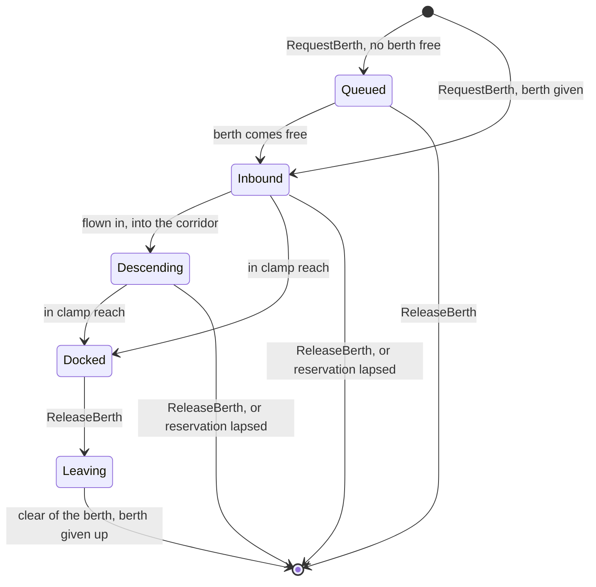

# Docks

The docks module gives a game's **platforms** their **berths** and decides which vehicle lands
where. A [platform](glossary.md#platform) is anything vehicles berth at: a station in Manifest, a
harbour, a car park on a ferry. Who holds a berth is state every player must see the same, so
berths live in the [simulation](glossary.md#simulation): they are entities, saved, and given out by
[commands](glossary.md#command) in the order the queue applies them, assuming no single player.

The engine owns the mechanism: fitting a vehicle to a berth, the queue, reservations, flying a
vehicle in and out, and the clamp that holds it. The game owns the rules: what a berth costs, who
may land where, and what loitering on one means.

## Concepts

| Term | What it is |
| --- | --- |
| [Platform](glossary.md#platform) | An entity built to a layout, carried on the [rails](glossary.md#rails) of a body the game's frame model moves. It owns its berths and a queue of vehicles waiting for one. |
| [Berth](glossary.md#berth) | A place on a platform's deck where one vehicle lands. An entity of its platform's, numbered from 1: free, reserved or holding a vehicle. |
| [Berth class](glossary.md#berth-class) | A [definition](glossary.md#definition): the largest vehicle a berth takes, the berth's size and a rank among the classes. The classes are the game's data. |
| [Vehicle](glossary.md#vehicle) | A definition with a size and the berth class it lands on. In the world, a dynamic body with a `Dock::Vehicle` component naming that definition. |
| Layout | A definition of a platform's structure (decks and piers, as boxes) and its berths. |
| Feature | A name of the game's that a berth offers, such as `dry-dock`. The docks match it and know nothing of what it means. |
| Display berth | A berth that is the layout's dressing. No vehicle is ever given it; the vehicle it shows is drawn by [presentation](glossary.md#presentation), never a body. |
| Docking | A vehicle's business with a platform (`Dock::Docking`): its place in the queue, or its berth and its stage. |

A berth holds at most one vehicle, and a vehicle holds at most one berth or place in a queue. A
berth clamps only the vehicle it was given to.

## How it works

### Definitions

The three definition kinds are loaded through the [definition
registry](glossary.md#definition-registry), so a [mod](glossary.md#mod) can add a berth class or a
vehicle, or rebuild a platform, with no engine change. A save names definitions and holds none, so
a world a save is loaded into must be given the same ones.

| Kind | Directory | Type | Fields (as the YAML names them) |
| --- | --- | --- | --- |
| Berth class | `defs/berths` | `Dock::BerthClassDefinition` | `rank`; `largestVehicle` (length, beam, height in metres); `berthSize` (width across the heading, length along it) |
| Vehicle | `defs/vehicles` | `Dock::VehicleDefinition` | `displayName`; `length`, `beam`, `height`; `berth` (its berth class); `model` (a glTF path, presentation's alone) |
| Layout | `defs/platforms` | `Dock::PlatformLayout` | `displayName`; `decks` and `piers` (boxes: `centre`, `size`); `berths`; `reservationSeconds` (default 60: the seconds a vehicle may come no nearer before it loses its berth) |

Each berth of a layout has a `class`, a `position` (the middle of its face on the deck), a `normal`
(the way a vehicle lands down it, default +Y), a `heading` (the way a docked vehicle's nose points,
default -Z), `display`, the `vehicle` a display berth shows, and `features`. Positions and
directions are in the platform's axes, in metres. A vehicle's axes are those of `Sim::Transform`:
nose along -Z, starboard +X, top +Y.

Each definition is checked as it is defined, and a bad one throws `Serialise::FormatError` naming
what does not fit. A name defined twice throws `std::invalid_argument`.

- A berth class has a positive, finite largest vehicle and berth, and that vehicle fits the berth.
- A vehicle names a defined berth class, and its size is positive and within that class's largest
  vehicle.
- A layout has at least one deck or pier, all boxes of positive size. Each berth's normal and
  heading are unit length and square to each other. Each berth lies wholly on a deck or a pier and
  overlaps no other berth. A berth with something of the platform over it, within the platform's
  bounding sphere (`Dock::Radius`), is covered, and needs headroom under the cover
  (`Dock::Headroom`) of twice its class's largest vehicle's height and 4 m more
  (`Dock::kCoverMargin`). Only a display berth may name a vehicle.

A clear column over a berth lets a vehicle come straight down onto it from outside the sphere; a
covered berth is flown to among the decks and piers ([below](#a-covered-berth)).

Defining a vehicle also defines its physics shape, `vehicles/<name>`: a box of its size, whatever it
is drawn as. Defining a layout defines `platforms/<name>`, a mesh of its decks and piers
(`Dock::DeckShape`). Their bodies name these shapes (`Docks::VehicleShape`, `Docks::PlatformShape`).

### Which berth a vehicle fits

`Dock::Fits` decides whether a vehicle lands on a berth of a given class: a free function over the
classes, so content validation can ask it with no world. A vehicle fits a berth of its own class, or
of any class ranked level with or above its own whose largest vehicle is no smaller than it in every
dimension. The rank orders the choice and the size is the limit. Ranks are data, and nothing
requires a higher-ranked class to be larger, so a game can add classes, a compact berth among them,
without an engine edit.

When a berth is given, the docks pick the **lowest-ranked free berth the vehicle fits**, and among
those the lowest numbered. With a feature asked for, only berths that offer it count. A display
berth never counts.

### Building a platform

`Docks::MakePlatform(world, frame, body, layout)` builds a platform: a kinematic body on the rails
of the named body of the frame's model, in that body's [local frame](glossary.md#local-frame),
colliding as its layout's decks and piers. Each berth is an entity on the same rails at its place,
so a vehicle's destination by a berth turns and moves with the platform. The frame and body must
already be defined in physics ([frame models](physics.md#frame-models-rails-and-gravity)).

### Asking for a berth and giving it up

Two commands drive the docks. Each carries its sender, a [controller](glossary.md#controller): a
player, the AI, or no one in particular (the game's own rules). A vehicle with a
`Sim::ControlledBy` takes them only from its controller or from no one in particular
(`Sim::MayCommand`).

| Command | Fields | What it does |
| --- | --- | --- |
| `Dock::RequestBerth` | `sender`, `vehicle`, `platform`, `fly` (default true), `feature` | Gives the vehicle the best free berth it fits, or a place at the back of the platform's queue. With `fly`, the docks fly it in. |
| `Dock::ReleaseBerth` | `sender`, `vehicle`, `fly` (default true) | Gives up a place in the queue or a reservation, which frees the berth for the next vehicle. A docked vehicle is let go and lifted; it gives the berth up once clear. |

A request is refused when:

- the vehicle is gone, or the sender does not control it;
- the platform is not one;
- the vehicle has no `Dock::Vehicle` of a defined kind, or cannot fly: it needs a dynamic body,
  `Physics::Handling`, `Physics::FlightControls`, `Physics::Velocity` and a transform;
- it is in another frame or local frame than the platform;
- it already holds a berth or a place;
- no berth on the platform fits it, or none that fits offers the feature asked for.

A release is refused for a vehicle with nothing to give up, a sender that does not control it, or a
vehicle already leaving.

The docks answer with [events](glossary.md#event), each naming the vehicle and the platform:

| Event | When |
| --- | --- |
| `BerthGiven` | A berth is reserved for the vehicle (with the berth and its number). |
| `BerthQueued` | The vehicle waits in the queue (its place, from 1). |
| `BerthRefused` | A command is refused, with a [reason](glossary.md#reason). |
| `BerthLapsed` | A reservation ran out before the vehicle landed. |
| `Landed` | The vehicle is clamped to its berth. |
| `Left` | A docked vehicle is let go. |
| `BerthReleased` | A berth or a place is given up, or left behind once the vehicle has lifted clear. |

`BerthGiven`, `BerthRefused`, `Landed` and `Left` are also visible to [scripts](scripts.md). A
refusal's reason is a `Dock::Reason`, worded by the string tables under `reason.dock.<name>`
(`assets/strings/<language>/reasons.yaml`), for example `reason.dock.no_berth_fits`.

A reservation is kept while its vehicle makes progress: each time the vehicle comes 1 m nearer the
berth than it has been (`Dock::kProgress`), its lapse is put off by the layout's
`reservationSeconds` (60 by default), rounded up to whole [steps](glossary.md#step). A vehicle that
comes no nearer for that long, stuck or circling, loses the berth to the next in the queue. The queue is served from the front as berths come free, each vehicle given the best free
berth it fits, so a small vehicle behind a large one can take a berth the large one does not fit.

### Dock control a game decides

Who may dock and who is served first are the game's rules, not the engine's. A game gives them as a
`Dock::Control` (`Docks::SetControl`), at start-up as it gives its definitions:

| Rule | Asked | Its answer |
| --- | --- | --- |
| `admit` | For a request that has passed the docks' own checks above | A `Sim::Reason` of the game's own (`reason.<game>.<name>`) refuses it with a `BerthRefused` carrying that reason; none admits it |
| `rank` | For every vehicle in a platform's queue, each time the queue is served, and as a vehicle is queued for its `BerthQueued` place | A number: the higher served first, equal numbers in the order they asked |

With no rules set, every request that fits is admitted and the queue is served first come, first
served. The queue a save holds stays in the order the vehicles asked; the rank is asked again each
time it is served, so a rule reads the game's own saved state and saves nothing of its own. A rule
reads the world and never changes it, and must give the same answer on every run, as any of the
step's code must ([coding standards](coding-standards.md#simulation-code)). `Docks::Park`, a world's
initial state, asks neither.

### A vehicle's stages

`Dock::Docking::stage` records how far a vehicle has got. The diagram shows the stages and what
moves a vehicle between them.



A vehicle with `fly` false is the game's or its pilot's to fly. It stays `Inbound` until it is in
clamp reach, and is clamped then just as a flown vehicle is.

### The way in

A berth lies inside the platform's bounding sphere, so a vehicle cannot keep clear of the sphere
and still reach it. The docks therefore fly a vehicle in (`RequestBerth::fly`) by
[steering](ai.md#steering), as one destination flown as a corridor (`Ai::Destination::corridor`),
without stopping:

1. **Round the sphere** (`Stage::Inbound`). A course round the platform's sphere (`Ai::Waypoints`)
   to the corridor's mouth, out along the berth's normal past the *point above the berth* by the
   platform's radius again (`kMouthShare`). The point above is outside the sphere by the vehicle's
   own size and steering clearance, and by 10 m more (`kAboveMargin`). The course is flown no faster
   than the vehicle can stop in the whole way left, and each waypoint is come to no faster than its
   turn allows, to a stop for one that turns back, so it comes to the mouth slow enough to turn down.
2. **Down the corridor** (`Stage::Descending`). Along the line from the mouth onto the berth
   (`Ai::ArriveAlong`): along it, as fast as it can still stop at the berth; across it, drawn back
   onto the line, and no faster along than it comes back onto it, so it is on the line before the
   end. Turned to the berth's heading about all three axes, and kept clear of the platform by its
   shape (`Ai::Destination::byShape`), not its sphere. It slows to stop a quarter of a metre above
   its resting height (`kHover`), since Jolt's contacts begin a little before two bodies meet. The
   clamp takes it from there.

The course is in the berth's axes (`waypointsOnEntity`), so it turns with the platform. Flown in
from all round Highport, 2 and 4 km out, still or going across at 150 m/s, every vehicle lands,
touching nothing, 12 to 26 s sooner than the stop out along the normal the corridor replaced (the
`dock` suite's `Docks benchmark`, 2026-11-26). Without the corridor, a vehicle flown straight to
the point above, fast and sideways, overshot into the sphere and circled until its reservation
lapsed.

### A covered berth

A berth with the platform over it, one under a pier, cannot be come down onto from outside the
sphere. The docks fly a vehicle to it among the decks and piers instead, by a course round their
boxes (`Ai::Waypoints` with `Ai::Box`es, [courses](ai.md#courses)), clear of them by the vehicle's
shape and its steering clearance:

1. **In among them.** To the point over the berth midway up its headroom, at 20 m/s, each waypoint
   passed within 5 m, since a course among decks turns within metres of them. The course is in the
   berth's axes (`Ai::Destination::waypointsOnEntity`), so it turns with the platform, and the
   vehicle is kept clear by its shape (`byShape`), not the platform's sphere. The berth's four ways
   out from under the cover, straight along its sides past the sphere, are among the waypoints.
2. **Onto the berth**, as for any berth.

Flown out, it goes up to the same point and out by the shortest way out, giving the berth up past
the sphere. Lifted by its pilot, it gives the berth up at that point, as high as straight up goes.

### The clamp

The system `dock` runs after physics each step. It clamps a vehicle on its way to its own berth once
it is within a clamp's reach, whether the docks flew it or its pilot did. No sensor is involved: the
docks check the vehicle against its berth. Clamping moves the vehicle to where it rests, so the
reach is how far it may be moved:

| Limit | Value |
| --- | --- |
| Across the berth, from where it rests | 2 m |
| Above or below its resting height (its centre half its height over the deck) | 1 m |
| Its top from the berth's normal | 10° |
| Its nose from the berth's heading | 15° |
| Its speed | under 0.5 m/s |

Clamped, the vehicle's body becomes kinematic, on the platform's rails at its place on the berth:
held exactly in the platform's frame, out of flight, and making no contacts with the deck. Its
steering destination and flight controls are cleared.

### Leaving

`ReleaseBerth` on a docked vehicle makes its body dynamic again where it lay and raises `Left`. The
berth stays held until the vehicle is clear, so no one else is given it meanwhile.

- **Flown out** (`fly` true): steered back up the normal at 20 m/s to the point above the berth,
  outside the sphere, where it gives the berth up. This suits a vehicle that goes on by steering or
  in [transit](transit.md).
- **Lifted** (`fly` false): its own thrusters push it straight up at 20 m/s, against the platform.
  It gives the berth up `Dock::kLiftHeight` (40 m) above where it rested, clear of the clamps and of
  a vehicle on the next berth, and its controls are left neutral for the pilot: a few seconds,
  against the half a minute the climb out of a large platform's sphere takes.

### What the step does

Each step the system `dock` works through the entities in order:

1. Gives up what a vehicle can no longer hold: a berth whose vehicle has gone, and a vehicle's
   business with a platform that has gone or whose frame or local frame it has left (through a
   [portal](glossary.md#portal), say).
2. Lapses each reservation whose step has come.
3. Moves each vehicle on: clamps one in reach, starts the next leg of one flown in or out, and gives
   up the berth of one that has lifted clear.
4. Serves each platform's queue from the front.

When every vehicle is docked, or queued with no berth free for it, and no reservation is held, the
system is quiet ([quiet steps](simulation.md#quiet-steps-and-fast-forward)).

### Saves and snapshots

`Dock::Vehicle`, `Dock::Platform`, `Dock::Berth` and `Dock::Docking` are components saved with the
world under the names `Dock.Vehicle`, `Dock.Platform`, `Dock.Berth` and `Dock.Docking`. A docked
vehicle's hold is its `Physics::OnRails`, saved like any component, so Jolt holds nothing of a
docking that the save does not.

`Berth`, `Docking` and `Vehicle` are shown in every [snapshot](glossary.md#snapshot), so
presentation can draw a berth's lamps and its clamps closing from the simulation's state.

## Using it

### Attaching and defining

Attach physics, the frame indices and steering first, as in [steering a
vehicle](ai.md#steering-a-vehicle), then the docks: their system orders itself after physics and
sets the destinations steering flies. Then load the three definition kinds and hand them to the
docks. From the suites' fixture, `source/engine/dock/tests/Fixture.h`:

```cpp
Dock::Docks &docks{Dock::Docks::Attach(world, physics)};

// ...
Sim::DefinitionRegistry definitions{files};
definitions.Load<Dock::BerthClassDefinition>(
    Dock::kBerthClassDirectory, Dock::BerthClassMigrations());
definitions.Load<Dock::VehicleDefinition>(Dock::kVehicleDirectory, Dock::VehicleMigrations());
definitions.Load<Dock::PlatformLayout>(Dock::kPlatformDirectory, Dock::PlatformMigrations());
docks.Define(definitions);
```

`Docks::Define` defines every berth class, then every vehicle, then every layout, so a vehicle or a
layout may name any class. `DefineBerthClass`, `DefineVehicle` and `DefineLayout` do the same one at
a time from code.

### Definition files

A berth class, `source/engine/dock/tests/fixtures/defs/berths/frigate.yaml`:

```yaml
version: 2
rank: 1
largestVehicle: [60, 30, 15]
berthSize: [50, 90]
```

A vehicle, `source/engine/dock/tests/fixtures/defs/vehicles/shuttle.yaml`:

```yaml
version: 3
displayName: Shuttle
length: 9.8
beam: 6.4
height: 1.8
berth: corvette
```

A platform, `source/engine/dock/tests/fixtures/defs/platforms/ostra-anchorage.yaml`: a hub with a
pier each side, four frigate berths on the piers and two corvette berths on the hub's top.

```yaml
version: 2
displayName: Ostra Anchorage
reservationSeconds: 300
decks:
  - {centre: [0, 0, 0], size: [120, 40, 120]}
piers:
  - {centre: [180, 0, 0], size: [240, 16, 80]}
  - {centre: [-180, 0, 0], size: [240, 16, 80]}
berths:
  - {class: frigate, position: [125, 8, 0], heading: [1, 0, 0]}
  - {class: frigate, position: [235, 8, 0], heading: [1, 0, 0]}
  - {class: frigate, position: [-125, 8, 0], heading: [-1, 0, 0]}
  - {class: frigate, position: [-235, 8, 0], heading: [-1, 0, 0]}
  - {class: corvette, position: [-25, 20, -10], heading: [0, 0, -1]}
  - {class: corvette, position: [25, 20, -10], heading: [0, 0, -1]}
```

### A platform, a vehicle and a request

A vehicle the docks can fly needs a dynamic body of its definition's shape, velocity, handling,
flight controls and a `Dock::Vehicle`, in the platform's frame and local frame. Condensed from
`Fixture::Vehicle` and the approach suite, `source/engine/dock/tests/ApproachTests.cpp`:

```cpp
platform = docks.MakePlatform(world, DockTests::kHarbour, DockTests::kFerry, "ostra-highport");

const entt::entity vehicle = registry.create();
registry.emplace<Sim::Transform>(vehicle, Sim::Transform{start});
registry.emplace<Sim::InFrame>(vehicle, kHarbour);
registry.emplace<Physics::LocalFrame>(vehicle, std::string{kFerry});
registry.emplace<Physics::Body>(
    vehicle, Physics::Body{Physics::BodyKind::Dynamic, Dock::Docks::VehicleShape("shuttle"), 20000.0f});
registry.emplace<Physics::Velocity>(vehicle);
registry.emplace<Physics::Handling>(vehicle);
registry.emplace<Physics::FlightControls>(vehicle);
registry.emplace<Dock::Vehicle>(vehicle, std::string{"shuttle"});

world.Commands().Push(Dock::RequestBerth{{}, vehicle, platform, true});
```

The next step answers with `BerthGiven` or `BerthQueued`; the vehicle then flies in, and `Landed`
follows. `Dock::ReleaseBerth{{}, vehicle}` flies it out again, and `Dock::ReleaseBerth{{}, vehicle,
false}` lifts it for its pilot.

### Asking for a feature

A berth offers features by name in its layout. From `source/engine/dock/tests/PadTests.cpp`, berth 2
is a frigate berth with a dry dock:

```cpp
yard.berths = {
    {"corvette", {-100.0, 10.0, 0.0}},
    {"frigate", {0.0, 10.0, 0.0}, {0.0, 1.0, 0.0}, {0.0, 0.0, -1.0}, false, {}, {"dry-dock"}},
    // ...
};
// ...
fixture.world.Commands().Push(Dock::RequestBerth{{}, first, platform, false, "dry-dock"});
fixture.world.Commands().Push(Dock::RequestBerth{{}, second, platform, false});
```

The first vehicle is given berth 2, over the smaller free corvette berth, which the second takes. A
third asking for `dry-dock` queues until berth 2 comes free. A request for a feature no berth offers
is refused with `reason.dock.no_berth_offers`. `Docks::Offers(registry, berth, feature)` answers
from the layout, so a berth saves no features.

### Parking a vehicle at the start

`Docks::Park(world, vehicle, berth)` puts a vehicle on a free, non-display berth and clamps it, as a
game does for the vehicles it starts docked. It throws `std::invalid_argument` for a berth that is
not free or a vehicle that does not fit it. From `PadTests.cpp`:

```cpp
yard.docks.Park(yard.world, yard.Waiting("hauler"), yard.BerthNumbered(yard.platform, 1));
```

Manifest docks every ship through these commands, in its travel module
(`source/game/travel/src/Travel.cpp` in the Manifest repository).

## Limits and open work

- A course among the decks goes round the structure, not round a vehicle docked on another covered
  berth; only the shape sweep stops it short of one.

## Decisions

The settled choices (docking as the simulation's, the approach from outside the platform's sphere,
a docked vehicle on its platform's rails, a display berth's vehicle and the clamps' motion as
presentation's) are in [decided](decisions.md#docks). How the module came to be is in
[history](history.md). Formats change in place until player testing
([decided](decisions.md#persistence)).

## Source

- Module `dock` (`source/engine/dock`), `DETERMINISTIC`. It depends on `ai`, `physics`, `sim`,
  `spatial`, `serialise` and `reflect`, among others.
- `source/engine/dock/include/jettison/dock/Definitions.h`: the definition kinds, their checks,
  `Fits`, `Radius` and `DeckShape`.
- `source/engine/dock/include/jettison/dock/Docks.h`: the components, commands, events and reasons,
  and `Docks`.
- `source/engine/dock/src/Docks.cpp`: the step, the way in and the clamp's limits.
- Tests: `source/engine/dock/tests` (`DefinitionTests.cpp`, `PadTests.cpp`, `ApproachTests.cpp`),
  with the retired space sample's definitions under `tests/fixtures`.
