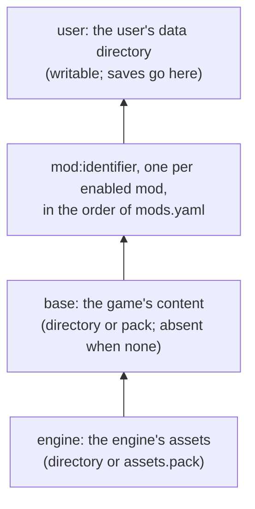
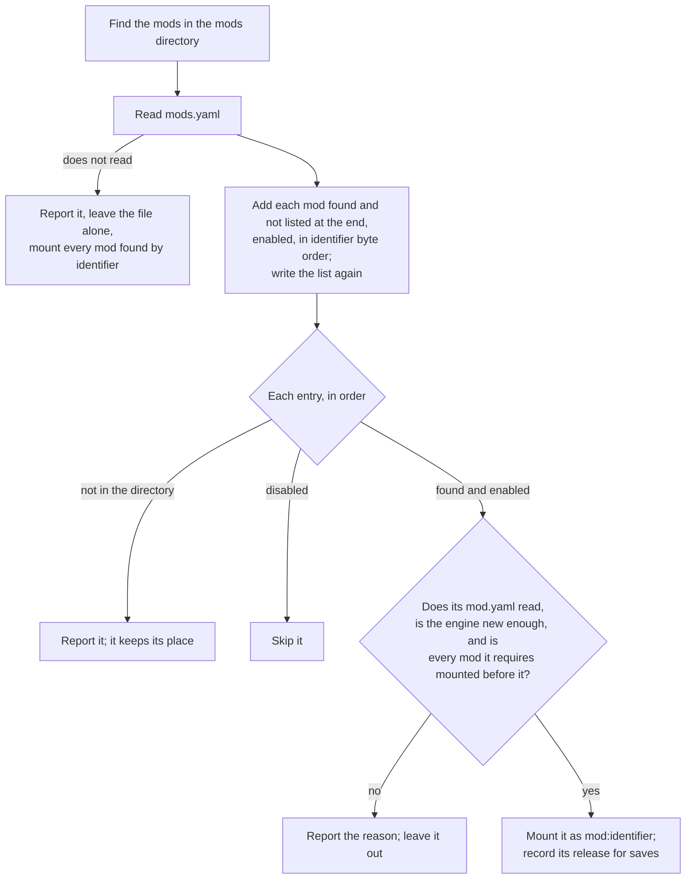
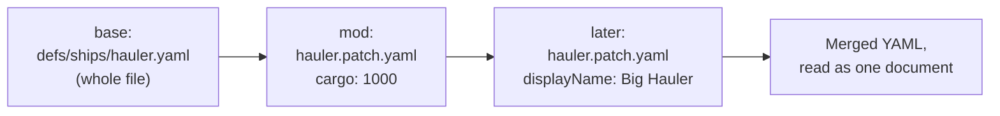

# Files, packs and mods

Every file the engine reads as content, a model, a scene, a definition or a string table, goes
through one virtual file system. It stacks several sources of files, called mounts, so that a
[game](glossary.md#game)'s content sits over the engine's assets and a player's
[mods](glossary.md#mod) sit over the game's. A mod changes the game by adding files or shadowing
existing ones, and never by editing them. A file may be loose in a directory, for its author, or
inside a [pack](glossary.md#pack), one file holding a whole tree, for its players. This document
also covers definition [layering](glossary.md#layering) and the resource manager; the modder's
how-to is in the [guide](guide.md#making-and-releasing-a-mod).

## Concepts

| Term | What it is |
| --- | --- |
| Virtual path | A file's name inside the file system: relative, forward-slashed, the same on every machine (`models/arm.glb`) |
| Mount | One source of files, a directory or a pack, with a name (`engine`, `base`, `mod:ships`, `user`) and a place in the stack |
| Shadowing | A later mount's file at a path hides an earlier mount's file at the same path |
| Resource | A value decoded from a file (a model, a rig, a material), loaded on the I/O worker and shared by handle |

The glossary defines the rest: [pack](glossary.md#pack), [package](glossary.md#package),
[mod](glossary.md#mod), [definition](glossary.md#definition), [patch](glossary.md#patch) and
[layering](glossary.md#layering).

### Virtual paths

A virtual path is relative to the root of every mount: `scene/main.yaml` names the same file in
the engine's assets, a game's content and a mod. Its segments are never empty, `.` or `..`, and it
holds no backslash, colon or control character, so data cannot name a file outside a mount and a
path means the same on every platform. Paths are case-sensitive, as the disk is. A path that breaks
the rules is a mistake in the data: every call on the file system throws `std::invalid_argument`
for one, rather than answering as if the file were absent. `FileSystem::IsValidPath` tests one.

## How it works

### The file system

`Vfs::FileSystem` holds the mounts in order and answers every read by walking them from the top,
whether a mount is a directory or a pack.

| Call | What it does |
| --- | --- |
| `AddMount` | Adds a mount on top. A regular file is mounted as a pack. Names must be unique |
| `Exists`, `Find` | Whether a file is there; `Find` also gives its mount index, time and size |
| `Read` | The topmost file's bytes, or none |
| `ReadLayers` | The file at the path in every mount that has one, the bottom mount's first |
| `ReadPatched` | A file with its patches, by the layering rules below: the topmost whole file, then the patches over it in mount order |
| `Refresh` | Opens again each pack whose file has changed on the disk ([packs](#packs)) |
| `Write` | Writes to the writable mount, replacing a file whole and durably |
| `Enumerate` | Every file under a directory, across all mounts, each once, sorted |

At most one mount is writable, and it must be the last, so a file written is the file read back.
A pack is never writable. `Write` replaces a file whole through `Core::WriteFileDurably`, so no
reader, crash or power cut finds half a file ([durable writes](persistence.md#durable-writes)).

`Enumerate` leaves out a file whose name is not a valid virtual path, since nothing could read it.
A symbolic link inside a mounted directory is followed.

Mounts are added at start-up, before anything reads; after that the `const` calls, `Refresh` too, are
safe from any thread, so the I/O worker and the main thread read at once.

### The shell's mounts

The [shell](glossary.md#shell) builds the stack in `App::MountAssets`, from the bottom up, as the
diagram shows; a read takes the first file it finds from the top.



1. **`engine`**: the engine's assets (`assets/`), what the shell needs to start and draw with no
   game: the compiled shaders and programs, the fonts, the saves screen and its stylesheets, and
   the engine's string tables. By default the staged directory beside the executable or, failing
   that, `assets.pack` beside it; `--assets` names either.
2. **`base`**: the game's content, its definitions, scenes, models and sounds. It is found the same
   way from the program's own subdirectory, or named with `--content`. Flotsam runs with none.
3. **`mod:<identifier>`**: each enabled mod, in the player's order (below).
4. **`user`**: the user's data directory, writable and last.

The shell logs every mount in order, with its kind of source. Mods live in
`~/.local/share/jettison/mods` and the list is `~/.config/jettison/mods.yaml`, by default
([user directories](runtime.md#user-directories)). The user mount's root is the data directory, so
the mods also appear under `mods/` in the virtual tree, where nothing reads them.

A game or tool that composes its own start-up mounts content through `Host::Session` instead
([the host session](simulation.md#the-host-session)): `Options::content` lists read-only mounts in
order, each package's description checked the same way.

### Engine assets and game content

The engine's assets and a game's content are two trees, each staged by the build and each
packable. No engine code reads the game's content by a host path. The default scene is the game's
(`Game::DefaultScene`, `scene/main.yaml` unless the game names another), read through the mounts.
The shell plays `audio/music/drift.flac` if the content has it. `--scene` alone still names a file
on disk, for the development scenes the reference views use
([the command line](app-shell.md#the-command-line)).

The build stages a tree with `jettison_add_assets`, which copies it beside the build on every build
of the target, so an edit reaches the running app's copy. `jettison_use_content` makes a staged tree
an executable's default content; each program's is listed in [the
programs](app-shell.md#the-programs). Several engine suites also read the test content, through
`JETTISON_TEST_CONTENT_DIR`.

### Packages and `mod.yaml`

A package may describe itself in `mod.yaml` at its root (`Host::PackageDescription`):

| Field | Meaning |
| --- | --- |
| `version` | The format of this file, 1 |
| `name` | What the log and the game's mod menu show |
| `release` | The package's own version, which a save records it by |
| `engine` | The oldest engine version it runs on, `major.minor.patch`; empty for any |
| `requires` | The mods that must be mounted before it, by identifier |

A mod with no `mod.yaml` still mounts, under its identifier and of no release. A field the
description does not have, such as a misspelt `relase`, makes it fail to read. The engine version
is the project's version in the top `CMakeLists.txt` (`Core::EngineVersion`). The content is held
stricter than a mod: content for a newer engine stops the start-up, since a game cannot run without
it, and content may require only `engine`, the one mount below it.

### The player's mod list

A mod is a directory or a `.pack` file in the mods directory. Its identifier is the directory's
name, or the pack's without `.pack`, so `ships/` and `ships.pack` are the same mod to a save and
to another mod's `requires`. If both are present, the pack is reported and the directory kept.
Anything else in the mods directory is reported and ignored.

The order is the player's, in `mods.yaml` (`App::ModList`) beside `settings.yaml`: the mods in
mount order, a later one winning, each enabled or not. The game's menu writes it; until a game has
one, the player edits it by hand. The diagram shows how `MountAssets` reads it.



A directory dropped into the mods directory works at once, and one bad mod, a damaged pack
included, never stops the game.
The list is not reordered to satisfy `requires`; the reason says which mod is missing.
`MountAssets` returns the mods it mounted, with their releases (`Sim::ModVersion`), which a save
records ([loading in the shell](persistence.md#loading-in-the-shell)).

### Packs

A pack exists for shipping: one file to hand out instead of a tree, read without unpacking. Each
file in it is stored as it is or compressed as one zstd frame, so one file reads without the rest.

| Part | Contents (little-endian) |
| --- | --- |
| Header | `JETPACK` and a zero byte; u32 layout (1); u32 file count; u64 index offset; u64 index size |
| Data | Every file's bytes as stored, in the index's order |
| Index | For each file: u32 path length, the path, u8 method (0 stored, 1 zstd), u64 offset, u64 stored size, u64 size |

The index is sorted by path, each path once, and every file's bytes lie between the header and the
index. The index is checked whole as the pack is mounted; a pack that breaks the layout, any
truncated prefix included, is refused with a message naming what is wrong. A compressed file's
frame checksum and size are checked as it is read; a stored file is not checked.

A file is compressed only where that pays. The packer tries zstd at level 1 and stores the file as
it is unless that saves at least a thirty-second of it, then compresses the files that pass at the
chosen level, 19 by default. KTX 2 textures are already supercompressed, and glTF models and music
barely shrink, so the high level is spent only where it helps.

The pack's file stays open and is read with `pread`, which keeps no file position, so two threads
read at once. A pack replaced on the disk is still read as it was mounted, rather than at the old
offsets of the new file, until `FileSystem::Refresh`: it opens the file again when its time, size
or inode is no longer the open pack's, and reads from the new pack from then on, while a read
already begun finishes on the old one. The resource manager calls it before each hot-reload check
([resources](#resources)), so a development run sees a rebuilt mod without a restart; every file
in a rewritten pack counts as changed, since a pack has one time. A pack that does not open, a
copy half written or a damaged one, keeps the old pack and logs a warning, once, and is tried again
when the file changes again. That holds for a pack replaced by a new file, as `WritePack` writes
one, renamed over the old: the old file is still open, and read. A pack written over in place has no
old file left to read, so its files fail to read until it is whole again, and the warning says so.
A file's info in a pack carries how many times the pack has been opened again, so even a pack
written to keep its time and its files' sizes counts as changed. With no `Refresh`, as in a shipped
build, a pack stays as mounted.

`Vfs::WritePack` writes a pack, the same files always giving the same bytes, beside the output and
renamed over it once complete, so a reader never finds half a pack. Files whose
names no virtual path could have are left out and listed in `PackSummary::skipped`.

### Layering definitions

Shadowing works file by file, which is too coarse for game data: two mods that each change one
field of a definition would fight over the whole file. So the
[definition registry](glossary.md#definition-registry) (`Sim::DefinitionRegistry`) reads every
mount's files for a definition through `ReadLayers`, not only the topmost one.

A definition's name is its path under its directory without `.yaml`:
`defs/vehicles/military/corvette.yaml`, loaded from `defs/vehicles`, is `military/corvette`. In
each mount, for that name:

- a whole file at the same path, `military/corvette.yaml`, replaces the definition and everything
  below it;
- a patch beside it, `military/corvette.patch.yaml`, changes what it names and keeps the rest;
- a file at a new path adds a definition.

A mount's patch goes over its own whole file, if it has one. Patches then apply in mount order over
the topmost whole file. A patch with no whole file under it in any mount is refused, which is why a
definition's name cannot end in `.patch`.



The diagram is the case from `source/engine/sim/tests/DefinitionTests.cpp`: the result has the base
file's mass, the first mod's cargo and the second mod's name.

The merge is on the YAML tree, before it is read into the type
(`Serialise::YamlArchive::ReadLayered`), so whole files and patches share one reader, its errors and
its line numbers, and a patch can say things a value cannot:

| In a patch | Effect on the layer below |
| --- | --- |
| A mapping | Merged key by key, all the way down (a class's fields, a map's entries) |
| `~` (null) | Removes the key, so the field reads as its default |
| A sequence tagged `!append` | Added to the end of the sequence below |
| A sequence of mappings tagged `!merge=<field>` | Merged element by element, matched by that field; an unmatched element is appended |
| A sequence of scalars tagged `!remove` | Takes out each element of the sequence below that equals one listed |
| A sequence tagged `!remove=<field>` | Takes out each element of the sequence below whose `<field>` equals a listed scalar |
| Anything else (a scalar, an untagged sequence) | Replaces what is below |

A `!remove` that names what is not in the sequence below is refused, naming the layer and the
value (`'mining' is not in the sequence below it`), as a patch naming what is not there is a
modder's mistake. A mod that wants a list as it likes replaces it whole.

Every patch has its own `version`, and each layer is checked against its type's
[format version](glossary.md#format-version) on its own before it is merged, so a
[migration](glossary.md#migration) step edits only what its layer has
([format versions and migrations](persistence.md#format-versions-and-migrations)).

The registry logs each definition a mount changes, naming the mounts, such as
`defs/ships/hauler: patched by 'mod', 'later'` or `replaced by 'later'`. An error names the file
and its mount, and the previous set of definitions stays loaded.

The rules are one function, `FileSystem::ReadPatched`, which the registry and the other readers
share, so a patch is named, ordered and refused the same everywhere it applies (a patch with no
whole file under it throws, naming the patch).

Other data layers in its own way:

- A scene is read as a definition is, through `Scene::Load(files, path)` or `SceneFile::Read`: a
  mod's `scene/main.patch.yaml` changes the base's scene, entity by entity with `!merge=id`,
  `!append` and `!remove=id`, and a whole `scene/main.yaml` replaces it. `--scene` names a file on
  disk and is read as it was.
- A stylesheet is replaced whole by shadowing, or changed by a `<name>.patch.rcss` beside it, which
  is appended after the text below it, the base's whole file first and each patch in mount order,
  so its rules win by the cascade. The same rules apply, a patch with no whole file under it being
  refused ([UI](ui.md)).
- A string table is one flat mapping, so a mod's file at the same path merges key by key with no
  `.patch.yaml` ([string tables](ui.md#string-tables)).
- A script is a definition, so a mod adds one with a file and changes another's grants with a patch
  ([scripts](scripts.md#a-script-is-a-definition)).
- A model or any other file is replaced whole by shadowing. The engine reads no YAML "system" of
  its own: a game's star systems are its content, layered as it chooses.

### Resources

`Resource::ResourceManager` loads files by virtual path on the I/O worker (`Jobs::IoWorker`),
shares them by handle and reloads them when they change. It runs on the main thread, apart from the
loaders' decoding. A module registers a `Loader<T>` for each type it owns, so the manager depends on
none of them:

| Stage | Thread | Job |
| --- | --- | --- |
| `decode` | I/O worker | The file's bytes to a value; throws for data it cannot use |
| `finish` (optional) | Main | What must happen there first, such as a GPU upload |
| `retire` (optional) | Main | Hands off a replaced or released value that a frame in flight may still read |

A `decode` must not read reflection or an archive: types register lazily on first use, and EnTT's
meta context is not guarded against the main thread registering at the same time. A YAML file is
parsed in `finish`, as clip files and sequences are (`animation/src/ClipFile.cpp`).

Today render registers models, materials and colour grades, animation registers rigs and clips,
and scene registers sequences.

`Load<T>(path)` returns a `ResourceHandle<T>` at once, and the value appears after a later
`Update()`. Each `Load` is paired with one `Release`; loading a path already loaded returns the
same handle and counts a reference. The last release frees the slot under a new generation, so old
handles go stale rather than name the next resource
([handles](runtime.md#hashes-string-ids-and-handles)). A
missing file or a throw in `decode` or `finish` fails the resource, and `ErrorOf` keeps the
reason.

Hot reload is on in development builds. Every 500 ms, `Update()` first calls `FileSystem::Refresh`, so
a pack rewritten on the disk is opened again, then compares each loaded file's
`FileInfo` (mount, time and size) with what it read; a changed file, or a mod's file that now
shadows it or no longer does, starts a reload. A reload keeps the handle and raises `RevisionOf`,
which a cache rebuilds on. A reload that fails keeps the last good value. For a run with
`--frame-step`, the shell turns hot reload off and settles every load within one `Update()`
(`ResourceOptions::settleLoads`), so its frames are the same every run.

## Using it

### Mounting and reading

A stack of packs and directories, from `source/engine/vfs/tests/PackTests.cpp`:

```cpp
Vfs::FileSystem files;
files.AddMount({"base", scratch.Path("base.pack")});
files.AddMount({"dlc", scratch.Path("dlc.pack")});
files.AddMount({"mod", scratch.Path("mod")});
files.AddMount({"user", scratch.Path("user"), true});

// The mod's directory shadows the packs.
CHECK(Text(files.Read("defs/goods/beer.yaml")) == "a mod's beer");
CHECK(files.Find("defs/goods/beer.yaml")->mount == 2);
// Every mount's file at a path, the bottom mount's first.
const std::vector<Jettison::Vfs::Layer> wine = files.ReadLayers("defs/goods/wine.yaml");
```

### A mod that patches the content

From `source/engine/app/tests/MountsTests.cpp`, a mod called `louder` in the user's mods directory
makes one event sound louder and adds another, over content shipped as a pack:

```text
user/mods/louder/defs/sounds/closed.patch.yaml   version: 1
                                                 volume: 0.9
user/mods/louder/defs/sounds/held.yaml           version: 1
                                                 clip: clamp.held
                                                 sound: b.wav
```

```cpp
Vfs::FileSystem files;
App::MountAssets(files, scratch.Path("engine"), scratch.Path("content.pack"), scratch.Path("user"));
// The mounts are "engine", "base", "mod:louder", "user".
Sim::DefinitionRegistry definitions{files};
definitions.Load<Audio::EventSound>(
    Audio::kEventSoundDirectory, Serialise::FormatVersion{Audio::kEventSoundVersion});
const auto *closed = definitions.Find<Audio::EventSound>("closed");
// closed->volume is the patch's 0.9; closed->sound is still the pack's "effects/closed.wav".
```

### Taking elements out of a list

A patch over the market of the next example, whose `goods` hold wheat seeds and beer, that drops the beer and a tag, from `LayerTests.cpp`:

```yaml
version: 1
goods: !remove=good [beer]
tags: !remove [hub]
```

Each listed value is matched against the `good` of each element below, and against each scalar of
`tags`; what is left keeps its order.

### Merging a list by key

A patch over a market whose `goods` list holds wheat seeds, then beer with a stock of 55, from
`source/engine/serialise/tests/LayerTests.cpp`:

```yaml
version: 1
goods: !merge=good
  - {good: beer, target: 25}
  - {good: wine, stock: 5, target: 10}
```

Each element is matched to the one below with the same `good`: beer keeps its place and stock of
55 and takes the target of 25, wine matches nothing and is appended, and the wheat seeds are
untouched. An element without the `good` field is refused,
naming the element (`Market.goods[0]`). Without the tag, the two-element list would replace the
whole list.

### Describing a package

The test content's `source/test/content/mod.yaml`:

```yaml
version: 1
name: Jettison test content
release: 1.0.0
engine: 0.1.0
```

A mod that needs another adds `requires: [base-goods]`, and must come after `base-goods` in the
list.

### The mod list

A `mods.yaml` that mounts `gamma` before `alpha` and turns `beta` off, from
`source/engine/app/tests/MountsTests.cpp`:

```yaml
version: 1
mods:
  - {mod: gamma}
  - {mod: gone}
  - {mod: alpha}
  - {mod: beta, enabled: false}
```

`gone` is no longer in the mods directory, so it is reported and keeps its place. A mod `delta`
found in the directory is appended, enabled, and the file written again.

### Making a pack

By hand, with the packer tool (`source/tools/pack`):

```bash
cmake --build --preset clang-debug --target jettison_pack
build/clang-debug/source/tools/pack/jettison_pack path/to/mymod mymod.pack
# --level <1-22> sets zstd's level; --directory <virtual path>, repeated, packs only those.
```

In the build, as the test content is packed in `source/test/CMakeLists.txt`:

```cmake
jettison_add_pack(jettison_test_content_pack
	SOURCE "${CMAKE_CURRENT_BINARY_DIR}/content"
	OUTPUT "${CMAKE_CURRENT_BINARY_DIR}/content.pack"
	DEPENDS jettison_test_content
)
```

The engine's assets pack the same way as `jettison_assets_pack`, to `build/<preset>/assets.pack`.
Neither is built by default; `./scripts/smoke-test.sh --packed` builds both and runs the render test
from them, as a shipped build would ([packed](build-and-gates.md#packed)):

```bash
build/clang-debug/source/test/render_test --assets build/clang-debug/assets.pack \
    --content build/clang-debug/source/test/content.pack --user-dir "$(mktemp -d)"
```

### Loading a resource

Adapted from `source/engine/resource/tests/ResourceTests.cpp`, with a loader that turns bytes into
text:

```cpp
Resource::ResourceManager manager{files, worker, options};
manager.RegisterLoader(TextLoader());

const auto handle = manager.Load<Text>("greeting.txt");
// Loading: TryGet is null and the revision 0 until an Update() finishes it.
worker.WaitIdle();
manager.Update();
// Ready: TryGet(handle)->contents == "hello", RevisionOf(handle) == 1.
manager.Release(handle);
```

## Limits and open work

- The menu over `mods.yaml` is the game's to build; until then the player edits the file.
- A pack is not signed as a whole, and a stored file in it is not checked: [J19](roadmap.md#j19).
- The file system reads a file whole; there is no streaming read for long audio:
  [J21](roadmap.md#j21).
- A scene's models are not prefetched before it is shown: [J13](roadmap.md#j13).

## Decisions

The settled choices are in [decisions](decisions.md#files-packs-and-mods); how this work was built
is in [history](history.md).

## Source

| Module | Key headers |
| --- | --- |
| `vfs` | `source/engine/vfs/include/jettison/vfs/FileSystem.h`, `Mount.h`, `Pack.h` |
| `resource` | `source/engine/resource/include/jettison/resource/ResourceManager.h`, `ResourceHandle.h` |
| `app` (the shell's mounts) | `source/engine/app/include/jettison/app/Mounts.h` |
| `host` (package descriptions) | `source/engine/host/include/jettison/host/Package.h` |
| `sim` (definitions) | `source/engine/sim/include/jettison/sim/DefinitionRegistry.h` |
| `serialise` (the merge) | `source/engine/serialise/include/jettison/serialise/Archive.h` (`YamlArchive::ReadLayered`) |
| The packer | `source/tools/pack/main.cpp`; `jettison_add_assets`, `jettison_use_content` and `jettison_add_pack` in `source/CMakeLists.txt` |
