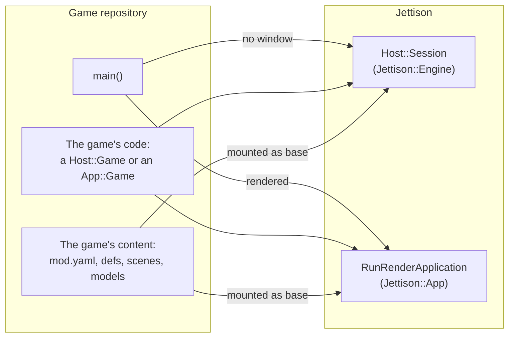
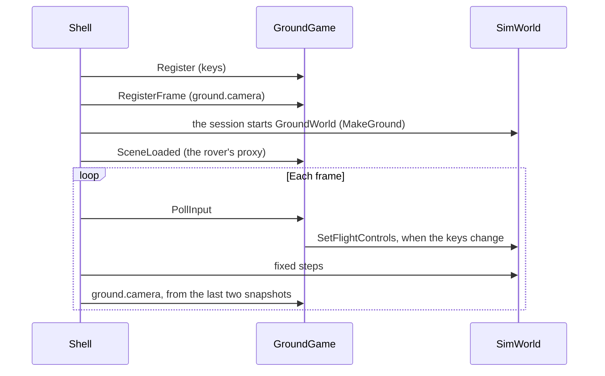

# Working with Jettison

How to do the common things, step by step, with the commands to run and the code to write. Each
section shows the way through; the reasons and the contracts are in the feature documents it links.

## Making and releasing a mod

A [mod](glossary.md#mod) is a directory of files mounted over a game's content. You write it as a
directory and give players one `.pack` file made from it. The engine treats `mymod/` and
`mymod.pack` as the same mod, identified as `mymod` and mounted as `mod:mymod`, so what you test
unpacked is what players get packed. How mounting, packs and layering work is in
[files, packs and mods](files-and-mods.md).

### Lay out the directory

Paths in the mod are the game's virtual paths, each kind of file in its place:

```
mymod/
  mod.yaml                      # describes the mod; optional, but a release should have one
  defs/goods/beer.patch.yaml    # a patch: changes the fields it names, keeps the rest
  defs/goods/cider.yaml         # a whole file: adds a definition, or replaces one entirely
  defs/scripts/mymod.yaml       # declares a script, if the mod has one
  scripts/mymod.wasm            # the script's compiled module
  ...                           # any other file replaces the base's at the same path
```

The `defs/goods` directory is an example: which directories hold definitions, and of what types, is
the game's to say. A file that is not a definition, such as a scene or a stylesheet, can only be
replaced whole.

### Write a patch

Prefer a [patch](glossary.md#patch) to a whole file for a definition the game already has: two mods
can then each change one field of the same definition, and a mod copies nothing it does not change.
A patch sits beside the definition it changes, named `<name>.patch.yaml`, in the definition's own
form with a `version` of its own. It is merged into what is below by the rules in
[layering definitions](files-and-mods.md#layering-definitions): `~` removes a field, `!append`
adds to a list, `!merge=<field>` merges a list's records by a key, `!remove` and `!remove=<field>`
take elements out, and anything else replaces.

A patch that sets one field and removes another, from the definition suite
(`source/engine/sim/tests/DefinitionTests.cpp`):

```yaml
version: 1
mass: ~
role: Fighter
```

A patch that adds to a list, and one that merges a list of records by a key, from the layering
suite (`source/engine/serialise/tests/LayerTests.cpp`):

```yaml
version: 1
tags: !append [refinery]
```

```yaml
version: 1
goods: !merge=good
  - {good: beer, target: 25}
  - {good: wine, stock: 5, target: 10}
```

What the second does is in [merging a list by key](files-and-mods.md#merging-a-list-by-key). A patch
takes elements out of a list with `!remove` (scalars) or `!remove=<field>` (records), and one that
names an element not there is refused ([taking elements out](files-and-mods.md#taking-elements-out-of-a-list)).

### Describe the mod

`mod.yaml` says what the mod is (`Host::PackageDescription`,
`source/engine/host/include/jettison/host/Package.h`):

```yaml
version: 1            # the format of this file, not of the mod
name: My Mod          # what the player's list of mods shows
release: 1.0.0        # the mod's own version, which a save records it by
engine: 0.1.0         # the oldest engine it runs on; on an older engine the mod is left out
requires: [othermod]  # the mods it needs, each enabled and before it in the player's list
```

The identifier is the directory's name, so keep it when you pack. Raise `release` with every
release you give out, since saves name the mod by it. The rules are in
[packages and `mod.yaml`](files-and-mods.md#packages-and-modyaml).

### Build the script, if there is one

A [script](glossary.md#script) is WebAssembly, written in C or Rust against bindings generated from
the game's types ([scripts](scripts.md)).

1. Run the build you are targeting and write its bindings, `jettison_script.h` and
   `jettison_script.rs`, with the console's `script_bindings <directory>`
   ([what a script sees](scripts.md#what-a-script-sees-is-generated-from-reflection)).
2. Build the module with `jettison_add_script` (`source/CMakeLists.txt`) into the mod's
   `scripts/`:

   ```cmake
   jettison_add_script(mymod_script ALL
   	OUTPUT "${CMAKE_CURRENT_SOURCE_DIR}/mymod/scripts/mymod.wasm"
   	SOURCES "${CMAKE_CURRENT_SOURCE_DIR}/src/mymod.c"
   	INCLUDES "${CMAKE_CURRENT_SOURCE_DIR}/bindings")
   ```

   The script suite builds its own modules the same way, in C and in Rust
   ([build the module](scripts.md#build-the-module)).
3. Declare it in `defs/scripts/<name>.yaml`, with the capabilities it needs and the events and
   inputs it answers ([declare a script](scripts.md#declare-a-script)).

### Pack it

`jettison_pack` writes the [pack](glossary.md#pack):

```bash
cmake --build --preset clang-release --target jettison_pack
build/clang-release/source/tools/pack/jettison_pack path/to/mymod mymod.pack
```

The tool logs how many files it packed and compressed, and warns of any it left out. Its flags, and
`jettison_add_pack` for a mod built with CMake, are in [making a
pack](files-and-mods.md#making-a-pack).

### Try the pack

Run the pack the way a player would, from a user directory of its own, so your own mods and saves
are not in the way. With `--user-dir <dir>`, mods are read from `<dir>/data/mods` and the player's
list is `<dir>/config/mods.yaml`:

```bash
mkdir -p "$TMPDIR/try/data/mods" && cp mymod.pack "$TMPDIR/try/data/mods/"
build/clang-release/source/test/render_test --user-dir "$TMPDIR/try"
```

Check the log:

- the mounts are listed in order, with `mod:mymod` as a pack, and `mods.yaml` gains the mod;
- the definitions name each one the mod replaces or patches, and the mount that changed it;
- a script says it loaded, with its handlers, its inputs and what it is granted.

The console's `scripts` then says what each loaded script has done. Take the directory out of the
mods directory to try the pack: with both there, the directory is kept.

### Release it

Give players `mymod.pack` alone, to put in their mods directory: for the engine's shell,
`~/.local/share/jettison/mods` by default (a game may keep its user data elsewhere). It is added to
the end of the player's `mods.yaml`, enabled, where the player orders and enables mods
([the player's mod list](files-and-mods.md#the-players-mod-list)).

### What is not there yet

- No prebuilt SDK, so building the pack tool and a script needs the engine built from source:
  [J18](roadmap.md#j18), [installing](build-and-gates.md#installing-not-yet-supported).
- A file stored uncompressed in a pack is not checked, and the pack is not signed as a whole:
  [J19](roadmap.md#j19).

## Composing a game on the engine

A [game](glossary.md#game) on Jettison is its own repository. It brings the engine in as a CMake
dependency, links the modules it needs, and composes itself into the engine through one of two
seams:

- **`Host::Game` in a `Host::Session`**: the CPU engine with no window. A server, a tool or a test
  runs a game so. The consumer project, `source/test/consumer`, is the smallest example.
- **`App::Game` in the app shell**: the engine with a window, a renderer, UI and sound. The ground
  sample, `source/samples/ground`, is the example: a rover driven on a slab of ground under
  gravity.

Both are the engine's own [consumers](glossary.md#consumer) ([samples](sample-game.md)). The
diagram shows how a game's parts meet the engine's.



### Bring in the engine

The consumer project's `CMakeLists.txt` is a game's build at its smallest. It fetches the engine,
either a checkout or a commit the game pins, with the engine's own tests and its presentation off:

```cmake
if(JETTISON_SOURCE_DIR)
	FetchContent_Declare(jettison SOURCE_DIR "${JETTISON_SOURCE_DIR}" EXCLUDE_FROM_ALL)
elseif(JETTISON_GIT_TAG)
	FetchContent_Declare(
		jettison
		GIT_REPOSITORY https://github.com/ivanhawkes/jettison.git
		GIT_TAG "${JETTISON_GIT_TAG}"
		EXCLUDE_FROM_ALL
	)
else()
	message(FATAL_ERROR "Give JETTISON_SOURCE_DIR (a checkout) or JETTISON_GIT_TAG (a commit)")
endif()
set(JETTISON_BUILD_TESTS OFF)
# No window, renderer or sample content: the CPU engine a server builds.
set(JETTISON_PRESENTATION OFF)
set(CMAKE_DISABLE_FIND_PACKAGE_Vulkan ON)
set(JETTISON_PLANNED_DEPENDENCIES OFF)
FetchContent_MakeAvailable(jettison)

add_executable(consumer main.cpp)
target_link_libraries(consumer PRIVATE Jettison::Engine)
```

`Jettison::Engine` links every module the build has, which with presentation off is the CPU engine;
a game may instead link only the `Jettison::<Module>` targets it uses. A rendered game leaves
presentation on and links `Jettison::App`. `EXCLUDE_FROM_ALL` keeps the engine's own executables out
of the game's build. Running it is [the consumer check](build-and-gates.md#the-consumer-check).

### A game with no window

The consumer is a race along a track. Its `Host::Game` has one hook a start-up phase. Types are
registered first, since reflection reads every file and save, and safely twice, since it is
process-wide (`source/test/consumer/main.cpp`):

```cpp
void RegisterTypes() override
{
	static const bool registered = []
	{
		using Reflect::Attribute;
		Reflect::RegisterType<Piece>("Consumer.Piece")
		    .Field<&Piece::displayName>("displayName", Attribute::Saved)
		    .Field<&Piece::stride>("stride", Attribute::Saved);
		// ... Token and Place the same way
		return true;
	}();
	(void)registered;
}

void LoadContent(
    const Vfs::FileSystem & /*files*/, std::span<const Host::Package> /*packages*/,
    Sim::DefinitionRegistry &definitions) override
{
	definitions.Load<Piece>("defs/pieces", {1});
}
```

`RegisterWorld` then registers its component, command and system, `CreateInitialState` may place
the first entities, and the session runs the hooks in order as it is constructed. The rest, from
`RegisterWorld` to the session's start and the hash checks, is in
[a game on the host](simulation.md#a-game-on-the-host); the phases and their failures are in
[the host session](simulation.md#the-host-session). The consumer then serves the race over loopback
([using it](networking.md#using-it)).

### A game in the shell: the ground sample

#### Its build

The sample is a library holding the game, a staged content tree, and an executable that ties them
together (`source/samples/ground/CMakeLists.txt`):

```cmake
add_library(jettison_sample_ground STATIC
	include/jettison/sample/GroundGame.h
	# ... its sources
)
target_link_libraries(jettison_sample_ground PUBLIC Jettison::App PRIVATE jettison_warnings)

jettison_add_assets(jettison_sample_ground_assets
	SOURCE "${CMAKE_CURRENT_SOURCE_DIR}/assets"
	OUTPUT "${CMAKE_CURRENT_BINARY_DIR}/assets"
	DIRECTORIES scene
	FILES mod.yaml
)

add_executable(ground main.cpp)
jettison_use_shared_assets(ground)
jettison_use_content(ground jettison_sample_ground_assets)
target_link_libraries(ground PRIVATE jettison_sample_ground jettison_warnings)
```

| Function (`source/CMakeLists.txt`) | What it does |
| --- | --- |
| `jettison_add_assets(<target> SOURCE OUTPUT [DIRECTORIES] [CONFIGURED] [FILES])` | Stages a tree of content beside the build. `DIRECTORIES` are copied again on every build, so an edit reaches the running program, which hot-reloads it; `CONFIGURED` ones, large and rarely changed, only when CMake configures; `FILES` are single files such as `mod.yaml` |
| `jettison_use_shared_assets(<executable>)` | Points the executable at the engine's staged assets (`JETTISON_ASSET_SUBDIRECTORY`) |
| `jettison_use_content(<executable> <assets target>)` | Makes a staged tree the executable's default content, mounted as `base` (`JETTISON_CONTENT_SUBDIRECTORY`); `--content` names another |
| `jettison_add_pack(<target> SOURCE OUTPUT [DIRECTORIES] [LEVEL] [DEPENDS])` | Packs a staged tree for shipping |

The content tree is small. `assets/mod.yaml` describes it as a package, and `assets/scene/main.yaml`
is the scene the shell loads by default: a camera, a lamp and the ground's mesh. The rover is not in
the file; the game builds it.

#### Its entry point

`main` hands the shell the game's world and its presentation, and says where the two staged trees
are (`source/samples/ground/main.cpp`):

```cpp
int main(int argc, char **argv)
{
	Jettison::Sample::GroundGame game;
	return Jettison::App::RunRenderApplication(
	    argc, argv, "Ground", JETTISON_ASSET_SUBDIRECTORY,
	    std::make_unique<Jettison::Sample::GroundWorld>(), &game, JETTISON_CONTENT_SUBDIRECTORY);
}
```

The world, a `Host::Game`, is the shell's to start through a session, as a server would start it;
the game outlives the run, so it lives in `main`. Every hook of `App::Game` is listed in
[the app shell](app-shell.md#the-game-a-program-composes).

#### Its world

`GroundWorld` registers the components the shell draws, attaches physics, and registers the
[helm](glossary.md#helm), the shapes and the gravity (`source/samples/ground/src/Ground.cpp`); its
initial state is the ground with the rover on it, the local player at the helm:

```cpp
void GroundWorld::RegisterWorld(Sim::SimWorld &world, const Sim::DefinitionRegistry & /*definitions*/)
{
	world.RegisterComponent<Sim::Transform>();
	world.RegisterComponent<Sim::InFrame>();
	Physics::PhysicsWorld &physics = Physics::PhysicsWorld::Attach(world);
	world.RegisterComponent<Sim::ControlledBy>();
	world.RegisterComponent<Sim::Helm>();
	DefineGround(physics);
}


void GroundWorld::CreateInitialState(Sim::SimWorld &world)
{
	MakeGround(world, App::kLocalPlayer);
}
```

Shapes and frames are defined as the world is made, not as the scene loads, because a save names
them and the world it loads into must already have them.

#### The hooks it uses

The sequence shows the main hooks the ground sample overrides, in the order the shell calls them,
and one frame of driving; [the hooks it uses](sample-game.md#the-hooks-it-uses) lists them all.



**`Register`** defines the keys: `RoverInput` defines two axes in the game's context, `rover`
(`source/samples/ground/src/RoverInput.cpp`).

**`SceneLoaded`** binds a [proxy](glossary.md#proxy) to the rover each time a scene loads, and
takes its input context:

```cpp
void GroundGame::SceneLoaded(App::Shell &shell)
{
	BindProxy(shell);
	shell.SetGameContext(RoverInput::kContext);
}
```

The proxy is a box mesh with a `Scene::SimProxyComponent` naming the rover, which the shell's sync
phase places from the snapshots each frame
([proxies of the simulation](scene.md#proxies-of-the-simulation)).

**`PollInput`** sends a command, which the next [step](glossary.md#step) applies, only when the
controls change (shortened from `GroundGame::PollInput`):

```cpp
Physics::FlightControls controls = m_input->Read(input);  // or the render test's, when it drives
if (controls == m_sent)
	return;
m_sent = controls;
shell.World().Commands().Push(Physics::SetFlightControls{shell.Player(), m_rover, controls});
```

**`RegisterFrame`** adds the camera behind the rover between the shell's camera rigs and its
cinematics ([the frame](app-shell.md#the-frame)), reading the rover's transform between the last two
snapshots with `Sim::Interpolate`, so the camera moves smoothly however frames fall between steps.

**`WriteSave`, `ReadSave` and `Loaded`** make the game's saves its own
([a game's save hooks](persistence.md#a-games-save-hooks)); `Loaded` finds the rover again and
takes the saved controls as the ones last sent. **`Hears`** picks out physics' events that name the
rover as their `vehicle` (`App::EventEntity`), though the sample maps no sounds to them yet.
**`DriveSmoke`** drives the render test's piloting stages
([the render test](app-shell.md#the-render-test)).

#### Its tests

The world is tested without the shell or a window: the suite builds the same world the shell would
and drives it with commands ([its tests](sample-game.md#its-tests),
`source/samples/ground/tests/GroundTests.cpp`):

```cpp
Fixture fixture;
Physics::FlightControls ahead;
ahead.linear.z = -1.0f;
fixture.Drive(ahead, 300);  // five seconds of steps at 60 a second
CHECK(fixture.Rover().position.z < -30.0);
CHECK(fixture.Rover().position.y == doctest::Approx(0.4).epsilon(0.02));
```

### Build and run it

```bash
cmake --build --preset clang-debug --target ground
build/clang-debug/source/samples/ground/ground          # W and S drive, A and D steer
ctest --test-dir build/clang-debug -R '^sample-ground$' --output-on-failure
./scripts/smoke-test.sh                                 # the render test, then the ground sample
```

Every flag and console command of the shell works on the sample too, such as `--user-dir` to keep
its saves apart, or `--run` to place the camera ([the app shell](app-shell.md#the-command-line)).
