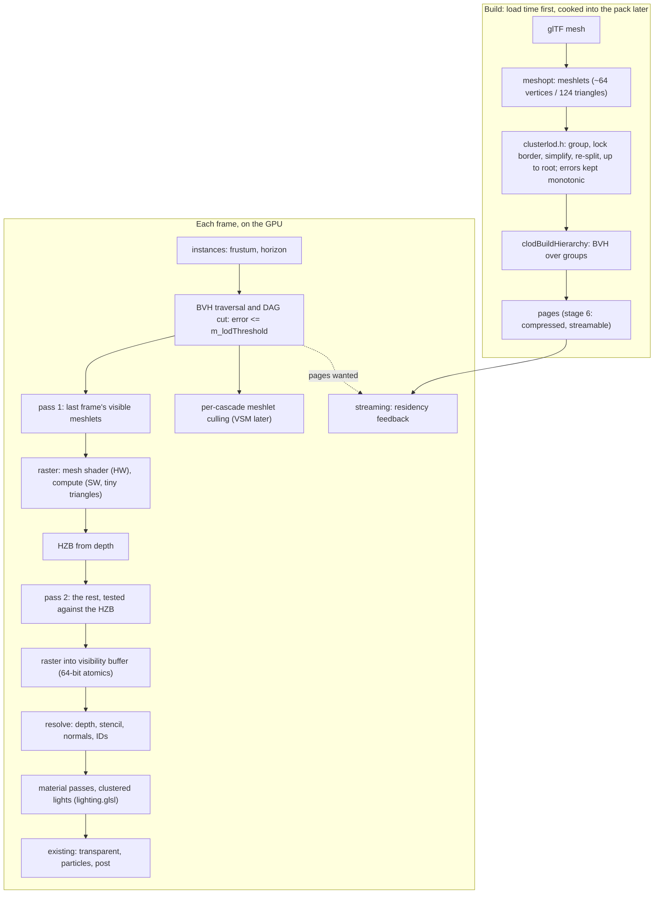

# Level-of-detail setters, and a Nanite-style geometry system for Jettison

Research, not a plan: nothing is booked from it yet ([waiting on you](roadmap.md#waiting-on-you)).
Code references are to the repository as of 2026-11-25.

## Summary

- **The setters.** No caller anywhere calls `Renderer::SetLodThreshold`, `SetClusterRange` or
  `SetShadowDistance`. That covers Jettison's `source`, Manifest's `source` and both repos' docs.
  `IRenderer` does not expose them, and `docs/rendering.md` ("Limits and open work") says so. LOD
  selection works without any of them, because each value has a default constant.
  - **Only `SetLodThreshold` concerns levels of detail.** It is the quality knob that discrete
    LODs for model files and a cluster-LOD system would both use, so **keep it**.
  - **The other two are unrelated to LOD.** `SetClusterRange` sets how far the light grid
    reaches. `SetShadowDistance` sets how far the sun's cascades reach.
- **Nanite-style geometry is possible here and the hardware is ready.** Both GPUs support mesh
  shaders and 64-bit image atomics, and so does **lavapipe**. Lavapipe on this machine is Mesa
  26.3.1, and `vulkaninfo` reports `VK_EXT_mesh_shader` (task and mesh), `shaderImageInt64Atomics`,
  `multiDrawIndirect` and `drawIndirectCount`. The task's premise that lavapipe has no mesh
  shaders is out of date: support landed in Mesa 23.2. A fallback is still worth having for other
  devices, and the existing per-draw indexed path is that fallback.
- **The smallest useful start** is discrete LODs for glTF files, generated with meshoptimizer and
  fed to the existing `SelectLod`. Then meshlets and a cluster DAG built with meshoptimizer's
  `clusterlod.h`, drawn by mesh shaders in the existing forward pipelines. Visibility buffer, HZB
  occlusion, software raster, streaming and virtual shadow maps come after that, each only once it
  is shown to be needed.
- **Three conflicts with current decisions need settling first:**
  - `docs/scope.md` lists occlusion culling as **Out**.
  - The anti-aliasing is MSAA, and a visibility buffer does not fit with it.
  - The glossary already uses the word **Cluster** for the light grid's cells.

---

## A. How levels of detail work today, and what the setters do

### Selection

The code is in `render/Culling.h` / `Culling.cpp`, called from `Renderer::PrepareFrame` around
`Renderer.cpp:1388` and from `Renderer::SelectLods` at `Renderer.cpp:1513`.

1. Every frame, `MakeLodSelection(camera, viewport.y, m_lodThreshold)` builds a `LodSelection`
   with three values:
   - `pixelsPerRadian = viewportHeight / (2 tan(fov/2))`
   - `thresholdPixels`, set from `m_lodThreshold`
   - the near plane.
2. A model holds `ModelLod` entries, finest first: `{firstPrimitive, primitiveCount, error}`. The
   error is the furthest the level's surface strays from the finest, in model units.
3. `SelectLod` walks from the coarsest level to the finest. It returns the first level where
   `error x scale x pixelsPerRadian / distanceToSphereNearestPoint <= thresholdPixels`, or level
   0 if none passes. The threshold is therefore **how many pixels of geometric error a level may
   show**. The default, `kDefaultLodThreshold = 1.0`, means "no visible error".
4. The chosen level is reused in three places:
   - The shadow casters are drawn at the view's level.
   - Horizon occluders, the planets, are shrunk by that level's error, so a body never hides more
     than its mesh does.
   - Batching keys on `(model, lod, material, stencil)`.
5. `TooSmallToSee` drops a draw narrower than `kDetailPixels = 1.0`. It uses the same
   `pixelsPerRadian`, but its own fixed pixel count, not the threshold.

**Where levels come from.** Only procedural shapes have more than one level: `GenerateLods` makes
5 for round shapes and 1 for a box. A glTF model always has one level of error 0
(`ModelGltf.cpp:258`). Levels for model files and hysteresis between levels are open in
[J27](roadmap.md#j27). So today a raised threshold would only coarsen procedural spheres and
planets.

### The three setters

| Setter | Field, default | What it controls | Related to LOD? |
|---|---|---|---|
| `SetLodThreshold(pixels)` | `m_lodThreshold`, `kDefaultLodThreshold = 1.0` | The pixels of geometric error a chosen level may show | **Yes.** It is the LOD quality knob |
| `SetClusterRange(m)` | `m_clusterRange`, `kDefaultClusterRange = 2000` | The view depth where the light grid ends: no local light is assigned past it, and the grid's exponential depth slices span up to it | No. "Cluster" here means a cell of the light grid |
| `SetShadowDistance(m)` | `m_shadowSettings.distance`, `kDefaultShadowDistance = 400` | The view depth past which the sun casts no shadow; the 4 cascades split this range | No, though casters are drawn at the view's LOD |

**Are they needed for LODs?** None of them is needed for LOD to *work*, since the constants do the
job. Keep `SetLodThreshold` anyway, as asked: it is the natural public knob for a quality
setting, for the dev tools, and for the cluster-cut error described below. Nanite's equivalent is
its pixels-per-edge / pixel-error setting.

`SetClusterRange` and `SetShadowDistance` play no part in LOD. Whether to delete them is a
separate decision:

- `SetShadowDistance` has a plausible future user in J27's "Shadow tuning" row.
- `SetClusterRange` has no named user.

If `SetLodThreshold` stays, it eventually belongs on `IRenderer`. That is when a quality setting
or a dev-tools slider first needs it, and the rendering.md line saying there is no setter changes
then.

---

## B. What a Nanite-style system is

Nanite, from Karis, Stubbe and Wihlidal, *A Deep Dive into Nanite Virtualized Geometry*, SIGGRAPH
2021 Advances ([PDF](https://advances.realtimerendering.com/s2021/Karis_Nanite_SIGGRAPH_Advances_2021_final.pdf),
[video](https://www.youtube.com/watch?v=eviSykqSUUw), and the background talk
[Journey to Nanite](https://www.highperformancegraphics.org/slides22/Journey_to_Nanite.pdf)), has
these parts:

1. **Clusters.** A mesh is split into clusters of about 128 triangles.
2. **A cluster DAG.** Clusters are grouped (about 8 to 32 neighbours per group). The group's outer
   border is locked, the group is simplified to half its triangles and re-split into clusters, and
   this repeats up to a root. Each cluster stores its own error and its parent group's error, both
   kept monotonic up the DAG. That lets each cluster decide **locally and in parallel** whether it
   is drawn: it is drawn when its own projected error is within the threshold and its parent's is
   not. Clusters that share a locked border always match, so there are no cracks between levels.
3. **GPU-driven culling.** Instances, then a BVH over cluster groups, then clusters are tested
   against the frustum and the LOD cut. This runs in persistent-thread compute with no CPU round
   trip.
4. **Two-pass occlusion culling with an HZB** (a depth pyramid):
   - First, draw what was visible last frame.
   - Build an HZB from that depth.
   - Test everything else against the HZB and draw what passes.
   - Background: Haar & Aaltonen, *GPU-Driven Rendering Pipelines*, SIGGRAPH 2015
     ([PDF](http://advances.realtimerendering.com/s2015/aaltonenhaar_siggraph2015_combined_final_footer_220dpi.pdf)).
5. **A visibility buffer.** Each pixel stores a 64-bit `depth | clusterID | triangleID` word,
   written with 64-bit atomic max. Materials are evaluated afterwards, once per pixel.
   - Background: Burns & Hunt, *The Visibility Buffer*, JCGT 2013 ([paper](https://jcgt.org/published/0002/02/04/)).
6. **Software rasterisation.** Clusters whose triangles are about a pixel in size are rasterised in
   a compute shader with the same atomics. Hardware rasterisers waste most of their work on those
   triangles because they shade 2x2 quads.
7. **Material evaluation** from the visibility buffer, per material, by depth-tested full-screen
   or tiled passes.
8. **Streaming.** Cluster groups are stored in fixed-size pages. The GPU reports which pages it
   needs, and a residency pool loads and evicts them. Data on disk is compressed.
9. **Virtual shadow maps** are not part of Nanite proper but are needed to shadow it well: 16k²
   virtual maps per light or clipmap level, page-tabled and cached, rendered through the same
   cluster pipeline.

Open implementations worth reading:

- **meshoptimizer** (pin v1.3; it is not yet a dependency here). It provides
  `meshopt_buildMeshlets`, `...Flex` and `...Spatial`, `meshopt_computeClusterBounds`
  (sphere and normal cone), `meshopt_simplify` with `meshopt_SimplifyLockBorder`, and
  `meshopt_partitionClusters`. Its single-header **`clusterlod.h`**, added in v1.0, builds the
  whole Nanite-style DAG; v1.2 added `clodBuildHierarchy`, a BVH for cut selection, and v1.3 added
  error clamping and border dilation.
  ([releases](https://github.com/zeux/meshoptimizer/releases), [v1.0 notes](https://meshoptimizer.org/v1.html),
  [clusterlod.h](https://github.com/zeux/meshoptimizer/blob/master/demo/clusterlod.h))
- **zeux, "Billions of triangles" posts.** The 1.6 billion-triangle Zorah scene is processed in
  about 3 min 45 s on 16 cores. Advice from the posts:
  - Select clusters by error, not by a triangle budget.
  - Clamp the attribute error.
  - Decode compressed clusters on the CPU while streaming.

  ([2025](https://zeux.io/2025/09/30/billions-of-triangles-in-minutes/), [2026](https://zeux.io/2026/09/30/billions-of-triangles-redux/))
- **niagara** (zeux): a Vulkan renderer with task/mesh shaders, meshlet cone, frustum and occlusion
  culling, and two-phase culling. Its LOD is discrete per mesh, each LOD split into meshlets, with a
  per-meshlet second level tried later. That is a good model for this engine's first step.
  ([repo](https://github.com/zeux/niagara), [mesh shader discussion](https://github.com/zeux/niagara/discussions/41),
  [meshlet size tradeoffs](https://zeux.io/2023/01/16/meshlet-size-tradeoffs/),
  [approximate projected bounds](https://zeux.io/2023/01/12/approximate-projected-bounds/))
- **nvpro-samples vk_lod_clusters**: continuous cluster LOD on the GPU, using:
  - a lightly modified `clusterlod.h`
  - per-instance hierarchy traversal on the GPU with no readback
  - mesh-shader raster, plus a compute raster for tiny clusters
  - on-demand streaming
  - optional RTX Mega Geometry ray tracing (`VK_NV_cluster_acceleration_structure`), which is out
    of scope here because ray tracing is Out.

  The older `nv_cluster_lod_builder` was archived in favour of clusterlod.h.
  ([sample](https://github.com/nvpro-samples/vk_lod_clusters), [builder](https://github.com/nvpro-samples/nv_cluster_lod_builder),
  [Mega Geometry blog](https://developer.nvidia.com/blog/nvidia-rtx-mega-geometry-now-available-with-new-vulkan-samples/))
- **Bevy virtual geometry** (JMS55), whose posts record the problems met along the way:
  - The DAG's quality matters most.
  - Culling was the bottleneck.
  - The visibility buffer moved to R64Uint texture atomics with two resolve passes, for depth and
    for material depth.
  - Hardware and software raster share one buffer.

  The author estimates that "meshlets + visibility buffer + two-pass occlusion + GPU-driven gives
  60 to 70% of Nanite's benefit".
  ([0.14](https://jms55.github.io/posts/2024-06-09-virtual-geometry-bevy-0-14/),
  [0.15](https://jms55.github.io/posts/2024-11-14-virtual-geometry-bevy-0-15/),
  [0.16](https://jms55.github.io/posts/2025-03-27-virtual-geometry-bevy-0-16/),
  [discussion](https://github.com/bevyengine/bevy/discussions/10433))
- **Lavapipe mesh shaders**: [Phoronix](https://www.phoronix.com/news/Lavapipe-Does-Mesh-Shaders).

---

## C. Each component mapped to Jettison

| Component | What exists | What is missing |
|---|---|---|
| LOD metric | `SelectLod` uses projected geometric error against a pixel threshold, the same metric Nanite uses per cluster | Errors per cluster and per parent group; glTF files have no levels |
| Mesh processing | glTF read at run time on the I/O worker (`Model::FromGltf`, fastgltf); procedural `GenerateLods` | Simplification, meshlets, DAG: **meshoptimizer is a new dependency** (not in `source/external/CMakeLists.txt` or `_deps`) |
| Vertex format | One 108-byte `Vertex` for every mesh, with two joint/weight sets; one vertex and one index buffer per model | A compact static-mesh vertex (position, normal, UV, later tangent), meshlet vertex and triangle index buffers, cluster bounds and cones |
| Culling | CPU, per draw, in double precision: frustum, horizon occluders, `TooSmallToSee`, `CastsInto` per cascade | GPU culling per instance and per cluster; render-space positions are already camera-relative, so float on the GPU is fine |
| Drawing | CPU-recorded `vkCmdDrawIndexed` per batch and primitive, instanced, front to back | Indirect or mesh-shader dispatch; no `multiDrawIndirect` / `drawIndirectCount` / `meshShader` features are enabled yet (`DeviceContext.cpp:566`) |
| Occlusion | Horizon test against bodies only; **occlusion culling is Out in `docs/scope.md`** ("open scenes, few occluders") | HZB build and two-pass culling, after a scope change backed by a measurement |
| Shading | Clustered forward: per-material pipelines and descriptor sets (set 1, no bindless), MSAA up to 4x, light grid in compute | Visibility buffer and material resolve; bindless or per-material tile classification |
| Depth prepass | Optional; writes depth, view normals and object IDs; `invariant gl_Position` because opaque tests depth equality against it | A mesh-shader variant with the same invariant position; or the visibility buffer replaces the prepass |
| Shadows | 4 cascaded 2048² maps, casters culled per cascade on the CPU, drawn at the view's LOD | Per-cascade cluster culling (easy once GPU culling exists); virtual shadow maps (large) |
| Asset pipeline | `jettison_pack` packs files into a zstd pack and processes nothing; formats are rewritten in place, with no migrations | A build step for clusters, at load time first; a cooked binary sidecar for streaming |
| Shader toolchain | glslc `--target-env=vulkan1.3` with variant builds (`CMakeLists.txt:60, 96`) | `GL_EXT_mesh_shader`, `GL_EXT_shader_image_int64` and int64 types, all supported by glslang under vulkan1.3 / SPIR-V 1.4+ |
| Reference frames | Byte-identical lavapipe captures under Xvfb | New references for the meshlet path on lavapipe, which has the features |

### Hardware

Both rows were measured on this machine with `vulkaninfo` on 2026-11-25.

| Feature | RTX 5060 Ti (driver 615.78.08) | Lavapipe (Mesa 26.3.1, LLVM 21) |
|---|---|---|
| `VK_EXT_mesh_shader`: task, mesh, queries | yes (max 256 vertices / 256 primitives, preferred workgroup size 32) | yes (256/256, preferred 128) |
| `shaderImageInt64Atomics`, `shaderBufferInt64Atomics`, `shaderInt64` | yes | yes |
| `multiDrawIndirect`, `drawIndirectCount`, `bufferDeviceAddress`, `descriptorIndexing`, `samplerFilterMinmax` (for the HZB) | yes | yes |
| `VK_NV_cluster_acceleration_structure` | yes (not needed: ray tracing is Out) | no |

The CI rasteriser can therefore run the mesh-shader path and the 64-bit-atomic visibility buffer.
A fallback is still needed for devices without mesh shaders: NVIDIA before Turing, AMD before
RDNA2, older Intel. Keep it cheap. The existing per-draw indexed path stays and draws **discrete
levels** cut from the same DAG, or from `meshopt_simplify`. That path remains in any case for
skinned and transparent draws. A device without the feature fails only the meshlet path's
requirement and falls back, logged the way `DeviceChoice` logs its reasons.

### Interactions

- **Clustered forward.** Nanite assumes deferred material evaluation, but a visibility buffer
  needs no G-buffer. Its resolve pass shades each pixel with the same `lighting.glsl` and cluster
  grid, so the light grid is unchanged. A first step needs no visibility buffer at all: mesh
  shaders replace the vertex stage of the existing per-material pipelines, and fragment shading
  stays as it is.
- **MSAA.** The opaque target is multisampled. A visibility buffer, and especially software
  raster, gives one sample per pixel. Nanite relies on TSR, temporal upscaling with anti-aliasing,
  and this engine has no temporal AA. Stage 3 therefore needs a decision: add TAA (and its ghosting
  and history handling), or accept aliasing on Nanite geometry. This is the biggest design conflict.
- **Transparency, particles, skinned draws, planets with air and rings.** Leave them on the
  existing forward path. Nanite itself kept skinned meshes out until UE 5.5.
- **Stencil masks, outlines, object IDs, AO.** The visibility buffer already gives depth and
  instance IDs. A resolve pass must write stencil and view normals the way the prepass does now.
- **Shadows.** The first step culls clusters per cascade and keeps the 2048² cascades. Virtual
  shadow maps are a separate large project, justified only if the cascades' resolution becomes the
  limit.
- **Existing LOD selection.** The DAG cut uses the same rule ("projected error <= threshold") with
  the same `LodSelection` values, so `m_lodThreshold` carries over unchanged. A cluster-level
  cut also makes J27's per-draw hysteresis item unnecessary for meshlet meshes, because switches
  are sub-pixel and local. Horizon occluders keep using the error, now that of the coarsest
  cluster drawn.
- **Large worlds.** Culling stays camera-relative in render space. Instance transforms already go
  to the GPU relative to the camera, so GPU culling in float is fine.
- **Determinism of reference frames:**
  - meshoptimizer is deterministic for the same input and version. Pin it, and the DAG is the same
    bytes every build.
  - GPU culling with atomic appends gives cluster lists in an unordered sequence. For depth-tested
    opaque geometry the image depends on that order only where depths are exactly equal, such as
    coplanar paint strokes. Two ways out: a visibility buffer, whose `atomicMax` on `depth|id`
    is order-independent and so deterministic; or sorting or compacting the list deterministically.
  - The prepass/opaque depth-equality test requires every variant, mesh shader included, to
    compute `gl_Position` identically.
  - Lavapipe's results are reproducible on one machine. Expect to re-record references when the
    path is switched on.
- **Name clash.** The glossary's *Cluster* is a cell of the light grid, and `ClusterRange` and
  `cluster_bounds.comp` already use the word. Call the geometry units **meshlets**, and the
  hierarchy a **meshlet DAG** or "meshlet LOD", in code and docs.
- **Is it needed?** Nanite pays off for dense authored or scanned meshes with many instances.
  Manifest's content is procedural shapes and mid-poly glTF. Under AGENTS.md's rule ("provision
  demonstrated reusable gaps"), stages beyond 2 should wait for content or a measurement that
  needs them.

---

## D. Pipeline (target, all stages)

---

## E. Staged plan

The effort figures are rough, for one experienced developer at this repository's bar: tests, docs,
a green gate and cross-review. Each stage is usable on its own.

| # | Stage | What it delivers | Effort | Main risks |
|---|---|---|---|---|
| 0 | **Discrete LODs for model files** | meshoptimizer added to `source/external` (pinned v1.3, probed by `dependency_probe`). `meshopt_simplify` levels with errors for glTF meshes on the I/O worker, fed to the existing `ModelLod`/`SelectLod`. LOD hysteresis (J27). `SetLodThreshold` gets a user | 3 to 5 days | Seams across primitives and materials (lock borders or simplify per primitive); UV and normal seams (attribute-weighted simplify); skinned meshes need per-joint care, so skip them first |
| 1 | **Meshlets and DAG built at load time** | `clusterlod.h` output per static mesh: meshlets, bounds and cones, groups, errors, BVH, in a device-free structure with CPU tests (the cut is crack-free, errors are monotonic, the same bytes per run) | 1 to 2 weeks | clusterlod.h's API is "less stable" than the main library's; load time for large meshes (measure; roughly 0.2 s per 100k triangles on one core, from zeux's figures) |
| 2 | **GPU meshlet culling and mesh-shader raster, forward** | Task shader: per-instance traversal, frustum, normal cone, DAG cut, `TooSmallToSee`. Mesh-shader variants of the mesh, prepass and shadow programs; per-cascade culling; device feature check with fallback to stage 0. Lavapipe references | 3 to 5 weeks | Per-material pipelines mean one dispatch per (material, instance set). Task payload sizing and occupancy, which niagara found sensitive to drivers. Determinism of order (coplanar ties). Two paths to keep in step |
| 3 | **Visibility buffer and material resolve** | 64-bit visibility buffer; resolve to depth, stencil, normals and IDs; per-material tiled shading with the clustered lights; prepass retired for meshlet geometry | 4 to 8 weeks | **MSAA conflict** (TAA needed or aliasing accepted); per-material classification, or bindless (`descriptorIndexing` is available but unused); derivatives for texture LOD computed analytically |
| 4 | **Two-pass HZB occlusion** | Depth pyramid with min reduction (`samplerFilterMinmax`), early and late passes | 1 to 2 weeks | **Scope change**: occlusion culling is Out today; open space scenes may gain little. Measure on Manifest's platforms first |
| 5 | **Software raster for tiny triangles** | Compute raster into the same visibility buffer, split by projected triangle size | 2 to 3 weeks | Rasterisation rules must match hardware exactly, or pixels flicker at the HW/SW boundary; lavapipe runs it slowly |
| 6 | **Streaming and a cooked format** | Fixed-size pages of compressed groups (meshlet codec, quantised vertices) in the pack; GPU page requests; a residency pool. The pack tool or a cook step writes the sidecar | 6 to 10 weeks | A new on-disk format (rewritten in place under the formats policy); VFS and resource integration; eviction under load; memory-pool sizing |
| 7 | **Virtual shadow maps** | Page-tabled 16k² sun clipmaps, cached, rendered through the meshlet pipeline | 6 to 10 weeks | Invalidation under a moving sun or objects; the largest stage after streaming; only if cascades are measurably insufficient |

**Totals.** Stages 0 to 2 take about 5 to 8 weeks and give most of the practical benefit for this
engine's content: LODs for every model, fine-grained LOD with no popping, and GPU culling of shadow
and view geometry. Full parity with Nanite (stages 0 to 7) is about 6 to 9 months.

**Recommended start.** Stage 0 alone is worth doing whatever is decided about Nanite: it closes
J27's "levels for model files". Stage 1 follows it cheaply. Make stage 2 conditional on Manifest
content that shows the triangle or draw-count cost, and put stages 3 to 7 in the backlog as one
item, with the MSAA/TAA and occlusion-scope decisions recorded as prerequisites.

---

## Sources

- Karis, Stubbe, Wihlidal, *A Deep Dive into Nanite Virtualized Geometry*, SIGGRAPH 2021: https://advances.realtimerendering.com/s2021/Karis_Nanite_SIGGRAPH_Advances_2021_final.pdf
- Karis, *Journey to Nanite*, HPG 2022: https://www.highperformancegraphics.org/slides22/Journey_to_Nanite.pdf
- Haar, Aaltonen, *GPU-Driven Rendering Pipelines*, SIGGRAPH 2015: http://advances.realtimerendering.com/s2015/aaltonenhaar_siggraph2015_combined_final_footer_220dpi.pdf
- Burns, Hunt, *The Visibility Buffer*, JCGT 2013: https://jcgt.org/published/0002/02/04/
- meshoptimizer releases: https://github.com/zeux/meshoptimizer/releases ; v1.0: https://meshoptimizer.org/v1.html ; clusterlod.h: https://github.com/zeux/meshoptimizer/blob/master/demo/clusterlod.h
- zeux, *Billions of triangles in minutes* (2025): https://zeux.io/2025/09/30/billions-of-triangles-in-minutes/ ; *redux* (2026): https://zeux.io/2026/09/30/billions-of-triangles-redux/
- zeux, niagara: https://github.com/zeux/niagara ; https://github.com/zeux/niagara/discussions/41 ; https://zeux.io/2023/01/16/meshlet-size-tradeoffs/ ; https://zeux.io/2023/01/12/approximate-projected-bounds/
- nvpro-samples: https://github.com/nvpro-samples/vk_lod_clusters ; https://github.com/nvpro-samples/nv_cluster_lod_builder ; https://developer.nvidia.com/blog/nvidia-rtx-mega-geometry-now-available-with-new-vulkan-samples/
- Bevy virtual geometry: https://jms55.github.io/posts/2024-06-09-virtual-geometry-bevy-0-14/ ; https://jms55.github.io/posts/2024-11-14-virtual-geometry-bevy-0-15/ ; https://jms55.github.io/posts/2025-03-27-virtual-geometry-bevy-0-16/ ; https://github.com/bevyengine/bevy/discussions/10433
- Lavapipe mesh shaders: https://www.phoronix.com/news/Lavapipe-Does-Mesh-Shaders
- Local: `vulkaninfo` (vulkan-tools 1.4.363) against `/run/opengl-driver/share/vulkan/icd.d/{lvp_icd.x86_64.json,nvidia_icd.json}`, 2026-11-25.
