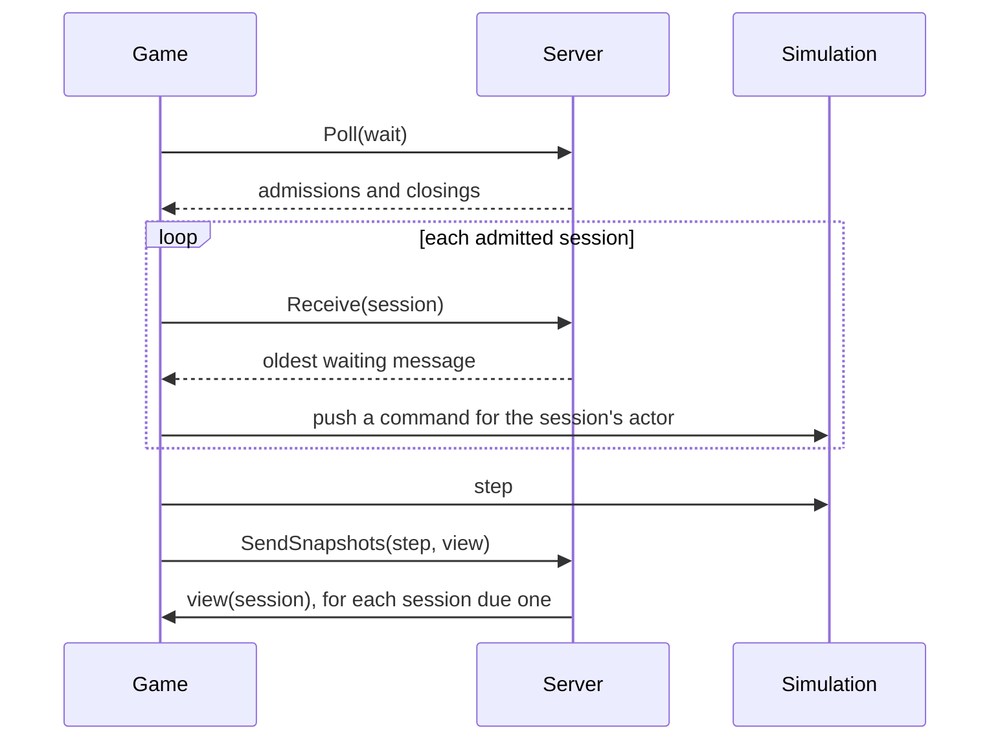
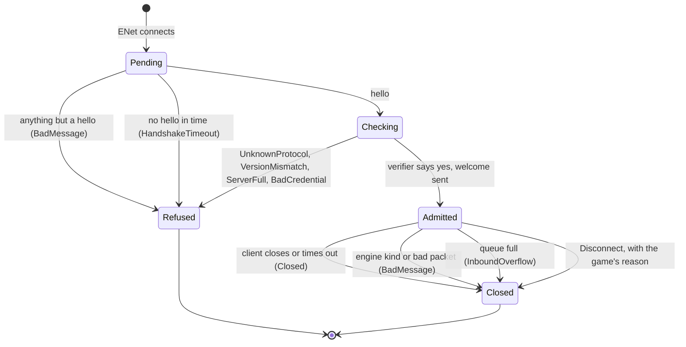

# Networking

The `net` module is the transport a game's dedicated server and its clients are built on. It
carries messages between one server and many clients over UDP, admits a client by a handshake,
bounds what each client may cost the server, and sends each client its own view of the world. It
knows nothing of what the messages mean: the protocol, the accounts, and what a client may do and
see stay in the game.

One stack, ENet over UDP, single-threaded and polled, serves an idle game's occasional requests and
a real-time game's stream of inputs and snapshots. It is plaintext for now, so a game hosts on
loopback or a trusted network until encryption lands ([J01](roadmap.md#j01)).

## Concepts

| Term | What it is |
| --- | --- |
| Server | `Net::Server`: listens on one IPv4 address and port, admits clients and queues their messages. |
| Client | `Net::Client`: one connection to a server. It connects as it is made and is spent once closed; to reconnect, make another. |
| Net session | One connection on the server, named by a `SessionId`. Ids count up from 1 and are never reused, so a reconnection is a new session. It is not a [host session](glossary.md#session) (`Host::Session`, a running world). |
| Protocol | The game's name for its protocol and a version number (`Net::Protocol`). A server lists the versions it accepts. A message's shape changing is a new version. |
| Credential | Bytes the client sends in its hello, opaque to the engine. Usually a bearer token. |
| Verifier | The game's function that judges a credential and admits or refuses the session. It records whom the session stands for, the game's *actor*. |
| Channel | `Reliable` (reliable and ordered) or `Unreliable` (unreliable and sequenced: a packet older than one already delivered is dropped). |
| Message | A `MessageKind` (the game's number for it, two bytes) and a body the game encodes, usually in the [binary archive](persistence.md#archives). |
| Snapshot view | The game's function that encodes what one session may see, which `SendSnapshots` sends. A network snapshot is this encoded view, not a presentation [snapshot](glossary.md#snapshot). |
| Reason | `Net::Reason`: why a connection ended, reported the same at both ends (`ReasonName` gives its text). |
| Token | A bearer token: 32 random bytes as 64 lower-case hex characters. The server keeps only its digest. |

### Reasons

| Reason | When |
| --- | --- |
| `Closed` | The other end closed, or nothing was heard from it within `Limits::timeout` (5 s). |
| `UnknownProtocol` | The hello names another protocol. |
| `VersionMismatch` | The hello's version is not one the server lists. |
| `ServerFull` | `maxSessions` are already admitted. |
| `BadCredential` | The verifier refused the credential. |
| `HandshakeTimeout` | No hello within `handshakeTimeout` (2 s) of connecting. |
| `BadMessage` | Anything but a hello before admission, a hello that does not decode, or a message of an engine kind. |
| `InboundOverflow` | A message arrived while `maxInbound` were already waiting for the game. |
| `Revoked` | The game closed the session because its credential was withdrawn. |
| `Shutdown` | The game closed the session, or destroyed the server, because the server is stopping. |

## How it works

### The network never steps the world

The server does nothing between calls, and every call is made from the thread that made it. So the
game decides when the network runs: it polls between its [steps](glossary.md#step), and the
[simulation](glossary.md#simulation) steps exactly as it would with no clients. This sequence shows
one turn of a server's loop:



`Server::Poll` sends what is queued and takes in what has arrived: connections, hellos, messages
and closings. It waits up to `wait` for the first event and never longer; zero does not block.
Messages from admitted sessions go into each session's queue, and `Server::Receive` takes them
out oldest first. The game turns each request into a [command](glossary.md#command) for the
session's actor, so no request can name whom it acts for.

The client is the same: `Client::Poll` returns `ClientEvent`s (`Admitted`, `Message`,
`Snapshot`, `Closed`) in order, and `Client::Send` queues a message for the next poll.

### The handshake

A connection carries nothing but a hello until it is admitted. This diagram shows a connection's
life on the server:



The client sends its hello as soon as ENet connects. The hello is a binary archive, format
`jettison.hello` version 1, of the protocol's name, its version and the credential. The server
checks, in this order:

1. the protocol's name;
2. the version, against `ServerConfig::versions`;
3. that fewer than `maxSessions` are admitted;
4. the game's verifier, called once per session inside `Poll`.

Each refusal closes the connection with its reason, which ENet's disconnect carries, so the client
reads it in its `Closed` event. A refusal raises no `ServerEvent`: the
game only hears of sessions it admitted. Admission sends the welcome, and only then does either end
accept a game's message.

### The wire

A packet is its kind, two bytes little-endian, then its body. A snapshot's body begins with the
step it was taken at, eight bytes little-endian. Kinds from `kFirstEngineKind` (`0xFF00`) up
are the engine's own: the hello, the welcome and the snapshot. Neither end sends a game's message
of one of those kinds (`Send` returns false), and a server closes a session that does
(`BadMessage`). Changing any of this breaks every client of an earlier build.

The handshake, requests and their results go `Reliable`; snapshots and a real-time game's inputs
go `Unreliable`, the newest superseding whatever is in flight. A snapshot longer than the MTU goes
in unreliable fragments, so a lost one is dropped whole rather than resent, holding back the next.

### Bounds

Every resource a client can make the server spend is bounded. These are `ServerConfig`'s fields
and `Limits`, which both ends have:

| Setting | Default | What it bounds |
| --- | --- | --- |
| `maxSessions` | 32 | Admitted sessions. A hello past it is `ServerFull`. |
| `maxPending` | 8 | Connections not yet admitted, on top of the sessions. Past both, ENet ignores a new connection, which times out at its client with `Closed`. |
| `handshakeTimeout` | 2 s | Time from connecting to the hello. |
| `maxInbound` | 256 | Messages a session may have waiting for `Receive`. One more closes it as `InboundOverflow`. |
| `snapshotInterval` | 100 ms | The least time between two snapshots to one session. |
| `Limits::maxMessageBytes` | 64 KiB | A whole message, kind and snapshot step included. |
| `Limits::timeout` | 5 s | Silence from a peer before it is closed. |

A message is one ENet packet, which ENet splits into datagrams and reassembles, so
`maxMessageBytes` bounds the whole message. ENet drops a longer packet before it is reassembled
(its `maximumPacketSize`), and `Send` refuses to make one. A peer that sends an oversize reliable
packet therefore stalls its own reliable channel until it times out, rather than being closed with
a reason.

A reliable message of any length under the limit arrives, paced by ENet's window. An unreliable
message's fragments are all sent at once and must all arrive, so it must also fit the receiver's
socket buffer, the 256 KiB ENet asks for. On loopback 256 KiB arrived every time and 384 KiB never
(2026-11-24). A view larger than that wants deltas, which are not provisioned.

### Snapshots

`Server::SendSnapshots(step, view)` asks the view for each admitted session whose last snapshot
is at least `snapshotInterval` old, and sends the body on the unreliable channel with the step
first. So the view on the server decides what each session may see, at a rate bounded per session.
A view that returns `nullopt`, or one over the limit (logged), sends nothing, and the session is
asked again next time. The view may disconnect sessions as it
runs: the server walks the sessions by id and skips any that closed. On the client, a `Snapshot`
event holds the body in `message.body` and the step in `step`.

### Closing

| Call | What happens |
| --- | --- |
| `Server::Disconnect(session, reason)` | Sends what was queued, then closes with the reason. No `Closed` event follows for that session. |
| `Server::Closing()` | True while a session closed with `Disconnect` still has messages unacknowledged or its client has not answered. |
| `~Server` | Closes every connection at once as `Shutdown`, dropping what is queued. |
| `Client::Disconnect()` | Sends what was queued, then closes; the server sees `Closed`. |
| `~Client` | Closes at once. |

A server that must deliver its last messages disconnects each session, then polls until
`Closing()` is false or a deadline of its own passes, and only then is destroyed: polling, not a
blocking shutdown, because the game owns the loop.

### Tokens

`Net::GenerateToken` gives a new bearer token from libsodium's random source. `Net::DigestToken`
gives its BLAKE2b-256 digest, also as hex. `Net::TokenMatches` compares a token's digest with a
stored one in constant time. A leaked store of digests gives away no token, and a token's 256 bits
of entropy make a fast digest enough where a password would want a slow one. The game issues, stores
and revokes tokens; revoking one closes its sessions with `Server::Disconnect(session,
Reason::Revoked)`.

## Using it

The [consumer project](sample-game.md#the-consumer-project), `source/test/consumer/main.cpp`, serves
a small race game over loopback. Its server admits by token, and the verifier records the actor:

```cpp
const std::string hareToken = Net::GenerateToken();
const std::map<std::string, std::string> digests{{Net::DigestToken(hareToken), "hare"}};
std::map<Net::SessionId, std::string> actors;
Net::ServerConfig config;
config.protocol = "race";
config.versions = {kVersion};
config.maxInbound = 2;
Net::Server server{
    config, [&](Net::SessionId session, std::span<const std::byte> credential)
    {
	    const std::string token{
	        reinterpret_cast<const char *>(credential.data()), credential.size()};
	    for (const auto &[digest, piece] : digests)
		    if (Net::TokenMatches(token, digest))
		    {
			    actors[session] = piece;
			    return true;
		    }
	    return false;
    }};
```

A client names the port, the protocol and its credential, then polls until it is admitted or
closed. `port` 0 on the server took an ephemeral one, which `Server::Port` reports:

```cpp
Net::ClientConfig player;
player.port = server.Port();
player.protocol = {"race", kVersion};
player.credential = Bytes(hareToken);
Net::Client client{player};
// Poll both ends until client.Admitted(), or a Closed event gives the reason it was refused.
```

A request becomes a command for the session's actor; it names no piece, so a client cannot act
for another:

```cpp
const std::optional<Net::Message> request = server.Receive(session);
if (request && request->kind == kPlaceMine)
	world.Commands().Push(Place{actors.at(session)});
```

After a step, each session is sent only what its actor may see, encoded in the binary archive:

```cpp
server.SendSnapshots(
    world.Clock().Step(),
    [&](Net::SessionId viewer) -> std::optional<std::vector<std::byte>>
    {
	    std::vector<Token> visible;
	    for (auto [entity, token] : world.Registry().view<Token>().each())
		    if (token.piece == actors.at(viewer))
			    visible.push_back(token);
	    Serialise::BinaryWriter writer{kViewFormat};
	    writer.Write(visible);
	    return writer.Finish({1});
    });
```

A clean stop delivers its last message before closing, from
`source/engine/net/tests/NetTests.cpp` (`Until` polls both ends until the condition holds):

```cpp
CHECK(fixture.pServer->Send(session, Channel::Reliable, 9, Bytes("last")));
fixture.pServer->Disconnect(session, Reason::Shutdown);
CHECK(fixture.pServer->Closing());
fixture.Until([&] { return !fixture.pServer->Closing(); }, {&client});
CHECK(fixture.ClosedWith(client) == Reason::Shutdown);
```

Manifest's dedicated server and remote client are a full example: `Manifest::Remote::Server`
(Manifest's `source/game/remote/include/manifest/remote/Server.h`) reads its tokens from a file,
closes revoked sessions as `Revoked`, and stops through `Closing`. Its contract is [Manifest's
network contract](../../manifest/docs/gameplay-and-server-plan.md#network-contract-n01-2026-11-20).

## Limits and open work

- Encryption: a key exchange in the hello with the server's key pinned, then every packet sealed,
  before a game hosts outside a trusted network ([J01](roadmap.md#j01)).
- Who a script's commands are sent as, when several players share a server ([J02](roadmap.md#j02)).
- No IPv6: ENet 1.3 does not have it.
- No deltas against an acknowledged snapshot, so an unreliable view must fit in 256 KiB (above).
- A real-time game's inputs at step rate need nothing new until a game measures them.
- A peer's oversize packet stalls it to a timeout (above).

## Decisions

The settled choices are in [decisions](decisions.md#networking); the scope's verdicts in
[scope](scope.md#networking).

## Source

- `source/engine/net`: the module, which depends on `core` and `serialise` and links ENet
  and libsodium privately.
  - `include/jettison/net/Protocol.h`: `Channel`, `Reason`, `Protocol`, `MessageKind`,
    `Message`, `Limits`.
  - `include/jettison/net/Server.h`: `Server`, `ServerConfig`, `ServerEvent`, `Verifier`,
    `SnapshotView`.
  - `include/jettison/net/Client.h`: `Client`, `ClientConfig`, `ClientEvent`.
  - `include/jettison/net/Token.h`: `GenerateToken`, `DigestToken`, `TokenMatches`.
  - `src/Wire.h`: the packet layout and the hello's encoding.
- `source/engine/net/tests/NetTests.cpp`: the `net` suite over loopback, including a raw ENet
  peer that is not the engine's client.
- `source/test/consumer/main.cpp`: the independent consumer's served race.
