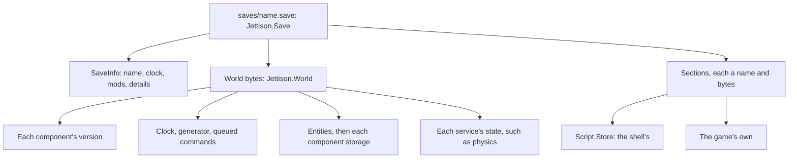
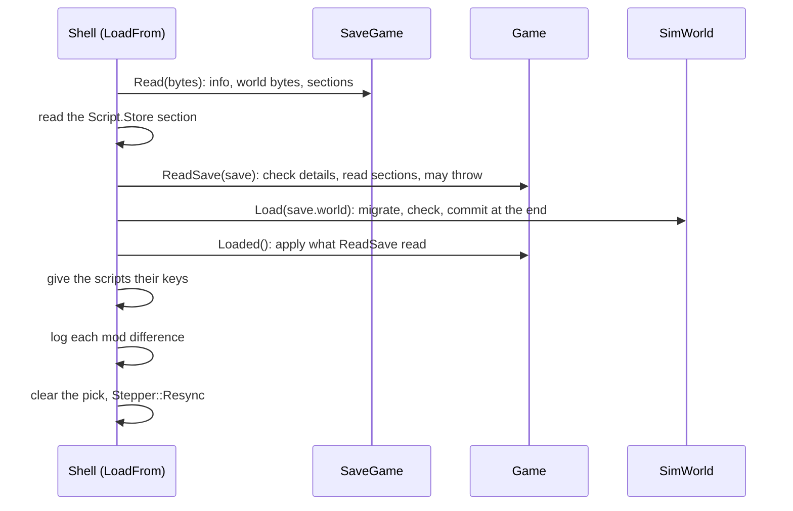
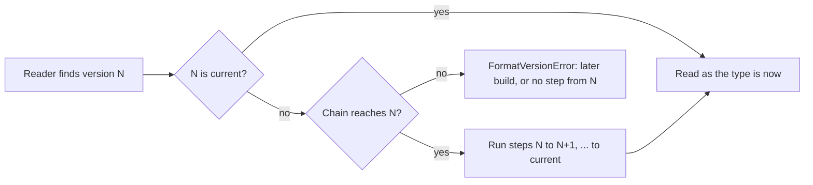

# Persistence

Persistence is how the engine writes its state to disk and reads it back: reflection describes C++
types; the archives turn a described value into YAML or binary; and the save game is the one file
holding a [simulation](glossary.md#simulation)'s whole state with the game's own beside it. Format
versions and migrations let a format change, and durable writes keep a save whole through a crash
or a power cut. A game rarely calls the archives itself: it registers its
types, and the [definition registry](glossary.md#definition-registry), the scene loader, the
world's save and the shell's saves read and write them.

## Concepts

### Reflection

`Reflect` (`reflect/Reflect.h`) is a thin layer over EnTT's `meta` tables. A type is registered
once, at start-up, by name, with the fields an archive or a tool may see, each a member object
pointer with attributes:

| Attribute | Read by |
| --- | --- |
| `Saved` | The archives: only Saved fields are written and read. |
| `Editable` | The editor inspector. |
| `Moddable` | The definition registry. |
| `Console` | The console's variables. |
| `Script` | The script host: a type scripts see, as an event or a command ([scripts](scripts.md)). |

An archive writes fields in registration order. An enumeration is registered with each
enumerator's name, so a file stores `Docked` rather than `3`, and reordering it changes no file's
meaning. Base classes are not reflected:
[components](glossary.md#component) and definitions are plain structs.

Registration throws `Reflect::RegistrationError` for a type registered twice, a name already taken,
or a field name used twice in one type; EnTT's own checks are assertions, absent in Release. A name
(`Reflect::Name`) has a `consteval` constructor, because EnTT keeps the pointer rather than a copy:
a name that would dangle does not compile. Lookups (`Resolve`, `FindField`) compare the text as well
as the 32-bit hash, so two names whose hashes collide never resolve to each other. A file always
names a type or field by its text, never by the hash.

### Archives

An archive writes a registered class field by field, Saved fields only, and reads it back into a
default-constructed value (`serialise/Archive.h`). There are two, written and tested as one pair:

| Archive | For | Layout |
| --- | --- | --- |
| `YamlArchive` | Authored content: definitions, scenes | A mapping, `version` beside the root's fields |
| `BinaryArchive` | Saves | Little-endian: a header, a table of names, the value |

A field may be a bool, an integer, a float or double, a `std::string`, a GLM vector or quaternion,
an `entt::entity`, a registered enumeration or class, a `std::optional` of any of these, or a
sequence or map of them. The full list, with how each is written, is the comment at the top of
`Archive.h`.

The rules every format inherits:

- **A field the data leaves out keeps its default.** Reading starts from a default-constructed
  value, so a field added to a type reads as its default from an older file.
- **A field the data names but the type does not save is refused.** A misspelt key fails rather than
  vanishing, and a file cannot set runtime state a type does not mark Saved.
- **Errors name the place.** A `Serialise::FormatError` names the field's path
  (`Cargo.holds[2].mass`) and, for YAML, the line.
- **The same value writes the same bytes.** Maps are written in the order of their keys' text,
  whatever the container's own order, and numbers as the shortest text that reads back exactly.
- **An optional field is left out when empty**, and read as present when the file names it. This is
  how a scene says which components an entity has.
- **A type an archive cannot handle is a defect, not bad data**: `UnsupportedTypeError`, a
  `std::logic_error`.

The binary layout writes every field with its name's index in the table and its length, so fields
are found by name rather than by position, and a field whose type changed size is reported rather
than misread. Every truncation of a binary archive is refused as a `FormatError`, which the
serialise suite tests for every prefix.

`BinaryWriter` and `BinaryReader` (`serialise/Binary.h`), the streams `BinaryArchive` is made of,
are public for a format that is a sequence of values, as the world's save is. `WriteBytes` puts
one archive inside another, as the save game holds the world's.

### Format versions and migrations

Every format has a name and a [format version](glossary.md#format-version)
(`Serialise::FormatVersion`). A reader given data of another version either runs the format's
[migrations](glossary.md#migration) or throws `FormatVersionError`, which names both versions and
why: "it was written by a later build", or "there is no migration from version N".

A format's migrations (`Serialise::Migrations<Data>`, `serialise/Migration.h`) are a chain of steps,
one from each version to the next, each reading only what its version wrote
([why](decisions.md#persistence)). The chain runs over one of three kinds of data:

| Chain | Data a step edits | Used for |
| --- | --- | --- |
| `BinaryMigrations` | `BinaryDocument`: the archive's table of names and its payload | Saves, the world's save |
| `YamlMigrations` | `YAML::Node`, the parsed tree, which keeps its lines for errors | Definitions |
| `Sim::ComponentMigrations` | `BinaryRecord`: one value's fields, each a name and its bytes | One component's storage, a reflected struct inside it included |

Because fields and enumerators are found by name, a rename is an edit to the names table alone
(`BinaryDocument::Rename`). A change inside the value a document begins with, as a save game's info
is, is `BinaryDocument::EditFirstRecord`. A change that needs the old types keeps them registered
under names of their own and reads with them.

A YAML step edits only what the data has and adds nothing it leaves out. A mod's patch is migrated
as a whole document is while leaving out every field it does not change, so a step that filled in a
default would set it over the layer below ([files, packs and mods](files-and-mods.md)).

**Until player testing, formats change in place**: the chains hold no steps, and a format change
rewrites the files in both repositories instead ([decided](decisions.md#persistence)).

### The save game

A [save](glossary.md#save) (`Sim::SaveGame`, `sim/SaveGame.h`) is one file of format
`Jettison.Save`, holding three parts, each versioned on its own:

- **The info** (`Sim::SaveInfo`): what a list of saves shows without loading one, and what a load
  checks first.
- **The world's save** (`Sim::SimWorld::Save`, format `Jettison.World`): the simulation's whole
  state.
- **The [sections](glossary.md#section)** (`Sim::SaveSection`): the game's own state, each a named
  binary archive of the game's format.

The save game holds the last two as bytes it does not read.

What a save holds beyond the engine's state is the game's to decide ([scope](scope.md)). The shell
adds one section of its own, `Script.Store`, the bytes scripts keep by key ([scripts](scripts.md)).

The info's fields:

| Field | What it is | Set by |
| --- | --- | --- |
| `name` | The player's name for the save | `SaveGame::Of` |
| `engineVersion` | `Core::EngineVersion()` of the build that wrote it, for a report; a reader goes by format versions, not this | `SaveGame::Of` |
| `writtenAt` | Seconds since the Unix epoch, by the wall clock | The caller: the simulation never reads the wall clock |
| `step`, `time` | The world's clock as it was saved | `SaveGame::Of` |
| `mods` | The mods enabled, in mount order, with their versions | The caller |
| `details` | Key and value strings of the game's, such as the place it was saved in | The game |

The info is written first, so `SaveGame::ReadInfo` reads a list of saves without reading further.



The diagram shows a save file's nesting.

### The world's save

`SimWorld::Save` writes everything a step depends on: the clock, the random generator, the
[commands](glossary.md#command) still queued (each by its registered name), the entities, every
registered component's storage in registration order, and each world service's state (physics' Jolt
bodies, for one). A component's Saved fields are all a save keeps of it, so the simulation depends
on no state outside them. The world's state hash is a hash of these bytes
([simulation](simulation.md#saving-hashing-and-replay)).

The save begins with each component storage's version, so a load checks every storage against its
component's chain first. A component is registered at version 1, or at its chain's current version
(`SimWorld::RegisterComponent<T>()` takes `T::Migrations()` when the type defines it). A storage
saved without a version is read as version 1.

`SimWorld::Load` reads everything into locals and commits only at the end, so a save that does not
fit leaves the world as it was. It refuses, naming the cause, a component, command or service the
world does not register, one given twice, a service missing from the save, and a storage at a
version its chain does not reach. A service reads its state against the registry and the command
queue it will have, and hands back what puts that state in place once they are committed.

### Durable writes

A save reported written must survive a crash or a power cut that follows it. Saves, settings and the
mod list are all written whole through `Core::WriteFileDurably` (`core/File.h`):

1. The bytes go to a partial file in the target's directory, the write's own,
   `:partial.<process ID>.<mark>.<count>`, the mark 16 hexadecimal digits the process draws once. Its
   length is bounded, so a target of the longest name a file system allows is still written; its
   colon makes it a name no virtual path can have, so nothing reads it as content. A partial of its
   own means two writers of one file at once never write into one, where one could rename the other's
   half-written bytes into place, and the mark that a process given a crashed one's ID never meets
   that one's partial.
2. The partial file is flushed to the disk (`fsync`).
3. It is renamed over the target.
4. The directory is flushed, since the rename is an entry in the directory.

A process's first write into a directory removes the partial files there that writers which no
longer run left, as a crash leaves them: files named exactly so, never another file, and never the
file the write is writing, whatever its name. One named for a process that runs is another
writer's, and kept. A crash's partial is an earlier process's, so one
look at a directory a process is enough, and a write after it does not list the directory again. A
failed write removes its own partial and never one it did not make.

The partial file is made anew with the permissions the caller gives, 0644 unless told otherwise
(`Core::kFilePermissions`), so a file a game keeps private, such as a server's secret key at 0600,
is never open to others on its way. Why both flushes are needed is
[decided](decisions.md#persistence). On failure it throws
`std::runtime_error` naming the path, with the partial file removed and the old file as it was;
only a failed flush of the directory, after the rename, leaves the new file in place, and says so.

The `core` suite fails each system call under the writes in turn (the partial's open, a write, a
write cut short and then failed, the file's `fsync` and `close`, the rename, the directory's open and
`fsync`, and `mkdir`) and checks the error names the path and the files are as promised. File.cpp
makes them through a table of the calls (`core/src/SystemCalls.h`, private to the module) that only
a test changes.

<a id="a-write-that-refuses-to-replace"></a>
`Core::WriteNewFileDurably` is the same write for a file that must not be there yet, a new save's name
or a world's first file. It decides in the rename that puts the file in place, `renameat2` with
`RENAME_NOREPLACE` (Linux; the one call is in `core/src/File.cpp`), so there is no check for another
writer to come between: of two writers making the same file one leaves it whole and the other gets
`Core::FileExistsError`, a `std::runtime_error` naming the path, with its partial file removed. A file
already there is as it was, a directory in the way included. The file system must support the flag (ext4, xfs, btrfs
and tmpfs do); on one that does not, the write throws naming the path and the reason.

A missing directory is made by `Core::CreateDirectoriesDurably`, outermost first, each one's parent
flushed as it is made: a new directory is an entry in its parent, and is lost with everything under
it until that parent is on the disk. Each directory has the permissions its caller asks for from the
moment it is made, under the process's umask.

`Core::FileLock` (`core/FileLock.h`) holds a directory to one writing process: a file locked with
the kernel's `flock`, so the lock ends with its process and a crash leaves nothing stale. It is
advisory, refusing only another `TryAcquire`, the same process's included.

<a id="a-locks-holder"></a>
Once it holds the lock it writes who does into the file, `<process ID> <program name>`, over what a
crashed holder left, so a refused caller can say by whom: `FileLock::HolderOf(path)` reads the file's
first line (at most `kHolderLimit` bytes) for the message. The kernel's lock alone decides who holds
it. What the file says is never trusted: after a crash it still names the dead holder, until the next
one writes its own, and a file that does not read gives an empty string. Manifest's server takes one before it writes a world ([Manifest's
saves](../../manifest/docs/persistence.md)).

Saves reach these writes through `Vfs::FileSystem::Write` (the writable mount, the user's data
directory), settings through `Core::Config::SaveUserLayer`, and the mod list through the shell's
mounts (`app/src/Mounts.cpp`).

### Settings apart from saves

Settings and bindings are one file in the configuration directory,
`~/.config/jettison/settings.yaml`, not in a save: loading a save changes none of them. The file is
the config's user layer, with the input system's binding overrides in it and the devices the
player's joysticks were bound as ([bindings as settings](ui.md#bindings-as-settings)). It is written
whole and durably each time the player changes a setting. If the file did not read at start-up, the
first write keeps it beside the new one as `settings.yaml.unread`, so a mistake in an edit by hand
is not lost. The player's mod list, `mods.yaml`, lives beside it ([files, packs and
mods](files-and-mods.md)).

## How it works

### Saving in the shell

`Application::SaveTo` (`app/src/Application.cpp`) writes a save in this order:

1. `SaveGame::Of(world, name)`: the world's bytes, its clock, the engine version and the name.
2. The wall-clock time and the mods enabled into the info.
3. The `Script.Store` section.
4. `Game::WriteSave`: the game adds its sections and details. A section name already taken throws,
   and nothing is saved.
5. `SaveGame::Write`, then `Vfs::FileSystem::Write` to `saves/<name>.save` on the user mount, the
   user's data directory (`~/.local/share/jettison/`).

A save's name is letters, digits, `-` and `_` (`App::SavePath`), one path segment on any file
system. F5 or `save [name]` saves (`quicksave` by default); F9 or `load [name]` loads. The saves
screen (L, or `saves`) lists every save from its info alone, one that does not read with the reason
([keys](app-shell.md#keys)).

### Loading in the shell



The diagram shows `Application::LoadFrom`. A load replaces the world only once the whole save has
read: any throw before `SimWorld::Load` commits changes nothing, and the shell logs why ("Not
loaded: ..."). A save made with other mods than the run's still loads: `Sim::ModDifferences` gives
one line for each mod saved with and not enabled, enabled and not saved with, at another version,
or in another order, and the shell logs each as a warning. Refusing is the game's, through
`Game::ReadSave`. Last,
`Stepper::Resync` takes the [snapshots](glossary.md#snapshot) again, since a loaded world's entity
identifiers may name other entities than they did, and the game rebuilds its own presentation in
`Game::Loaded`.

### Reading data of an older version



The diagram shows what every reader given a chain does. `Migrations::Check` refuses before any step
runs, so no file is half migrated.

## Using it

### Registering a type

From `source/engine/sim/tests/SaveGameTests.cpp`: a component and a game's own record, each with one
Saved field; the static runs registration once.

```cpp
void RegisterTypes()
{
	static const bool registered = []
	{
		Reflect::RegisterType<Freight>("SaveGameTests.Freight")
		    .Field<&Freight::tonnes>("tonnes", Attribute::Saved);
		Reflect::RegisterType<Purse>("SaveGameTests.Purse")
		    .Field<&Purse::credits>("credits", Attribute::Saved);
		return true;
	}();
	(void)registered;
}
```

### What the YAML archive writes and refuses

From `source/engine/serialise/tests/SerialiseTests.cpp`: the version first, then the Saved fields in
registration order, an enumeration by name.

```cpp
CHECK(
    YamlArchive::Write(Hold{Good::Water, 40, 0.25}, {3}) ==
    "version: 3\ngood: Water\nquantity: 40\nmass: 0.25\n");
```

A field the type does not save is refused with its path and line:

```text
SerialiseTests.Ship.speed: 'SerialiseTests.Ship' has no saved field 'speed' (line 2)
```

The test content's scenes are this archive's output; `source/test/content/scene/main.yaml` begins
`version: 3`, then `entities:`.

### A save with a game's section

From `source/engine/sim/tests/SaveGameTests.cpp`: the info filled in, a section of the game's own
format, and the save read back.

```cpp
Sim::SaveGame save = Sim::SaveGame::Of(world, "Before the jump");
save.info.writtenAt = 1'794'400'000;
save.info.details = {{"company", "Ostra Freight"}, {"day", "12"}};
save.AddSection("SaveGameTests.Purse", Serialise::BinaryArchive::Write(Purse{125'000}, {1}));

const std::vector<std::byte> bytes = save.Write();
const Sim::SaveGame read = Sim::SaveGame::Read(bytes);
CHECK(Sim::SaveGame::ReadInfo(bytes).Detail("day") == "12");
CHECK(
    Serialise::BinaryArchive::Read<Purse>(read.FindSection("SaveGameTests.Purse")->data, {1})
        .credits == 125'000);

// The world loads into a world registered the same way, and steps on as the saved one.
loaded.Load(read.world);
```

### A game's save hooks

The ground sample (`source/samples/ground/src/GroundGame.cpp`) marks its saves with a detail and
refuses, before the world is touched, any save without it:

```cpp
void GroundGame::WriteSave(Sim::SaveGame &save, App::Shell & /*shell*/)
{
	save.info.details.push_back({std::string{kSaveDetail}, "rover"});
}

void GroundGame::ReadSave(const Sim::SaveGame &save, App::Shell & /*shell*/)
{
	if (save.info.Detail(kSaveDetail).empty())
		throw std::runtime_error("the save is not the ground sample's");
}
```

`source/samples/ground/tests/GroundTests.cpp` checks both. A `place` detail
(`App::kPlaceDetail`) is shown in the saves screen's list.

### A migration chain

From `source/engine/serialise/tests/MigrationTests.cpp`: version 1 called a cargo's weight `mass`,
version 2 renamed it `tonnes` (an edit to the names table), and version 3 added `origin` (reading
version 2 with the type that wrote it).

```cpp
BinaryMigrations migrations{std::string{kCargo}, {3}};
migrations.Add(1, [](BinaryDocument &document) { document.Rename("mass", "tonnes"); });
migrations.Add(
    2,
    [](BinaryDocument &document)
    {
	    const std::vector<std::byte> bytes = document.Emit();
	    BinaryReader reader{bytes, document.format, {2}};
	    CargoV2 old;
	    reader.Read(old);
	    reader.End();
	    BinaryWriter writer{document.format};
	    writer.Write(Cargo{old.label, old.tonnes, OriginOf(old.label)});
	    document = BinaryDocument::Parse(writer.Finish({3}), document.format);
    });

// Any earlier version then reads as the current one.
const auto first = BinaryArchive::Read<Cargo>(Written(CargoV1{"Halcyon ore", 40}, 1), migrations);
```

The same file has the YAML chain for the same history, a step editing the tree: `root["tonnes"] =
root["mass"]; root.remove("mass");`.

### A component's chain

From `source/engine/sim/tests/SimTests.cpp`: a step over one value's record, which removes a field
and decodes a retyped one by the old layout, without the old C++ type.

```cpp
Sim::ComponentMigrations chain{"SimTests.Cargo", {2}};
chain.Add(
    1,
    [](Serialise::BinaryRecord &record)
    {
	    if (record.Has("grade"))
	    {
		    if (record.Get<std::string>("grade") == "fine" && record.Has("tonnes"))
			    record.Set("tonnes", record.Get<std::uint32_t>("tonnes") * 3 / 2);
		    record.Remove("grade");
	    }
	    // ...
    });
world.RegisterComponent<Cargo>(std::move(chain));
```

`RegisterComponent` throws for a chain named other than the component. A storage of a later
version is refused by the component's name, as in "SimTests.Cargo:
version 3 found, version 2 expected: it was written by a later build".

### Holding a directory to one writer

From `source/engine/core/tests/FileTests.cpp`:

```cpp
std::optional<FileLock> held = FileLock::TryAcquire(path);
REQUIRE(held);
CHECK_FALSE(FileLock::TryAcquire(path)); // refused while held, even in the same process
CHECK(FileLock::HolderOf(path) == "1234 manifest-server"); // for the message: process ID, program
```

## Limits and open work

- **No migration steps exist** until the first build given out (above).
- **A save holds no definitions**, only their names. A definition's format can change without a
  save's, but a save loaded with other content reads whatever the definitions now say.
- **`WriteNewFileDurably` is Linux only** until the Windows port, which has no rename that refuses to
  replace (`MoveFileEx` without its replace flag does the same).
- **`FileLock` is for a local file system.** Over NFS, Linux emulates `flock` with a lock that does
  not refuse its own process.

## Decisions

The settled choices are in [decisions](decisions.md#persistence); a save naming its mods is under
[files, packs and mods](decisions.md#files-packs-and-mods).

## Source

| Module | Headers | What |
| --- | --- | --- |
| `reflect` | `reflect/Reflect.h` | Registration, attributes, lookups |
| `serialise` | `serialise/Archive.h` | `YamlArchive`, `BinaryArchive`, `FormatVersion`, the errors |
| | `serialise/Binary.h` | `BinaryWriter`, `BinaryReader`, `BinaryRecord` |
| | `serialise/Migration.h` | `Migrations`, `BinaryDocument`, `Migrate`, `PeekVersion` |
| `sim` | `sim/SaveGame.h` | `SaveGame`, `SaveInfo`, `SaveSection`, `ModDifferences` |
| | `sim/SimWorld.h` | `SimWorld::Save`, `Load`, `RegisterComponent`, `ComponentMigrations`, `WorldService` |
| `core` | `core/File.h`, `core/FileLock.h` | `WriteFileDurably`, `WriteNewFileDurably`, `CreateDirectoriesDurably`, `FileLock` |
| `app` | `app/Game.h`, `app/src/Saves.h`, `app/src/Settings.h` | The game's save hooks, save paths and the saves screen, settings |

Headers are under `source/engine/<module>/include/jettison/`, and `app/src` under `source/engine/`.
The suites: `reflect`, `serialise` (`SerialiseTests.cpp`, `MigrationTests.cpp`,
`LayerTests.cpp`), `sim` (`SaveGameTests.cpp`, `SimTests.cpp`) and `core` (`FileTests.cpp`).
