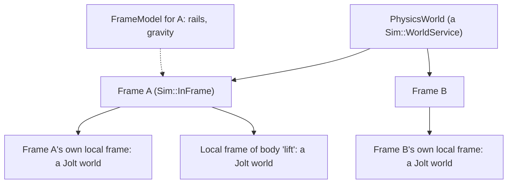
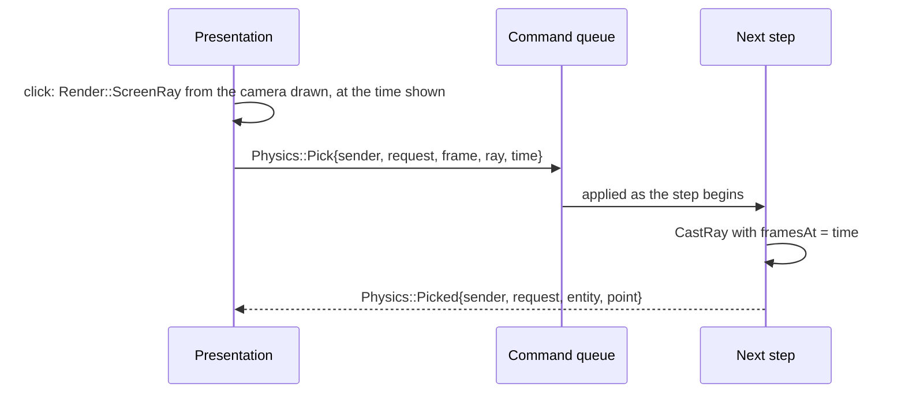
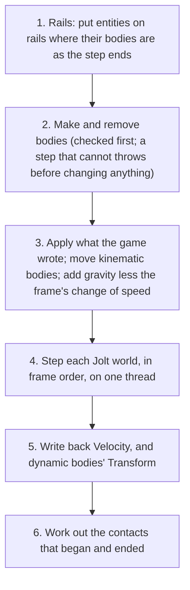

# Physics

Physics moves bodies, makes them collide, and answers questions about where they are. It is
[Jolt Physics](https://github.com/jrouwe/JoltPhysics) in double precision, stepped inside the
simulation's [fixed step](glossary.md#fixed-step). Its state is part of the
[simulation](glossary.md#simulation): a [save](glossary.md#save) holds it, the world's hash covers
it, and a world loaded from a save steps on to the same bytes as the world that was saved. A game
sees bodies as [entities](glossary.md#entity) with components. It never sees a Jolt type.

The module also holds the flight model, which turns a pilot's demands into velocity before each
physics step. It suits anything driven by thrust-like accelerations: the ground sample drives a
rover with it.

## Concepts

### Bodies

A body is an entity with three [components](glossary.md#component):

| Component | Holds |
| --- | --- |
| `Physics::Body` | Its kind, its shape by name, mass, friction, restitution, damping, two flags (`continuous` and `sensor`), and optionally its [layer and group](#layers-and-groups) |
| `Sim::Transform` | Its position (double precision) and orientation in its frame |
| `Sim::InFrame` | The [frame](glossary.md#frame-coordinates) it is in. An entity in no frame (`Sim::kNoFrame`, one passing through a [portal](glossary.md#portal)) has no body |

Physics adds a fourth, `Physics::Velocity`, to every moving body that lacks one: metres and radians
a second, relative to the body's [local frame](#frames-and-local-frames).

The kind says what moves the body:

| `BodyKind` | Moved by | Typical use |
| --- | --- | --- |
| `Static` | Nothing. The game moves it only by writing its `Transform` again | Ground, walls |
| `Kinematic` | The game or its rails, through its `Transform`. Physics moves it there over the step, so it pushes what it meets | A lift, a platform on its orbit |
| `Dynamic` | Physics, which writes its `Transform` and `Velocity` after every step | Crates, vehicles |

Physics reads `Body` when it makes the body; changing any field makes it again at the next step,
keeping its velocity. The fields are floats, as Jolt keeps them; only positions are double.

- **Continuous.** A dynamic body marked `continuous` is swept along its motion each step instead
  of placed at its end, so it cannot pass through a thin panel between two steps. It costs a cast a
  step: use it for piloted vehicles, not cargo.
- **Sensor.** A body marked `sensor` meets and pushes nothing. It reports the dynamic bodies that
  enter and leave it as [contacts](#contacts). It never sleeps, so it still sees a vehicle come to
  rest inside it. It is placed, not swept, so it does not see a body that crosses it entirely
  between two steps. A sensor cannot also be continuous.

### Layers and groups

What may touch what is the game's. A **layer** is a `Physics::LayerDefinition` (`physics/Layer.h`)
naming the layers it meets; a body is in one by its `Body::layer`. Two layers meet if either names
the other, and a layer meets itself only if it names itself. A body in no layer meets every body, as
every body does when a game names no layers, so a game's layers narrow only what its own layered
bodies meet, and what an engine module makes in none (a dock's platform) is met by all of them. A
**group** (`Body::group`) is a number of the game's choosing: bodies of one group never meet one
another, whatever their layers, as a vehicle and the parts it carries should not. A group is any
number but the largest, which Jolt keeps for none.

Bodies of two layers that do not meet, or of one group, pass through each other: no push, no
contact, and a sensor does not report them. Static bodies still never meet each other. Changing a
body's layer or group makes it again at the next step, as any change to its `Body` does.

Layers are definitions: the registry type `Physics.Layer`, marked moddable, one file a layer, its
name the definition's. The game defines them all at once, before any body is made
(`PhysicsWorld::DefineLayers`, from a map in code or from the registry), since each world's
collision tables are made from them; a second definition, or one after a body, throws
`std::logic_error`, and a layer meeting one not defined throws `std::invalid_argument`. A body in a
layer not defined cannot be made, and a save naming one is refused, as one naming an unknown shape
is. A body in no layer and no group saves no field for either, so a world whose game names none
saves and hashes as it did before layers existed. A file of the suite's layer test:

```yaml
version: 1
meets: [ship]
```

A cast or an overlap is cast as a layer with `CastOptions::layer`: it hits only what a moving body
of that layer would meet, and with none, everything ([casts and picking](#casts-and-picking)). A
snapshot pick is cast as one with `PickOptions::layer`, by the same rule, read from the definitions
(`PhysicsWorld::Layers`, or the picker's own); `Physics::LayersMeet` is the rule over the
definitions. Steering leaves out of a vehicle's clearance what it would pass through, a body its
layer does not meet or one of its group ([AI](ai.md#steering)).

### Shapes

A shape is a `Physics::ShapeDefinition` (`physics/Shape.h`), in metres, in the body's own
axes. Its kind is one of:

| `ShapeKind` | Fields read |
| --- | --- |
| `Box` | `halfExtents` |
| `Sphere` | `radius` |
| `Capsule`, `Cylinder` | `radius`, `halfHeight` (along Y; a capsule's excludes its caps) |
| `ConvexHull` | `points` |
| `Mesh` | `vertices`, `indices` (counter-clockwise from outside). Static and kinematic bodies only: a mesh has no inside |
| `Compound` | `parts`: shape definitions of any kind, at least one, each placed in the compound by its own `offset` and `turn`. One with a mesh among its parts is a mesh |

A shape of any kind sits in its body where its `offset` and `turn` put it, in the body's axes: a
body's origin need not be its shape's centre, as a door's hinge or a wheel's axle is not. With
neither, a shape is built as it always was. A compound is Jolt's `StaticCompoundShape`; its parts
are its own, not shapes defined by name (why is in [decisions](decisions.md#physics)), and a part
may be a compound. `ShapeRadius`, what steering keeps clear of, widens a shape's radius by its
offset's length, which holds it but not always closely.

Shapes are [definitions](glossary.md#definition), not state. The game defines each by name at
start-up, in code (`PhysicsWorld::DefineShape`) or from the
[definition registry](glossary.md#definition-registry) (`DefineShapes`). The registry type is
`Physics.Shape`, marked moddable, so a [mod](glossary.md#mod) can replace a shape. Each is built
into a Jolt shape as it is defined, so a shape Jolt refuses throws there, naming it. Bodies and
saves name shapes, so a world a save is loaded into has to define the same ones.

### A model's collision shape

A body drawn from a model collides as a shape baked from the model into a file of its own, its
**collision file** (`physics/CollisionFile.h`). Physics is the server's, and a server reads no
model, so the shape cannot be read from the glTF at run time. The file is world content, under
`collision/` (`Host::kWorldDirectories`), so it is in the server's pack and in the digest a client
checks its own against ([files, packs and mods](files-and-mods.md#the-servers-world-content)), and
the client and the server collide with the same bytes. A model's is by convention at its path with
`collision/` for `models/` and `.collision` for its extension (`models/rover.glb`'s at
`collision/rover.collision`); what uses one names its path, as a dock's vehicle does
([docks](docks.md)).

The shape is a `Compound` whose parts are each a `ConvexHull` or a `Mesh`, in the model's axes and
metres, written by the binary archive as a `Physics.Shape` of version 1 (`kCollisionFileVersion`),
so the same shape is the same bytes. `ReadCollisionFile` reads one through the file system and
refuses one of another kind or version, naming the path, and the game defines it as it defines any
shape (`DefineShape`). A mesh among its parts makes it a mesh, for static and kinematic bodies only.

`jettison_bake_collision <model> <collision file>` (`source/tools/collision`) bakes one from a glTF
or GLB model, through the library function `Bake::CollisionShape`, which the cook
([J37](roadmap.md#j37)) is to call for every model it cooks:

| The model's mesh nodes | Their parts |
| --- | --- |
| `collision-<name>` | A convex hull of each one's vertices, kept whole within Jolt's limit of 256 points |
| `collision-mesh-<name>` | A mesh of each one's triangles |
| None named either way | A convex hull of each mesh node, simplified to at most 32 points (`Bake::kDrawnConvexHullPoints`) |

A model with `collision-` nodes collides as them alone, its drawn nodes left out. Each part is moved
by its node's transform, in the scene's order, a mirroring transform's triangles turned back to face
out. The simplification is Jolt's convex hull builder (`Physics::ConvexHullPoints`), which keeps the
points of those given that shape the hull most, none moved; a flat node makes a flat hull. A drawn
part with a hollow or a notch collides as its convex hull: an author who wants it closer splits it
into `collision-` nodes. The baker is compiled with `-ffp-contract=off`, as the simulation is, so a
debug and a release build bake the same bytes.

### Frames and local frames

[Coordinate frames and units](coordinates.md) defines frames and the engine's units; this section
says what physics does with them.

Physics divides each frame into **local frames** (`Physics::LocalFrame`). A body without a
`LocalFrame` is in the frame's own, at rest at its origin. A body with one is in the local frame of
a named body of the frame, such as a lift or a platform, which moves with its body but does not
turn with it. In it, Jolt's positions are metres from the body and its velocities relative to the
body's motion. `Sim::Transform` always stays in the frame's coordinates; `Physics::Velocity` is
relative to the local frame.

Each local frame with bodies is a Jolt world of its own (`JPH_DOUBLE_PRECISION`), made with its
first body and removed with its last. So only bodies in the same local frame of the same frame
meet, and a body that changes frame or local frame is made again in the other world, its velocity
converted to the new local frame. A static body is always in its frame's own local frame; anything
a local frame carries is kinematic or dynamic. [Why local frames](#why-local-frames) gives the
reason they exist. The diagram shows how a frame breaks down into Jolt worlds.



### Frame models: rails and gravity

What moves a frame's named bodies, and what pulls in it, is the game's: it subclasses
`Physics::FrameModel` and gives it to `PhysicsWorld::DefineFrame`.

| Method | Answers |
| --- | --- |
| `HasBody(name)` | Whether the frame has a body of that name |
| `BodyAt(name, time)` | Where that body is at a simulation time, and how it is turned |
| `GravityAt(time)` | A function from a position to gravity's acceleration there, or an empty function for none (the default) |

A model is a definition: it is neither saved nor hashed, and must give the same answer for the same
time in every run. A frame with no model has no rails, no local frames and no gravity.

The model's bodies drive two components:

- **Rails** (`Physics::OnRails`). Each step puts the entity's `Transform` where the named body
  is as the step ends, turned as the body is. An offset and a turn place the entity at a point on
  the body, in the body's axes. A kinematic body on rails pushes what it meets.
- **Local frames** (`Physics::LocalFrame`). The local frame of a named body moves where `BodyAt`
  puts it (`PhysicsWorld::FrameOrigin` gives its origin at a time).

Gravity moves only dynamic bodies. Physics asks `GravityAt` once a step and applies it where each
body is as the step begins. A local frame falls with its body, so each step physics also takes the
local frame's change of speed off every dynamic body in it: a vehicle beside a platform falls with
the platform and feels only the tide.

In Manifest, a star system is a frame model: a station's body follows its orbit on rails, and
planets pull as point masses ([Manifest's space document](../../manifest/docs/space.md)). The
physics suite's room (`source/engine/physics/tests/RoomTests.cpp`) is a model with a lift and
its own gravity, and no star system.

### The flight model

The flight model is the system `flight` (`physics/Flight.h`), which runs before `physics`. A
vehicle, to the flight model, is any dynamic body with two more components (it needs no
`Dock::Vehicle`):

| Component | Holds |
| --- | --- |
| `Physics::Handling` | Accelerations along and about the vehicle's axes, so handling does not change with mass; with flight assist, the top speed and turn rates it is held to |
| `Physics::FlightControls` | Demands from -1 to 1 along and about each axis, whether assist is on, and the reference entity its velocity is taken against |

The vehicle's axes are its `Transform`'s: +X to starboard, +Y up, forward along -Z. Full ahead
is `linear.z = -1`.

- **With assist,** a linear demand is a velocity relative to the reference, a share of `maxSpeed`,
  and an angular demand a rate of turn. The thrusters accelerate towards them as fast as they can,
  so a vehicle let go stops relative to the platform it flies by.
- **Without assist,** a demand is a share of the thrusters' acceleration. Nothing is held: the
  vehicle coasts and spins on.

The flight model changes the vehicle's `Velocity`; physics then steps it like any body, so a
vehicle flown into a platform meets it. It also writes `Physics::Thrust` for presentation's plumes:
the share of each axis's thrust that changed the velocity, from -1 to 1. It is what was fired, not
what was asked, so a vehicle holding its speed in space fires nothing whatever its throttle.
`Thrust` is not state: nothing in the simulation reads it, and it is shown in
[snapshots](glossary.md#snapshot) but neither saved nor hashed.

`FlightControls` is state, set only by the [command](glossary.md#command)
`Physics::SetFlightControls`. A game sends one when a control moves, not every frame, so a
recording holds few commands. `Sim::MayFly` accepts it only from a sender at the vehicle's
[helm](glossary.md#helm) (`Sim::Helm`) or from no one in particular (the game's own rules).
Otherwise physics raises `Physics::FlightControlsRefused` with the [reason](glossary.md#reason)
`reason.physics.not_at_helm`.

### Contacts

Contacts are the simulation's to read, not presentation's. A game rule decides in the step what a
contact means (damage, a sound, a gate crossed), so physics keeps them rather than sending them to
the [event](glossary.md#event) queue, which presentation drains.

- `PhysicsWorld::Contacts()` is what the last step began and ended, in order of pair. Each
  `ContactEvent` names the pair in entity order and whether one is a sensor. A beginning also
  carries the point, the normal from the first body towards the second, and the speed they closed
  at: what a game judges an impact's damage or sound by.
- `PhysicsWorld::Touching(entity)` is what touches a body now, in entity order.

A contact is between two bodies, not their parts: a compound body touching another with two parts
is one contact, and neither names the part ([decisions](decisions.md#physics)).

A system ordered `after` `physics` reads the step's contacts; one before it reads the last
step's. Both are saved, so either reads the same after a load. Two bodies touch while Jolt's contact
cache holds a contact between them after the step, which begins a couple of centimetres before they
meet (Jolt's speculative contacts). A body asleep on another still touches it. A body removed, or
made again, ends every contact it had in the step that removes it.

### Casts and picking

`CastRay` finds the first body along a ray. `CastShape` finds the first body a defined shape
meets, swept along a direction: whether a vehicle fits through a gap, or how far it can go. Both
search every local frame of one frame, and both return a `CastHit` (entity, distance, point,
normal, and the part of a compound it hit, by its index in `parts`, 0 for a shape not one) or
nothing: the first of what `CastRayAll` or `CastShapeAll` returns, so of two hits as near,
the lower entity's, within a local frame or across two, and of two parts of a body as near, the
lower part. `CastOptions` leaves out the caster's own body (`ignore`), unless
asked for, sensors, and, cast as a `layer`, what a body of that layer would not meet (a layer
not defined throws `std::invalid_argument`). Casts read the world as the last step left it, and are for the simulation's
systems to call. Steering sweeps a vehicle's shape with `CastShape` ([AI](ai.md)).

Four queries return more than one body. `CastRayAll` and `CastShapeAll` return every body the cast
meets within the distance, each once at its nearest hit, nearest first and a tie by entity, so the
first is what `CastRay` or `CastShape` returns; they are for "everything along this ray". `Overlap`
returns every body a defined shape, placed at a `Sim::Transform`, overlaps, and `OverlapSphere` the same
for a sphere of a radius, with no shape defined; both answer in entity order, each body once, across
every local frame, for a trigger's volume or what is near a point. `CastOptions` (`ignore`,
`sensors`, `framesAt`, `layer`) applies to all four. A cast meets a compound body once, at its nearest part;
an overlap names bodies, not parts, as a contact does ([decisions](decisions.md#physics)). A
compound is cast and overlapped as any shape is. A mesh shape, or a compound with one, is refused as `CastShape` refuses it, Jolt
colliding convex shapes against others, and a bad direction, distance, radius or place throws
`std::invalid_argument`.

Picking, what is under the mouse, cannot call `CastRay`, because presentation never reads the
simulation's state. And presentation draws [behind the
simulation](simulation.md#snapshots-and-the-stepper), while a fast local frame can move hundreds of
metres a step, so a ray drawn from the picture must be cast against the world as it was drawn.

A pick the simulation answers, one a game's rule acts on, is the command `Physics::Pick`, carrying
the ray through the cursor and the simulation time it was drawn at; the step casts it with each
local frame placed as it was then. As a queued
command it is in a recording, and a replay raises its answer again. The sequence shows one pick,
answered a frame later. The answer carries the pick's sender and request number, so each player's
presentation takes its own.

A pick presentation makes for itself, what the cursor is over or what a click selects, is
`Physics::SnapshotPicker`: a ray against the bodies as the two newest snapshots draw them, each at
the transform between them the frame shows (`Sim::Interpolate` at the alpha drawn), so it is
answered at once, while the world is paused, and every frame, for a hover. It reads no simulation
state: the bodies are the snapshots' (`Body`, which the world shows in them) and their shapes are
definitions, built as Jolt shapes from the physics world's (`PhysicsWorld::FindShapeDefinition`)
or defined on the picker by a client with no world of its own, and each is cast against with
Jolt's own ray test, so it hits what the step's `CastRay` would. `PickOptions` leaves out the body
the camera is inside, sensors unless asked for, static bodies when `statics` is false, for a
pick of only what moves, and, picked as a `layer`, what a body of that layer would not meet, as a
cast does. The layers are the world's definitions (`PhysicsWorld::Layers`), or, for a client with
no world, given to the picker (`SnapshotPicker::DefineLayers`, checked as the world's are); a pick
as a layer not defined throws `std::invalid_argument`. It tests every body of the frame
(`shortcut:` a broadphase over the snapshot, should a frame hold tens of thousands).



## How it works

### The physics step

`PhysicsWorld::Attach` registers two simulation [systems](glossary.md#system), `flight` then
`physics`, which game systems order themselves against. The `physics` system runs one fixed step
from `Now` to `Now + step` in six stages, detailed below the diagram:



1. **Rails.** Each body is evaluated once for everything riding on it. Systems after `physics`
   therefore see every `Transform` one step ahead of the clock's `Now`, at
   `PhysicsWorld::PlacedAt`; code that measures a `Transform` against a body's place should
   evaluate the body then.
2. **Bodies.** An entity that changed frame, local frame or `Body` is made again with the velocity
   it had. One that cannot be made or placed (an unknown shape, a frame with no such body, a full
   world) makes the step throw `std::invalid_argument` naming the entity.
3. **What the game wrote.** A static or dynamic body whose `Transform` differs from where physics
   last placed it is put there; a dynamic body whose `Velocity` was written takes it. A kinematic
   body is moved towards its `Transform` over the step, pushing what it meets. In a world with
   nothing dynamic it is instead put there at rest and asleep, its `Velocity` still what the move
   implies ([quiet steps](#quiet-steps) say why).
4. **Jolt steps** each local frame's world, in order of frame and local frame; continuous bodies
   are swept.
5. **Write-back.** Each moving body's `Velocity`, and each dynamic body's `Transform`, are
   written from Jolt for [presentation](glossary.md#presentation) to interpolate.
6. **Contacts.** What began and ended touching is worked out for `Contacts()`.

If a frame outgrows Jolt's pair or contact capacities, Jolt carries on with what fitted, and
physics logs a warning once.

### Why local frames

Without local frames a vehicle could not meet a fast-moving platform. Take a station orbiting a
star at 30 km/s, 500 m a step, about 150 million kilometres out (measured 2026-11-11). In the star's
frame three of Jolt's limits break:

- Jolt finds what to sweep a fast body against along that body's absolute motion. A vehicle and a
  station each moving 500 m a step never find each other, however slowly they close.
- Jolt's broadphase keeps bounds in floats, which are 8 km apart at that distance.
- A float velocity at 30 km/s is 4 mm/s between values.

In the station's local frame, each of these is metres and metres a second. One frame per star
system would not do either: two stations about two planets move 30 km/s apart.

A local frame does not turn, because a turning frame would put rotation's forces on every body in
it. A turning body, such as a ring or a spinning deck, is kinematic and placed each step instead, so
a skip can set its place exactly. The full reasoning is in [decided](decisions.md#physics).

### Determinism and saves

Jolt is built `CROSS_PLATFORM_DETERMINISTIC`: given the same calls in the same order and the same
body identifiers, it gives the same results in every build. Physics makes its calls in entity order
on the simulation's one thread, and Jolt's job system is single-threaded. The module is
`DETERMINISTIC` ([coding standards](coding-standards.md#simulation-code)).

Body identifiers are the engine's, not Jolt's: Jolt's free list is history a save does not hold.
Physics takes the lowest free index, with a sequence number per index that a save keeps, so a world
loaded from a save makes the same identifiers as the world saved.

`PhysicsWorld` is a `Sim::WorldService`: state the world owns outside its registry, saved after
the components and hashed with them ([Persistence](persistence.md)). A save holds:

- each local frame's origin, and its velocity over the last step;
- each body's record: what it was made from, where it was last placed, and whether it sleeps;
- Jolt's own state: positions, velocities, sleep, and the contact cache each step warm-starts
  from;
- the contacts as the engine sees them: what touches, and what the last step began and ended;
- the Jolt version that wrote it (`Physics::JoltVersion`).

Physics' save layout is 5. A save of another layout is refused, since formats change in place until
player testing ([decisions](decisions.md#persistence)).

The Jolt version is Jolt's major, minor and patch (`BuiltJoltVersion()`: 5.6.0 today), and the
feature bits that change what Jolt saves or how it steps: double precision, cross-platform
determinism, and 32-bit object layers. Assertions and the profiler differ between Debug and Release
and change neither, so a save moves between those builds with Jolt's state kept.

A save written by another Jolt version cannot have its Jolt state read. It is loaded, with a log
line, by rebuilding each body from its record: where it was placed, moving as it was, asleep if it
was. The world steps on, but not to the same bits: Jolt loses its warm start, and each awake body's
time at rest begins again. What touches is kept, and the contacts Jolt finds again in the first
step begin nothing. The same pairs begin and end touching each step, and bodies stay within a tenth
of a millimetre of the unbroken run (`ReplayTests.cpp`). Saved again, the world holds this build's
Jolt state and reloads exactly. A docked vehicle loses nothing, being kinematic on its platform's
rails. `PhysicsWorld::SaveAsJoltVersion` writes a save marked as another version, so the tests
exercise this path before Jolt is ever upgraded.

Jolt asserts through the engine's assertions in a Debug tree, and its profiler zones appear on
Tracy's timeline (`source/engine/physics/src/JoltProfile.cpp`).

### Quiet steps

`SimWorld::FastForward` can pass over [quiet steps](glossary.md#quiet-step), steps in which
nothing happens but what a formula of the clock gives ([Simulation](simulation.md)). Physics is
quiet once two steps have ended with nothing dynamic, nothing awake and no body made or removed.
It stays quiet while no body needs to be made, removed or placed, every kinematic body is on rails,
and every body on rails is where its rails put it now. Its skip places every entity on rails and
every local frame's origin over the passed steps.

This is why a kinematic body in a world with nothing dynamic is placed rather than swept (step 3):
its Jolt state is then its place alone, which a skip can set in one go. A sweep's would be the
history of every step, including the rounding of a far-out coordinate, whose grid changes as it
crosses a power of two and would wake a body at rest. Once something dynamic joins, the body is
swept on from where it was put.

Flight is quiet while no vehicle's velocity would change (`Physics::FlightAtRest`), none is flown
against a reference with a velocity, and none is on rails: either can change what a vehicle is held
to from step to step. Its skip leaves `Thrust` as the last step wrote it.

### A piloted vehicle, frame to step

A piloted vehicle crosses the simulation and presentation boundary every frame. The game's input
becomes a `SetFlightControls` when a control moves; the flight model and Jolt advance it in steps;
its [proxy](glossary.md#proxy) interpolates between the last two, and the camera follows the proxy
(`Scene::PilotCameraComponent`, [Scenes](scene.md#camera-rigs)).

## Using it

### Attaching physics and defining shapes and frames

`Attach` makes the physics world, gives it to the simulation world, and registers the physics
components, the `SetFlightControls` and `Pick` commands, and the two systems. The game registers
`Sim::Transform` and `Sim::InFrame` itself. From the room fixture,
`source/engine/physics/tests/RoomTests.cpp`:

```cpp
Sim::RegisterTypes();
world.RegisterComponent<Sim::Transform>();
world.RegisterComponent<Sim::InFrame>();
Physics::PhysicsWorld &physics = Physics::PhysicsWorld::Attach(world);
physics.DefineShape("floor", Box({20.0f, 0.5f, 20.0f}));
physics.DefineShape("crate", Box({1.0f, 1.0f, 1.0f}));
physics.DefineFrame(kRoom, std::make_unique<Room>());
```

`Attach` takes optional `PhysicsSettings`, Jolt's capacities per frame: 8,192 bodies by
default, and a speed limit of 100 km/s rather than Jolt's 500 m/s. Each world costs about 0.7 MB at
the default capacities (measured 2026-11-11).

### A frame model

The room's model has one body, a lift moving along X at 2 m/s, and Earth-like gravity
(`RoomTests.cpp`, shortened):

```cpp
class Room final : public Physics::FrameModel
{
  public:
	bool HasBody(std::string_view body) const override { return body == "lift"; }

	Sim::Transform BodyAt(std::string_view /*body*/, double simSeconds) const override
	{
		return {{kLiftSpeed * simSeconds, 0.0, 0.0}, glm::dquat{1.0, 0.0, 0.0, 0.0}};
	}

	std::function<glm::dvec3(const glm::dvec3 &)> GravityAt(double /*simSeconds*/) const override
	{
		return [](const glm::dvec3 &) { return kGravity; };
	}
};
```

The ground sample's model (`source/samples/ground/src/Ground.cpp`) has no bodies at all, only
gravity: a frame model is how a game gets gravity even with nothing on rails.

### Bodies and a vehicle

The ground sample makes a static ground and a dynamic rover that the flight model drives
(`source/samples/ground/src/Ground.cpp`, shortened):

```cpp
registry.emplace<Sim::Transform>(ground, Sim::Transform{{0.0, -kGroundHalfExtents.y, 0.0}});
registry.emplace<Sim::InFrame>(ground, GroundFrame());
registry.emplace<Physics::Body>(ground, Physics::Body{Physics::BodyKind::Static, "ground"});

registry.emplace<Sim::Transform>(rover, Sim::Transform{{0.0, kRoverHalfExtents.y, 0.0}});
registry.emplace<Sim::InFrame>(rover, GroundFrame());
Physics::Body body{Physics::BodyKind::Dynamic, "rover"};
body.mass = 800.0f;
registry.emplace<Physics::Body>(rover, body);
registry.emplace<Physics::Velocity>(rover);
registry.emplace<Physics::Handling>(
    rover, Physics::Handling{
               .forward = 6.0f, .reverse = 3.0f, .lateral = 0.0f, .vertical = 0.0f,
               .angularAcceleration = {0.0f, 8.0f, 0.0f},
               .maxSpeed = 12.0f, .maxAngularRate = {0.0f, 1.0f, 0.0f}});
registry.emplace<Physics::FlightControls>(rover);
registry.emplace<Sim::Helm>(rover, player);
```

The bodies appear in Jolt at the next step. The rover's zero lateral and vertical acceleration
means it can only drive and turn; gravity and the ground hold the rest.

### Rails and a local frame

A kinematic plate rides the lift's rails, and a crate in the lift's local frame rides on the plate
(`RoomTests.cpp`, "a plate on the room's rails carries a crate in its local frame with the
lift"):

```cpp
const entt::entity plate = fixture.Add(BodyKind::Kinematic, "plate", {0.0, 0.0, 0.0});
registry.emplace<Physics::OnRails>(plate, "lift");
registry.emplace<Physics::LocalFrame>(plate, "lift");
const entt::entity crate = fixture.Add(BodyKind::Dynamic, "crate", {0.0, 1.3, 0.0});
registry.emplace<Physics::LocalFrame>(crate, "lift");
```

After two seconds both are 4 m along X, and the frame has two Jolt worlds, its own and the
lift's (`FrameCount(kRoom) == 2`). `RailsPlace` and `FrameOrigin` say where rails and local
frames are at any time without stepping, so a game can place an entity before its first step.

### Shapes from data

A shape file is YAML read by the definition registry; a later mount overrides an earlier one. From
`source/engine/physics/tests/PhysicsTests.cpp` ("shapes are definitions a mod can override"),
the base defines `shapes/ships/courier.yaml` as:

```yaml
version: 1
kind: Capsule
radius: 2
halfHeight: 6
```

and a mod's file of the same path makes it `kind: Sphere` with `radius: 3`. A compound lists its
parts, each with its own offset and turn (a turn is x, y, z, w); from the same suite's shape file
test, two parts, the bar turned to lie along x, all raised 1 m in the body:

```yaml
version: 1
kind: Compound
offset: [0, 1, 0]
parts:
  - kind: Sphere
    radius: 1
    offset: [-3, 0, 0]
  - kind: Box
    halfExtents: [0.2, 3, 0.2]
    turn: [0, 0, 0.70710678, 0.70710678]
```

The game loads and defines them:

```cpp
Sim::DefinitionRegistry definitions{fileSystem};
definitions.Load<ShapeDefinition>("shapes", Serialise::FormatVersion{1});
physics.DefineShapes(definitions);   // defines "ships/courier" (the mod's sphere) and "crate"
```

### Flying

The ground sample reads its keys into `FlightControls` each frame and sends a command only when
they change (`source/samples/ground/src/GroundGame.cpp`, `GroundGame::PollInput`):

```cpp
Physics::FlightControls controls = m_input->Read(input);
if (controls == m_sent)
	return;
m_sent = controls;
shell.World().Commands().Push(Physics::SetFlightControls{shell.Player(), m_rover, controls});
```

### Reading contacts

A rule that reacts to a sensor reads `Contacts()` from a system ordered after `physics`. The
transit module's gated slots do so (`source/engine/transit/include/jettison/transit/Slot.h`,
`Crossed`):

```cpp
for (const Physics::ContactEvent &contact : physics.Contacts())
{
	if (contact.phase != Physics::ContactPhase::Began || !contact.sensor)
		continue;
	// contact.first and contact.second are the pair, in entity order
}
```

The dock suite collects impacts the same way, keeping beginnings that are not sensors
(`source/engine/dock/tests/Fixture.h`).

### Picking

The shell picks against the snapshots as the camera it last drew drew them
(`source/engine/app/src/Application.cpp`), in the frame the game picks in (`Game::PickIn`):

```cpp
const Math::DRay ray = Render::ScreenRay(
    Render::ActiveCameraView(m_pScene->Registry()), point, glm::dvec2{width, height});
return m_pPicker->CastRay(
    m_simStepper->Previous(), m_simStepper->Current(), m_simStepper->Alpha(), space->frame, ray.origin,
    ray.direction, kPickDistance, {.ignore = space->ignore, .statics = space->statics});
```

A click is answered as it is made, paused or not. The shell marks a hit where it was, with the
surface's normal, names it in an overlay, and logs what was picked and how far off, or "Picked
nothing". Each frame it picks under the cursor too, where the cursor is over the scene rather than
a window, and outlines what it is over in a fainter, narrower line than a selection's; not in a run
with `--frame-step`, whose frames are the same every run. A pick reaches 50 km (`kPickDistance`). A
game whose `PickSpace` sets `statics` false picks and hovers only what moves.

### Seeing the bodies

The dev tools draw the bodies as Jolt has their shapes: the Scene panel's Physics bodies (F1), or
the console's `bodies on`. Each body of the frame the game picks in (`Game::PickIn`) is drawn by
Jolt's own debug renderer in wireframe, every edge of its shape's triangles, compound parts and
offsets included, over the scene: static bodies grey, kinematic amber, dynamic green and sensors
violet. A game that picks in no frame draws none.

It is presentation, as a pick against the snapshots is: `SnapshotPicker::DrawBodies` places each
body as `CastRay` does, between the two newest snapshots at the alpha the frame shows, from its
shape's definition built as Jolt builds it, so the lines sit on the proxies and read no simulation
state. The picker's frame is the scene's coordinates, as a pick's ray is cast in them, and the lines
go to `Render::DebugDraw`, which takes the camera off in double precision. Nothing runs until it is
turned on, the picker making Jolt's renderer at its first draw. Jolt picks a round shape's detail by
its distance from the camera. Jolt's `JPH_DEBUG_RENDERER` is on in the Debug and Release
configurations the presets build (`source/external/CMakeLists.txt`); it adds drawing code and no
state, so no step, save or hash changes with it. The physics suite holds a box, a mesh and a
compound of two placed parts to the corners Jolt draws.

```bash
scripts/capture.sh --ground bodies.png --run "bodies on"
```

## Limits and open work

- Jolt's job system on more threads, tuned capacities:
  [J07](roadmap.md#j07).
- A drawn mesh node collides as one convex hull: the baker makes no convex decomposition, so a
  concave part needs `collision-` nodes ([a model's collision shape](#a-models-collision-shape)).

## Decisions

The settled choices (Jolt in the simulation, a Jolt world per local frame, gravity from the game's
frame model, contacts from Jolt's cache, picking as a command, Jolt's state kept across saves,
layers as definitions, a model's collision file) are in [decisions](decisions.md#physics). How the
module was built is in [history](history.md).

## Source

The module is `source/engine/physics` (`jettison_physics`), depending on `core`, `math`, `profile`,
`reflect`, `serialise`, `sim` and `vfs`. It links Jolt privately, so Jolt's headers and its AVX2
flags stay inside it.

| Header | Holds |
| --- | --- |
| `source/engine/physics/include/jettison/physics/PhysicsWorld.h` | `PhysicsWorld`, `PhysicsSettings`, `FrameModel`, contacts, casts and overlaps, `Pick` and `Picked`, `JoltVersion` |
| `source/engine/physics/include/jettison/physics/SnapshotPicker.h` | `SnapshotPicker`, `PickOptions`: picks against the snapshots, and draws their bodies as Jolt has their shapes (`DrawBodies`, `BodyLine`) |
| `source/engine/physics/include/jettison/physics/Components.h` | `Body`, `BodyKind`, `Velocity`, `OnRails`, `LocalFrame`, `RegisterTypes` |
| `source/engine/physics/include/jettison/physics/Shape.h` | `ShapeDefinition`, `ShapeKind` |
| `source/engine/physics/include/jettison/physics/CollisionFile.h` | A model's collision file: `WriteCollisionFile`, `ReadCollisionFile`, `CheckCollisionShape`; `ConvexHullPoints`, Jolt's convex hull builder |
| `source/engine/physics/include/jettison/physics/Layer.h` | `LayerDefinition`: a collision layer and what it meets; `LayersMeet`, the rule over them |
| `source/engine/physics/include/jettison/physics/Flight.h` | `Handling`, `FlightControls`, `SetFlightControls`, `Thrust`, `Reason`, `StepFlight` |

Tests: `source/engine/physics/tests/PhysicsTests.cpp` (bodies, shapes, offsets and compounds,
layers and groups, capacities, the bodies drawn), `CollisionFileTests.cpp` (collision files written
and read, refused, simplified convex hulls, and bodies colliding as a file's shape where its box
would not), `RoomTests.cpp` (a frame model's rails, local frames, gravity and quiet steps) and
`ReplayTests.cpp` (a recorded run pinned to a state hash, saves, and the rebuild across Jolt
versions). Run them with `ctest --test-dir build/clang-debug -R '^physics$'`. The baker's suites are
`bake_collision` (`source/tools/collision/tests/BakeTests.cpp`: a model with `collision-` nodes and
one without, baked the same twice and collided with) and `bake_collision_cli`, the tool run twice
over one model to the same file.
