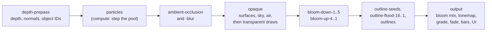
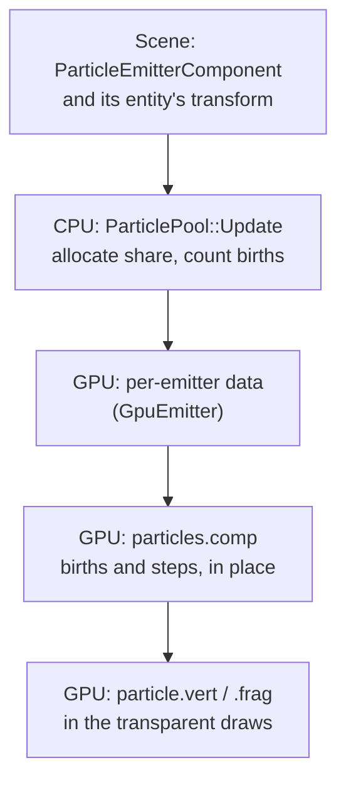

# Transparency, particles and post-processing

The renderer draws most of a frame as opaque surfaces, each pixel the nearest surface shaded once.
This document covers what is drawn after or over them: transparent surfaces such as glass, which
show what is behind them; particles, many small sprites such as smoke, sparks and an engine's
plume; and post-processing of the finished image: ambient occlusion, bloom, outlines and a colour
grade. All of it is in the `render` module, within the frame [Rendering](rendering.md) describes.
Every effect is [presentation](glossary.md#presentation): nothing the
[simulation](glossary.md#simulation) decides waits on one, and none is saved with the world.

## Concepts

| Term | What it is |
| --- | --- |
| Program blend | How a shader program's surfaces meet what is behind them: `Opaque` or `Transparent` (`ProgramBlend`, `render/Material.h`). A program's descriptor (`shaders/<name>.program.yaml`) names it. |
| Transparent draw | A draw whose material's program is transparent, or a particle emitter's sprites. Drawn after the opaque surfaces, furthest first. |
| Transmissive blending | The one blend every transparent draw uses: it writes the light it adds and, as a second colour, the share of what is behind that it lets through, by colour (`BlendMode::Transmissive`). |
| Particle emitter | An entity that sends out sprites (`Scene::ParticleEmitterComponent`, a scene file's `particles`). |
| Particle pool | The GPU buffer of particle slots that every emitter shares, and its CPU bookkeeping (`Render::ParticlePool`, `render/Particles.h`). |
| Particles' frame | The entity whose position and turn the particles are at rest in: by default the emitter itself. |
| Post chain | The full-screen passes that run on the resolved HDR image after the opaque pass and before the output pass's tonemap. |
| Stencil mask | One byte per pixel in the depth target's stencil, written by every opaque draw: which pixels are the cockpit, outlined, left alone by post-processing, or marked by the game (`Scene::MaskComponent`). |
| Object ID | A number per pixel, written by the depth prepass, naming the draw and the outline on it (`Render::ObjectId`, `render/PostProcess.h`). |
| Outline | A line or a glow drawn on the screen round a mesh and everything under it (`Scene::OutlineComponent`). |
| Colour grade | A 3D lookup table, read from a `.cube` file, that maps each displayed colour to a graded one (`Render::ColourLut`, `Scene::ColourGradeComponent`). |

## How it works

### Where the effects sit in the frame

The diagram shows this document's passes in frame order. The whole pass list, why a pass the frame
does not need stays in the plan, and when the depth prepass runs are in
[the frame](rendering.md#the-frame).



### Transparency

A transparent draw must show what is behind it, so it cannot write depth or be drawn before what is
behind it. The renderer takes a transparent material's draws out of the opaque batches. It sorts
them, with the particle emitters in view, furthest first by the centres of their bounds
(`BuildBackToFront`, `render/DrawBatches.h`). Ties are broken by kind and index, so a scene sorts
the same way every frame.

Neighbours in that order with the same model, level of detail and material become one instanced
draw, its instances still furthest first. That holds only for a level of one primitive. An instanced
draw lays down each primitive for every instance before the next primitive, so a far instance's
second primitive would land over a near one's first. A level of more primitives is therefore one
draw per instance.

The transparent draws are recorded last in the opaque pass's own rendering, after the sky and the
air, for the reason the sky is ([the frame](rendering.md#the-frame)), so they are multisampled as
the opaque surfaces are. They test the opaque depth and write none. They draw both
faces, so a canopy is seen from inside. They cast no shadow and are not in the depth prepass.

**Transmissive blending.** Each transparent fragment writes two colours: the light it adds, *A*, and
what it lets through, *T*, by colour. Dual-source blending (the device's `dualSrcBlend`, which the
renderer requires) then sets the target to:

```
result = A + T × behind
```

Premultiplied alpha has one opacity for all three channels, so it cannot tint; with *T* per channel,
amber glass lets red and green through and stops blue. Where *T* is near white, as through clear
glass, the order of two surfaces hardly matters: swapping them changes only how much of the far
surface's reflection the near one tints. So the two faces of a closed shape come out alike in either
order.

**Glass** (`assets/shaders/glass.frag`, `glass.program.yaml`) is a thin dielectric pane, shaded
through the shared lighting include with a black base colour, so only the specular lobe is left: the
sun's highlight, the clustered lights and the environment's reflection. It lets through its tint
times what the split-sum approximation says it does not reflect (`SpecularReflectance`), so it lets
less through and reflects more towards its edges. Nothing bends on its way through: see
[Limits](#limits-and-open-work). The program's parameters are `tint` (with a texture of the same
name), `surface` (x is the roughness) and `emissive`.

A planet's air is not drawn over a transparent draw, as it is not over an opaque mesh
([J27](roadmap.md#j27)).

### Particles

An emitter sends sprites along its entity's -Z axis, as a spotlight shines, within a cone
(`spread`), from anywhere inside a sphere (`radius`). It emits at a `rate` per second while
`active`, and in a `burst`: once when first drawn active, and again each time the game raises its
`pulses` count. Each particle lives its `lifetime`, is slowed by `drag`, and mixes its size and
colour from its birth values to its death values.

A sprite adds its colour times its intensity (the colour's alpha), in the HDR target's linear units.
It hides its `opacity` share of what is behind it. With a non-zero `albedo` it is also lit, as a
small dusty sphere would be: by the sun through its shadow cascades, the clustered lights and the
sky (`ShadeVolume` in `lighting.glsl`, by Lambert's phase law for a sphere).

**The pool.** The particles live on the GPU, in one device-local buffer of 2^17 slots, 32 bytes each
(4 MiB, `kParticleSlots`), kept from frame to frame and shared by the frames in flight. Each frame,
`particles.comp` steps every live emitter's slots in place, one invocation per slot. The CPU never
reads the buffer back: `ParticlePool` keeps each emitter's share of the pool and a count of what it
has made, and tells the GPU each frame how many particles are born, from which slot, and the serial
number of the first.



The pool's rules, from `render/Particles.h`:

- An emitter's share is a ring of its `capacity` slots, starting at a multiple of the compute
  workgroup (64). A birth past the capacity takes the oldest particle's slot.
- A new emitter empties its share before its first births, so the pool is never cleared whole.
- An emitter keeps its share while every frame lists it, and loses it in a frame that does not.
- An emitter with nothing alive keeps its slots but is neither stepped nor drawn.
- An emitter that does not fit is left out and counted (`Refused()`); the renderer logs it once.
- A frame longer than a quarter of a second counts as a quarter, so a hitch does not release a flood
  of births.

**Determinism.** A frame's births are spread through its seconds, each born where the emitter was at
its moment, then moved on, so a moving emitter leaves an even trail rather than a clump per frame.
Each particle's random draws are a hash of the emitter's `seed` and the particle's serial number,
and drag is applied in closed form. So a capture whose clocks advance a fixed step is the same every
run. The shader arithmetic is `assets/shaders/include/particles.glsl`, written in the subset of GLSL
that GLM also compiles, and the render suite runs it as C++.

**The particles' frame.** Particles are at rest in one entity's frame: its position and turn,
without its scale (`EmitterInput::frame`, `render/Particles.h`). By default that is the
emitter itself, so a nozzle's glow keeps to the nozzle as it moves and turns. An emitter can name
another entity (`frame` in the scene file). Its particles then stay where they were left in that
entity's frame, and an emitter moving through it leaves a trail. Either way a particle's position is
a small number of metres from its frame's origin, so it keeps its precision as a float wherever the
frame is.

**Drawing.** Each emitter is one draw in its place in the transparent order: one instance per slot,
six vertices making a quad that faces the camera. With `stretch`, the quad is drawn out behind the
particle along the last `stretch` seconds of its path, in perspective, for streaks and sparks. A
sprite fades as (1 - r²)² from its middle to its edge. A streak's light is spread along its length,
as a moving light's is in a photograph. Within an emitter, particles are drawn in slot order, not
sorted. A sprite of light alone needs no order, since additions commute; a smoky one is soft enough
that its order shows little. Particles are not softened where they meet a surface.

A game drives an emitter from its simulation's state. The flight model writes each vehicle's
`Physics::Thrust` every step (`physics/Flight.h`): the share of each axis's thrust that changed its
velocity. A snapshot carries it, and a game can light a plume from it; see [Physics](physics.md).

### Post-processing

Each pass of the post chain draws one full-screen triangle into one target, reads its images
through its own descriptor set (`post-set`), and takes a few numbers as push constants. They work
on the single-sampled targets the opaque pass resolves as it ends.

All their arithmetic is one file, `assets/shaders/include/post.glsl`, in the GLM-compatible subset
of GLSL, which the render suite runs as C++ through `Render::Post` (`render/PostProcess.h`). It
checks the view position recovered from reversed depth, the occlusion of a flat surface and a
corner, the bloom filters, and the jump flood against a search of every seed.

The colour grade and a cinematic's letterbox bars belong to the output pass, after the tonemap.

### Ambient occlusion

Ambient occlusion estimates how much ambient light reaches each pixel's opaque surface, darkening
corners the sky's light would otherwise fill: where crates meet a deck, or between hull modules. It
is computed before the opaque pass shades, so it dims the image-based light alone
(`EnvironmentLighting` in `lighting.glsl`) and leaves the sun and the clustered lights to their own
shadows. It scales the diffuse ambient light directly, and the specular by Lagarde and de Rousiers'
fit (2014), so a smooth surface seen face on still mirrors its surroundings.

The estimator is Scalable Ambient Obscurance (McGuire, Mara and Luebke, 2012). It reads the depth
prepass's depth and view-space normals at sample zero, which is what a resolve to sample zero would
give, without the copy.

| Setting | Value (`post.glsl`, `Renderer.h`) |
| --- | --- |
| Samples per pixel | 12, on a spiral of 7 turns |
| Reach | 2 m (`kAoRadius`), falling off to nothing there |
| Per-pixel turn | One of 16, in a 4 × 4 pattern the blur averages out |
| Blur | Neighbours weighted by how near their depth is, so it keeps to a surface |
| Cut-off | No occlusion where 2 m spans under three pixels, or past 1 km (`kAoDistance`), fading over the last fifth |

Transparent draws and particles are not occluded: the image is of the opaque surfaces. A
[debug view](rendering.md#measuring-the-frame) shows it.

Ambient occlusion is on by default, except on a CPU device such as [lavapipe](glossary.md#lavapipe),
where the prepass it needs costs too much
([decided](decisions.md#transparency-particles-and-post-processing)). `--ambient-occlusion` and
`--no-ambient-occlusion` override the default, and the dev tools switch it live
(`IRenderer::SetAmbientOcclusion`).

### Bloom

Bloom spreads a little of the frame's light about bright things, as a lens does. It is Jimenez's
chain (2014). Five levels below the frame, each half the size of the one above
(`Render::BloomExtents`), are filtered down in turn by thirteen bilinear taps as five overlapping
boxes. The first step weighs each box by the inverse of its brightness (Karis's weighting), so a
star or a glint spreads no more light than a few pixels would. The chain then comes back up, each
level adding a tent filter of the one below.

The top level holds the sum of all five levels. The output pass mixes it with the frame by the
bloom's strength *s*, over the levels: `frame × (1 − s) + top × s / 5` (`ApplyBloom` in
`post.glsl`). Nothing gets brighter for being blurred: what bright things spread is taken from them.
There is no threshold, since light in a lens has none. The strength is 0.04 by default, set by
`--bloom <0..1>` or live by `IRenderer::SetBloom`; 0 turns it off. A pixel the stencil marks as
unprocessed has no bloom added.

### Masks

Some passes must treat some pixels differently: keep post-processing off an in-world display, or
outline one shape. The stencil gives each pixel a byte for that, beside the float depth reversed-Z
needs (`D32_SFLOAT_S8_UINT`).

Every opaque draw writes its stencil byte, whatever was there (`Render::StencilBits`). Draws that
differ in it cannot share a batch (`BatchKey::stencil`). A mesh takes its nearest mask and outline,
its own or an ancestor's.

| Bit | Constant (`render/PostProcess.h`) | Set by | Used for |
| --- | --- | --- | --- |
| 0 | `kStencilCockpit` | `MaskComponent::cockpit` | The cockpit the camera sits in; outlines are not drawn over it |
| 1 | `kStencilOutlined` | An `OutlineComponent` on it or an ancestor | The selected line's edge test |
| 2 | `kStencilUnprocessed` | `MaskComponent::unprocessed` | Left as shaded: no bloom, no outline, as a display drawn in the world wants |
| 3–7 | `kStencilGameShift` | `MaskComponent::game` (0 to 31) | The game's own passes |

The depth and the stencil are separate resources in the pass list, each with its own layout (the
device's `separateDepthStencilLayouts`, which the renderer requires). So ambient occlusion can read
the depth while the post passes test the stencil. The opaque pass resolves both to sample zero as it
ends, together, since lavapipe cannot resolve one without the other. The post passes test the
resolved stencil read-only, so the hardware skips masked pixels before shading them.

### Outlines

A game outlines what the player selects or targets. An `OutlineComponent` outlines a mesh and every
mesh under it as one shape. Both styles are measured in pixels, so they read at any distance:

- **Selected:** a line one pixel wide just outside the shape. A pixel gets it if it is not outlined
  but has an outlined neighbour, by the stencil. Its colour is the outline named by that neighbour's
  object ID.
- **Targeted:** a soft glow that fades as a square over its `width`, up to 24 pixels
  (`kMaxOutlineWidth`). It is found by Rong and Tan's jump flood (2006). The targeted shapes' pixels
  are *seeds*. Five steps, with strides from 16 down to 1 pixel, give every pixel within 31 pixels
  its nearest seed. So the glow's 24 pixels fall well inside the flood's reach.

One pass draws both over the frame: the line covers what is there, the glow adds to it. It tests the
stencil, so the hardware skips the outlined shapes themselves, the cockpit and the unprocessed
pixels.

**Object IDs.** The depth prepass writes each pixel's object ID; no material program has to know of
it. The ID packs the draw's index plus one in its low 16 bits and the outline's index plus one in
the 8 bits above (`Render::ObjectId`). So a frame tells apart up to 65,535 draws (`kMaxObjectIds`)
and 255 outlines (`kMaxOutlines`); past those, the ID is 0, as the sky's is. The ID is stored as a
whole number in a float target, because a device need not support multisampled integer targets and
lavapipe has none.

The shell outlines what the player picks (`Application::MarkScene`). It is selected by default, and
targeted when the game's `PickIn` says it is targeting (`app/Game.h`). The cockpit and unprocessed
marks are the game's to set.

### Colour grading

A colour grade gives a scene its look. It is a 3D table, from 2 to 65 entries a side, read from a
`.cube` file (`Render::ReadCubeLut`, `render/ColourGrade.h`). A scene has at most one
(`Scene::ColourGradeComponent`), with a `strength` from 0 to 1 mixing the graded colour with the
ungraded.

The output pass applies it after the tonemap, before the fade, the letterbox bars and the UI. It
looks the table up with the displayed colour encoded sRGB: what a screenshot holds and what a
grading tool shows. So a grade made in Resolve or Photoshop from a capture of the frame grades the
frame the same way. The `graded` [reference frame](glossary.md#reference-frame-image) checks this:
the orbit scene graded by `grades/cold-light.cube` is held to its ungraded capture put through the
table on the CPU (`Render::SampleLut`). The device's trilinear filter samples the table at its
texels' centres (`LutCoordinate` in `post.glsl`), which the render suite holds to the CPU lookup.

The table is a [resource](files-and-mods.md#resources), parsed on the I/O worker and uploaded as a
3D image of half floats; a reload is uploaded over the old one. Each upload waits for the queue, so
no frame in flight still reads the table it replaces and the output pass's descriptor set can name
the new one at once. Until the table is in, and without one, the grade's strength is 0 and the frame
is shown as tonemapped. A table that fails to load is logged once as a warning.

## Using it

### A glass material

A material names the glass program and sets its tint. From
`source/test/content/materials/glass-amber.material.yaml`:

```yaml
version: 1
program: glass
parameters:
  - name: tint
    value: [0.95, 0.62, 0.18, 1]
  - name: surface
    value: [0.02, 0, 0, 0]
```

A mesh in a scene uses it as any material (`source/test/content/scene/effects.yaml`):

```yaml
  - id: amber-pane
    parent: bench
    transform:
      translation: [-1.8, 0.4, -1.2]
      rotation: [0, 0.35, 0]
      scale: [1.4, 1.8, 0.02]
    mesh:
      shape: box
      color: [0.6, 0.4, 0.1]
      material: materials/glass-amber.material.yaml
```

A new transparent program says so in its descriptor, as `assets/shaders/glass.program.yaml` does
with `blend: Transparent`, and writes its second output for the transmissive blend.

### A particle emitter

An engine's plume, light alone, stretched along its path (`source/test/content/scene/effects.yaml`).
The entity is turned so its -Z points along +X:

```yaml
  - id: nozzle
    parent: bench
    transform:
      translation: [3.4, -1.6, 0.5]
      rotation: [0, -1.5707963, 0]
      scale: [0.25, 0.25, 0.25]
    particles:
      rate: 300
      lifetime: 0.6
      lifetimeJitter: 0.3
      speed: 9
      speedJitter: 0.3
      spread: 0.07
      radius: 0.06
      drag: 1.5
      size: [0.35, 0.9]
      stretch: 0.03
      color: [0.55, 0.75, 1, 0.7]
      colorEnd: [0.25, 0.35, 1, 0]
      capacity: 256
      seed: 3
```

The same file has lit smoke (`opacity: 0.6`, `albedo: [0.55, 0.55, 0.56]`, no light of its own) and
sparks (a high intensity in `color`'s alpha, a short `stretch`). Every field, its unit and its
default are in `Scene::ParticleEmitterComponent` (`scene/Components.h`).

A game fires a burst by counting pulses up. From `source/engine/render/tests/ParticleTests.cpp`, an
inactive emitter with a burst of 5, pulsed twice, makes ten particles in the next frame:

```cpp
ParticleEmitterComponent emitter;
emitter.rate = 30.0f;
emitter.burst = 5;
emitter.capacity = 100;
// ...
emitter.active = false;
emitter.pulses = 2;
auto draws = Step(pool, {At(1, emitter, {})}, 1.0);
CHECK(draws[0].gpu.slots.w == 10u);
```

### Outlines and masks

From `source/test/content/scene/post.yaml`, a selected crate, a targeted pod (its child fin is
outlined with it, as one shape), and a lamp panel that post-processing leaves alone:

```yaml
  - id: crate-selected
    mesh:
      shape: box
    outline:
      style: selected
      color: [1, 0.75, 0.2, 4]
  - id: pod-targeted
    mesh:
      shape: icosphere
    outline:
      style: targeted
      color: [1, 0.15, 0.1, 3]
      width: 14
  - id: panel-unprocessed
    mesh:
      shape: box
      material: materials/lamp.material.yaml
    mask:
      unprocessed: true
```

(Transforms and parents are cut here.) From C++, a game places an outline as the shell does in
`Application::MarkScene` (`source/engine/app/src/Application.cpp`):

```cpp
Scene::OutlineComponent outline;
outline.style = Scene::OutlineStyle::Targeted;
outline.color = {1.0f, 0.2f, 0.1f, 2.0f};
outline.width = 14.0f;
registry.emplace<Scene::OutlineComponent>(proxy, outline);
```

### A colour grade

The console's `grade <name> [strength] | off` grades the current scene. A bare name is a table in
`grades/`; a name with a `/` is a path. It sets the scene's grade on its active camera, so a scene
saved from the Scene panel keeps it. The `graded` reference view runs it at start-up
(`source/test/frames/views.txt`):

```
graded --scene $PWD/source/test/content/scene/orbit.yaml --run grade|cold-light
```

In a scene file, the entity's `grade` field holds the component's `lut` path and `strength`
(`Scene.cpp`'s reflection of `Scene.ColourGrade`). A scene with more than one grade, or a grade
without a table or with a strength outside 0 to 1, is refused.

`ReadCubeLut` refuses a 1D table, a size outside 2 to 65, a domain other than 0 to 1, the wrong
number of entries, or anything not a finite number, and names the file and the line
(`source/engine/render/tests/ColourGradeTests.cpp`).

### Switches and checks

The effects' [arguments](app-shell.md#the-command-line) and [console
lines](app-shell.md#the-console) are the app shell's. The test content has a bench for each half,
`scene/effects.yaml` (glass, plume, smoke, sparks) and `scene/post.yaml` (occlusion, both outline
styles, an unprocessed panel, a blinking beacon), which the `effects`, `post` and `graded`
[reference frames](build-and-gates.md#reference-frames) hold.

## Limits and open work

- No refraction through glass, soft particles, sorting within an emitter, tinted transparent
  shadows, glTF `BLEND` primitives (they draw opaque), or an emitter started warm:
  [J24](roadmap.md#j24).
- A transparent part of an outlined shape is not outlined; no pick from the object IDs; the UI is
  not under a mask; ambient occlusion has no cheaper half-size mode: [J25](roadmap.md#j25).
- A grade blended between two tables, for a sequence's own look: [J22](roadmap.md#j22).
- The UI's clip masks and filters, which want the stencil and post targets in the output pass:
  [J23](roadmap.md#j23).
- An emissive scale per draw, and other rendering items not yet placed: [J27](roadmap.md#j27).
- Screen-space reflections are out by decision, not open work.

## Decisions

The settled choices are in [decisions](decisions.md#transparency-particles-and-post-processing).
Clustered forward rendering, which the transparent draws' lighting relies on, and the stencil and
object ID buffer are under [Rendering](decisions.md#rendering).

## Source

| Where | What |
| --- | --- |
| `source/engine/render/include/jettison/render/Material.h` | `ProgramBlend`, a program's descriptor |
| `source/engine/render/include/jettison/render/DrawBatches.h` | `BuildBackToFront`, the transparent order |
| `source/engine/render/include/jettison/render/Particles.h` | `ParticlePool`, and `particles.glsl` as C++ |
| `source/engine/render/include/jettison/render/PostProcess.h` | Stencil bits, `ObjectId`, `BloomExtents`, and `post.glsl` as C++ (`Render::Post`) |
| `source/engine/render/include/jettison/render/ColourGrade.h` | `ColourLut`, `ReadCubeLut`, `SampleLut`, the loader |
| `source/engine/render/include/jettison/render/IRenderer.h` | `SetAmbientOcclusion`, `SetBloom`, `RendererOptions` |
| `source/engine/scene/include/jettison/scene/Components.h` | `ParticleEmitterComponent`, `OutlineComponent`, `MaskComponent`, `ColourGradeComponent` |
| `source/engine/render/src/vulkan/Renderer.cpp` | The passes, their order and recording |
| `assets/shaders/` | `glass.frag`, `particles.comp`, `particle.vert`/`.frag`, `ssao*.frag`, `bloom_*.frag`, `outline*.frag`, `output.frag`, `include/post.glsl`, `include/particles.glsl` |
| `source/engine/render/tests/` | `DrawBatchTests`, `ParticleTests`, `PostProcessTests`, `ColourGradeTests` |
