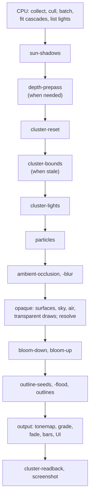
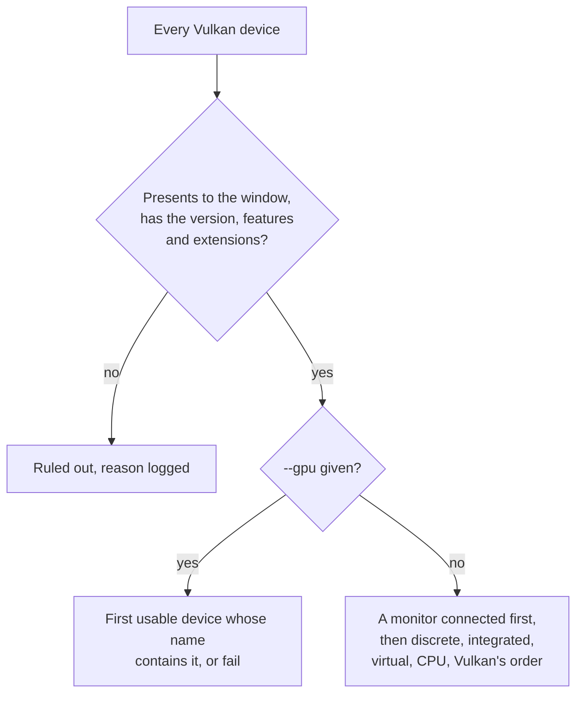

# Rendering

The `render` module draws a [scene](glossary.md#scene) on the GPU with Vulkan 1.4. Each
[frame](glossary.md#frame-rendering) it reads the scene's components as
[presentation](glossary.md#presentation) left them, culls and batches what is in view, lights it,
and writes it to the window with the UI over it. It owns the window, the device, the swapchain, the
materials and the models. No Vulkan type leaves the module: the rest of the engine sees one
interface, `Render::IRenderer`.

It is a **clustered forward** renderer. A compute pass sorts the local lights into a 3D grid of
view-space cells, and each surface is shaded once, in its own material program, by the lights
listed for its cell. There is no G-buffer. Transparency, particles, ambient occlusion, bloom,
outlines, masks and colour grading have their own document,
[transparency, particles and post-processing](rendering-effects.md).

## Concepts

| Term | What it is |
| --- | --- |
| Render space | The scene's double-precision positions with the camera's position taken off, made float only then. Every position the GPU sees is in it ([render space](coordinates.md#render-space)). |
| Pass | One node of the frame: graphics, compute or transfer. It declares the images and buffers it touches and how (`Render::PassList`). |
| Frame in flight | One of two slots (`Renderer::kFramesInFlight`) the CPU writes a frame's data into while the GPU draws the other. |
| Program | A shader pair (or a compute shader) found by name in `assets/shaders`, with a descriptor, `<program>.program.yaml`, listing its parameters and texture slots. |
| Material | A YAML file naming a program and setting its parameters and textures, some moving with time (`materials/<name>.material.yaml`). |
| Model | What a mesh draws: a glTF file, or a procedural shape made in code. |
| Level of detail | One version of a model's geometry and its geometric error in metres. The renderer draws the coarsest whose error covers under a pixel. |
| Batch | Draws that share a model, a level, a material and stencil bits, drawn as one instanced draw. |
| Cluster | One cell of the light grid: a screen tile times a depth slice. |
| Cluster range | The view depth where the light grid ends, 2 km. |
| Local light | A point or spot light (`Scene::LightComponent`), always with a finite range. |
| Sun | The scene's one directional light (`Scene::SunComponent`), shadowed by cascades. |
| Cascade | One of the sun's four shadow maps, each covering a slice of the view's depth. |
| Environment | The sky captured into cube maps and filtered, which lights every surface with image-based lighting. |
| Body | Here, a scene entity marked `Scene::BodyComponent`, not a physics [body](glossary.md#body): a round mesh drawn as a sphere, which hides what is behind it and may have air and rings. |
| Debug view | What the lit programs show instead of the shaded scene: a light heat map, the cascades or the ambient access (`Render::DebugView`). |

## How it works

### What the renderer reads

The renderer reads the scene and never writes it; presentation has animated it and composed its
world transforms before `IRenderer::Render`. It draws these components:

| Component (`Scene::`) | What the renderer does with it |
| --- | --- |
| `CameraComponent`, `CameraPoseComponent` | The active camera's view: the pose a rig wrote, or the authored one (`Render::ActiveCameraView`). |
| `MeshComponent` | A model file or a procedural shape, with an optional material. |
| `LightComponent` | A point or spot light in the cluster grid. |
| `SunComponent` | The directional light, in the frame constants. |
| `SkyComponent` | The procedural sky, drawn behind the scene and captured into the environment. |
| `BodyComponent`, `AtmosphereComponent`, `RingsComponent` | A body's occluding sphere, its air and its rings. |
| `ColourGradeComponent`, `ParticleEmitterComponent`, `OutlineComponent`, `MaskComponent` | The effects in [transparency, particles and post-processing](rendering-effects.md). |
| `HiddenComponent` | Set on a hidden [layer's](glossary.md#layer) entities: neither drawn nor casting shadows. |

### Why clustered forward

Clustered forward was chosen from the start, for five reasons:

- **Material variety:** hulls, terrain, air, glass and emissive panels are each their own program,
  with no common G-buffer layout imposed on them.
- **Transparency:** glass and particles are lit by the same lights through the same code, where
  deferred shading would still need a forward path for them.
- **Anti-aliasing:** MSAA works directly on the HDR target, and thin struts against a dark sky are
  where aliasing shows most.
- **Bandwidth:** no fat render targets, which matters on laptops and on
  [lavapipe](glossary.md#lavapipe), the CPU device the gate draws with.
- **Many small lights:** a structure can carry hundreds, but few reach any one pixel, and clustering
  keeps a fragment's cost to those.

Effects that need a G-buffer stay out, screen-space reflections among them
([decided](decisions.md#transparency-particles-and-post-processing)). Ambient occlusion needs only
the depth and normals the depth prepass writes, so it is in.

### The frame

The frame is a declared list of passes (`render/PassList.h`). Each pass names the resources it uses
and how, and `PassList::Compile` derives every barrier between them once, at start-up. A pass
therefore adds its uses, never its synchronisation, and compute passes sit beside graphics passes on
the same terms. The backend records the plan with dynamic rendering and synchronization2.

Every pass is in every frame's plan, except `screenshot`, which is there only when the swapchain can
be read back. A pass a frame does not need records nothing, but its barriers are still recorded, so
the plan the gate's synchronisation validation checks is the plan every run has. The diagram shows
the passes in order and the main resources between them.



The passes, by the names `Renderer::CreatePassList` gives them:

1. **CPU preparation:** culling, levels of detail, batching, the cascades' fit and the light list
   ([collecting and culling](#collecting-and-culling)).
2. **`sun-shadows`** (graphics). Each cascade renders its casters, depth only, into one layer of the
   shadow map ([sun shadows](#sun-shadows)). A scene with no sun only clears them.
3. **`depth-prepass`** (graphics). The view's batches lay down depth, view-space normals and object
   IDs. It runs only when a frame needs it (below); otherwise the opaque pass clears the depth.
4. **`cluster-reset`** (transfer). Zeroes the light index list's allocator.
5. **`cluster-bounds`** (compute, `cluster_bounds`). Each cluster's view-space bounds, rebuilt only
   in a frame whose projection, viewport or cluster range changed; the buffer keeps its contents.
6. **`cluster-lights`** (compute, `cluster_lights`). Assigns the lights to the clusters
   ([clustered lights](#clustered-lights)).
7. **`particles`** (compute). Steps every live emitter's particles in place.
8. **`ambient-occlusion`**, **`ambient-occlusion-blur`** (graphics). How much ambient light reaches
   each pixel, from the prepass's depth and normals.
9. **`opaque`** (graphics). Into a multisampled RGBA16F HDR target (up to 4x MSAA): the surfaces
   front to back, then the sky, then the bodies' air and rings, then the transparent draws back to
   front. As it ends, the colour resolves into a single-sampled HDR target, and the depth and
   stencil resolve to sample zero.
10. **`bloom-down-1`** to **`-5`**, **`bloom-up-4`** to **`-1`** (graphics). The bloom chain.
11. **`outline-seeds`**, **`outline-flood-16`** to **`-1`**, **`outlines`** (graphics). After bloom
    has read the frame, so outlines do not bloom.
12. **`output`** (graphics). Exposure, then the tonemap into the sRGB swapchain image, with bloom
    added where the stencil allows; then the colour grade, the fade and a cinematic's letterbox;
    then the game UI's overlay and the dev tools over it.
13. **`cluster-readback`** (transfer). Copies the grid out for the cluster check, when it is on.
    **`screenshot`** (transfer) copies the swapchain image as the output pass left it, UI included,
    when one is asked for. It is written as a PNG through stb once that frame's fence is waited on,
    or as the renderer is destroyed, so a run can end on the next frame.

The sky is not a pass of its own. It is one full-screen triangle at depth 0, the far end of the
reversed-Z range, drawn inside the opaque pass and tested against the depth, so it shades only
pixels no surface covered. A separate pass would have to store the multisampled target and load it
again, which the opaque pass keeps on chip.

The tonemapper is Khronos PBR Neutral (`assets/shaders/include/tonemap.glsl`). A base colour under
white light of intensity one shows as authored, and highlights compress towards white without
changing hue.

**The depth prepass** costs more than it saves as a prepass alone, because the batches are already
front to back (measured 2026-11-11, [decided](decisions.md#rendering)). It runs in a frame where
ambient occlusion is on, an outline is in view, or `IRenderer::SetDepthPrepass(true)` (the
`--depth-prepass` argument) asks for it.

### Collecting and culling

The CPU decides what to draw before recording (`render/Culling.h`, `render/DrawBatches.h`), in
render space and in double precision: a planet's centre may
be ten thousand kilometres off while a structure a hundred metres away is tested against its
horizon.

A mesh is left out of the view when:

- **It is outside the frustum:** its bounding sphere is wholly outside one of the five planes.
  There is no far plane.
- **It is behind a body's horizon.** A body is a sphere shrunk by its level's error, so it is wholly
  inside the mesh it draws, and whatever it hides the mesh hides too (`Occludes`).
- **It is too small to see:** its breadth, the model's radius times its transform's middle scale,
  covers under a pixel at its nearest point (`TooSmallToSee`). So a long thin stroke of paint
  vanishes from afar, while the wide plate it is painted on does not.
- **Its transform's scale is zero**, as a rig's stowed part is.

A skinned draw's pose can leave its model's bounds, so it is never culled. A model file's mesh is
not drawn until its rig has placed it within its file.

Each kept draw takes the coarsest level of detail whose geometric error, scaled and projected,
covers no more than one pixel (`SelectLod`). A procedural shape has five levels, but the box has
one; a glTF file has one. Draws sharing a model, a level, a material and stencil bits become one
instanced draw. The batches are ordered front to back by their nearest instance, so the depth test
rejects hidden surfaces before they are shaded; ties break by draw index, so the order is the same
every frame.

Each cascade keeps only the casters whose sphere reaches the prism its map shadows (`CastsInto`).
A light is left out when its sphere lies wholly beyond the cluster range, outside the frustum or
behind a body, since every surface it could light is too.

### Clustered lights

The grid is 32 x 18 screen tiles times 48 depth slices (`render/Clusters.h`), the slices
exponential in view distance from the near plane to the cluster range. Depth is reversed-Z with an
infinite far plane, so the slices come from view-space distance, never from the depth buffer. Past
the cluster range a surface is lit by the sun, the environment and its own emission only, so a
distant structure's lights are its emissive panels.

The assignment runs one compute invocation per cluster. It tests each light's sphere, and a spot's
cone, against the cluster's bounds, and writes an offset and a count per cluster into one global
light index list. The list's first word is its allocator, from which each cluster reserves its share
with one atomic add. The list holds 32 entries per cluster on average
(`kRendererLightIndicesPerCluster`): a budget for the frame, not a cap on any one cluster.

The rules the grid sets:

- **Every local light has a finite range.** Falloff is inverse-square, windowed to reach zero at the
  range: `(1 - (d/r)^4)^2 / d^2`. Culling a light against a cluster is then exact. A scene file
  that leaves out a light's range is refused.
- **A spot's cone** is an inner and an outer half-angle about the entity's -Z, as glTF's
  `KHR_lights_punctual` has them.
- **The sun is not a cluster light.** It is held in the frame constants and shadowed by cascades.
- **Light data lives in storage buffers**, one per frame in flight. The frame's uniform buffer holds
  only the light count and the grid's parameters.
- **One lighting implementation.** Every lit program shades through `lighting.glsl` over
  `brdf.glsl`, glTF's metallic-roughness model. No material lights itself its own way. `brdf.glsl`
  and `tonemap.glsl` are in the subset of GLSL that GLM compiles, so the render suite runs the
  shaders' own source as C++ against reference values (`BrdfTests.cpp`,
  `scripts/brdf-reference.py`).

**The cluster check** proves the GPU's assignment right. `clusters.glsl` is written in the same
subset, and `render/Clusters.h` is that source compiled as C++. With
`RendererOptions::clusterCheck` on, as in the smoke test, each frame's grid is read back and
compared, cluster by cluster as a set, with a CPU reference built on it (`CheckClusterAssignment`).
The tolerance is a hundred-thousandth of the largest distance a test involves, with a floor of
10⁻⁴ (`Clusters.cpp`).

### Sun shadows

The sun casts shadows through four cascaded shadow maps (`render/Shadows.h`): the layers of one
2048 x 2048 reversed-depth array image. The view's depth is cut into four slices by the practical
split scheme, a blend of even and logarithmic splits (0.8 towards logarithmic), from the near plane
to the **shadow distance**, 400 m. Past it the sun casts no shadow. The CPU fits the cascades each
frame; `shadows.glsl`, compiled as C++ the same way, selects and samples them.

- **Stable by construction.** A still caster lands on the same texels every frame, however the
  camera moves. Each map covers the bounding sphere of its slice, so its texel size depends only on
  the projection. Its centre is snapped to whole texels in the sun's frame, which is built from the
  system's axes, never the camera's. The snap is measured from the camera's **frame origin**
  (`CameraView::frameOrigin`), the [local frame](glossary.md#local-frame) the camera moves in, and
  taken in double precision; only the render-space-to-map matrix becomes a float.
  `Render::ActiveCameraView` sets that origin to what an orbit camera circles or, for a pilot
  camera, to the entity its vehicle flies by (`Scene::PilotCameraComponent::frame`). A grid fixed
  to the frame's origin would slide under a fast-moving platform and make its shadows' edges crawl.
- **Each map keeps a border** of 4 texels (`kShadowBorderTexels`): half for the snap, 1.5 for the
  filter's taps, the rest for the normal offset.
- **Casters sunwards of a map still shadow it.** The shadow pass clamps depth rather than clipping
  it (`depthClamp`, a required device feature).
- **Acne** is kept off by a slope-scaled depth bias, and by moving each receiver along its normal
  before the lookup: up to 1.5 cascade texels at a surface edge-on to the sun.
- **Lookup.** A fragment selects its cascade by view depth and takes nine bilinear comparison taps a
  texel apart, a 4 x 4 texel neighbourhood. Across the last tenth of each cascade it blends into the
  next, or out of shadow past the last. Each cascade is fitted from the start of the previous one's
  blend band, so the blend's second lookup lands inside its map.

### The environment

The sky is drawn behind the scene and also lights it (`render/src/vulkan/Environment.h`). Its stars,
galactic band and nebula are procedural, from the scene's `SkyComponent` and a seed, and `sky.glsl`
draws them both in the frame and into a cube map. A scene without a sky has a black one that lights
nothing.

When a scene loads or its sky changes, the renderer **bakes** the sky into image-based lighting: a
128-texel cube capture, a specular cube filtered with one roughness per mip level, and a
cosine-weighted irradiance cube. The split sum's lookup table depends only on the BRDF and is made
once. The bake runs on the graphics queue outside the pass list, as a texture upload does, and
waits for the queue. The sun is not in the capture: it lights the scene as the directional light,
and a disc in the capture would light it twice.

The capture also draws up to eight of the nearest bodies as lit spheres of their mesh's colour,
with their air and rings (`body.glsl`), so a surface over a planet reflects it and its night side is
lit by the planet's day side. A body smaller on the sky than a fifth of a texel of the capture is
left out, since it would light nothing. The capture is of where the camera is, so it is baked again
when what lights it moves by about a texel (`CaptureMoved`): a body's or the sun's direction by a
hundredth of a radian, a body's size by 2%, or a body come or gone. It is baked at most every 16
frames, since a bake waits for the queue.

### Atmospheres and rings

A body can have air (`AtmosphereComponent`) and rings (`RingsComponent`). Both are maths over a
sphere, not meshes or baked tables (`atmosphere.glsl`, `rings.glsl`), in the GLSL subset GLM
compiles, so the render suite runs the shaders' own source as C++ (`render/Atmosphere.h`) against
brute-force integration.

- **Air** is single scattering: Rayleigh for the air itself and Mie for haze, each with a density
  falling off exponentially with height; the defaults are Earth's, after Hillaire (2020). The
  column of air along a ray has a closed form, so an atmosphere is only its parameters. Multiple
  scattering is left out, which darkens a sky seen from the ground and matters little from orbit.
- **Rings** are an annulus in the body's equatorial plane, of bands and gaps drawn from a seed.
  Their bands fade to their mean where a pixel spans them, which keeps their shadow from aliasing.
  The body's shadow on them has a penumbra as wide as the sun.

Every such body is in the frame's body list, and three programs read it. `planet` reddens the
sunlight on the surface by the air it passes through, darkens it in the rings' shadow and adds
haze. `atmosphere` is a full-screen triangle at depth 0 after the sky, so it draws only the limb,
the sky from inside the air and the rings over space. The environment's capture is the third.

`planet` also draws clouds and city lights from noise (`planet.frag`). Clouds are white and rough,
warped by a coarser copy of their noise so they swirl, drift round the body by a time-driven turn,
and cast a shadow a little sunwards. City lights are clusters on the night side's land, broken into
towns and streets and faded to their mean from afar, each town with a glow, all dimmed by the cloud
over them. A detail layer repeats over the maps, kept to the land by the height map's sea level. The
tangent frame comes from the direction out of the body's centre, so a planet is normal-mapped
without vertex tangents.

A mesh in front of a body's air is not hazed by it, which is right for a structure in orbit and
wrong for a vehicle in the air; and bodies are not sorted, which is wrong only where two bodies' air
or rings overlap on screen ([J27](roadmap.md#j27)).

### Materials and programs

Materials are data (`render/Material.h`): a file names a program and sets its parameters and
texture slots. A parameter may move with presentation time along a wave (sine, triangle, saw or
square) between two values. The time is reduced to the wave's cycle in double precision, so a
session hours long animates as smoothly as its first minute.

A program's descriptor, `assets/shaders/<program>.program.yaml`, lists its parameters (vec4s, with
defaults), its texture slots (each with a fallback: white, black or a flat normal) and its blend,
opaque or transparent. A material is checked against its program when it loads, not when it draws.
Every scene program shares one layout. Its texture slots, up to sixteen (`kMaterialTextureSlots`,
the program format's limit), and up to eight parameters are a block in the frame's material
buffer: an index into the texture table for each slot, then the parameters, which
`material.glsl` reads from the draw's offset (`MaterialTexture`, `MaterialParameter`). A new
program is therefore data plus GLSL, not a new code path.

<a id="a-draws-own-glow"></a>**A draw's own glow.** A mesh's `emissiveScale`
(`Scene::MeshComponent`; rgb a tint, a a scale on the intensity, all one by default) multiplies its
material's `emissive` parameter, channel by channel, so a glow a game moves each frame, a nozzle's
say, needs no material or model for each value. It travels with the instance, beside its transform
in the frame's instance buffer (`GpuInstance`), not in the material's block, so draws that differ in
it are still one instanced draw. `mesh.vert` hands it to the fragment stage at location 9, and every
program drawn over it multiplies the parameter that is its glow: `mesh` and `mesh_triplanar` their
`emissive`, `glass` its `emissive`, `planet` its cities' lights (`night`), and `unlit`, which is
all glow, its `color`. A program of a game's over `mesh.vert` takes it there too, since the
validation layer reports an output no stage reads. At the default the frame is unchanged to the
byte.

<a id="the-texture-table"></a>**The texture table** is descriptor set 1, bound with the frame's set:
one array of `kTextureTableSize` (4096) sampled images, partially bound and updated after bind,
and the material sampler. A texture takes an element when its upload finishes and gives it back,
with its image, once no frame in flight can read it, so an element is only written while no
submission reads it; the fallbacks hold elements 0 to 2, by `TextureFallback`. A draw's material
is one for all its instances, so a slot's index is uniform across the draw and needs no
`nonuniformEXT`. A full table fails the texture's load, naming it. The test content's fixture
program `slots` reads all sixteen slots, one a cell of a grid, its index non-uniform, and the
`slots` reference view draws it.

| Program | For |
| --- | --- |
| `mesh` | The default: glTF's metallic-roughness model, lit by the sun, its cascades, the environment and the cluster's lights. |
| `mesh_triplanar` | `mesh` built with `TRIPLANAR`: projects textures along the object's axes in metres, for shapes without texture coordinates. |
| `unlit` | What is a light rather than lit by one: lamps, beacons. |
| `planet` | A body's surface, its maps read by longitude and latitude, with air, rings, clouds and city lights over it. |
| `glass` | A transparent surface ([transparency](rendering-effects.md#transparency)). |

A variant is a compile-time define on one source, built under its own name by
`jettison_compile_shader_variant`. `PipelineCache` makes a graphics pipeline per program and
render state, and a compute pipeline per program, finding the SPIR-V through the asset VFS.

`MaterialCache` loads materials and their textures through the resource manager, and takes a
texture's new element into the material's block when it reloads. A material that cannot be drawn (its program missing,
or a parameter its program lacks) is logged once, and the draw falls back to the model's own. A
model without a material draws with its own base-colour texture through `mesh`, a block for each
of its primitives.

### Models and textures

`MeshComponent` names a model file by virtual path (`models/crate.glb`), so a
[mod](glossary.md#mod) can shadow it, or a procedural shape sized by the transform's scale.
`ModelCache` resolves either. A glTF file is loaded through fastgltf on the I/O worker, uploaded by
its loader's `finish` on the main thread, and reloaded when its file changes. A procedural shape
(`render/Procedural.h`: UV, ico and cube spheres, rings, cylinders, boxes) is made on first use,
each with five levels of detail but the box, which has one.

A scene's models are asked for as it loads (`IRenderer::PrefetchScene`), not the first frame that
draws each, and the shell holds the scene behind a full fade until every model file it names has
loaded or failed, `App::kPrefetchSeconds` (5 s) at most, so the first frame shown draws complete;
past it, the scene is shown as it stands and the wait is logged. A game can wait on the same
(`Shell::SceneReady`), holding its own effect over a change of scene.

Textures decode on the I/O worker with no device (`render/Texture.h`):

- **KTX 2** files transcode from Basis Universal to BC7, or to RGBA8 on a device without block
  compression, keeping the file's colour space.
- **PNG and JPEG**, through stb_image, are for development. They get a mip chain built on the CPU,
  averaged in linear light for sRGB data. A name ending `.linear.png` marks linear data, such as a
  normal map.

A CPU device is given RGBA8 rather than BC7, and its material sampler takes no anisotropy. Lavapipe
decodes BC7 and filters anisotropically in software at every fetch, each of which multiplied the
opaque pass's cost (measured 2026-11-11 and 2026-11-12, [decided](decisions.md#rendering)).

Nothing a frame in flight may read is freed on the spot. A model, or a texture and its element of
the table, that a reload replaced waits in a queue for `kFramesInFlight` frames.

### Cameras

The renderer draws from the scene's active camera (`Render::ActiveCameraView`). Its projection is
reversed-Z with an infinite far plane
([depth](coordinates.md#depth-reversed-z-with-an-infinite-far-plane)), and the [camera
rigs](scene.md#camera-rigs) that pose it are the scene's. `ScreenRay` turns a cursor position into a
picking ray.

### The Vulkan backend

The backend is private (`source/engine/render/src/vulkan`). `CreateRenderer` makes it behind
`IRenderer`, and the shell includes no Vulkan header.

- **`DeviceContext`** holds the instance, the device, the debug messenger (with synchronisation
  validation in Debug builds), object names and the VMA allocator every buffer and image comes from.
- **The device** must report Vulkan 1.4 (`DeviceContext::kApiVersion`; a device that reports 1.3 is
  ruled out with "it is Vulkan 1.3, and the engine needs 1.4") and offer anisotropic sampling, depth
  clamp, dual-source blending, separate depth and stencil layouts, dynamic rendering and
  synchronization2, and the descriptor indexing the [texture table](#the-texture-table) needs:
  `runtimeDescriptorArray`, `descriptorBindingPartiallyBound`,
  `descriptorBindingSampledImageUpdateAfterBind`, `descriptorBindingUpdateUnusedWhilePending`,
  `shaderSampledImageArrayDynamicIndexing` and `shaderSampledImageArrayNonUniformIndexing`, with
  `kTextureTableSize` sampled images a stage. A device without one is ruled out naming it ("it lacks
  descriptor indexing's runtimeDescriptorArray"). Lavapipe has them all, so the headless render test
  on lavapipe covers every pass.
- <a id="the-device-and-its-capabilities"></a>**Its capabilities** (`DeviceCapabilities.h`) are read once
  when the device is chosen and logged: the 1.4 features, `multiDrawIndirect`, `drawIndirectCount`,
  `bufferDeviceAddress`, `descriptorIndexing`, `samplerFilterMinmax`, the 64-bit atomics, mesh and task
  shaders with their limits, ray queries and acceleration structures, and
  `VK_NV_cluster_acceleration_structure` with the size of a cluster. `ChoosePaths` turns them into
  three optional paths, each logged with why it is off: meshlets (`meshShader`, `taskShader`,
  `multiDrawIndirect`, `drawIndirectCount`), ray tracing (`accelerationStructure`, `rayQuery`,
  `bufferDeviceAddress`) and Mega Geometry (the cluster extension, and the ray tracing path). The
  player turns one off with `--no-meshlets`, `--no-ray-tracing` or `--no-mega-geometry`, or with
  `false` in the settings `render.meshlets`, `render.rayTracing` or `render.megaGeometry`
  (`RendererOptions`). No path uses the table yet; the paths of
  [dense geometry and ray tracing](dense-geometry-and-ray-tracing.md#device-capabilities-and-paths) will.
- **`Swapchain`** prefers an sRGB format and owns its image views.
- **`Renderer`** runs the pass list. The frame constants, skin palette, light list, material
  parameters, instance buffer and command buffer exist once per frame in flight. The render targets,
  the shadow map and the cluster buffers are one shared set: the pass list's barriers order each
  frame's first use after the last frame's last.
- **`Destroy`** releases every GPU object, in order, after the last frame's fence. No destructor
  releases one.

**Choosing the GPU** (`render/src/vulkan/DeviceChoice.h`). A card kept for compute with no monitor
still claims, on Wayland, that it can present. So the renderer rules devices out for what they
cannot do, then prefers the one driving a monitor, and logs every device and why it was or was not
chosen.



**Offscreen** (`--offscreen`, `RendererOptions::offscreen`). NVIDIA's driver cannot present to
Xvfb, and test runs must not open windows on the desktop. Offscreen, GLFW runs on its null platform:
a window with a size and input callbacks but no display, and no surface. The swapchain then owns two
`B8G8R8A8_SRGB` images it hands out in turn, with no acquire, no semaphores and no present. The
frame is the one the swapchain would show: the `orbit-offscreen`
[reference frame](glossary.md#reference-frame-image) is held to the `orbit` view's image.

### Measuring the frame

`GpuProfiler` writes a GPU timestamp either side of every declared pass, in a query pool per frame
in flight, and reads them back after the frame's fence. With Tracy compiled in (`JETTISON_PROFILE`),
the same spans are GPU zones named after the passes. `IRenderer::GetPassTimings` gives each pass's
last and mean time, and `GetFrameStats` the frame's counts (meshes, culled draws by reason, batches,
casters, lights listed, emitters, outlines). The dev tools' Renderer panel shows both, and the
[benchmark](build-and-gates.md#benchmark) prints them.

The frame's budget is 4 ms on hardware, a quarter of a 60 Hz frame, leaving the rest to the game
and the UI; on lavapipe at 640 x 480 it is 50 ms, which keeps a smoke run in the tens of seconds.
The gate does not enforce them, since its runners' timings vary too much: a change that may matter
is measured with the benchmark and recorded in [history](history.md).

The debug views make a lighting problem visible rather than inferred:

| View | Key | Console | Shows |
| --- | --- | --- | --- |
| `DebugView::ClusterHeat` | F3 | `view clusters` | Lights per cluster as a heat map, in place of the shaded surfaces. |
| `DebugView::ShadowCascades` | F4 | `view cascades` | Each surface in its cascade's colour, lit by the sun alone and shadowed. |
| `DebugView::AmbientAccess` | F6 | `view occlusion` | The share of ambient light ambient occlusion leaves each surface, as grey. |
| `DebugView::Shaded` | | `view shaded` | The normal frame. |

`Render::DebugDraw` collects lines (axes, boxes, spheres, circles) any system adds during the
frame, in double precision. The renderer makes them camera-relative and draws them into the HDR
target, depth-tested or over everything. The dev tools draw the physics bodies' shapes through it
([physics](physics.md#seeing-the-bodies)).

## Using it

### Making the renderer

The shell makes one renderer at start-up, from its arguments
(`source/engine/app/src/Application.cpp`):

```cpp
Render::RendererOptions options;
options.clusterCheck = m_arguments.smokeTest;
options.depthPrepass = m_arguments.depthPrepass;
options.ambientOcclusion = m_arguments.ambientOcclusion;
options.bloom = m_arguments.bloom;
options.gpu = m_arguments.gpu;
options.drawEveryFrame = m_arguments.frameStep > 0.0;
options.offscreen = m_arguments.offscreen;
m_pRenderer = Render::CreateRenderer(m_assets, *m_pResources, std::move(options));
m_pRenderer->Init();
```

Each frame, after presentation has updated the scene, it calls
`m_pRenderer->Render(*m_pScene, m_debugDraw, overlay, presentationTime)`. A game on the shell
never calls the renderer; it puts components in the scene ([the app shell and tools](app-shell.md)).

### Lights

A point light from the ground sample (`source/samples/ground/assets/scene/main.yaml`); `range` is
required:

```yaml
  - id: lamp
    transform:
      translation: [0, 30, 10]
    light:
      type: point
      color: [1, 0.95, 0.85]
      intensity: 4000
      range: 200
      active: true
```

A spot, from `source/test/content/scene/vesper.yaml`, shines along its entity's -Z with half-angles
in radians:

```yaml
    light:
      type: spot
      color: [0.92, 0.95, 1]
      intensity: 2325.9387
      range: 62.09198
      innerConeAngle: 0.35
      outerConeAngle: 0.62
      active: true
```

### Sun and sky

The sun shines from its entity's position (`source/test/content/scene/effects.yaml`), and the sky
both shows and lights the scene (`source/test/content/scene/main.yaml`):

```yaml
  - id: sun
    transform:
      translation: [-6.0e10, 9.0e10, 8.0e10]
    sun:
      color: [1, 0.95, 0.88]
      intensity: 3.4
  - id: sky
    sky:
      seed: 3
      stars: 4000
      starFlux: 4.0e-5
      band:
        normal: [0.2, 0.95, 0.25]
        width: 0.35
        color: [0.3, 0.27, 0.24]
      nebula:
        color: [0.12, 0.08, 0.16]
        scale: 1.5
```

### A material

A program's descriptor, `assets/shaders/unlit.program.yaml`:

```yaml
version: 1
parameters:
  # rgb: colour, a: intensity in the HDR target's linear units.
  - name: color
    default: [1, 1, 1, 1]
textures:
  - name: color
    fallback: White
```

A material over `mesh_triplanar` with two textures and an animated emissive glow
(`source/test/content/materials/hull.material.yaml`):

```yaml
version: 1
program: mesh_triplanar
parameters:
  - name: metallicRoughness
    value: [0.45, 0.42, 0, 0]
  - name: triplanar
    value: [0.0625, 6, 0, 0]
textures:
  - slot: baseColor
    path: textures/panels/panels-color.ktx2
  - slot: emissive
    path: textures/panels/panels-emissive.ktx2
animated:
  - name: emissive
    wave: Sine
    period: 7
    from: [1, 0.92, 0.82, 1.2]
    to: [1, 1, 1, 2.4]
```

A mesh names a material by path, as the deck in `source/test/content/scene/main.yaml` does with
`material: materials/deck.material.yaml`.

### A body with air and rings

From `source/test/content/scene/vesper.yaml`, trimmed: a field left out takes its default. The
surface's radius is the transform's smallest scale; the rings' radii are in metres:

```yaml
  - id: corva
    transform:
      scale: [7e+07, 7e+07, 7e+07]
    body:
      body: Corva
    atmosphere:
      height: 4e+05
      rayleighHeight: 27000
      mie: 2e-06
      mieExtinction: 2.2e-06
      mieHeight: 6000
    rings:
      innerRadius: 86800000
      outerRadius: 1.33e+08
      opacity: 0.85
      seed: 5
    mesh:
      shape: sphere
      material: materials/gas-giant-a.material.yaml
```

### Testing without a device

Most of the frame's logic is tested with no GPU, since culling, batching, the cluster grid and the
shadow fit are plain C++. From `source/engine/render/tests/CullingTests.cpp`:

```cpp
CameraView camera;
camera.verticalFov = glm::radians(50.0f);
const LodSelection selection = MakeLodSelection(camera, 480.0, 1.0);
// A painted stroke a metre wide and 180 m long, from a kilometre and a half at 480 lines:
// under a pixel across however long it is. From 300 m, it is seen.
CHECK_FALSE(seen({0.5, 0.02, 90.0}, 1500.0));
CHECK(seen({0.5, 0.02, 90.0}, 300.0));
```

Run the suite with `ctest --test-dir build/clang-debug -R '^render$' --output-on-failure`.

### Seeing a frame

`scripts/capture.sh` writes a frame on lavapipe under Xvfb, the same every run; a console line given
with `--run` picks a debug view:

```bash
scripts/capture.sh build/clusters.png \
    --scene source/test/content/scene/orbit.yaml --run "view clusters"
```

The [reference frames](build-and-gates.md#reference-frames) hold the renderer's output to
committed images.

## Limits and open work

- Not yet placed, all in [J27](roadmap.md#j27): shadow tuning, and bodies' shadows past the shadow
  distance; programs and their descriptors hot-reloaded (materials and
  textures already are); cube maps and texture arrays from files; normal mapping on meshes (the BRDF
  has it, the vertex has no tangents); a glTF model's own metallic-roughness factors (it reads its
  base-colour image only); a model file read once rather than for its mesh and again for its rig;
  air over a mesh; the capture's planets and a gas giant's bands.
- Levels of detail for model files, with hysteresis between them (a draw at a threshold can switch
  level frame to frame), are [J37](roadmap.md#j37).
- No spot or point light shadows; ray-traced ones are [J45](roadmap.md#j45), on devices with ray
  queries.
- Meshlets, occlusion culling, streaming and ray tracing are planned in [dense geometry and ray
  tracing](dense-geometry-and-ray-tracing.md).
- The cluster range, shadow distance and level-of-detail threshold are constants of the backend;
  `IRenderer` has no setter for them.
- An acquire that finds the swapchain out of date twice has no test ([J16](roadmap.md#j16)).
- Transparency and the post chain have their own open work ([J24](roadmap.md#j24),
  [J25](roadmap.md#j25)).

## Decisions

The settled choices are in [decisions](decisions.md#rendering); screen-space reflections are under
[transparency, particles and
post-processing](decisions.md#transparency-particles-and-post-processing). How the renderer was
built and measured is in [history](history.md).

## Source

- `source/engine/render/include/jettison/render`: the public, device-free side.
  - `IRenderer.h`: `IRenderer`, `RendererOptions`, `DebugView`, `CreateRenderer`.
  - `PassList.h`: the declared pass list and its barrier plan.
  - `Camera.h`, `SceneView.h`: `CameraView`, the projection, render space, `ScreenRay`.
  - `Culling.h`, `DrawBatches.h`: culling, levels of detail, batching, back-to-front order.
  - `Clusters.h`, `Shadows.h`, `Atmosphere.h`: the shaders' own GLSL compiled as C++.
  - `Material.h`, `Texture.h`, `Procedural.h`, `Mesh.h`: materials, texture decoding, shapes.
  - `FrameData.h`, `FrameStats.h`, `DebugDraw.h`, `Screenshot.h`.
- `source/engine/render/src/vulkan`: the private backend: `Renderer`, `DeviceContext`,
  `DeviceChoice`, `Swapchain`, `Window`, `PipelineCache`, `MaterialCache`, `ModelCache`,
  `Environment`, `GpuProfiler`, `PassBarriers`.
- `assets/shaders`: the programs and their descriptors; `assets/shaders/include` the shared GLSL
  (`lighting.glsl`, `brdf.glsl`, `clusters.glsl`, `shadows.glsl`, `sky.glsl`, `tonemap.glsl`).
- `source/engine/render/tests`: the `render` suite, device-free.
- `source/test/content/scene`: the test scenes the reference frames draw.
