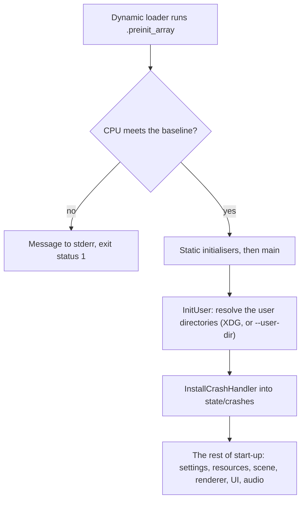
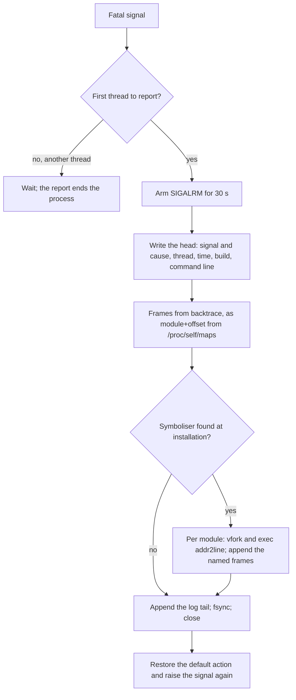
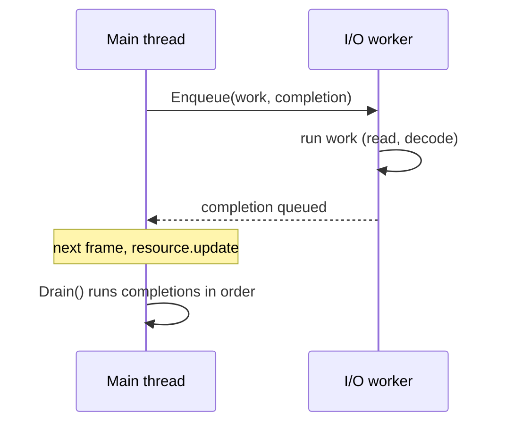

# Runtime: core and platform

The rest of the engine stands on four small modules. `core` is the common vocabulary: logging,
assertions, layered configuration, hashes, string IDs, typed handles and the engine's version.
`platform` is the contact with the operating system: where user files live, the start-up CPU check,
the crash handler and the directory watcher. `jobs` holds the one worker thread that reads and decodes files. `profile`
puts Tracy behind macros that cost nothing when profiling is compiled out. They are the bottom of
the [module graph](architecture.md#module-dependencies) and know nothing of the simulation, the
renderer or a game.

## Concepts

| Term | What it is |
| --- | --- |
| Severity | How serious a log message is: `Trace`, `Debug`, `Info`, `Warning`, `Error`, `Fatal`. |
| Category | The name a log message is filed under (`"render"`, `"sim"`), for a sink to filter on. |
| Sink | Where log messages go: stderr, a file, or a callback such as the console's log view. |
| Log tail | The last 64 KiB of log lines, kept in memory for a crash report. |
| Config layer | One source of settings: defaults, the user's file, or the command line. A higher layer overrides a lower one. |
| `StringId` | A 64-bit hash of a name, compared as an integer. Part of the save format. |
| `Handle` | An index into an owner's table and the slot's generation, so a stale handle is detected. |
| User directories | The four XDG directories for saves, settings, logs and caches. |
| CPU baseline | x86-64 with AVX2, BMI1, LZCNT, POPCNT and F16C. A machine below it is refused at start-up. |
| Crash report | A text file written on a fatal signal: the signal, the stack, the build and the log tail. |
| I/O worker | One thread that runs file reads and decodes, and hands their results back on the main thread. |
| Zone | A named span on the profiler's timeline. |

The durable file writes and the directory lock are also in `core` (`core/File.h`,
`core/FileLock.h`); [persistence](persistence.md#durable-writes) describes them.

## How it works

### Start-up

Two things in start-up are this layer's. The CPU check runs before any instruction the machine
might lack, and the crash handler is in place before the rest of the engine starts, so a crash
during start-up is reported too. The flowchart shows the order in the [shell](glossary.md#shell);
the rest is in [the app shell's start-up](app-shell.md#start-up).



### Logging

Engine code logs through `Core::Log` (`core/Log.h`), never through spdlog directly, so the
categories and sinks are the engine's own: spdlog writes the stderr and file sinks, and `Log.cpp`
decides which messages reach them.

A call names a severity, a category and a `std::format` string:

- **The format is checked at compile time.** A runtime string is logged as `Log(severity, category,
  "{}", text)`.
- **Disabled messages cost almost nothing.** Arguments are formatted only when the severity is at or
  above the minimum (`IsLogEnabled`).
- **The caller's location is captured** with the format string, so the file sink can name it.
- **A category is not copied.** Its name must outlive the call, so modules declare one constant:
  `constexpr Core::Category kRender{"render"};`.

Each message goes to every sink, then to the log tail, then to every callback, all under one lock.
Messages at `Error` and above are flushed as they are written. The stderr line has the time of
day, the severity in colour, the category and the message; the file line adds the date and the
source location.

`InitLogging(minimum, file)` installs the sinks: stderr always, and the file when one is given
(truncated). Before it is called, and after `ShutdownLogging`, messages at `Info` and above go to
stderr, because a report that goes nowhere is lost. Every function in `Log.h` is thread-safe.

A callback (`AddLogCallback`) sees each `LogRecord` on the thread that logged it, with the lock
held, so it must not log and should return quickly. The devtools console registers one for its log
view ([the console](ui.md#the-console)).

The shell calls `InitLogging` when it resolves the user directories (`Application::InitUser`), with
`Info` as the minimum and `jettison.log` in the `state` directory (`app/src/RunLog.h`):
`~/.local/state/jettison/jettison.log`, or `<directory>/state/jettison.log` under `--user-dir`. A run
truncates it, so it holds the run a report is about, and the player sends it with the report; the
crash reports are beside it in `crashes/`. A file that cannot be opened costs a warning on stderr, not
the run. The failure report, the usage line and teardown stay on `std::cerr` ([coding
standards](coding-standards.md#errors)).

The log tail is a 64 KiB ring of lines in the file's format, filled whether or not there is a file.
A crash handler reads it without the log's lock: `WriteLogTail` calls only `write(2)`, and the ring
publishes its byte count after its bytes, so a reader sees whole data and skips to the first whole
line.

### Assertions

`core/Assert.h` has three macros. Their conditions must have no side effects, because a release
build does not evaluate `JETTISON_ASSERT`'s.

| Macro | Checked | On failure |
| --- | --- | --- |
| `JETTISON_ASSERT(condition)` | Debug builds only | Logs at `Fatal`, flushes, stops in an attached debugger, aborts |
| `JETTISON_VERIFY(condition)` | Every build | The same |
| `JETTISON_NOT_IMPLEMENTED()` | Every build | Throws `Core::NotImplementedError` (a `std::logic_error`) |

A failed check names the expression, the function, the file and the line, through the log, so it
reaches the file, the console and the crash report's tail (or `fprintf` to stderr if the log cannot
take it). An attached debugger (`TracerPid` in `/proc/self/status`) stops at the failure with
`SIGTRAP` rather than inside `abort`; the abort then reaches the crash handler as `SIGABRT`.

`JETTISON_NOT_IMPLEMENTED` throws instead of aborting, so a test can prove a stub fails loudly by
catching it. Assertions are for defects only; errors a caller can recover from are in the [coding
standards](coding-standards.md#errors).

### Configuration

`Core::Config` (`core/Config.h`) holds settings in three layers; a read takes the value from the
highest layer that has the key.

| Layer | Meant for |
| --- | --- |
| `CommandLine` | Values given for one run |
| `User` | The player's settings file |
| `Defaults` | The engine's and the game's defaults |

Keys are dotted paths (`render.vsync`, `audio.music`), each segment a level of a YAML map in a
file. Values are stored as text and read as the type asked for (`GetString`, `GetNumber`, or
`GetBool`: `true` or `false` only). A layer whose value does not read as that type is skipped with a
warning, so a bad edit to the user's file falls back to the default.

The rules keep a layer writable as YAML:

- A key is dotted segments of letters, digits and underscores. Anything else throws
  `std::invalid_argument`.
- One layer cannot hold both `render` and `render.vsync`: a key cannot be a value and a map.
- `LoadLayer` treats a missing file as an empty layer. A malformed file throws naming the path and
  leaves the layer as it was.
- `SaveUserLayer` writes the user layer through `Core::WriteFileDurably`, leaving out values equal
  to the default's.

`Config` is not thread-safe; it is read and written on the main thread. It does not know where the
file lives: the shell keeps it in `<config>/settings.yaml`
([settings apart from saves](persistence.md#settings-apart-from-saves)).

### Hashes, string IDs and handles

`Core::Fnv1a64` (`core/Hash.h`) is 64-bit FNV-1a: a few lines that run the same at compile time
and at run time, over short names, where a faster hash would not show.
`HashCombine` folds one hash into another for a composite key; order matters. Both are pinned by
recorded values in `core/tests/HashTests.cpp` and never change in place, because saves and caches
depend on them.

`Core::StringId` (`core/StringId.h`) is a name hashed with `Fnv1a64`, compared as an integer. In
development builds (no `NDEBUG`), every ID made at run time records its text in a
thread-safe table. `Text()` then names it in a message, and two different strings with the same hash
stop the program at the second. Release builds keep no table, and `Text()` says `<unknown>`.

`Core::Handle<Tag>` (`core/Handle.h`) is a 32-bit index and a 32-bit generation. The owner bumps a
slot's generation when the slot is reused, so a handle to the old occupant no longer matches and the
owner reports it stale. The tag type makes handles to different things different types; null is
generation 0. Caches key on handles, not addresses, because a reload can reuse an address ([coding
standards](coding-standards.md#ownership-and-lifetime)). The resource manager's
`Resource::ResourceHandle<T>` is this type ([resources](files-and-mods.md#resources)).

### The engine's version

`Core::EngineVersion()` (`core/Version.h`) returns the project version from `CMakeLists.txt`. A save
records it for a report, though whether a save reads is decided by its
[format version](glossary.md#format-version). A [package](glossary.md#package)'s `engine`
requirement is checked against it ([packages](files-and-mods.md#packages-and-modyaml)), and the
crash report's build line includes it.

### User directories

`Platform::ResolvePaths(applicationName)` (`platform/Paths.h`) returns where the engine reads and
writes outside its asset tree. It follows the XDG base directory specification (0.8):

| Field | Variable | Default | Meant for |
| --- | --- | --- | --- |
| `userData` | `XDG_DATA_HOME` | `~/.local/share/<name>` | Saves, the user's mods |
| `config` | `XDG_CONFIG_HOME` | `~/.config/<name>` | Settings, keybindings, the mod list |
| `state` | `XDG_STATE_HOME` | `~/.local/state/<name>` | Logs, console history, crash reports |
| `cache` | `XDG_CACHE_HOME` | `~/.cache/<name>` | Shader caches, thumbnails |

Today the shell uses `userData`, `config` and, for the log and crash reports, `state`; nothing uses `cache` yet.
A variable that is empty or relative is ignored, as the specification says; `HOME` is needed only
then, and resolving throws without it. The name must be one path component. `ResolvePath(Directory,
name)` resolves one directory alone. Resolving touches nothing on disk: a writer creates its
directory when it first writes. The environment can be passed as an `EnvironmentLookup`, so tests do
not depend on the machine's. `ExecutablePath()` reads `/proc/self/exe`.

The shell resolves the paths for `jettison`. With `--user-dir <directory>` it uses `data`,
`config`, `state` and `cache` under that directory instead, which keeps a run's settings, saves
and mods apart, as the smoke test's fresh temporary directory does.

### The CPU check

Jolt adds its AVX2 flags publicly, and physics links it privately, so they reach only physics's and
Jolt's own units (`source/external/CMakeLists.txt`). That is enough to fault: an inline function or
template compiled there may be the copy the linker keeps for every unit, and on an older machine
the first AVX2 instruction is an illegal-instruction fault, wherever it falls. Instead, the player
is told what is missing.

So the check is not a call. Every executable that links `platform` runs a guard from
`.preinit_array`, which the dynamic loader calls before any static initialiser. On a machine below
the baseline, the guard writes the missing features to stderr with `write(2)` and exits with status
1. Three things make it safe:

- `platform/src/Cpu.cpp` is compiled with `-mno-avx -mno-bmi -mno-lzcnt -mno-popcnt -mno-f16c` after
  every other flag, so neither Jolt's `-mavx2` nor `-march=native` reaches it.
- The guard calls no inline function or template, whose linked copy could come from an AVX2-compiled
  unit.
- `platform` links with `--require-defined=JettisonCpuGuard`, so an executable that links it carries
  the guard or fails to link.

`DetectCpuFeatures` and `CheckCpuBaseline` (`platform/Cpu.h`) give the same check as a value, for
tests and diagnostics. AVX2 counts only when the operating system saves the AVX register state.

### Crash reports

A player's machine may have no debugger, so a crash writes its own report.
`Platform::InstallCrashHandler` (`platform/Crash.h`) writes a report on SIGSEGV, SIGBUS, SIGFPE,
SIGILL or SIGABRT, the last covering a failed assertion and `std::terminate`. Its terminate handler
first logs the uncaught exception at `Fatal`, so the log tail says what it was.

A crash can happen anywhere, inside `malloc` or with the log's lock held, so until the frames are on
the disk the handler calls only what a signal handler may: system calls into buffers made at
installation, glibc's `backtrace` with its unwinder loaded at installation, and `/proc/self/maps`
for each frame's module, since `dladdr` takes the loader's lock. The flowchart shows the handler
from signal to exit.



Each step has a reason:

- **The symboliser runs last, in a child.** `vfork` and `exec` run none of the fork handlers that
  would take malloc's locks. The report is already on the disk if the child hangs, and SIGALRM ends
  the process after 30 seconds.
- **The signal is raised again** under its default action, so the process ends with the status and
  core dump it would have had without a handler.
- **The handler runs on a stack of its own** (`sigaltstack`, 128 KiB), so the main thread's stack
  overflowing is reported too.
- **The report's head and frames go to stderr as well**, then the line `The crash report is <path>`.
  The tail goes only to the file.

The report is `crash-<UTC time>-<process id>.txt` in the directory given, which installing the
handler makes if it is missing, through `Core::CreateDirectoriesDurably`, and refuses with
`std::runtime_error` if it cannot; the shell gives `<state>/crashes`. Its layout, from `WriteReport` in `platform/src/Crash.cpp`:

```text
Fatal signal SIGSEGV (11), an address that is not mapped, at 0x0
Thread <tid> '<name>', the main thread, of process <pid>
Time <UTC time>
Build <CrashOptions::build>
Command <command line>

Frames, as module+offset:
  #00 <address>  <module>+<offset>
  ...

Modules:
  <module> build-id <hex>
  ...

Frames, named by <symboliser>:
  ...

The log's tail:
<the last 64 KiB of the log>
```

A machine without `addr2line`, such as a player's, writes only modules and offsets, which
`scripts/symbolise-crash.sh <report> [build directory]` names later against the build that wrote
the report, finding each module's debug file by the GNU build ID the report lists for it
(`<directory>/.build-id/<2 digits>/<rest>.debug`, the layout a stripped release's kept debug files
have), else by its name. Every binary the engine links carries a SHA-1 build ID
(`--build-id=sha1`). The handler runs on a stack of its own on the thread that installs it and on
each thread holding a `Platform::ThreadCrashStack`, as the I/O worker and the scripts' watchdog do,
so any of those overflowing its stack is reported. Under the address sanitiser nothing is installed and `InstallCrashHandler` returns
false, since the sanitiser's report names more. Tracy's crash handler is compiled out
(`TRACY_NO_CRASH_HANDLER`), so there is only one. The console's `crash fault | assert |
exception` command crashes the shell each way, to see a report.

### Watching a directory

`Platform::DirectoryWatcher` (`platform/DirectoryWatcher.h`, which documents the contract) reports
the files and directories that change under a directory, new directories watched as they appear. A
caller waits on it with a timeout and gets the changed paths, so it can look at a stop flag between
waits; it needs no thread of its own. On Linux it is inotify, a watch a directory; a link below the
root is not followed, so nothing outside the tree is watched. The cook's watch
is its user ([the cook](dense-geometry-and-ray-tracing.md#the-cook)); the resource manager's hot
reload still polls the file system's stamps, since a pack or a mod's directory is not a tree to watch.

### The I/O worker

Reading and decoding a model or a texture can take longer than a frame, so `Jobs::IoWorker`
(`jobs/IoWorker.h`) runs that work on one thread. Each item is a pair: the work, run on the worker,
and a completion, run later on the main thread, so engine state is touched only there.



- **Order.** Work runs one item at a time, in the order enqueued, and completions in the same
  order. `Enqueue` is safe from any thread, a completion included.
- **Failure.** Work that throws does not take the worker down. Its completion is skipped, and
  `Drain` rethrows the exception on the main thread after the completions before it. Work should
  still catch what it expects, as the resource manager does for a load.
- **Shutdown.** The destructor finishes the item in progress and drops the rest, with no
  completions. Call `WaitIdle` and `Drain` first to finish everything.

The shell makes one worker in `InitResources` and gives it to `Resource::ResourceManager`, whose
`Update` drains it once a frame ([resources](files-and-mods.md#resources)). The engine's threads are
listed in [architecture](architecture.md#threading). A general job system waits until a profile
shows the need ([scope](scope.md#runtime-core-and-platform)), as a second type beside this one.

### Profiling

`profile/Profile.h` wraps Tracy in four macros:

| Macro | What it records |
| --- | --- |
| `JETTISON_PROFILE_ZONE(name)` | A named zone, from here to the end of the block |
| `JETTISON_PROFILE_FUNCTION()` | A zone named after the enclosing function |
| `JETTISON_PROFILE_FRAME()` | The end of a frame |
| `JETTISON_PROFILE_PLOT(name, value)` | A value plotted against time; integers plot as `int64_t` |

Names are string literals, since Tracy keeps the pointer and identifies a zone by it. The CMake
option `JETTISON_PROFILE` (off by default) compiles the client in. Off, the macros expand to nothing
(a plotted value sits in an unevaluated operand, so it is not an unused variable). On, the client is
on demand and listens on localhost only, costing nothing until a profiler connects.
`Profile::IsEnabled()` and `IsConnected()` say which.

Tracy is a public dependency of `profile`, so its `TRACY_ENABLE` definition travels with the target
and every unit agrees on it. Jolt's zones reach Tracy through its external-profile hooks
(`physics/src/JoltProfile.cpp`). GPU zones, one per declared pass, are the renderer's
(`render/src/vulkan/GpuProfiler.h`, [measuring the frame](rendering.md#measuring-the-frame)). The
client's version must match the profiler's; building a profiling tree and capturing a run are in
[profiling](build-and-gates.md#profiling).

## Using it

### Logging and asserting

A module declares its category once and logs through it. From
`source/engine/app/src/Application.cpp`, the console's `crash assert`:

```cpp
constexpr Core::Category kShell{"shell"};
// ...
Core::Log(Core::Severity::Warning, kShell, "Crashing: an assertion that fails");
JETTISON_VERIFY(how == "a defect");
```

A debug-only check of a caller's contract, from `source/engine/time/src/Clock.cpp`:

```cpp
JETTISON_ASSERT(fixedStep > 0.0);
```

From `source/engine/core/tests/LogTests.cpp`: below the minimum, a message is dropped before its
arguments are formatted.

```cpp
InitLogging(Severity::Warning);
int formatted = 0;
Log(Severity::Info, kTestLog, "{}", CountsFormats{&formatted});
Log(Severity::Warning, kTestLog, "kept {}", CountsFormats{&formatted});
CHECK(formatted == 1);
ShutdownLogging();
```

### Reading settings

From `source/engine/core/tests/ConfigTests.cpp`: a nested YAML file reads as dotted keys.

```cpp
const auto path = scratch.Write(
    "settings.yaml",
    "render:\n  vsync: false\n  window:\n    width: 1280\naudio:\n  music: 0.25\n");
Config config;
config.LoadLayer(ConfigLayer::User, path);
CHECK(config.GetBool("render.vsync") == false);
CHECK(config.GetNumber("render.window.width") == 1280.0);
```

### Resolving user directories

From `source/engine/platform/tests/PathsTests.cpp`, with the environment passed in:

```cpp
const Paths paths = ResolvePaths("jettison", Environment({{"HOME", "/home/pilot"}}));
CHECK(paths.userData == "/home/pilot/.local/share/jettison");
CHECK(paths.config == "/home/pilot/.config/jettison");
CHECK(paths.state == "/home/pilot/.local/state/jettison");
CHECK(paths.cache == "/home/pilot/.cache/jettison");
```

### Installing the crash handler

The shell, in `Application::InitUser` (`source/engine/app/src/Application.cpp`), right after it
resolves the user directories:

```cpp
Platform::InstallCrashHandler(
    {m_userPaths.state / "crashes",
     std::format("{}, engine {}", m_windowTitle, Core::EngineVersion()),
     {},     // the symboliser: addr2line found on PATH
     true}); // name the frames
```

A program built on the engine without the shell calls it the same way, from the main thread, before
it starts other threads.

On its next start the shell names each report a crash left since the start before, once, as a warning
in the log: `Platform::TakeNewCrashReports` returns the reports newer than the one a `seen` file beside
them names, and marks the newest seen.

### Work on the I/O worker

From `source/engine/jobs/tests/JobsTests.cpp`: a failing item skips its completion, and `Drain`
rethrows on the main thread.

```cpp
IoWorker worker;
std::vector<std::string> finished;
worker.Enqueue([] {}, [&] { finished.emplace_back("before"); });
worker.Enqueue(
    [] { throw std::runtime_error{"disk on fire"}; }, [&] { finished.emplace_back("failed"); });
worker.Enqueue([] {}, [&] { finished.emplace_back("after"); });
worker.WaitIdle();

CHECK_THROWS_WITH_AS(worker.Drain(), "disk on fire", std::runtime_error);
CHECK(finished == std::vector<std::string>{"before"});
worker.Drain(); // the worker survived; the next drain carries on
CHECK(finished == std::vector<std::string>{"before", "after"});
```

### Profiling a system

The shell's simulation system, in `source/engine/app/src/Application.cpp`, zones itself and plots
the steps a frame ran:

```cpp
[this](entt::registry &, double deltaTime)
{
	JETTISON_PROFILE_ZONE("sim.step");
	const int steps = m_simStepper->Advance(deltaTime);
	JETTISON_PROFILE_PLOT("sim.steps", steps);
}
```

`Application::Tick` opens with `JETTISON_PROFILE_FUNCTION()` and ends with
`JETTISON_PROFILE_FRAME()`.

## Limits and open work

- Another thread's stack overflow goes unreported, and reports carry no build IDs, are sent nowhere
  and have no minidump: [J11](roadmap.md#j11).
- The shell fills only the user configuration layer. Defaults live in the code that reads each key;
  the console's variables are the devtools' ([console variables](ui.md#console-variables)).
- `StringId` is used little so far; most of the engine still keys on strings.
- Jolt runs its single-threaded job system: [J07](roadmap.md#j07).
- Paths, the CPU check, the crash handler and the directory watcher are Linux and x86-64 only, as
  the engine is.

## Decisions

The settled choices are in [decisions](decisions.md#runtime-core-and-platform); the AVX2 baseline
is under [build and platform](decisions.md#build-and-platform). The modules' history is in
[history](history.md).

## Source

| Module | Key headers | Tests |
| --- | --- | --- |
| `core` | `source/engine/core/include/jettison/core/Log.h`, `Assert.h`, `Config.h`, `Hash.h`, `StringId.h`, `Handle.h`, `Version.h` (and `File.h`, `FileLock.h`: [persistence](persistence.md)) | `source/engine/core/tests` |
| `platform` | `source/engine/platform/include/jettison/platform/Paths.h`, `Cpu.h`, `Crash.h`, `DirectoryWatcher.h` | `source/engine/platform/tests` |
| `jobs` | `source/engine/jobs/include/jettison/jobs/IoWorker.h` | `source/engine/jobs/tests` |
| `profile` | `source/engine/profile/include/jettison/profile/Profile.h` | `source/engine/profile/tests` |

`core` links spdlog and yaml-cpp privately; `platform`, `jobs` and `profile` depend on `core`. The
build settings are in each module's `CMakeLists.txt` (the CPU guard's flags in
`source/engine/platform/CMakeLists.txt`) and Tracy's in `source/external/CMakeLists.txt`.
`scripts/symbolise-crash.sh` names a report's frames after the fact.
