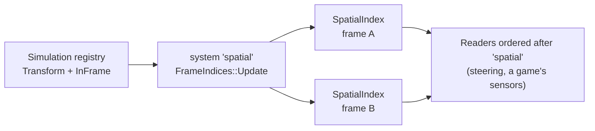

# Scenes

A scene is what the player sees: the cameras, lights, meshes, sky and effects of one view of a game,
held apart from the simulation that decides what happens. This document covers the scene
(`engine/scene`): its file, its components, its layers, the proxies that show simulation entities in
it, the systems that update it each frame, and its camera rigs. It also covers the spatial index
(`engine/spatial`), which answers "what is near this point" for the simulation.

The two sit on opposite sides of the engine's split: the scene is
[presentation](glossary.md#presentation)'s world, the spatial index the
[simulation](glossary.md#simulation)'s.

## Concepts

| Term | Meaning |
| --- | --- |
| [Scene](glossary.md#scene) | `Scene::Scene`: an EnTT registry of presentation components, loaded from and saved to a scene file. It names no GPU device. |
| Scene entity id | `SceneEntityId`: the name a scene file gives an entity (`id: deck`). Parents, orbit targets and clip bindings refer to entities by it. `FindById` looks one up. |
| Authored state | What the scene file says: a transform, a mesh, a light. Saved back exactly. |
| Runtime state | What the engine or a game works out each frame: a clip's pose, a camera rig's pose, a game's placement of a body. Never saved. |
| Built entity | An entity a game makes rather than the file authors, tagged `BuiltComponent`. The writer leaves it out. |
| [Layer](glossary.md#layer) | `Scene::Layer`: environment, traffic or effects. Each layer can be hidden. |
| [Proxy](glossary.md#proxy) | A scene entity that shows a simulation [entity](glossary.md#entity) (`SimProxyComponent`), placed from the simulation's [snapshots](glossary.md#snapshot). |
| Camera rig | A piece of code that places a camera: orbit, chase, cockpit or map (`scene/CameraRigs.h`). |
| Spatial index | `Spatial::SpatialIndex`: an octree over points, answering sphere, box and nearest queries. |
| Frame indices | `Spatial::FrameIndices`: one spatial index for each [frame](glossary.md#frame-coordinates), kept from the simulation's components every [step](glossary.md#step). |

## How it works

### The scene and its file

A scene is a registry of the components in `scene/Components.h`, plus those of `engine/animation`
that its update drives. The renderer reads it; the scene knows nothing of the renderer. What an
entity draws is named, never held: a model by its virtual path (`models/crate.glb`), or a procedural
shape (`sphere`, `box`, `icosphere`, `cubesphere`, `ring`, `cylinder`), which the renderer loads
or makes. Every path in a file is a virtual path, so a mod can shadow any model, material or clip a
scene names ([files, packs and mods](files-and-mods.md)).

The file is YAML, read and written through the reflection archives (`serialise/Archive.h`;
[persistence](persistence.md)). It is at format version 3 (`Scene::kFormatVersion`). A file of any
other version is refused, and so is a field the scene does not know, with its path and line:

```text
Scene.entities[0].camera.far: 'Scene.Camera' has no saved field 'far' (line 5)
```

There are no migrations: until player testing, formats change in place and the files that use them
are rewritten ([decided](decisions.md#persistence)).

A file is a list of entities. Each entity is a record with an `id` and any of these fields:

| Field | Becomes | Described in |
| --- | --- | --- |
| `parent` | `ParentComponent`: the transform is relative to this entity | here |
| `layer` | `LayerComponent` | [Layers](#layers) |
| `transform` | `TransformComponent`: translation (double), rotation (Euler radians), scale | [coordinates](coordinates.md) |
| `camera` | `CameraComponent`, and `OrbitCameraComponent` if it has an `orbit` | [Camera rigs](#camera-rigs) |
| `light` | `LightComponent`: a point or spot light with a range, optionally animated | [rendering](rendering.md) |
| `sun`, `sky` | `SunComponent`, `SkyComponent`: the scene's one directional light and its environment | [rendering](rendering.md) |
| `mesh` | `MeshComponent` (a model or a shape, and a material), and `RigComponent` for a model | [rendering](rendering.md) |
| `body`, `atmosphere`, `rings` | `BodyComponent`, `AtmosphereComponent`, `RingsComponent` | [rendering](rendering.md) |
| `particles`, `outline`, `mask`, `grade` | `ParticleEmitterComponent`, `OutlineComponent`, `MaskComponent`, `ColourGradeComponent` | [effects](rendering-effects.md) |
| `transformAnimation`, `animation`, `clip` | a rotation, a model's clip player, a clip file's player (`ClipPlayerComponent`) | [animation](animation.md) |

Every entity gets a `TransformComponent`, the identity if the file gives none.

The loader and the writer share one check of what a file may say (`Validate`, in
`scene/src/Scene.cpp`), so the writer cannot produce a file the loader refuses. The check refuses,
among others:

- an empty or repeated id, or a `parent`, orbit `target`, clip binding or particle `frame` that
  names no entity;
- more than one active camera, sun, sky or colour grade;
- a mesh with both a model and a shape, or neither; a `color` on a model; an `innerRadius` on
  anything but a ring;
- a path that is not a virtual path (`../models/arm.glb`);
- an atmosphere or rings without a mesh of a shape, or a body without a name;
- a light with no positive range, or cone angles on a point light.

Loading replaces the scene. `Scene::Load` and `Scene::LoadText` clear it first, and a file that
fails leaves it empty, with the error naming the file. A game that must keep the shown scene when a
new file is bad reads it first with `SceneFile::Read`, which checks it without touching the scene,
then calls `Scene::Load(const SceneFile &)`, which fails only where making entities does: a model,
in a scene built without a resource manager.

A scene built with a `Resource::ResourceManager` loads each model's rig through it (the model's
node hierarchy, which places the mesh within its file). One built without refuses a file with a
model, so tests that need no assets load scenes of shapes alone. `Scene::Clear` and
`Scene::Destroy` release the rigs they loaded.

`Scene::Generation` counts the times the contents were replaced. The renderer compares it to know
when to rebake the environment and release what the new contents no longer draw.

### Authored and runtime state

A saved scene is the file that was loaded
([coding standards](coding-standards.md#components-and-state)), so runtime state lives in its own
components or fields, which the writer never reads:

| Runtime state | Held in |
| --- | --- |
| A rotation's angle, a clip player's time | `RotationAnimationComponent`, `ClipPlayerComponent::time` |
| A clip's pose of an entity | `NodePoseComponent` |
| A game's placement of a body | `PlacementComponent` |
| A camera rig's pose | `CameraPoseComponent` |
| A model's rig | `RigComponent` |
| The composed world transform | `WorldTransformComponent` |
| A layer's hidden flag | `HiddenComponent` |
| What a game built | any entity tagged `BuiltComponent` |

The writer saves only entities with a `SceneEntityId` and without `BuiltComponent`, sorted by id.
The scene suite's round-trip tests run the update for ten seconds and check that the saved text has
not changed.

### Layers

A scene's content is split into three layers, so a developer can hide one to see the others and a
game can show its parts separately:

| Layer | Holds |
| --- | --- |
| `environment` | What the scene file places: ground, buildings, bodies, platforms. |
| `traffic` | What the simulation places: vehicles, loads, debris. |
| `effects` | Beacons, markers and other transient visuals. |

An entity's layer is its own `layer`, or else its parent's, up to the environment at a root, so a
platform's parts are in the platform's layer unless one says otherwise.

`Scene::SetLayerVisible` shows or hides a layer. The visibility is held in the registry's context
(`LayerVisibility`), so it outlasts a load. The scene update tags every entity of a hidden layer
`HiddenComponent`, and the renderer neither draws a hidden mesh nor lights the scene with a hidden
light. The sun and the sky are drawn whatever their layer. The shell's Scene panel has a checkbox
for each layer ([app shell](app-shell.md)).

### Proxies of the simulation

A proxy holds the simulation entity's identifier (`SimProxyComponent::simEntity`) and finds it in
the snapshots, since presentation never holds a reference into the simulation's world. Every frame,
in the sync phase, the shell writes each proxy's transform from the two newest snapshots,
interpolated as [the stepper](simulation.md#snapshots-and-the-stepper) describes
(`Scene::SyncSimProxies`). The position stays a double, in the entity's frame. A proxy whose entity
is not in the snapshots stays where it was; the events that say why are presentation's to act on.

The engine does not make proxies. Only the game knows what a vehicle looks like, so the game builds
each proxy, tags it `BuiltComponent`, and gives it a `SimProxyComponent`. A game that makes and
unmakes its proxies as entities come and go does it in `Game::SyncProxies` and returns true; the
shell then skips its own `SyncSimProxies`.

### The frame

The scene is updated in the shell's frame loop: `sim.sync` places the proxies, then `scene.update`,
the camera rigs (`camera.rig`), a cinematic (`camera.sequence`) and audio run in the presentation
phase before the render reads the scene. The whole order, and how a game slots its systems in by
name (`Game::RegisterFrame`), is in [the app shell](app-shell.md#the-frame).

`scene.update` is `Scene::SceneUpdateSystem::Update`. In order, it:

1. advances rotation animations and clip players;
2. poses each model from its rig, once the rig has loaded, and samples each clip file's clip onto
   the entities bound to it (`NodePoseComponent`);
3. composes every world transform in double precision, throwing on a parent cycle;
4. tags the entities of hidden layers.

It returns the clip events crossed in the frame (`ClipEventFired`) for the game to hear. A model
whose rig has not loaded is not drawn, and a clip its rig lacks leaves it at rest
([animation](animation.md#a-gltf-models-rig)).

### Camera rigs

A rig turns what the player does into a camera pose (`CameraPose`: a double position and an
orientation). Every rig smooths what the player moves (angles, zoom, a chase's lag) but follows its
target exactly: a camera trailing a target at orbital speed by one frame's smoothing would sit far
off centre and swim, so the target's position is added in double precision every frame, unfiltered.
The smoothing (`SmoothingFactor`) is exponential, so it lands in the same place at any frame rate.

| Rig | For | Placed by |
| --- | --- | --- |
| `OrbitCamera` | Looking at a target from any side: yaw, pitch, and a distance that zooms by ratios | A scene file's `camera.orbit` (`OrbitCameraComponent`), `UpdateOrbitCameras` |
| `ChaseCamera` | Behind a vehicle; its rotation follows the target's with a lag | `PilotCameraComponent`, or a game's own system |
| `CockpitCamera` | In the seat, rigid with the target, with a free look held in a cone | `PilotCameraComponent` |
| `MapCamera` | Looking down on a plane from a logarithmic zoom, panned and focused | A game's own system |
| `CameraTransition` | Easing from one rig's pose to another's, whose destination may move | Both camera components |

A rig writes the camera's `CameraPoseComponent`; a camera with none is where its `CameraComponent`
puts it. `UpdatePilotCameras` runs after `UpdateOrbitCameras`, so a pilot camera's pose wins. A
pilot camera is runtime only: a game adds it, since what it follows is a proxy the game made.
Switching between chase and cockpit is a transition, never a swing, since both rigs follow the
target all the time. A cinematic places the camera last, over what the rigs left
([animation](animation.md)). A camera has a near plane and no far one
([depth](coordinates.md#depth-reversed-z-with-an-infinite-far-plane)).

### The spatial index

The simulation needs to ask what is near: the vehicles within a sensor's range, the obstacles in a
vehicle's way. Jolt's broadphase answers for physics alone. The spatial index is the simulation's
own answer, and deterministic: what a query returns depends on the positions alone, never on the
order things were indexed in.

`SpatialIndex` is an octree over points (`Spatial::Octree`). A node's cube splits into eight when it
holds more than a leaf's capacity (64), and its children merge back when their subtree holds half
that. A crowded place is in small leaves and empty space in large ones. The root cube is a power of
two metres on a side, so every node's centre and size are exact in double. A point outside the root
cube is held by the root itself, which every query visits.

| Query | Returns |
| --- | --- |
| `QuerySphere(centre, radius)` | Everything within the radius, on it included, in identifier order |
| `QueryBox(box)` | Everything in the box, on its faces included, in identifier order |
| `QueryNearest(point, count, maxDistance)` | The nearest `count` within `maxDistance`, nearest first, ties by identifier |

Every structure decides membership through the same functions (`Spatial::InSphere`,
`Spatial::InBox`, `Spatial::DistanceSquared` in `spatial/Queries.h`), so the octree agrees to the
last bit with the brute-force walk its tests compare it with. Entities are points: a query for
things with extent widens its radius by the largest extent it cares about, then tests each extent
itself.

`Spatial::FrameIndices` keeps one index for each frame. It indexes every simulation entity with a
`Sim::Transform` and a `Sim::InFrame`, at its transform's position, in that frame's index. An entity
between frames (`Sim::kNoFrame`) is in none. `FrameIndices::Attach` registers the simulation
[system](glossary.md#system) `spatial`, which brings every index up to the registry as the step's
systems begin.



A reader orders itself after `spatial` (`FrameIndices::kSystemName`), as steering does
([AI](ai.md)); a system that must run before the step moves anything, such as behaviour trees,
orders itself before it.

The index is not state. It is made from the components each step, so a save does not hold it, and a
world loaded from a save has it from its next step. Why an octree, and not a grid or a loose octree,
is in [decided](decisions.md#scenes).

## Using it

### A scene file

The ground sample's scene (`source/samples/ground/assets/scene/main.yaml`) is a camera, a lamp and
the ground. The rover is not in it: the game builds its proxy as the scene loads.

```yaml
version: 3
entities:
  - id: camera
    camera:
      position: [0, 4, 10]
      rotation: [-0.3, 0, 0]
      fov: 60
      near: 0.1
      active: true
  - id: lamp
    transform:
      translation: [0, 30, 10]
    light:
      type: point
      color: [1, 0.95, 0.85]
      intensity: 4000
      range: 200
      active: true
  - id: ground
    transform:
      translation: [0, -0.5, 0]
      scale: [200, 0.5, 200]
    mesh:
      shape: box
      color: [0.35, 0.45, 0.3]
```

A child and a layer, from the test content (`source/test/content/scene/vesper.yaml`): a deck marking
in the effects layer, placed relative to its parent.

```yaml
  - id: built-10
    parent: built-3
    layer: effects
    transform:
      translation: [2.9700000286102295, 0.04500000178813934, -32.099998474121094]
      rotation: [0, 0, 0]
      scale: [0.648, 0.02, 2.5704005]
    mesh:
      shape: box
      color: [0.92, 0.92, 0.9]
```

An orbit camera, from `source/test/content/scene/orbit.yaml` (its transform left out here), framing
the entity `highport`:

```yaml
  - id: camera
    camera:
      position: [2, 2, 2]
      rotation: [-0.6154797, 0, 0.7853982]
      fov: 50
      near: 0.5
      active: true
      orbit:
        target: highport
        distance: 1500
        yaw: 0.8
        pitch: -0.1
        minDistance: 840
```

### Loading, updating and saving in code

From `source/engine/scene/tests/SceneTests.cpp`: a scene of shapes alone needs no resource manager,
and its update never reaches the file.

```cpp
Scene scene;
scene.LoadText(kSceneWithoutModels);
const std::string first = scene.SaveText();

const SceneUpdateSystem update;
for (int frame = 0; frame < 100; ++frame)
	update.Update(scene.Registry(), 0.1f);
CHECK(scene.SaveText() == first);
```

### A game's proxy

The ground sample builds the rover's proxy when a scene loads (`GroundGame::BindProxy`, in
`source/samples/ground/src/GroundGame.cpp`). It is built, so the writer leaves it out:

```cpp
const entt::entity proxy = scene.create();
scene.emplace<Scene::BuiltComponent>(proxy);
scene.emplace<Scene::TransformComponent>(
    proxy, glm::dvec3{0.0}, glm::vec3{0.0f}, kRoverHalfExtents);
Scene::MeshComponent mesh;
mesh.shape = Scene::Shape::Box;
mesh.color = {0.8f, 0.45f, 0.15f};
scene.emplace<Scene::MeshComponent>(proxy, std::move(mesh));
scene.emplace<Scene::SimProxyComponent>(proxy, m_rover);
```

The shell's `SyncSimProxies` then places it every frame, since the ground sample leaves
`Game::SyncProxies` at its default.

### A game's camera

The ground sample drives its own `ChaseCamera` in a presentation system ordered after `camera.rig`
and before `camera.sequence` (`GroundGame::RegisterFrame`; the registration is shown in [the app
shell](app-shell.md#the-frame)). Its `PlaceCamera` sets the rig's target to the rover's interpolated
transform, calls `m_camera.Update(deltaTime)`, and writes the pose into the active camera's
`CameraPoseComponent`.

### Hiding a layer

```cpp
scene.SetLayerVisible(Scene::Layer::Traffic, false);
```

From the next `scene.update`, the traffic layer's meshes and lights are tagged `HiddenComponent` and
not drawn.

### Querying the spatial index

A world attaches the frame indices before the systems that read them ([steering a
vehicle](ai.md#steering-a-vehicle)). A reader finds its frame's index and queries it, as steering
does (`source/engine/ai/src/Steering.cpp`):

```cpp
if (const Spatial::SpatialIndex *index = m_indices.Find(frame))
	index->QuerySphere(agent.position, reach, near);
```

The results' order is fixed, as `source/engine/spatial/tests/SpatialTests.cpp` shows: range queries
in identifier order, nearest queries by distance and then identifier.

```cpp
Spatial::SpatialIndex index;
index.Insert(Entity(7), {100.0, 0.0, 0.0});
index.Insert(Entity(3), {-100.0, 0.0, 0.0});
index.Insert(Entity(5), {0.0, 100.0, 0.0});
CHECK(index.QuerySphere({0.0, 0.0, 0.0}, 100.0) ==
      std::vector<entt::entity>{Entity(3), Entity(5), Entity(7)});
```

## Limits and open work

- A scene's models are not prefetched before it is shown: [J13](roadmap.md#j13).
- Layers are for visibility only; nothing loads a scene layer by layer.
- No test covers layer visibility (`SetLayerVisible`, `HiddenComponent`).
- `Scene::ProxyFactory` (`scene/SimProxies.h`) is declared but nothing calls it; games build proxies
  in `Game::SceneLoaded` or `Game::SyncProxies`.
- The spatial index holds points; an entity's extent is the querying system's to test.
- A model file is read twice, once for its rig and once for its geometry: [J27](roadmap.md#j27).

## Decisions

The settled decisions on the spatial index (the octree, the index made each step) are in
[decided](decisions.md#scenes); formats changing in place is under
[Persistence](decisions.md#persistence). How the scene and its index came to be is in
[history](history.md).

## Source

| Module | Key headers |
| --- | --- |
| `engine/scene` | `scene/Scene.h` (the scene and its file), `scene/Components.h` (every component), `scene/SceneSystems.h` (the update, the camera systems, the sequence system), `scene/SimProxies.h`, `scene/CameraRigs.h`, `scene/Shape.h`, `scene/Wave.h`, `scene/Sequence.h` ([animation](animation.md)) |
| `engine/spatial` | `spatial/SpatialIndex.h`, `spatial/Octree.h` (structure and settings), `spatial/Queries.h` (membership and order), `spatial/FrameIndices.h` |

Headers are under `source/engine/<module>/include/jettison/`. The tests are
`source/engine/scene/tests` and `source/engine/spatial/tests`; `SpatialBenchmark.cpp` measures the
octree.

`scene` depends on `animation`, `core`, `ecs`, `math`, `reflect`, `resource`, `serialise`, `sim` and
`vfs`. `spatial` depends on `core`, `math`, `profile` and `sim`, and is `DETERMINISTIC`
([coding standards](coding-standards.md#simulation-code)). Neither depends on `render`.
