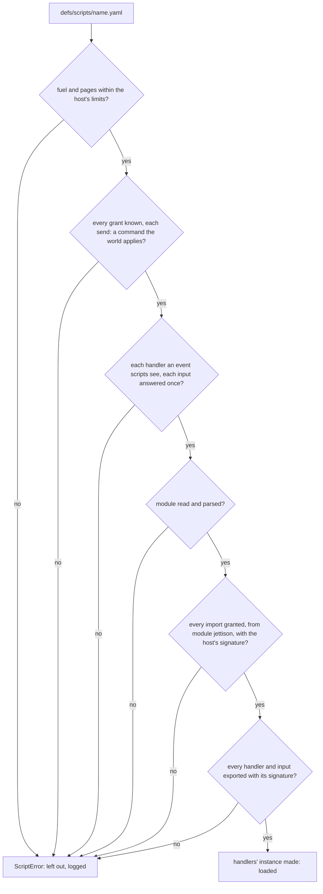
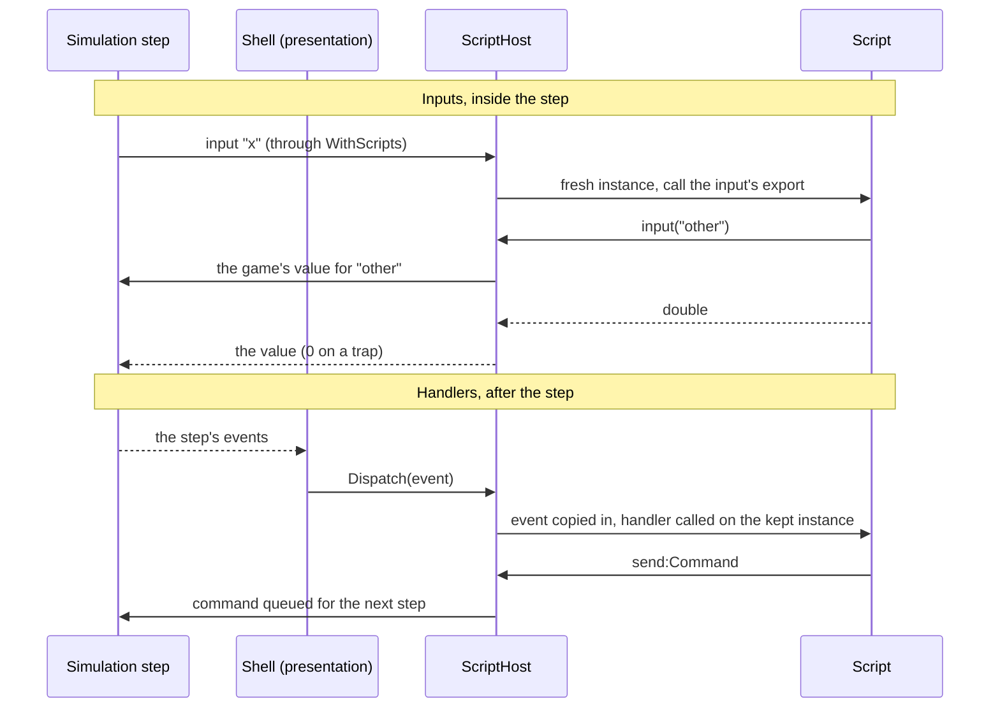
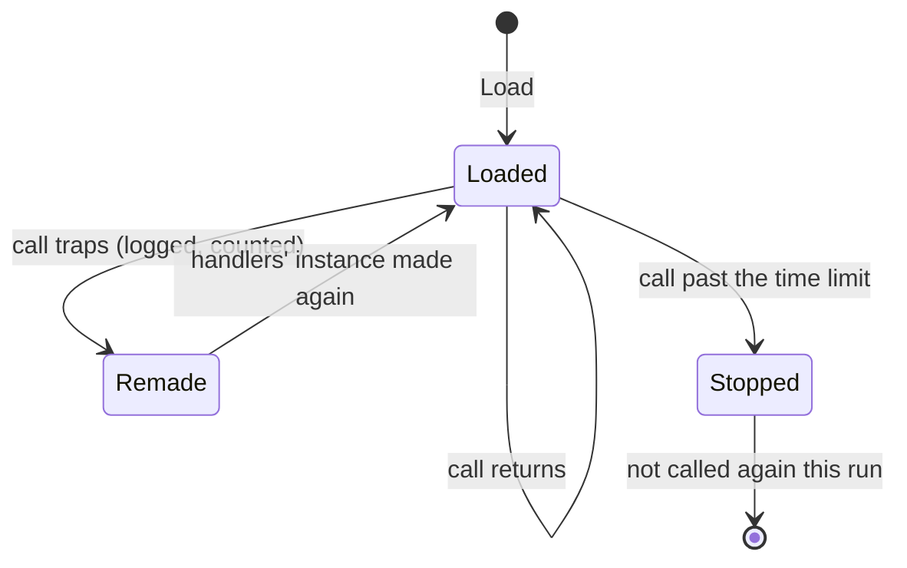

# Scripts

Scripts are how a [mod](glossary.md#mod) changes behaviour, not just data. A
[script](glossary.md#script) is a WebAssembly module, written in C or Rust, that the engine runs in
a sandbox. It hears the simulation's [events](glossary.md#event) and may answer with
[commands](glossary.md#command), and it can work out a number an AI decision weighs. It sees only
the game's types it is given, calls only the host functions it is granted, and every call is
bounded by [fuel](glossary.md#fuel), memory and a time limit.

The `script` module runs scripts in WAMR, the WebAssembly Micro Runtime, through its fast
interpreter, whose instruction count is the same on every run: one kind of call is made inside the
[step](glossary.md#step), where everything must be deterministic
([simulation code](coding-standards.md#simulation-code)).

## Concepts

### A script is a definition

A script is declared by a [definition](glossary.md#definition), `defs/scripts/<name>.yaml`, loaded
through the [definition registry](glossary.md#definition-registry), so it
[layers](glossary.md#layering) as any other: a mod adds a script with a file, and changes another
mod's grants or fuel with a [patch](glossary.md#patch)
([layering definitions](files-and-mods.md#layering-definitions)). Its name is the file's stem.

| Field | Default | What it says |
| --- | --- | --- |
| `module` | none | The `.wasm`'s virtual path, read through the VFS, usually from the same mod |
| `fuel` | 100,000 | The interpreter's instructions one call may run before it traps |
| `memoryPages` | 16 | The most the module's memory may grow to, in 64 KiB pages |
| `capabilities` | none | What the module may import: `log`, `store`, `send:<Command>` |
| `events` | none | Handlers: `{event: <registered name>, function: <export>}` |
| `inputs` | none | Inputs it answers: `{input: <name>, function: <export>}` |

A definition's fuel and pages must lie within the host's ceilings (below), or it does not load.

### What a script sees is generated from reflection

A script cannot read the engine's C++ objects. The host copies a value into the script's linear
memory as a plain struct, and a command out the same way, laid out from the reflection tables: a
type registered with `Reflect::Attribute::Script` is one scripts see, as an event a handler is
given or a command a script may be granted to send.

`Script::Bindings` lays each type out as a C compiler or rustc lays out a struct for wasm32: its
fields in registration order, each at its own alignment, the struct padded to its widest field.

| Field type in C++ | In a script's memory |
| --- | --- |
| `bool`, integers, `float`, `double` | Themselves |
| GLM vectors and quaternions | Their components (`jettison_vec3`, `jettison_dquat` and the rest) |
| `entt::entity` | Its 32-bit identifier, `jettison_entity` (`JETTISON_NO_ENTITY` for null) |
| A reflected enumeration | An unsigned integer of its size, its enumerators as constants |
| `std::string` | `jettison_string`: a pointer and a byte count, not terminated |
| A reflected class | Its own struct, nested |
| `std::vector` of any of these | A pointer to the elements and their count |
| Anything else (`std::optional`, a map) | Left out; the header says so, and a command read back keeps its default |

From the same layouts the host writes the bindings a script is compiled against, a C header
(`jettison_script.h`) and a Rust module (`jettison_script.rs`), each asserting every struct's size
and every field's offset, so a script built against another build's types fails to compile rather
than misread memory.

Every pointer and count a script hands back is checked against its memory's bounds, and every bool
and enumerator against its legal values. Only bytes cross the boundary.

The engine's own events that scripts see today are `Transit.PassageEnded`, `Transit.PortalLeft`,
`Dock.BerthGiven`, `Dock.BerthRefused`, `Dock.Landed` and `Dock.Left` ([Transit](transit.md),
[Docks](docks.md)). The engine marks no command for scripts: a game marks its own.

### Imports are capabilities

A script reaches the host only through imports from the module `jettison`, each needing a grant in
the definition:

| Capability | Imports | What they do |
| --- | --- | --- |
| `log` | `log` | A line in the game's log, under the script's name |
| `store` | `store`, `load` | Keep bytes under a key, and read them back (below) |
| `send:<Command>` | `send:<Command>` | Put a command of that registered type into the world's queue |
| (answering inputs) | `input` | Ask the game for one of the option's other inputs |

The `input` import is allowed when the definition lists inputs. A module that imports anything
not granted, from any module, is refused as it loads, naming the import.

WAMR is built without its libc (`printf`, `malloc` and the rest) and without WASI, so a script
has no files, clock or environment beyond what is granted. It is built with bulk memory and
reference types, which clang and rustc emit by default, and without SIMD, threads, AOT or JIT, so a
module that uses SIMD is refused at load (`source/external/wamr/CMakeLists.txt`).

### Two kinds of call: handlers and inputs

The host calls a script from two places, one outside the step and one inside it
([why](decisions.md#scripts)).

- **Handlers** run in [presentation](glossary.md#presentation). Once a frame the shell gives the
  host the simulation's events, and the host calls every script with a handler for each event's
  type, in name order. A handler acts by sending commands, which are queued for the next step and
  recorded with the player's, so a replay needs no script to run. A handler's instance is kept from
  call to call, so it may count what it has seen.
- **Inputs** run inside the [simulation](glossary.md#simulation). A utility-AI consideration names
  an input ([utility AI](ai.md#utility-ai)), and a script that answers the name works the value out.
  Each input call is made on a fresh instance, so its answer depends only on the option's inputs.
  An input call may not `send`, `store` or `load`.

Neither the `ai` module nor a decision knows scripts exist. The game wraps its own inputs with
`ScriptHost::WithScripts`, which routes an input a script answers to the script and any other to
the game. Only one script may answer a given input.

### What a script keeps

A handler's memory is not saved ([why](decisions.md#scripts)). A script keeps what must outlast its
instance by key, through `store` and `load`, in an encoding it chooses and migrates itself, so the
host never needs its types.

The keys are a [section](glossary.md#section) of the [save](glossary.md#save), `Script.Store`, at
its own [format version](glossary.md#format-version) ([the save
game](persistence.md#the-save-game)). They are not in the world's state, its hash or a replay, since
handlers run outside the step. The host keeps a script's keys whether it is loaded or not, so a
script left out of one run finds them in the next.

### Limits: fuel, memory and time

`Script::HostLimits` holds the host's ceilings, which no definition may exceed.

| Limit | Default | What it bounds |
| --- | --- | --- |
| `fuel` | 10,000,000 | The most fuel a definition may ask for, per call |
| `memoryPages` | 256 (16 MiB) | The most pages a definition may ask for |
| `storeBytes` | 64 KiB | A script's keys and their bytes together |
| `storeKeys` | 256 | How many keys a script may keep; a key is 1 to 64 bytes |
| `time` | 250 ms | A call's wall time, the host's alone |

Fuel is WAMR's instruction metering, counted the same on every run, so a call out of fuel traps at
the same instruction in every build. The time limit covers what fuel cannot see: a stalled machine,
or a definition with fuel enough for seconds. A [watchdog](glossary.md#watchdog) thread
looks at the running call every 5 ms and terminates one past the limit.

Memory bounds are checked in software. WAMR's hardware checks would reserve 8 GiB of address space
an instance and install a SIGSEGV handler of their own, beneath the sanitisers and the engine's
[crash handler](runtime.md#crash-reports).

A handler call on its kept instance costs 0.27 µs, and an input call 9 to 10 µs, nearly all of it
WAMR's instance and environment (Release, 2026-11-13). An input instance has no host heap, since it
is given nothing to copy in: with one, the call took 41 µs.

## How it works

### Loading

`ScriptHost::LoadAll` loads every script the registry defines, in name order, through the checks
the diagram shows. A failure throws `ScriptError` naming the script and keeps nothing of it;
`LoadAll` logs it and carries on with the rest.



A handler is exported as `void f(const T *event)`, and an input as `double f(void)`. A `send:`
grant needs a world that applies the command, given by `SendCommandsTo`.

### The two call paths

The diagram shows where each kind of call sits.



For a handler, the host copies the event into a heap it manages inside the instance's memory,
calls the handler, and reads each command it sends out into the engine's type.

### Who a script's commands are from

A command's sender is the host's to say, not the script's. Each top-level `Sim::Controller` field
of a command a script sends is replaced by the sender the game gave `SendCommandsTo`
([controller](glossary.md#controller)). With none given, such a command traps. A script can
therefore command neither as no one in particular, which may command anything, nor as a player.
The shell gives none today, so its scripts cannot yet send a command that has a sender
([J02](roadmap.md#j02)).

### Traps and stops

A call that traps loses its result. The causes are running out of fuel, an access out of bounds, an
`unreachable`, a stack overflow, or a host call the host refuses: a command whose memory does not
read, a store past the limits, a send or store while answering an input, or an input the game does
not know. An input that returns NaN or infinity counts as a trap. A trapped or stopped input reads
as 0.



A trap is not the script's end, but a call past the time limit stops it for the run, logged as an
error ([why](decisions.md#scripts)). The host logs a script's first ten traps one by one, then only
counts them. A handler's effects stop where it trapped, and its instance is made again from the
module, since a trap leaves its stack where it was.

Loading a save calls `SetStore`, which replaces every script's keys and makes each loaded script's
handlers' instance again, so what a script holds is the loaded game's.

## Using it

### Declare a script

The script suite writes this definition for its C module
(`source/engine/script/tests/ScriptTests.cpp`, "every script the registry defines loads"):

```yaml
version: 1
module: events.wasm
capabilities: [log, send:Test.Pong]
events:
  - {event: Test.Ping, function: on_ping}
inputs:
  - {input: doubled, function: doubled}
```

`fuel` and `memoryPages` are left at their defaults. In a mod the file is
`defs/scripts/events.yaml`, and `module` is usually a path in the same mod, such as
`scripts/events.wasm`.

### A handler and an input in C

From `source/engine/script/tests/scripts/events.c`, shortened. The handler sends a command made
from the event it hears; the input reads another input and doubles it.

```c
#include "jettison_script.h"

static int32_t s_pings;

JETTISON_EXPORT("on_ping") void on_ping(const Test_Ping *ping)
{
	++s_pings;
	int64_t total = ping->count;
	for (uint32_t index = 0; index < ping->numbers.size; ++index)
		total += ping->numbers.data[index];
	Test_Pong pong = {.ship = ping->ship, .total = total, .text = ping->text};
	jettison_send_Test_Pong(&pong);
	jettison_log(JETTISON_INFO, ping->text.data, ping->text.size);
}

JETTISON_EXPORT("doubled") double doubled(void)
{
	return 2.0 * jettison_input("base", 4);
}
```

`s_pings` survives between handler calls, as a handler's instance is kept; in an input it would
always start from zero.

### Keep a value across saves, in Rust

From `source/engine/script/tests/scripts/keys.rs`, shortened. The definition grants `store`.
Storing no bytes takes a key away; `load` returns how many bytes are kept, or nothing for no key.

```rust
#![no_std]

#[path = "jettison_script.rs"]
mod jettison;

use jettison::*;

#[unsafe(export_name = "remember")]
pub extern "C" fn remember(value: i32) {
    store("count", &value.to_le_bytes());
}

#[unsafe(export_name = "recall")]
pub extern "C" fn recall() -> i32 {
    let mut bytes = [0u8; 4];
    match load("count", &mut bytes) {
        None => -1,
        Some(4) => i32::from_le_bytes(bytes),
        Some(_) => -2,
    }
}

#[unsafe(export_name = "forget")]
pub extern "C" fn forget() {
    store("count", &[]);
}
```

A real script would put a version byte in front of its count, so it can read an older layout later.

### Build the module

`jettison_add_script` (`source/CMakeLists.txt`) builds a module from C or Rust sources. The
script suite builds its own so (`source/engine/script/CMakeLists.txt`, shown for one module):

```cmake
jettison_add_script(jettison_script_test_events ALL
	OUTPUT "${script_test_modules}/events.wasm"
	SOURCES "${CMAKE_CURRENT_SOURCE_DIR}/tests/scripts/events.c"
	INCLUDES "${CMAKE_CURRENT_SOURCE_DIR}/tests/scripts")
```

| Language | Compiled and linked by | Sources |
| --- | --- | --- |
| C | clang `--target=wasm32 -ffreestanding -nostdlib`, then `wasm-ld --no-entry` | Any number; `INCLUDES` finds `jettison_script.h` |
| Rust | rustc, a `no_std` `cdylib` for `wasm32-unknown-unknown`, linked by the same `wasm-ld` | One, the crate's root, which includes `jettison_script.rs` by `#[path]` |

Both languages get a 16 KiB stack placed first in memory, below the data, so a stack that overflows
runs off the bottom of memory and traps rather than overwrite the data. The toolchain and the
suite's modules are in [scripts in the build](build-and-gates.md#scripts-in-the-build).

### Host scripts in a game

The shell wires the host up as it loads definitions
(`source/engine/app/src/Application.cpp`):

```cpp
Script::LoadDefinitions(*m_definitions);
m_pScripts = std::make_unique<Script::ScriptHost>(m_assets);
m_pScripts->SendCommandsTo(m_sim);
m_pScripts->LoadAll(*m_definitions);
```

It then gives the host every event it takes from the simulation (`Dispatch`), writes the keys
into each save (`AddSection(Script::kStoreSection, Script::WriteStore(...))`), and restores them
on a load (`SetStore(Script::ReadStore(...))`). A game reaches the host through
`App::Shell::Scripts()`.

To let scripts send a game's command, register the command with `Reflect::Attribute::Script` and
with the world (`SimWorld::RegisterCommand`). To let a script answer a consideration, give the
decision `host.WithScripts(gameInputs)` in place of the game's inputs. The suite does both
(`source/engine/script/tests/ScriptTests.cpp`, shortened):

```cpp
Script::ScriptHost host{files};
host.SendCommandsTo(world.world, kScripts);  // kScripts: Sim::Controller{Ai, 9}
host.Load("events", Events(module));

const Script::Inputs game = [](std::string_view input) -> double
{
	if (input == "base")
		return 21.0;
	throw std::invalid_argument{std::format("no input '{}'", input)};
};
const Script::Inputs inputs = host.WithScripts(game);
CHECK(inputs("doubled") == 42.0);  // the script's, from the game's "base"
CHECK(inputs("base") == 21.0);     // the game's
```

`ScriptHost::Call` calls any export that takes and returns `i32`s, under the script's limits: the
tests' and the console's way in.

### Write the bindings, and see what scripts did

The shell's console has two commands for script authors:

| Command | What it does |
| --- | --- |
| `script_bindings <directory>` | Writes `jettison_script.h` and `jettison_script.rs` for this build's types |
| `scripts` | Lists each loaded script: its calls, its traps, whether it is stopped, and its last trap |

Write the bindings from the build a mod targets, and build the mod's scripts against them
([the guide](guide.md#build-the-script-if-there-is-one)).

## Limits and open work

- Who a script commands as under networked play, per call, and a sender nested in a command's
  fields: [J02](roadmap.md#j02).
- A script reading the world (decided: the newest snapshot, by component, as granted):
  [J04](roadmap.md#j04).
- A script called from a behaviour tree's task: [J04](roadmap.md#j04).
- A script reloaded when its module changes: [J04](roadmap.md#j04).
- Scripts compiled ahead of time: [J04](roadmap.md#j04).
- The fuel a call used, for the console (WAMR does not report it): [J04](roadmap.md#j04).
- A script's own [reasons](glossary.md#reason), under `reason.script.<script>.<name>`:
  [J04](roadmap.md#j04).

## Decisions

The settled choices are in [decisions](decisions.md#scripts).

## Source

| Path | Holds |
| --- | --- |
| `source/engine/script/include/jettison/script/ScriptHost.h` | `ScriptHost`, `HostLimits`, `ScriptStore`, `ScriptStatus`, `ScriptError` |
| `source/engine/script/include/jettison/script/ScriptDefinition.h` | `ScriptDefinition`, `EventHandler`, `InputFunction` |
| `source/engine/script/include/jettison/script/Bindings.h` | The layouts, `Header` and `RustModule` |
| `source/engine/script/tests/` | The suite, its types (`TestTypes.h`) and its C and Rust modules (`scripts/`) |
| `source/external/wamr/CMakeLists.txt` | WAMR's build options, and why each |
| `source/CMakeLists.txt` | `jettison_add_script` |

The module depends on `core`, `reflect`, `serialise`, `sim` and `vfs`, and links WAMR privately.
It is built under the simulation's determinism rules.
