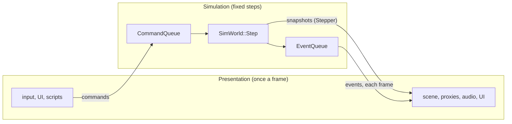
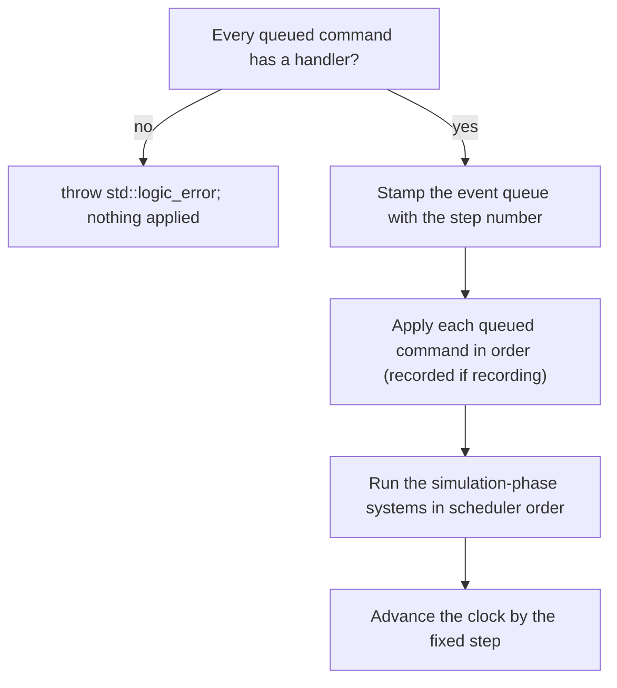
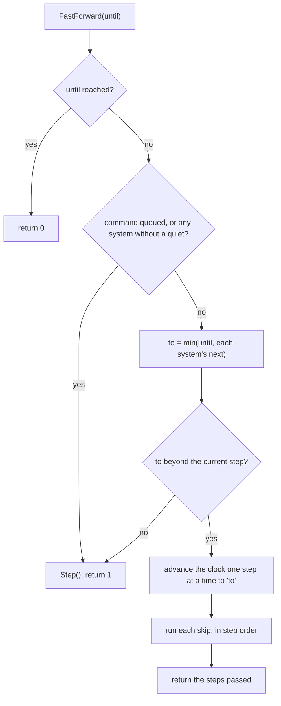
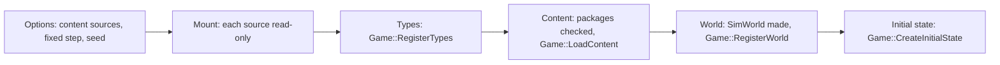

# Simulation

The simulation is the authoritative state of a game: what exists, where it is, who owns it and what
it is doing. Jettison keeps it apart from everything drawn and heard, advances it in fixed steps,
and makes it deterministic, so the same save and the same commands give the same state in every
build. This document covers the four modules that make that so: `sim` (the world, commands, events,
snapshots, definitions), `ecs` (the scheduler), `time` (the clocks) and `host` (a game's session
with no window).

The split is the engine's central rule. Simulation code never includes `render`, `ui`, `audio` or
`input`: code that can see the renderer eventually reads from it, and is then neither deterministic
nor testable without a GPU ([architecture](architecture.md)). The determinism rules are in the
[coding standards](coding-standards.md#simulation-code).

## Concepts

| Term | What it is |
| --- | --- |
| [Simulation](glossary.md#simulation) world | `Sim::SimWorld`: its own `entt::registry`, a clock, a command queue, a scheduler and a random generator: all the state a save holds. |
| [Entity](glossary.md#entity), [component](glossary.md#component) | An EnTT entity, and a plain struct registered with Reflect whose `Saved` fields are its state. |
| [System](glossary.md#system) | A named function over the registry, run in a phase of the frame, in an order the scheduler fixes. |
| [Step](glossary.md#step) | One advance of the world by its [fixed step](glossary.md#fixed-step): commands applied, systems run, clock advanced. |
| [Tick](glossary.md#tick) | One frame of the application: six phases, the simulation phase among them, running zero or more steps. |
| [Presentation](glossary.md#presentation) | What is drawn and heard, in its own registry, once a frame. It reads the simulation only through snapshots and events. |
| [Command](glossary.md#command) | A reflected struct presentation (or a script, or the network) queues for the next step: the only way in. |
| [Event](glossary.md#event) | A reflected struct a step raises for presentation: the way out, with snapshots. |
| [Snapshot](glossary.md#snapshot) | A copy, taken after a step, of every entity's transform and of the components the world shows. |
| [Reason](glossary.md#reason) | Why a step refused or gave something up: a key and typed arguments, never text. |
| [Controller](glossary.md#controller), [helm](glossary.md#helm) | Who sends a command, who commands an entity, and who flies it. |
| [Definition](glossary.md#definition) | A typed piece of game data loaded from YAML, such as a vehicle class, held by the [definition registry](glossary.md#definition-registry). |
| [Quiet step](glossary.md#quiet-step), [fast-forward](glossary.md#fast-forward) | A step in which nothing happens but what a formula of the clock gives, and passing over such steps exactly. |
| [Session](glossary.md#session) | `Host::Session`: one game's files, definitions and world, started in phases, with no presentation. |

## How it works

### The seam between simulation and presentation

The game runs as if its simulation were a local server, even in single-player. The diagram shows
what crosses between the two worlds, and in which direction.



The world advances only in steps, on simulation time, and never reads the wall clock. Commands go in
through `SimWorld::Commands()`, the seam for replays, automated tests and networking. Presentation
never holds a reference into the world's registry: the UI's data models and the scene's
[proxies](glossary.md#proxy) read snapshots ([scenes](scene.md), [UI](ui.md)).

### A step

`SimWorld::Step` is one fixed step. The flow below is the whole of it.



A system receives the registry and the fixed step as its delta time. An exception from a command or
a system leaves the world part-way through a step; only a load recovers it.

A system that acts for an agent, such as a behaviour tree's task, sends the commands a player would
through `SimWorld::Apply`. That applies the command at once, through the queue's handler and so its
checks. It is not recorded: a replay's systems send it again ([AI](ai.md)).

The world's generator (`SimWorld::Random()`, a `Math::Random`) and its event queue live in the
registry's context (`registry.ctx().get<...>()`). The generator is state: its draws are part of the
replay, so a system draws in an order its step fixes.

### The scheduler

`Ecs::Scheduler` orders and runs systems. The application has one for the frame, and each world one
for its simulation phase. A system is an `Ecs::SystemDescription`:

| Field | Meaning |
| --- | --- |
| `name` | Unique; what others order themselves by. |
| `phase` | One of `Ecs::kTickPhases`: Input, Commands, Simulation, Sync, Presentation, Render. A world accepts Simulation only. |
| `access` | The components it reads and writes: `Access::Of<Reads...>().Writing<Writes...>()`. |
| `after` | Systems it runs after, in its phase. They must exist by `Validate()`. |
| `run` | `void(entt::registry &, double deltaTime)`. |
| `before` | Systems it runs before: how a module goes ahead of one that cannot name it. |
| `afterIfRegistered` | Systems it runs after only if they are registered: how an optional module orders itself against another it does not depend on. |

The order is a stable topological sort, the constraints first and then registration order, so it is
the same every run. `Register` refuses a system with no name or no `run`, a duplicate name, a
constraint across phases, and a cycle, as soon as the system closing it arrives. `Validate()`
refuses a constraint naming a system never registered. `Run` validates on its first call; the shell
validates after registration, so the error comes at start-up.

Declared access does not change the order. `Ambiguities(phase)` lists the pairs whose access
conflicts and which no constraint orders: what registration order decides now, and what a parallel
scheduler would have to keep apart. The shell's frame systems are in [the app
shell](app-shell.md#the-frame).

### Time

The `time` module has two clocks and an accumulator between them.

- `Time::RealClock` is wall-clock time for presentation: frame deltas, UI animation, profiling. It
  is monotonic and clamps a tick to a quarter of a second, so a breakpoint held for a minute does
  not become a minute of animation.
- `Time::SimClock` is the simulation's: its step count and time in seconds, paused or running, with
  a compression factor. Pause and compression are the player's choice, not state, so a save leaves
  them out. `Advance` works while paused, so a debugger can single-step.
- `Time::FixedStepAccumulator` turns a frame's scaled seconds into whole steps and keeps the
  remainder as `Alpha()`, the fraction of a step not yet simulated.

Compression runs more steps a frame, never longer ones, so the step stays the one physics and AI
were tuned for. The accumulator caps the steps a frame (8 by default), so a slow frame cannot make
the next slower still. Steps over the cap are dropped and counted in `DroppedTime()`; a growing
count says the simulation cannot keep up.

`Time::Calendar` turns simulation seconds into an in-game date: a year, a day of the year and a time
of day. The game supplies the shape (seconds a day, days a year, the epoch's year), and `Format`
writes an ISO 8601 ordinal date such as `3301-043 14:05:09`.

### Snapshots and the stepper

`Sim::Capture(world)` takes a `Sim::Snapshot`: the clock's step and time, every entity with a
`Sim::Transform` with its frame, and a copy of each component the world shows. A game shows a
component with `SimWorld::ShowInSnapshots<T>()`; a screen reads it with `snapshot.Get<T>(entity)` or
`Components<T>()`. Every list is sorted by entity identifier, so a lookup is a binary search. Each
capture copies, so a shown component should be small.

`Sim::Transform` is a position in metres and an orientation, both double precision. `Sim::InFrame`
names the [frame](glossary.md#frame-coordinates) the position is in. A game of one frame still gives
its entities one: an entity without it is in no frame (`Sim::kNoFrame`), so physics makes it no body
and the spatial index leaves it out ([coordinate frames and units](coordinates.md#frames)).

`Sim::Stepper` is the frame's simulation phase. `Advance(realSeconds)` scales the seconds by the
world's clock, runs the accumulator's steps, and keeps the snapshots either side of the last one; a
frame of many steps captures twice, not once a step. Presentation draws `Alpha()` of the way from
`Previous()` to `Current()`. What it shows is therefore exactly one step behind real time, and on
average half a step behind the newest state: the price of moving smoothly at any display rate.

`Sim::Interpolate` moves the position along the line and the orientation along the shorter arc. An
entity only the current snapshot has stands where it is; one only the previous has has no transform.
One whose frame changed in the last step stands where it is now, since its two positions have
different origins. After a load, or any change made outside a step, `Stepper::Resync()` makes both
snapshots the current state, so nothing is interpolated across the change.

### Commands, controllers and the helm

A command is a plain struct registered with Reflect. Its `Saved` fields are what it carries, so it
can be saved with the queue, recorded for a replay and sent over a network. The game registers how
the world applies each type with `RegisterCommand<T>(handler)`.

A command that acts on an entity carries its sender, a `Sim::Controller`: a kind (`None`, `Player`
or `Ai`) and a player's number (`slot`). No simulation module assumes one player, so a server can
hold every player's commands in one queue. Two checks use the sender:

- `Sim::MayCommand(registry, entity, sender)` holds when the entity has no `Sim::ControlledBy`, when
  the sender is its controller, or when the sender is `None`: the game's own rules, or a test.
- `Sim::MayFly(registry, entity, sender)` holds when the sender is at the entity's `Sim::Helm`, or
  is `None`. An entity no one holds the helm of is flown by what the game's rules give it, such as
  its behaviour's steering.

The docks, steering and behaviour trees check `MayCommand`; the flight model checks `MayFly`
([physics](physics.md), [AI](ai.md), [docks](docks.md)). A refused command only raises an event
saying why.

### Events and reasons

A command handler or a system raises an event with `world.Events().Emit(event)`. The queue stamps it
with the step and keeps every type in one list, in the order raised, so presentation sees "docked"
before the "trade filled" that followed it. Presentation calls `Take()` once a frame and tells
events apart with `entt::meta_any::try_cast`. The queue is not state: a save leaves it out, a load
empties it, and no simulation code may read it back.

An event that says why something was refused carries a `Sim::Reason`, never English: a key and
positional arguments, each an integer (which keeps currency whole), an entity or an identifier from
the game's data. Presentation words it in the player's language ([UI, input and
localisation](ui.md#wording-a-reason)). A developer reads it with `Sim::Describe`, as
`reason.reasontests.short_of_stock(entity 0x2a, -12, Shell.Good 'copper', 'Corva')`
(`source/engine/sim/tests/ReasonTests.cpp`).

A module's reasons are an enumeration registered with Reflect as `<Module>.Reason`. The key is made
from the module's name and the enumerator's registered name, so two modules cannot make the same
key: `Lift::Reason::OverCapacity`, registered as `over_capacity` in `Lift.Reason`, is
`reason.lift.over_capacity`. The engine registers `Ai.Reason`, `Dock.Reason` and `Physics.Reason`.
`Sim::ReasonKeys` lists a module's keys: what its string table has to word.

### Saving, hashing and replay

`SimWorld::Save()` writes the whole state in the binary archive's layout: each component's version,
the clock, the generator, the commands still queued, the entities, every registered component and
every service. It goes through EnTT's snapshot, which keeps the entity storage as it was (packed
order, free list, next identifier), so a loaded world creates the same entities and its views visit
them in the same order. How `Load()` checks a save and commits it whole is in
[persistence](persistence.md#the-worlds-save). `StateHash()` is FNV-1a over the save: the same seed
and commands give the same hash in every build, which is what the suites pin.

A **world service** (`Sim::WorldService`) is state the world keeps outside its registry, such as
physics' Jolt bodies and contacts. The world owns it, saves it after the components and hashes it
with them. A service loads in two halves: it reads its state against the registry and queue being
loaded, then commits once they are the world's. Physics is the engine's one service
([physics](physics.md#determinism-and-saves)).

With `SetRecording(true)`, every command the queue applies is kept with its step (`Recorded()`). Fed
back to a world started the same way, the commands replay the session to the same hash. A load
clears the recording.

### Quiet steps and fast-forward

A long, uneventful stretch, such as Manifest's 4.49-day cruise of 23 million steps, should not take
23 million steps of work. `SimWorld::FastForward(until)` passes over steps in which nothing happens
but what a formula of the clock gives, and leaves the state stepping through them would, to the bit.
Each system may be registered with a `Sim::Quiet`:

- `next(world)` gives the first step the system has to run in, given the world as the last step left
  it and no command applied. It changes nothing.
- `skip(world, passed, lastBegan)` puts what the system writes where the passed steps would have
  left it. The clock is already at their end; `lastBegan` is when the last of them began, since the
  clock's time is a sum of steps, not a product. It is empty for a system that writes nothing when
  quiet.

A system registered without a `next` runs every step, so no step is passed over while it is
registered. The diagram shows one call.



A caller loops until it reaches its target, as Manifest's console and fixture tests do. The quiets
see a change made to the registry between steps other than by a command only once a step runs.
`FastForward` validates the systems' order as a step does. The engine's systems each have a quiet:

| System | Has to run while | Detail |
| --- | --- | --- |
| Physics | it has not yet rested two steps (nothing dynamic or awake, no body made or removed), or a body is to be made, removed or placed | [physics](physics.md#quiet-steps) |
| Flight | a vehicle's velocity would change, or it is flown against a reference with a velocity, or is on rails | [physics](physics.md#quiet-steps) |
| Transit | a passage brings one out, or a portal's arrival ends; a slot's hold lapses | [transit](transit.md) |
| Steering | a steered vehicle has a destination in a frame | [AI](ai.md#steering) |
| Behaviour trees | a running path ends: a wait, a task's wake, a node about to start | [AI](ai.md#behaviour-trees) |
| Docks | a vehicle is neither docked nor queued for a full berth, or a reservation is held | [docks](docks.md#what-the-step-does) |

The spatial index is not state and never has to run: it is rebuilt in a step before anything reads
it ([scenes](scene.md#the-spatial-index)).

### Definitions

A definition is game data the simulation reads: a vehicle class, a good, a piece in a race. The game
declares each type with Reflect, and `Sim::DefinitionRegistry` loads every YAML file of the type
under a directory. A definition's name is its path under the directory without `.yaml`:
`defs/vehicles/military/corvette.yaml` loaded from `defs/vehicles` is `military/corvette`.

`Load` replaces the type's set only once every file has read; a bad file throws `FormatError` naming
it and its mount, and the previous set stays. `Find<T>(name)` returns the definition or null, and
`Names<T>()` the sorted names. The sets are ordered maps, so any walk over them is the same every
run. A save refers to definitions by name and holds none. The files come through the virtual file
system, so a mod replaces, patches or adds a definition by its mounts
([layering](glossary.md#layering); [files, packs and mods](files-and-mods.md#layering-definitions)).

### The host session

`Host::Session` is the CPU host a game starts through: one game's file system, definitions and
world, with no window, renderer or sample content. A server, a tool or a test runs a game through
it. A game composes itself as a `Host::Game`, with one hook a phase, run in order:



A constructed session is ready. A phase that throws becomes a `Host::StartupError` naming the phase
and the source being read; no later hook runs, and the session has released what it built. Options
are refused with no content source, a writable mount or a step that is not positive. `Shutdown()` is
idempotent and destroys the world, the definitions, the file system and then the game, so state a
world callback captures from the game outlives the world. Reflection is process-wide, so
`RegisterTypes` must be safe to run again for a second session.

The content phase reads each source's `mod.yaml` as a `Host::PackageDescription` and refuses a
[package](glossary.md#package) for a newer engine or one requiring a package not mounted before it.
`Host::DescribePackages` runs the same check with no world, for a validator ([files, packs and
mods](files-and-mods.md#packages-and-modyaml)).

The rendered shell does not start through a session: it builds its own world with a fixed step of
1/60 s and composes the game through `App::Game` ([the app shell and tools](app-shell.md)).
Manifest's server, console and tests start through `Host::Session` ([game
integration](game-integration.md)).

### State machines

`Ecs::StateMachine<State, Event>` is a small finite state machine: a current state, a table of
transitions added at construction, and a hook on entry and exit. It needs only `==` of its types and
searches its tables in order, so it is deterministic. It refuses a second transition on one event
from one state, and a `Dispatch` from inside a hook. A transition to the state it starts from runs
both hooks. No engine module uses it yet.

## Using it

### A game on the host

The consumer project, `source/test/consumer/main.cpp`, is a race with nothing of space in it. It
registers its types, loads its definitions, and registers a component, a command and a system:

```cpp
void RegisterWorld(Sim::SimWorld &world, const Sim::DefinitionRegistry &definitions) override
{
	world.RegisterComponent<Token>();
	world.RegisterCommand<Place>(
	    [&definitions](Sim::SimWorld &target, const Place &command)
	    {
		    JETTISON_VERIFY(definitions.Find<Piece>(command.piece) != nullptr);
		    target.Registry().emplace<Token>(target.Registry().create(), command.piece, 0);
	    });
	// A piece goes its stride, and a die the world's generator rolls may add a square.
	world.RegisterSystem(
	    {"advance",
	     Ecs::TickPhase::Simulation,
	     Ecs::Access::Of<>().Writing<Token>(),
	     {},
	     [&definitions](entt::registry &registry, double)
	     {
		     auto &random = registry.ctx().get<Math::Random>();
		     for (auto [entity, token] : registry.view<Token>().each())
			     token.square += definitions.Find<Piece>(token.piece)->stride + random.Range(0, 1);
	     }});
}
```

Its definitions are YAML under `content/defs/pieces`, loaded with
`definitions.Load<Piece>("defs/pieces", {1})`. This is `hare.yaml`:

```yaml
version: 1
displayName: Hare
stride: 3
```

It starts a session, pushes commands, steps, saves, and checks that a second session with the same
seed and commands, and a third loaded from the save, reach the same hash:

```cpp
auto session = std::make_unique<Host::Session>(
    Host::Options{{{"race", CONSUMER_CONTENT}}, 1.0, 7}, std::make_unique<Race>());
Sim::SimWorld &world = session->World();
world.Commands().Push(Place{"hare"});
world.Commands().Push(Place{"tortoise"});
Run(world, 5);   // world.Step() five times
const std::vector<std::byte> save = world.Save();
const std::uint64_t hashAtSave = world.StateHash();
```

### A handler that refuses with a reason

The ground sample sends its rover's controls as `Physics::SetFlightControls`, with the local
player as sender, only when they change ([physics](physics.md#flying)). Physics applies it only from
the one at the vehicle's helm, and otherwise raises an event with a reason
(`source/engine/physics/src/PhysicsWorld.cpp`):

```cpp
world.RegisterCommand<SetFlightControls>(
    [](Sim::SimWorld &target, const SetFlightControls &command)
    {
	    entt::registry &registry = target.Registry();
	    if (!registry.valid(command.vehicle))
		    return;
	    if (!Sim::MayFly(registry, command.vehicle, command.sender))
	    {
		    target.Events().Emit(
		        FlightControlsRefused{
		            command.sender, command.vehicle, Sim::MakeReason(Reason::NotAtHelm)});
		    return;
	    }
	    registry.emplace_or_replace<FlightControls>(command.vehicle, command.controls);
    });
```

### A system with a quiet

From `source/engine/sim/tests/FastForwardTests.cpp`: an alarm system that has to run only in the
step its earliest unrung alarm is due. It writes nothing when quiet, so it needs no `skip`:

```cpp
world.RegisterSystem(
    {"alarm",
     Ecs::TickPhase::Simulation,
     Ecs::Access::Of<>().Writing<Alarm>(),
     {},
     [&world](entt::registry &registry, double)
     {
	     for (const auto [entity, alarm] : registry.view<Alarm>().each())
		     if (!alarm.rung && alarm.at == world.Clock().Step())
			     alarm.rung = true;
     }},
    {.next = [](const Sim::SimWorld &target)
     {
	     std::uint64_t next = kNever;
	     for (const auto [entity, alarm] : target.Registry().view<const Alarm>().each())
		     if (!alarm.rung)
			     next = std::min(next, alarm.at);
	     return next;
     }});
```

The same test checks that 40,000 steps fast-forwarded in six calls save to the same bytes as 40,000
steps run one by one.

### A replay

From `source/engine/sim/tests/SimTests.cpp`: the recorded commands, pushed at their steps into a
world started the same way, reach the session's hash:

```cpp
std::size_t next = 0;
while (replay.Clock().Step() < kSteps)
{
	for (; next < recorded.size() && recorded[next].step == replay.Clock().Step(); ++next)
		replay.Commands().Push(recorded[next].command);
	replay.Step();
}
CHECK(replay.StateHash() == session.StateHash());
```

## Limits and open work

- Behaviour trees ticked less often than every step, and their other gaps: [J03](roadmap.md#j03).
- Systems run on the main thread; a parallel scheduler is deferred until a profile shows the need:
  [J31](roadmap.md#j31).
- The rendered shell builds its own world rather than start through `Host::Session`:
  [J30](roadmap.md#j30).
- `Time::Calendar` has no months until a game needs them.

## Decisions

The settled decisions on stepping, reasons, controllers and quiet steps are in
[decided](decisions.md#simulation); agents' commands applied at once are under
[AI](decisions.md#ai). The modules' history is in [history](history.md).

## Source

| Module | Key headers |
| --- | --- |
| `sim` | `source/engine/sim/include/jettison/sim/SimWorld.h` (the world, `Quiet`, `WorldService`), `CommandQueue.h`, `Events.h`, `Reason.h`, `Controller.h`, `Snapshot.h`, `Stepper.h`, `DefinitionRegistry.h`, `SaveGame.h` ([persistence](persistence.md)) |
| `ecs` | `source/engine/ecs/include/jettison/ecs/Scheduler.h`, `StateMachine.h` |
| `time` | `source/engine/time/include/jettison/time/Clock.h`, `FixedStep.h`, `Calendar.h` |
| `host` | `source/engine/host/include/jettison/host/Session.h`, `Package.h` |

`sim` and `time` are `DETERMINISTIC` modules
([coding standards](coding-standards.md#simulation-code)); `host` is not. The suites are
`source/engine/sim/tests`, `source/engine/ecs/tests`, `source/engine/time/tests` and
`source/engine/host/tests`, and the consumer project is `source/test/consumer`.
