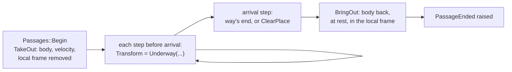
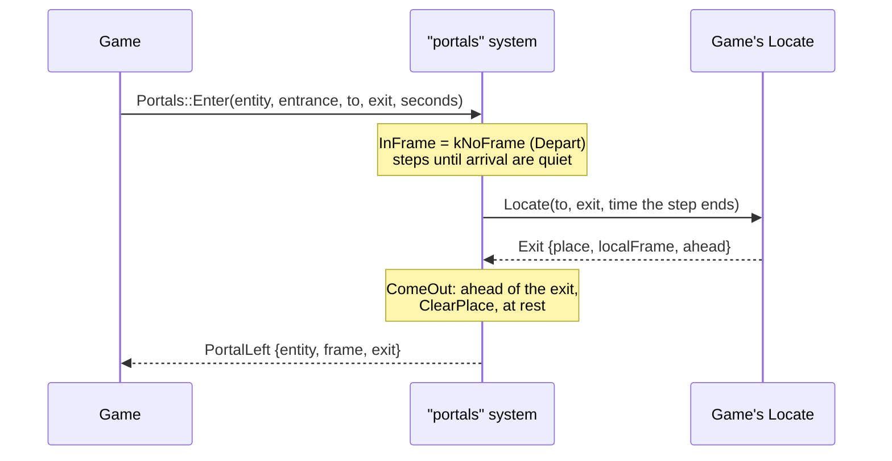
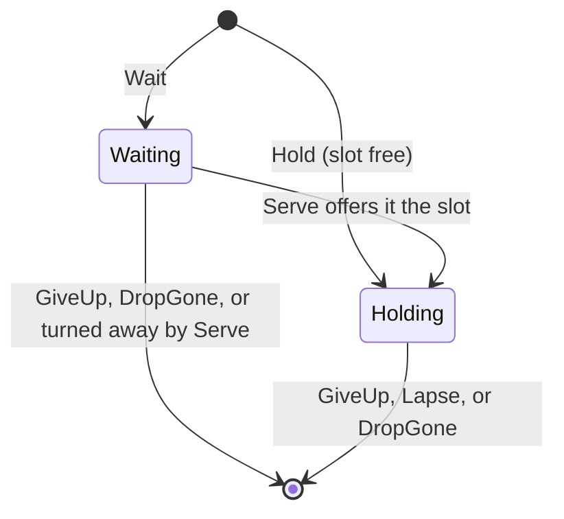

# Transit

Transit is travel that physics does not carry: a lift's car up its shaft, a train along its line,
a door between two levels, a teleporter, a car park's bay that one car holds at a time. The
`transit` module gives any game these as neutral parts and knows nothing of the game's setting.
Manifest's cruises, jump lanes and stargates are built on it ([in Manifest](#in-manifest)). It
offers three parts, each usable on its own:

| Part | What it is for | Header |
| --- | --- | --- |
| [Passage](glossary.md#passage) | An entity taken out of physics and moved along a way the game gives, then put back at rest | `transit/Passage.h`, `transit/Path.h` |
| [Portal](glossary.md#portal) | An entity out of its frame for a set time, then out at a named exit in any frame | `transit/Portal.h` |
| [Slot](glossary.md#slot) | Something one entity holds at a time, with others queued first come first | `transit/Slot.h` |

A [motion profile](glossary.md#motion-profile) (`transit/Profile.h`) says how fast a passage
covers its way; alone, it prices a journey or shows its time.

## Concepts

### Why travel leaves physics

Physics integrates forces step by step. That is right for a car on a road, but wrong for a lift
that must arrive on time, or a train that crosses a level in a minute: its arrival would depend on
contacts and rounding. So transit takes the entity's body out of physics, places it each
[step](glossary.md#step) by a formula of the step count, and gives the body back on arrival. The
journey is the same every run, and a save taken half-way resumes exactly.

Every duration is a whole number of [fixed steps](glossary.md#fixed-step), counted from the clock's
step, since comparing seconds would let rounding move an arrival by a step between runs.
`Transit::Steps(seconds, fixedStep)` rounds up to whole steps, at least one, after forgiving a
millionth of a step: 40 s at 60 Hz is 2400.0000000000005 steps in floating point, and should be
2400.

### Passages

A passage moves an entity along a **way**: a list of points from where it sets out to where it
arrives, both included, in metres from the passage's **carrier** in its
[frame's](glossary.md#frame-coordinates) axes. The carrier is what the way moves with, such as a
ferry the train runs on; the game places it each step, and with none the way is fixed to the frame's
origin. Everything is double precision, so a share of a way of 10^11 m still places an entity to
the metre.

On a passage the entity keeps its `Sim::InFrame` but has no `Physics::Body`, `Physics::Velocity`
or `Physics::LocalFrame`; its `Sim::Transform` is wherever the way puts it at the end of each step.
On arrival it gets its body back, at rest, in a [local frame](glossary.md#local-frame) the game
names. Along the way it moves in one of two ways:

- **Eased** (no profile): an in-out cubic of the share of steps run (`Transit::Eased`). It leaves
  gently enough to be seen leaving; a smoothstep would already be 290 km out one second into a
  minute's passage of 10^11 m.
- **On a motion profile**: it covers the way as the profile would, in closed form
  (`Transit::Covered`). The profile's time is stretched to the whole steps the passage was given,
  so it never arrives early.

### Motion profiles

A `Transit::MotionProfile` is travel limited by acceleration, turning at the midpoint. It
accelerates at `boostAcceleration` for up to `boostSeconds` of the whole way (half at each end),
and at `sustainedAcceleration` between. It is at rest at both ends. A short way stays at the boost
throughout; a long one spends most of its time at the sustained rate.

An optional `thrustShare` (above 0, at most 1) makes it thrust for only that share of the total
time, half at each end, and coast between; a share rather than seconds means the same at any
distance. No share, or 1, thrusts to the midpoint.

| Function | Returns |
| --- | --- |
| `Seconds(profile, metres)` | How long the way takes; 0 for no distance |
| `Covered(profile, metres, seconds)` | Metres covered so far, from 0 to all of them |
| `Thrust(profile, metres)` | Seconds thrusting at each end, at the boost and then sustained, so a game can price its burns |
| `CheckProfile(owner, profile)` | Throws `Serialise::FormatError` for a profile that could never end, or has a negative or non-finite field |

All are in metres and seconds. The profile is registered with Reflect as `Transit.MotionProfile`,
every field saved and moddable, so a game can define profiles in data.

### Portals

A portal takes an entity out of its frame for a set time and brings it out at a named **exit**, in
any frame, the one it left included. Meanwhile the entity is in no frame (`Sim::kNoFrame`): it
keeps its `Physics::Body`, but physics removes the body. Its `Sim::Transform` stays where it left,
and no interpolation runs across the change of frame.

The game places each exit as a `Transit::Exit`:

| Field | Meaning |
| --- | --- |
| `place` | Where the exit is as the step ends, in its frame, facing the way an arrival comes out (its −z) |
| `localFrame` | The local frame an arrival with a body comes out in, or empty for the frame's own |
| `ahead` | How far ahead of the exit an arrival comes out: past a door's frame, or past a sensor that would send it back |

### Slots and gated portals

A slot is what one entity holds at a time until it gives it up or its hold lapses at a step; others
wait for it, first come first. A slot is a `Transit::Slot` on the slot's entity (its holder, the
step its hold lapses at, and its queue), and each claimant has a `Transit::Claim` (which slot, and
whether it holds it or waits). A slot is free while none holds it and none waits. Transit runs no
slot system: the game asks and serves in its own, with the functions below, because what a hold
asks of its holder (a fee, a permit, a timetable) is the game's.

A **gated portal** is a slot with a sensor body. Its holder touching the sensor goes through; any
other body that begins to touch it passes, unsent. What "going through" does is the game's,
usually `Portals::Enter`.

## How it works

### A passage

`Transit::Passages::Attach` registers the `Passage` component and the system `"transit"`, ordered
after physics. Each step, the system places every entity on a passage, in entity order. The diagram
shows a passage's life; the steps below give the detail.



1. `Passages::Begin(world, entity, passage, seconds)` needs an entity with a body, a transform and
   a frame, not already on a passage, and a way of at least one point; otherwise it throws
   `std::invalid_argument`. It sets the departure step to the clock's count and the arrival step
   `Steps(seconds)` later, and takes the body out (`TakeOut`).
2. `TakeOut` removes the body, velocity and local frame, and returns the body to keep in the
   passage. It also gives up a steered entity's `Ai::Destination` and lets go of its flight
   controls (`GiveUpDestination`), or steering would fly it on from where it comes out.
3. Each step before the arrival step, the transform is `Underway(...)`: the point along the way
   for the share of steps run, about the carrier's place as that step ends, facing along the leg.
4. In the arrival step, the entity goes to the way's end, facing along its last leg. If that place
   is not clear of every body there and of earlier arrivals in the same step, `ClearPlace` finds
   the first clear place on rings round it (below). Then `BringOut` gives the body back at rest in
   the passage's local frame; physics makes the body in the next step. A
   `Transit::PassageEnded` [event](glossary.md#event) is raised.

The passage arrives as the step before `arrivalStep` ends, so after it the clock reads
`arrivalStep`.

**Clear of what is there.** `ClearPlace` treats each body as the sphere holding its shape
(`PhysicsWorld::ShapeRadius`). A place is clear when it is farther from every occupant in the same
frame than both radii plus a clearance (`kArrivalClearance`, 1 m). If it is taken, it tries rings
round it in the plane across the way the arrival faces, each the arrival's breadth plus the
clearance further out, with six more places than the last. Sensors are not occupants: nothing meets
them.

**Quiet steps.** Until the step that places an arrival, every entity on a passage is just where its
way puts it. The system's `Sim::Quiet` says so, and its skip places each entity as the last step
passed over would have, so [fast-forward](glossary.md#fast-forward) jumps over the journey in a few
calls and lands on the same bytes as stepping.

### A portal

`Transit::Portals::Attach` registers the `InPortal` component and the system `"portals"`, after
physics. It needs the game's `Locate`, which places exits; without one it throws
`std::invalid_argument`. The sequence shows one trip through a portal, detailed below it.



1. `Portals::Enter(world, entity, entrance, to, exit, seconds)` throws for an entity in no frame,
   which includes one already in a portal. It records an `InPortal` (the frame it left, the
   entrance, the frame and exit it comes out of, the arrival step) and calls `Depart`, which puts
   the entity in no frame and gives up its destination.
2. Nothing in a portal changes until the arrival step, so the system is quiet until then
   (`NextArrival`).
3. In the arrival step it finds the entities arriving (`Arriving`), in entity order, and asks
   `Locate` for every exit before moving any. An exit the game does not have throws, and the step
   changes nothing.
4. `ComeOut` places each arrival with a body `ahead` plus its own radius plus the clearance in
   front of the exit, then clear of what is there, at rest in the exit's local frame. One without a
   body goes exactly to the exit. Flight controls are set to steer against nothing, since their
   reference is in the frame it left.
5. A `Transit::PortalLeft` event names the entity, its frame and the exit.

### A slot

A game's slot system usually runs these, in this order, each step:

| Call | Does |
| --- | --- |
| `InOrder<Slot>(registry)` | The slots in entity order, so the result does not depend on storage order, which a load changes |
| `DropGone<Slot>(registry, slots)` | Removes holders and waiting entities that no longer exist; returns them |
| `Crossed<Slot>(registry, physics, slots)` | For gated portals: `through` (each holder touching its sensor, one already inside included) and `passed` (every other body that began to touch one) |
| `Lapse<Slot, Claim>(registry, slots, ending)` | Gives up every hold that lapses as the step ending at that count ends |
| `Serve<Slot, Claim>(registry, slot, offer)` | Offers a slot nobody holds to its queue from the front, until one holds it or nobody waits |

The game asks with `Free`, then `Hold` (the slot at once) or `Wait` (a place at the back, which
it returns, from 1). `GiveUp` drops a claim, freeing the slot or the place. `NextLapse<Slot>` is
the system's quiet: now, if anyone has gone or a free slot has a queue; otherwise the step before
the first hold lapses.



The diagram shows a claimant's claim. Every function is a template on the slot and claim types
(`Kept` and `Held`), so a game whose slots save fields of their own derives its components from
`Transit::Slot` and `Transit::Claim` and passes those.

### Building on the parts

`Passages` and `Portals` are complete systems for games whose passages and portals need no
saved fields of their own. A game that needs more keeps its own component and system, and calls the
parts directly: `TakeOut`, `Underway`, `Occupants`, `ClearPlace` and `BringOut` for passages;
`Depart`, `Arriving`, `NextArrival` and `ComeOut` for portals.

## Using it

The module's suite is the reference consumer: a building with a lift, a harbour with a moving
ferry, a car park and a toll booth.

### A lift on a profile

From `source/engine/transit/tests/PassageTests.cpp`. The fixture attaches passages, placing
carriers by the physics frame model's bodies:

```cpp
// A lift's: 1.2 m/s² for two seconds at each end, at its speed between.
constexpr Transit::MotionProfile kLift{1.2f, 4.0f, 0.0f};

Transit::Passages::Attach(
    world, physics, [this](std::uint64_t frame, std::string_view carrier, double time)
    { return physics.FrameOrigin(frame, carrier, time); });
```

The fixture's helper fills in a passage; the carrier and the arrival's local frame are one name:

```cpp
static Transit::Passage Way(
    std::vector<glm::dvec3> path, std::optional<Transit::MotionProfile> profile = {},
    std::string frame = {})
{
    Transit::Passage passage;
    passage.frame = frame;
    passage.carrier = std::move(frame);
    passage.path = std::move(path);
    passage.profile = profile;
    return passage;
}
```

Then a car is sent up a 40 m shaft, taking exactly the profile's time:

```cpp
const std::vector<glm::dvec3> shaft{{0.0, 0.0, 0.0}, {0.0, 40.0, 0.0}};
const double seconds = Transit::Seconds(kLift, 40.0);
Transit::Passages::Begin(fixture.world, car, Fixture::Way(shaft, kLift), seconds);
```

When it arrives, the car comes out beside a car parked at the top, at least both radii and 1 m
from it.

### A train on a moving ferry

The same file sends a train along a ferry's deck. The way is in the ferry's coordinates, so
`carrier` and the arrival `frame` are both `"ferry"`:

```cpp
const std::vector<glm::dvec3> line{{0.0, 1.0, 0.0}, {100.0, 1.0, 0.0}, {100.0, 1.0, 80.0}};
Transit::Passages::Begin(fixture->world, train, Fixture::Way(line, {}, "ferry"), 30.0);
```

The test runs one world by `FastForward` and one step by step. The saves match after every call,
the passage's 1,800 steps take fewer than 70 calls, and a save from half-way loads and finishes on
the same state hash.

### A door and a lift door

From `source/engine/transit/tests/PortalTests.cpp`. The game's `Locate` places a roof exit in the
building and a gangway on the moving ferry, and throws for any other:

```cpp
Transit::Portals::Attach(
    world, physics,
    [this](std::uint64_t frame, std::string_view exit, double time) -> Transit::Exit
    {
        if (frame == kBuilding && exit == "roof")
            return {{kRoof, Transit::Facing({1.0, 0.0, 0.0})}, "", kDoorDepth};
        if (frame == kHarbour && exit == "gangway")
            return {
                {physics.FrameOrigin(frame, "ferry", time) + kGangway,
                 Transit::Facing({0.0, 0.0, 1.0})},
                "ferry",
                kDoorDepth};
        throw std::invalid_argument{"no such exit"};
    });

// Two seconds from the street, out on the gangway, in the harbour's frame.
Transit::Portals::Enter(fixture.world, car, "street", kHarbour, "gangway", 2.0);
```

`Transit::Facing(direction)` gives the orientation whose −z points along a unit direction.

### A car park and a toll booth

From `source/engine/transit/tests/SlotTests.cpp`. The game registers `Transit::Slot` and
`Transit::Claim` itself and asks for a slot like this:

```cpp
void Ask(entt::entity car, entt::entity slot)
{
    entt::registry &registry = world.Registry();
    if (Transit::Free(registry.get<Transit::Slot>(slot)))
        Transit::Hold<Transit::Slot, Transit::Claim>(registry, slot, car, PaidUntil());
    else
        Transit::Wait<Transit::Slot, Transit::Claim>(registry, slot, car);
}
```

Its system, ordered after physics, runs the parts in the order of the table above. A holder that
touches the booth's barrier, a kinematic sensor, goes through a portal to the motorway beyond:

```cpp
const std::vector<entt::entity> slots = Transit::InOrder<Transit::Slot>(registry);
Transit::DropGone<Transit::Slot>(registry, slots);
const Transit::Crossings crossings = Transit::Crossed<Transit::Slot>(registry, physics, slots);
for (const auto [slot, car] : crossings.through)
{
    Transit::GiveUp<Transit::Slot, Transit::Claim>(registry, car);
    Transit::Portals::Enter(world, car, "booth", kTown, "beyond", kThrough);
}
Transit::Lapse<Transit::Slot, Transit::Claim>(registry, slots, world.Clock().Step() + 1);
for (const entt::entity slot : slots)
    Transit::Serve<Transit::Slot, Transit::Claim>(
        registry, slot,
        [&](entt::entity car)
        { Transit::Hold<Transit::Slot, Transit::Claim>(registry, slot, car, PaidUntil()); });
```

(The test also logs each result.) Its quiet returns the current step while a booth is held, since
a holder may touch the barrier in any step, and `NextLapse` otherwise.

### In Manifest

Manifest's cruise is a passage on a ship's motion profile, built from the parts with its own
component; its jump lanes are portals, also built from the parts; and its stargates are gated
portals whose clearance is a slot, with components derived from `Transit::Slot` and
`Transit::Claim` ([cruising](../../manifest/docs/space.md#cruising),
[jumps](../../manifest/docs/space.md#jumps),
[gates](../../manifest/docs/space.md#gates)).

## Limits and open work

- An arrival keeps clear of bounding spheres, not shapes, so it may come out farther away than
  needed.
- An arrival always comes out at rest; speed is not carried through a passage or a portal.
- `Locate` must be a pure function of its arguments, the same every run: it is a definition, not
  state, and is not saved.
- A passage with a carrier and no `Locate` throws when its step runs.
- No roadmap item is open for transit.

## Decisions

The settled choices are in [decisions](decisions.md#transit).

## Source

- Module: `source/engine/transit` (namespace `Jettison::Transit`), `DETERMINISTIC`
  ([coding standards](coding-standards.md#simulation-code)). It depends on `physics` (it takes
  bodies out and gives them back), `ai` (it gives up a steered entity's destination), `core`,
  `reflect`, `serialise` and `sim`.
- `transit/Profile.h`: `MotionProfile`, `Seconds`, `Covered`, `Thrust`, `CheckProfile`.
- `transit/Path.h`: `Steps`, `Eased`, `Facing`, `Length`, `Along`, `Underway`.
- `transit/Passage.h`: `Passage`, `PassageEnded`, `Passages`, `TakeOut`, `BringOut`,
  `GiveUpDestination`, `Occupant`, `Occupants`, `ClearPlace`.
- `transit/Portal.h`: `Exit`, `InPortal`, `PortalLeft`, `Portals`, `Depart`, `Arriving`,
  `NextArrival`, `ComeOut`.
- `transit/Slot.h`: `Slot`, `Claim`, `Free`, `Hold`, `Wait`, `GiveUp`, `InOrder`, `DropGone`,
  `Lapse`, `Serve`, `NextLapse`, `Crossings`, `Crossed`.
- `transit/Types.h`: `RegisterTypes`, which registers every type above with Reflect, all fields
  saved. `Passages::Attach` and `Portals::Attach` call it.
- Tests: `source/engine/transit/tests` (the `transit` suite).
- History: the module came out of the space extraction, 2026-11-22 ([history](history.md)).
