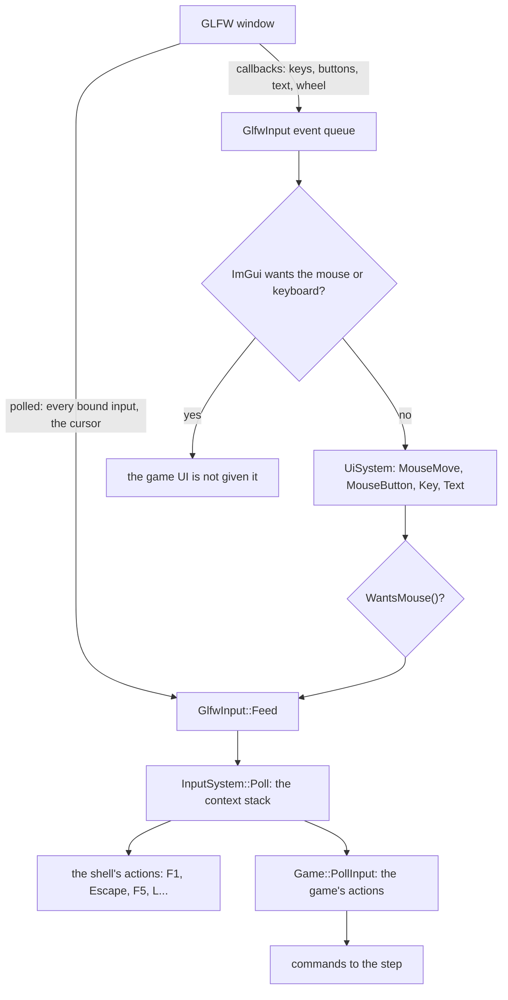
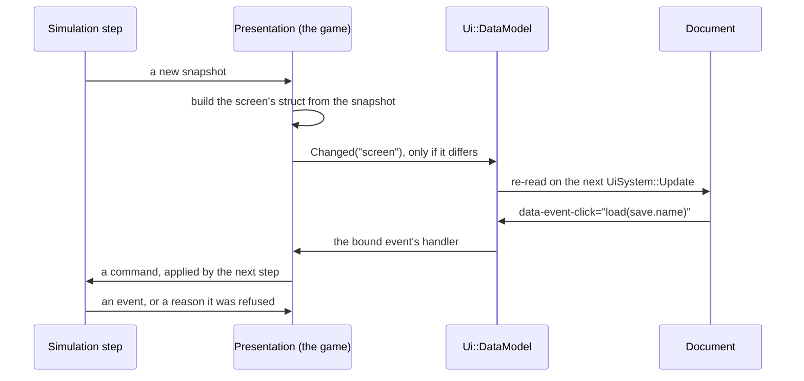
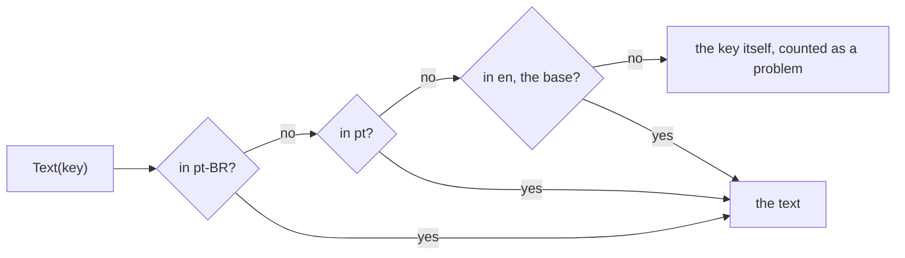

# UI, input and localisation

This document covers what the player touches and reads: the input system, which turns keys, mice,
gamepads and joysticks into the game's actions; the game UI, which draws a game's screens from its
data; the string tables, which put the player's text in their language; and the developer console
and dev tools. A game defines its actions and screens. The engine owns the mechanism, the reading of
files through the virtual file system, and the rule that a screen never reads the
[simulation](glossary.md#simulation)'s state directly.

## Concepts

| Term | What it is |
| --- | --- |
| Action | What the game asks about, such as "drive" or "toggle the saves screen": a button, an axis from -1 to 1, or a two-dimensional vector. Looked up by name once and queried every frame by `Input::ActionId`. |
| Binding | One way to drive an action: an input, an optional negative input (two keys make an axis), a scale, a dead zone, and a vector's component. |
| Input context | A named set of bindings, such as `shell`, `rover` or `console`. Contexts are pushed and popped on a stack; the top one claims the inputs it binds. An *opaque* context hides everything below it. |
| Override | A binding the player chose, which replaces a context's defaults for one action. Only overrides are saved. |
| Document | An RmlUi screen (`.rml`) with its stylesheets (`.rcss`), read through the VFS. Loaded hidden, then shown or hidden by a generational `Ui::DocumentHandle`. |
| Data model | A named view of the game's data that a document reads (`data-model="saves"`): variables bound by address and events bound by name. |
| Overlay | The game UI's drawing as a plain draw list (`Render::Overlay`), which the renderer draws over the tonemapped scene. |
| String table | The player's text by key, per language, from YAML under `strings/<language>/`. |
| Base language | English, `en`. It must have every key; every other language falls back to it. |
| Problem | A warning or error RmlUi logged, a key no table has, a translation refused, or a character in a document's text that no font loaded has. The [smoke test](glossary.md#smoke-test) holds the count at none. |
| Console | The developer's command line: the log, commands, and variables bound through reflection. |
| Dev tools | The ImGui windows F1 opens: the Dev tools window (checkboxes for the console, ImGui's demo and metrics and the game UI's debugger, and the theme's palette, console mono face and scale), the Renderer and Scene panels, and a game's own panels (`Game::DrawPanels`). |

Two UI libraries are in use, each for one audience. The game UI, which a player sees, is
[RmlUi](https://github.com/mikke89/RmlUi): HTML-like documents and CSS-like stylesheets, which a
[mod](glossary.md#mod) can restyle ([the game UI](#the-game-ui)). The console and the dev tools are
Dear ImGui, which is quick to write a tool in and needs no assets. Developer text (the log, the
console, the dev tools) stays English and never goes through the string tables.

## How it works

### The frame's input

Each frame the [shell](glossary.md#shell) reads the window once, in its input phase, before the
[step](glossary.md#step). The diagram shows the order, and who claims the mouse and keyboard first.



`App::GlfwInput` feeds the actions by polling every input any context binds, once a frame. It polls
rather than listens because an action wants a level ("is W held?"). The cost is that a key pressed
and released inside one frame, shorter than a keypress at the shell's frame rates, can be missed.
The wheel has no state to poll, and the UI wants each key, button and character in order, so those
come from GLFW callbacks, installed over the ImGui backend's and passing every event on to it.

The dev tools come first: what ImGui wants, the game UI is not given. The game UI comes next: a
click on one of a shown document's elements is the UI's (`UiSystem::WantsMouse`), so it is not a
pick or a camera drag. A document covers the frame but lets the mouse through everywhere except its
panels, so a click beside a panel still reaches the scene. `UiSystem::WantsKeyboard` says a text
field has focus; the shell checks it before L toggles the saves screen, and a game checks it for
its own keys.

### Actions, contexts and bindings

`Input::InputSystem` (`input/Actions.h`) turns raw input into actions. The game defines its
actions and contexts at start-up and binds their defaults. `Poll()` then reads the context stack
from the top: a context claims the inputs it binds, so a lower context does not see them. The
`InputTests.cpp` example is a map pushed over flight: the map's W pans, so flight's W does not
throttle, while flight's Space still fires. An opaque context, the console, hides everything below
it, so the keys typed into the console drive nothing else.

The shell's stack, bottom first, is `shell` (the camera, F1 to F6, F9, L, Escape), the game's own
context if it set one (`Shell::SetGameContext`), then `console` while the console is open. F1, the
backtick and Escape are bound in both `shell` and `console`, so they work while the console hides
the rest.

A binding reads its input (1 for a button held, the value for an axis), subtracts its negative
input if it has one, and multiplies by its scale. An analog reading inside the dead zone reads 0.
How the bindings of one action combine depends on its type:

| Type | Value |
| --- | --- |
| Button | Pressed while any binding reads at least 0.5. A press and release between two polls counts as pressed for one frame. |
| Axis | The sum of its bindings, clamped to [-1, 1]. |
| Vector | Each component the sum of its bindings, not clamped, so mouse motion comes through whole. |

Input codes are GLFW's own numbers (`input/InputCode.h`), so the module does not include GLFW. The
shell checks a sample of the codes against GLFW's headers with `static_assert`. The mouse's axes
are the module's own: 0 and 1 the cursor's motion in pixels since the last poll, 2 and 3 the
wheel's. The gamepad is the first one connected, through GLFW's mapping. A joystick that is not a
gamepad, such as a HOTAS's stick or throttle, is a device of its own, read by its raw axes and
buttons.

### Bindings as settings

Bindings are written as text, which is what the settings file and the console's `bind` hold:

| Text | Means |
| --- | --- |
| `Key.W` | The W key. |
| `Key.W/Key.S` | W positive, S negative: an axis from two keys. |
| `GamepadAxis.LeftY*-1~0.15` | The left stick's Y, scaled by -1, with a dead zone of 0.15. |
| `y:MouseAxis.Y*0.5` | The vector's y component, from the cursor's vertical motion at half scale. |
| `Joystick2.Axis2` | The second joystick's axis 2: joysticks count from 1 in text, their axes and buttons from 0. |
| `Key.Up/Key.Down, Joystick2.Axis2` | Two bindings of one action, separated by a comma. |

`SaveBindings` writes only the overrides, under `input.<context>.<action>` in the user's settings,
so a default changed in a later version still reaches a player who never touched it. An action reset
to its defaults (`ResetBindings`, the console's `unbind`) is taken out of the settings, so it stays
reset on the next load. `LoadBindings` applies nothing if any key fails to read, and names the key
that failed.

A binding names a joystick by number, but GLFW's slot numbers change as devices are plugged in.
`Input::JoystickMap` (`input/Joysticks.h`) fixes that: a number the player has bound is named
after the GUID of the device that answered to it then, under `input.devices.joystick<N>`. From then
on that number is that device wherever it is plugged in. Numbers no name claims take the unclaimed
devices in slot order, which with nothing named is GLFW's own order. Two devices of the same model
share a GUID; a name then takes the first of them still free.

### The game UI

`Ui::UiSystem` (`ui/UiSystem.h`) is RmlUi behind an engine interface that names no RmlUi type, so
neither the game nor the shell includes RmlUi. RmlUi is one library-wide instance, so a process has
one `UiSystem` at a time; a second throws `std::logic_error`. It runs on the main
thread, in the presentation phase. Its messages go to the log under the `ui` category, and its
warnings and errors are counted as problems.

Documents, stylesheets, templates, fonts and images are all read through the
[virtual file system](files-and-mods.md). A mod's mount over the base therefore restyles a screen
by shadowing its stylesheet, with no code, or changes it with a `<name>.patch.rcss` beside it, which
is appended after the stylesheet below it so its rules win
([layering](files-and-mods.md#layering-definitions)). Mods are mounted before the UI is made, as
the shell mounts them; a file changed under a mount already there is read again in development
([reloading](#reloading-and-the-debugger)). Fonts are FreeType's, one build that RmlUi's font engine
and ImGui's rasteriser (`imgui_freetype`) both link. The shell loads
Roboto Medium, Roboto Italic and Hack, with Droid Sans as the fallback face for any glyph the others
lack (`UiSystem::LoadFont`). RmlUi picks a face by family and style, the nearest weight within the
style, and gives a style its family has no face of none at all: its text draws as nothing, and the
fallback does not fill in, since that is per glyph within a face. Roboto Italic is there for `em`;
RmlUi logs each text it lays out with no face, naming the element and the face it asked for, which
counts as a problem.

**A game's fonts.** The engine's faces cover Latin, Greek and Cyrillic, and no Chinese, Japanese or
Korean. A game whose tables need another script ships the face itself: every `.ttf` and `.otf`
under `fonts/` in its content or a mod is loaded as a fallback face after Droid Sans, in path order
(`UiSystem::LoadFallbackFonts`, from the mount above the engine's), so RmlUi draws a character
the document's own family lacks from the first of them that has it. A document names no game
face: it keeps its family, and the fallback fills in. For Manifest's Japanese table that is a Noto
Sans JP subset of Manifest's, whose licence travels with the game, not the engine. A character no face loaded has would draw as
a box, RmlUi's replacement, and RmlUi says nothing; the UI therefore reads each face's characters
as it loads it (FreeType, RmlUi's own) and checks every text RmlUi reads against them, data views'
included. Such a character is logged once, with the language it was read in, and counted as a
problem, so the smoke test fails on it:

```text
No font loaded has U+65E5 '日', which the 'ja' text draws as a box: a game ships a face for it under fonts/
```

The dev tools' ImGui faces are not checked: developer text stays English.

**Drawing.** RmlUi's compiled geometry stays in the UI and is copied into a `Render::Overlay`
(`render/Overlay.h`) each time it is drawn. The overlay is a plain draw list: vertices in the
frame's pixels, indices, and draws with a translation, a scissor and an optional transform. Textures
(a font's glyph atlas, an image) are held by identifiers the overlay never gives out twice, so a
draw cannot name a removed texture's successor. Because the overlay names no device and no UI
library, the UI's suite reads what a document drew with no GPU. The renderer draws the overlay in
the output pass, after the tonemap and the fade and before the dev tools
(`vulkan/OverlayRenderer.h`, and [rendering](rendering.md) for the pass). It writes the overlay into
the frame slot's buffers, uploads a texture the first time a draw names it, and releases its copy
once the overlay no longer holds it and the frames in flight are done with it.

Colours arrive as a stylesheet gives them: encoded sRGB, with alpha premultiplied. They are
multiplied and filtered as encoded, as a browser does. On an sRGB swapchain the fragment shader
decodes the colour before it is written, so blending happens in linear light; a browser blends the
encoded values, which leaves the half-covered edge of light text on dark a little brighter here.
Clip masks, layers, filters and shaders are left to RmlUi's defaults, which draw nothing for them
([J23](roadmap.md#j23)).

**Images.** A document's image (``) is read and decoded on the I/O worker by the
[resource manager](files-and-mods.md#resources) the shell gives the UI, which registers the loader
(`UiSystem`'s last argument). RmlUi asks for an image as it lays out its element and keeps the size
it is given; until the image is there it is given a texture that draws nothing and has no size. An
element whose style sets its width and height is therefore laid out the same before and after, and
does not move when the image arrives; one that takes its size from the image is laid out again then.
`UiSystem::Update` looks before the layout: RmlUi forgets the empty texture and every `img` asks for
its source again, so the image is drawn on the frame it arrives, and an image no element asks for
then is let go, to be read again if one does. One that is missing, or that stb_image cannot read, is
logged once and counted as a problem (the resource manager logs it too), and its element stays
blank, the document read again included. A decorator's image (`decorator: image(...)`, a sprite
sheet) is decoded on the main thread as its element is first drawn, because RmlUi reads its size once,
then, and keeps it. A UI made with no resource manager, as a suite's is, decodes every image so, as
the document lays out.

The loads are the resource manager's, so `ResourceManager::Loading` counts them, and a captured
frame waits for a screen's images as it waits for a scene's models: a run with `--frame-step` (the
reference views) holds its clocks while anything loads and settles a load in the next frame's
`resource.update`, so the frame an image appears on is set by the frame count, and the screenshot
is taken after a run of frames with nothing loading.

### Data models: the screen and the simulation

A document never reads the world. It reads a data model (`ui/DataModel.h`), whose variables are
[presentation](glossary.md#presentation)'s copies of what the simulation's
[snapshots](glossary.md#snapshot) carry. This keeps a screen correct when the simulation runs on
another thread or another machine. The diagram shows the loop from a snapshot to a screen and back.



A variable is bound by address to a value presentation owns. Its type is any type registered with
Reflect, read in place through the reflection tables: a field's address comes from its member
pointer, a `std::vector` is shown by its elements, and a leaf (a bool, an integer, a float, a
string, a registered enumeration by its name) as a value. Binding a type therefore needs nothing
beyond its registration. A type that cannot be shown is refused as it is bound, naming it, so a
binding that cannot work fails at start-up rather than as an empty screen.

A world shows a component to presentation with `SimWorld::ShowInSnapshots<T>()`, after which every
snapshot holds every entity's copy of it (`Snapshot::Components<T>`, `Snapshot::Get<T>`). See
[simulation](simulation.md) for snapshots, [commands](glossary.md#command) and
[events](glossary.md#event). Presentation tells the model only when what it shows has changed
(`Changed`), so a still screen costs one comparison a step. An event a document raises carries its
arguments as `Ui::EventArgument` values (a bool, a whole number, a double or text), read with
`AsInteger` and `AsText`.

`UiSystem::Update` runs once a frame in the presentation phase: it applies the models' changes,
lays the documents out, and draws them into the overlay, which it clears first.
`UiSystem::ElementText` and `UiSystem::Click` read and press an element by id, which is how the
tests and the smoke sequence drive a screen.

### Reloading and the debugger

A UI author changes a document or a stylesheet and sees it on the next look, with no restart.
`UiSystem::ReloadChanged` notices a change as the resource manager does
([resources](files-and-mods.md#resources)): it calls `FileSystem::Refresh`, then compares the
`FileInfo` of every file RmlUi has opened through the UI's file interface (documents, stylesheets,
a stylesheet's `.patch.rcss` beside it, templates) with what it was when RmlUi read it. A changed
file, one added or gone, or another mount's file now shadowing it, clears RmlUi's stylesheet and
template caches, which otherwise keep a file for the run, and reads every open document again, each
keeping its handle and whether it is shown, as `SetLanguage` does. Every document is read again,
not only those that read the file, because a stylesheet or template is shared by path. The data
models are the context's, not a document's, so a document read again reads the same bound values
and raises the same events. One that no longer loads keeps the document read before, logged, and is
tried again once a file changes again. Only the topmost file of a path is compared, as the resource
manager compares it, so a patch edited under another mount's patch of the same stylesheet is seen
when something above it changes.

The shell looks every 500 ms where the resources hot-reload (development builds) and never in a
run with `--frame-step`, in `ui.update` before `Game::UpdateUi`, so a document read again is
filled and drawn that frame. Images and fonts are not read again.

RmlUi's debugger (its Debugger library, `Rml::Debugger`) is the dev tools' "Game UI debugger"
checkbox: its menu, an element's styles and box, the event log and the data models, drawn into the
overlay over the documents, while the dev tools are open and the box is ticked
(`UiSystem::ShowDebugger`). It is made the first time it is shown, so a run that never shows it,
the smoke test and the reference views included, loads none of its fonts or documents. It answers
the mouse as a document does, so a click on it is not the scene's.

### String tables

The text a player reads comes from string tables (`ui/StringTable.h`), read through the VFS:
every YAML file under `strings/<language>/`. A file holds a `version` and nested mappings, joined
into keys by dots. A key with plural forms holds them as children:

```yaml
# assets/strings/en/saves.yaml
version: 1
saves:
  title: Saved games
  empty: "There are no saves yet: F5 saves to quicksave."
  column:
    save: Save
```

This file gives `saves.title`, `saves.empty` and `saves.column.save`. A language is read over
its primary language, and that over the base, so a key a translation lacks reads the base's text.
A key no table has reads as the key itself and counts as a problem. A base with no tables is
refused. The diagram shows where a key is looked for, for a player reading Brazilian Portuguese.



The same file in several mounts is merged key by key, the bottom mount's first. A mod therefore
changes only the strings it names, adds a file for its own screens, or adds a language as a new
directory. A table is one flat mapping, so a mod's file is already a patch of it, and string tables
have no `.patch.yaml` (unlike [definitions](files-and-mods.md#layering-definitions)). One key
defined by two files of the same language is refused, because the files' order would otherwise
decide it.

**In documents.** A document names a key as `[[saves.title]]`. RmlUi hands every text it reads to
the UI's system interface (`TranslateString`), and the table replaces the keys before RmlUi
parses the text for markup and data expressions. A translation may therefore move
`{{screen.used}}` within its sentence or wrap a word in a `<span>`. An attribute that holds a key,
`placeholder="[[saves.name]]"`, a `title` or a `value`, is handed over the same way as its element
is made (a plugin's `OnElementCreate`, `Detail::AttributeTranslator`), so it reads in the language
too and is reread by `SetLanguage`'s reload. A `data-` attribute is an expression, not text, and an
attribute a data binding sets (`data-attr-title`) is not translated; a binding that wants words
binds them already translated.

**In code.** The game formats its text with `Format`, which takes `std::format`'s positional
arguments (`{0}`, `{1:>8}`), so a translation orders them its own way. `Plural` chooses
`key.one`, `key.few`, `key.other` and the rest by the CLDR's plural rule for a whole number in
the language, with the count as `{0}`. `FormatArguments` and `PluralArguments` do the same for arguments
known only at run time, already in words, up to eight of them.

**Numbers, dates and times.** The table's `numbers.*` keys (`strings/<language>/numbers.yaml`) hold
the language's forms, so a game's language adds its own; no `std::locale` or C library locale is
read, so a machine's locale never changes them.

| Call | Document transform | Keys | English | German | French | Japanese |
| --- | --- | --- | --- | --- | --- | --- |
| `Number(1250000)` | `{{v \| thousands}}` | `thousands` | 1,250,000 | 1.250.000 | 1 250 000 | 1,250,000 |
| `Decimal(1250.5, 2)` | `{{v \| decimal(2)}}` | `thousands`, `decimal` | 1,250.50 | 1.250,50 | 1 250,50 | 1,250.50 |
| `Date(2026y / November / 27d)` | `{{days \| date}}` | `date` | 11/27/2026 | 27.11.2026 | 27/11/2026 | 2026/11/27 |
| `Time(15h + 5min)` | `{{minutes \| time}}` | `time`, `clock`, `am`, `pm` | 3:05 PM | 15:05 | 15:05 | 15:05 |

French groups by a no-break space. `Decimal` rounds to the digits after the point the caller asks for (`std::format`'s, the same on
every machine), and a value that rounds to nothing has no minus sign. `numbers.date` formats the
year `{0}`, the month `{1}` and the day `{2}`; `numbers.time` the hour `{0}` on the clock
`numbers.clock` counts (`"12"` or `"24"`), the minute `{1}`, and on a 12-hour clock `numbers.am` or
`numbers.pm` as `{2}`. These are held to the base's text as every translation is, which is why the
base, English, names all three. A document's `date` takes days since 1970-01-01, its `time` minutes
since midnight, and `decimal` with no digits asked writes none. A table with none of these keys
writes English's separators and ISO 8601's `2026-11-27` and `15:05`. Month and weekday names are
not written.

**Refused translations.** A translation that names an argument or a data expression its base text
does not, or holds a brace that is neither, is refused as it is read, and the base's text stands. An
argument past the eight a text formats (`StringTable::kMaxArguments`) is no argument, in a base text
too.
No translation can make a format throw or make a document read a variable its screen does not bind.

### The language

The language is the player's setting, `ui.language` in the settings file. At the first start, with
none set, an interactive run takes the environment's locale (`LC_ALL`, `LC_MESSAGES`, then
`LANG`): its region's table where there is one, else its language's (`pt_BR.UTF-8` reads `pt-BR`,
then `pt`), kept as the setting from then on; a locale no table is in leaves the base's, unkept.
The smoke test and a run of a fixed frame step never read the locale, so a
[reference frame](glossary.md#reference-frame-image) or the smoke test reads the same on every
machine. `UiSystem::SetLanguage` reads the
tables and reloads every open document, each keeping its handle and whether it is shown, because
RmlUi translates a document's text as it reads it. If the tables fail to load, it throws and the
language before it stays. The console's `language [tag]` lists the languages or sets one and saves
the setting. The engine ships English, German, French and Japanese tables for its own text: the saves screen,
the number format and the engine's reasons (the user's, 2026-11-27, so every game has them; a game
adds its own languages beside them). Japanese draws only with a font that has its characters, which a
game supplies.

### Wording a reason

A [reason](glossary.md#reason) is the simulation's explanation of a refusal: a key such as
`reason.dock.no_berth_fits` and a list of typed arguments (an integer, an entity, an identifier).
The simulation does not word it, because wording depends on the player's language and on names only
presentation knows. `App::WordReason` (`app/Reasons.h`) words it from the table under its key,
in `strings/<language>/reasons.yaml`. Each argument is put in words first:

| Argument | Worded as |
| --- | --- |
| Integer | `StringTable::Number`, so 1200 is `1,200` in English and `1.200` in German. |
| Entity | Its name in the snapshot: the game's name for it (`Game::NameEntity`), else the body a platform or a portal rides the rails of, else `reason.entity` ("something"). |
| Identifier | The game's name for it (`Game::NameIdentifier`), a vehicle by its definition's name, any other as the data gives it. |

The words then go into the text by position (`FormatArguments`). A key with plural forms is
chosen by its first integer (`PluralArguments`). The arguments are positional, as the tables'
are, so the check that holds a translation to its base text holds it to the reason's arguments.

### The console

`DevTools::Console` (`devtools/Console.h`) is the developer's command line. It draws nothing:
`DrawConsole` and `DrawDevTools` (`devtools/Views.h`) put it on screen with ImGui, and the
tests drive it as text. It captures the log through a log callback, under its own lock because a
message can come from any thread, and keeps the most recent lines (2000 by default).

A line is a command or a variable followed by its arguments, separated by spaces; double quotes
hold spaces. A command that throws prints its error rather than ending the run. A variable alone
prints its value; a variable and one argument sets it. `BindVariables(prefix, object)` makes each
field of a reflected object that carries `Reflect::Attribute::Console` a variable named
`<prefix>.<field>`. A field may be a bool, an integer, a float, a double, a string or a
registered enumeration; any other type is refused before any field is bound. History keeps each
line once in a row, Up and Down walk it, and Tab extends the first word as far as the candidates
agree. The console registers `help`, `clear` and `vars` itself; the shell's own commands are
in [the app shell](app-shell.md).

### The dev tools' theme

The dev tools' style is built by `devtools/Theme.cpp`, not left at ImGui's stock look. Its colour
roles are named as a Tailwind/shadcn stylesheet names them (`Background`, `Surface`, `Primary`,
`Border` and the rest, `DevTools::Token`). Their values are one of Catppuccin's four palettes:
Latte, Frappé, Macchiato and Mocha, the default and the one the design is drawn against. The spacing
is set against 16 px body text: a 4 px spacing scale, radii of 6 px for a control and 8 px for a
panel, a hairline border, and tabs marked by an overline.

`DevTools::ThemeSettings` holds the choice: the palette, the scale and whether the console's lines
are in the mono face. The console binds it as `dev.palette`, `dev.ui_scale` and
`dev.console_mono`, and the dev tools window's controls write the same fields, so the mouse and
the console cannot disagree. The shell calls `ApplyThemeIfChanged` from `DrawUI` every frame,
which does nothing when nothing changed, so a change lands on the next frame. It is applied there
rather than at start-up because the style belongs to the ImGui context, which the renderer makes.

Two rules in the theme are easy to break, so the code states them:

- **"Changed" is read from the style, not remembered by the context's address.** A context made
  after a themed one can reuse its address and start with ImGui's stock style, so the check
  compares the last settings applied, then reads the style's own fields.
- **The palette goes to ImGui as written, and the UI's shader decodes it.** ImGui packs a vertex
  colour into 8-bit bytes, so the style hands over the palette's own bytes. The dev tools draw
  straight into the swapchain; on an sRGB one, which encodes what it is given, the backend's
  fragment stage (`assets/shaders/imgui.frag`) decodes the colour in floats first, and on a UNORM
  one, which a compositor may hand over, ImGui's own stage stores the bytes as they are. The game
  UI's `overlay.frag` follows the same contract. Decoded before the packing instead, as the style
  was until 2026-11-28, the darkest tones landed up to four steps off (`#1e1e2e` as `#1c1c2e`).

Every palette colour lands on the frame as written, which `ThemeTests.cpp` checks over all 264
channels, and a capture shows (2026-11-28, lavapipe): the panel ground `#1e1e2e`, the title bar
`#181825` and the input field `#11111b`, where the frame before the change read `#1c1c2e`,
`#161626` and `#0d0d1c`. A panel is 97 % opaque, so it reads exactly where what is under it is
as dark as it is. `dev.ui_scale` is clamped to 0.25 to 4, because a scale far enough below that
drives ImGui's metrics past what `NewFrame` accepts.

The fonts are rasterised at the size the spacing assumes (`ImGuiRenderer::kFontSize`, 16): Roboto
Medium for the UI and Hack for the console's lines. `render/src/vulkan/imgui/FontFaces.h` records
two facts about ImGui 1.93 that the loading depends on. ImGui draws with the *first* face added
unless `io.FontDefault` names another, so the UI face is named and the order carries no meaning.
And a face read from memory, as every face read through the VFS is, has no name, so the loader
writes the file's name onto it; the console finds its mono face by that name (`MonoFont()`).

### The game UI's palette

The game UI wears the dev tools' palette, so a game's screens and the tools read as one design.
`assets/ui/base.rcss` holds every colour the engine's screens are drawn in, each one of Mocha's
roles (`DevTools::Token`), and `ThemeTests.cpp` holds every hex in `base.rcss` and `saves.rcss`
to its palette's table:

| Where | Role |
| --- | --- |
| Text (`body`), a heading | `Foreground` |
| `.panel` | `Background` at 97 %, the tools' window ground, with a `Border` hairline |
| `.muted`, `.faint`, `.warning`, `.danger` | Their roles, as the console's lines take them |
| `thead td`, `tbody td` | `Border`, and `Border` at 60 %: the tools' strong and light table lines |
| `button` | `Subtle` on a `Border` hairline; `Hover` under the mouse; `Primary` with `OnPrimary` text while pressed; `Surface` with `Faint` text when `.disabled` |

RmlUi 6.3 has no variables and no `@import` (`StyleSheetParser.cpp`, read 2026-11-28), so the
palette is the cascade's. The base gives the colours and a screen the metrics: `saves.rcss` sets a
border's width and the base its colour, and a screen's text takes a role by class. A mod changes
the palette for every screen by restating the rules that carry a colour in `ui/base.patch.rcss`,
which comes after the base and wins ([the game UI](#the-game-ui)). A screen's own colour, written in
a rule more specific than the base's (an id's `border` or `background-color`), keeps it.

The colours land on the frame as written, through the overlay's decode (`overlay.frag`): captured
on lavapipe (2026-11-28), a button's ground reads `#45475a` and a disabled one's `#181825`. A
panel is 97 % opaque, as the tools' are, so its ground is exact only over a dark enough scene.

The game UI follows `dev.palette` as the tools do. The rules above are Mocha's, and the base ends
with an `@media (theme: latte)` block, and one for Frappé and Macchiato, each restating every rule
that carries a colour in its palette's roles (`ThemeTests` holds each block to its table, and to as
many colours as the plain rules have). `UiSystem::SetTheme` activates one theme by name, RmlUi's
`Rml::Context::ActivateTheme`, deactivating the one before; the shell sets the palette's name
(`DevTools::PaletteName`) where it applies the dev tools' theme, every frame, and it does nothing
when the name is unchanged, so a change lands on the next frame. Mocha has no block: its name, or
none, draws the plain rules, so a run that never changes the palette draws as before. A mod's
`base.patch.rcss` changes a variety by restating its block.

## Using it

### Defining actions and a game's context

The ground sample's drive keys (`source/samples/ground/src/RoverInput.cpp`) define two axis
actions in a context of the game's own, and bind W/S and A/D as key pairs:

```cpp
RoverInput::RoverInput(Input::InputSystem &input)
    : m_drive{input.DefineAction("drive", Input::ActionType::Axis)},
      m_steer{input.DefineAction("steer", Input::ActionType::Axis)}
{
	using Input::Keys::Character;
	input.DefineContext(std::string{kContext}); // "rover"
	input.Bind(kContext, m_drive, {Character('w'), Character('s')});
	input.Bind(kContext, m_steer, {Character('a'), Character('d')});
}
```

The game makes it from `Shell::Input()` in `Game::Register`, and calls
`shell.SetGameContext(RoverInput::kContext)` in `Game::SceneLoaded`. Each frame the shell calls
`Game::PollInput`, where the sample reads the actions and pushes a command only when the controls
changed (`source/samples/ground/src/GroundGame.cpp`):

```cpp
controls = m_input->Read(input); // drive and steer into Physics::FlightControls
if (controls == m_sent)
	return;
m_sent = controls;
shell.World().Commands().Push(Physics::SetFlightControls{shell.Player(), m_rover, controls});
```

### Rebinding from the console

The console's `bind` and `unbind` change a binding and save the settings at once:

```text
bind rover drive                      # says what it is bound to: rover.drive is Key.W/Key.S
bind rover drive Key.Up/Key.Down      # an override, saved under input.rover.drive
bind rover drive Key.Up/Key.Down Joystick2.Axis2   # two bindings
unbind rover drive                    # back to the defaults, and out of the settings
```

The same round trip in code, from `source/engine/input/tests/InputTests.cpp`:

```cpp
input.Rebind("flight", fixture.fire, {{Keys::Enter}});
Jettison::Core::Config config;
input.SaveBindings(config);
CHECK(config.GetString("input.flight.fire") == "Key.Enter");
CHECK_FALSE(config.GetString("input.flight.throttle")); // a default is not written
```

### A screen and its data model

The shell's saved-games screen is the engine's own example of a document over a data model. The
shell makes the model, binds a reflected struct and an event, and then loads the document
(`source/engine/app/src/Application.cpp`, `InitUi`):

```cpp
Ui::DataModel &saves = m_pUi->CreateDataModel("saves");
saves.Bind("screen", &m_savesScreen); // App::SavesScreen, registered with Reflect
saves.BindEvent(
    "load",
    [this](std::span<const Ui::EventArgument> arguments)
    {
	    if (!arguments.empty() && LoadFrom(Ui::AsText(arguments[0])))
		    ShowSaves(false);
    });
m_savesDocument = m_pUi->LoadDocument("ui/saves.rml");
```

The document (`assets/ui/saves.rml`) names the model, reads the rows, takes its text from the
string table, and raises the event:

```html
<body data-model="saves">
  <h1>[[saves.title]]</h1>
  <p id="empty" data-if="screen.saves.size == 0">[[saves.empty]]</p>
  <tr data-for="save, i : screen.saves">
    <td class="name" data-attr-id="'save-' + i">{{save.name}}</td>
    <button data-attr-id="'load-' + i" data-event-click="load(save.name)">[[saves.load]]</button>
  </tr>
</body>
```

A data model must exist before the documents that name it load. `source/engine/ui/tests/UiTests.cpp`
shows a bound value moved and the screen unchanged until `model.Changed("screen")`. A game makes its
own models and documents in `Game::OpenUi` and refreshes them in `Game::UpdateUi` ([the app
shell](app-shell.md)).

### Formatting text in code

From `source/engine/ui/tests/StringTableTests.cpp`, over a table holding
`docked: Docked at {0}` and a `crossing` key with `one` and `other` forms:

```cpp
StringTable strings;
strings.Load(files, "en");
CHECK(strings.Format("market.docked", "Ostra Highport") == "Docked at Ostra Highport");
CHECK(strings.Plural("market.crossing", 1) == "; 1 crate crossing the deck");
CHECK(strings.Plural("market.crossing", 12) == "; 12 crates crossing the deck");
```

A Russian table there gives `one`, `few` and `many` forms and moves the arguments
(`pays: "{1} платит {0}"`), and the same calls read correctly in Russian. Inside a running shell,
use the UI's table, `shell.GameUi()->Strings()`, so the code and the documents read the same
language.

### Adding a language, or changing words in a mod

To add a language, put a directory of tables under `strings/<tag>/` in a mod or the game's assets,
with the same file names and keys as the base. Keys it lacks read in English. A script the engine's
fonts lack needs a face under `fonts/` beside the tables ([a game's fonts](#the-game-ui)); a
subset of the characters the tables use keeps it small. The German tables
the engine ships are the pattern (`assets/strings/de/`):

```yaml
# assets/strings/de/numbers.yaml
version: 1
numbers:
  thousands: "."
  decimal: ","
  date: "{2:02}.{1:02}.{0}"
  time: "{0:02}:{1:02}"
  clock: "24"
```

To change words, a mod ships the same file path holding only the keys it changes. `language de`
then shows the screens in German ([the language](#the-language)).

### A reason in words

From `source/engine/app/tests/ReasonsTests.cpp`, a docks reason naming a berth number and a
platform entity:

```cpp
word(Sim::MakeReason(
    Dock::Reason::AlreadyHoldsBerth, {Argument::Integer(12), Argument::Entity(platform)}))
// "the vehicle already holds berth 12 at North Quay"
// in German, with 1200: "das Fahrzeug hat bereits Stellplatz 1.200 an North Quay"
```

A game gets the same through `Shell::Word(reason)`.

### Console variables

Any reflected struct whose fields carry `Attribute::Console` becomes variables
(`source/engine/ui/imgui/tests/ConsoleTests.cpp`):

```cpp
console.BindVariables("render", settings);
console.Execute("render.max_frames 2");    // sets settings.maxFrames
console.Execute("render.quality Low");     // an enumeration, by its registered name
console.Execute("render.samples 300");     // refused: a whole number, and the value stays
```

The theme's `dev.` variables ([the dev tools' theme](#the-dev-tools-theme)) are bound so.

## Limits and open work

- Right-to-left and shaped scripts, and a first-start language from the platform:
  [J15](roadmap.md#j15).
- RmlUi's clip masks, layers, filters and shaders draw nothing: [J23](roadmap.md#j23).
- The palette as a player setting on a game's own settings screen: [J26](roadmap.md#j26).
- One `UiSystem` at a time in a process, because RmlUi is one library-wide instance.
- A key tapped and released inside one frame can be missed, since the shell polls the actions.
- Two joysticks of one model cannot be told apart, since GLFW gives no device path.

## Decisions

The settled choices are in [decisions](decisions.md#ui-input-and-localisation). How the modules came
to be is in [history](history.md).

## Source

- Module `input` (`source/engine/input`): `input/Actions.h` (`InputSystem`, actions and
  contexts), `input/InputCode.h` (codes, `Binding`, the text form), `input/Joysticks.h`
  (`JoystickMap`). Tests: `InputTests.cpp`, `JoystickTests.cpp`.
- Module `ui` (`source/engine/ui`), with RmlUi private to it: `ui/UiSystem.h`,
  `ui/DataModel.h`, `ui/StringTable.h`; `src/RmlInterfaces.cpp` (RmlUi's file, system and
  render interfaces over the VFS, the log and the overlay). Tests: `UiTests.cpp`,
  `StringTableTests.cpp`, which run RmlUi with no device (a stylesheet and a document changed on
  the disk and read again, and the debugger, among them); `UiTests.cpp` writes a font of its own
  for a game's fallback face, generated, so it carries no one's licence.
- Module `devtools` (`source/engine/ui/imgui`): `devtools/Console.h`, `devtools/Views.h`,
  `devtools/Theme.h`. Tests: `ConsoleTests.cpp`, `ViewTests.cpp`, `ThemeTests.cpp`, which run
  ImGui with no renderer.
- Rendering side: `source/engine/render/include/jettison/render/Overlay.h`,
  `source/engine/render/src/vulkan/OverlayRenderer.h`,
  `source/engine/render/src/vulkan/imgui/FontFaces.h`.
- Shell side: `source/engine/app/src/GlfwInput.h` (the window's input),
  `source/engine/app/src/Settings.h` (`bind`, `unbind`, the settings file),
  `source/engine/app/include/jettison/app/Reasons.h` (`WordReason`), `source/engine/app/src/Saves.h`
  (the saves screen's data).
- Assets: `assets/ui` (`base.rcss`, `saves.rml`, `saves.rcss`), `assets/strings/en`,
  `assets/strings/de`, `assets/strings/fr`, `assets/strings/ja`.
